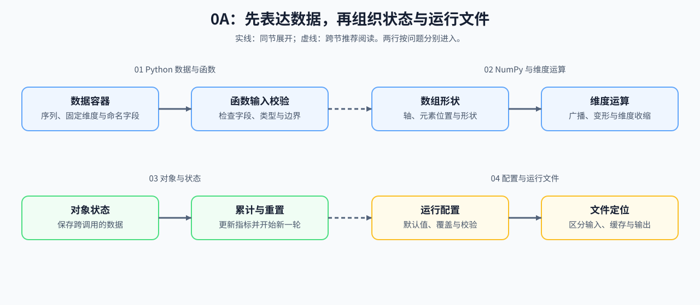

# Group 0A: Python, NumPy, and Engineering Entry | 0A: Python、NumPy 与工程入口

## Group Overview | 组概览

样本、张量形状、累计指标和文件路径需要不同的表达方式。本组先检查容器与函数输入，再处理数组维度，随后区分对象内部状态与一次运行的配置、文件。

## Group Asset Overview | 组内资产总览

| 页面 | 要回答的问题 | 运行时观察什么 |
|:---|:---|:---|
| [01 Python 数据与函数](./01_Python_Essentials_for_LLM.ipynb) | 有序数据、固定维度和命名字段分别怎样表达？ | 容器行为、输入错误与惰性样本读取 |
| [02 NumPy 与 Einsum](./02_NumPy_and_Einsum.ipynb) | 广播、变形和维度收缩后，元素位置与形状是否正确？ | 数组内容、维度往返与矩阵乘法对照 |
| [03 对象与状态](./03_Python_OOP_and_Utility_Patterns.ipynb) | 哪些值需要跨调用累计，何时应该重置？ | 对象字段、指标更新与重置结果 |
| [04 配置与运行文件](./04_Python_Config_and_Data_Entry.ipynb) | 配置怎样覆盖，输入、缓存与输出怎样定位？ | 配置校验、文件生命周期与运行记录 |

## Learning Path | 学习路径

### Recommended Order | 推荐顺序

按 01 → 02 → 03 → 04 阅读。熟悉 Python 和 NumPy 时，可先运行各页验证代码，再按失败项回查；03 处理对象内部状态，04 处理配置和外部文件。

### Next Steps | 后续衔接

进入 [0B 张量与自动求导](./0B.md)，继续检查 PyTorch 张量的存储、布局和梯度。后续遇到形状问题回查 02，累计指标异常回查 03，配置和路径问题回查 04。

## Environment Notes | 环境说明

使用 [`BASE-CPU`](../docs/guide.md#base-cpu)，在 CPU 上运行四节的参考代码与验证。
