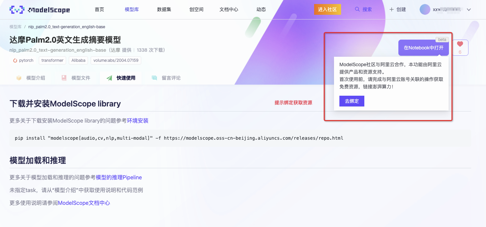
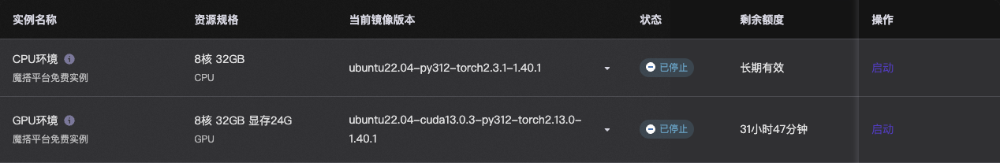
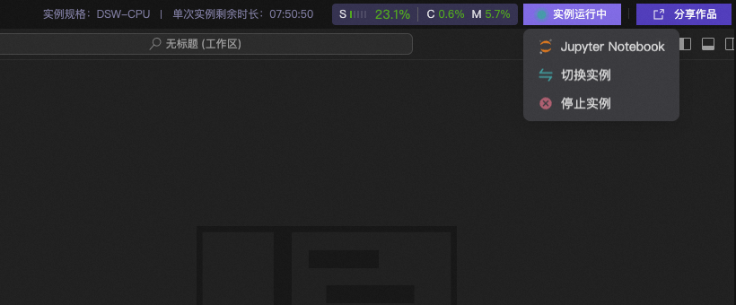
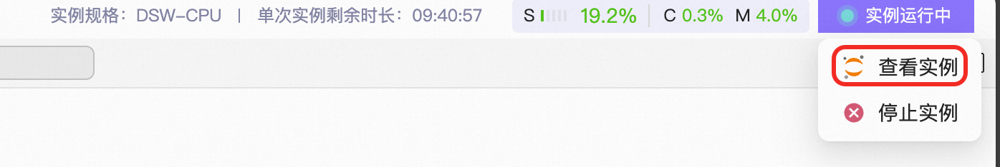
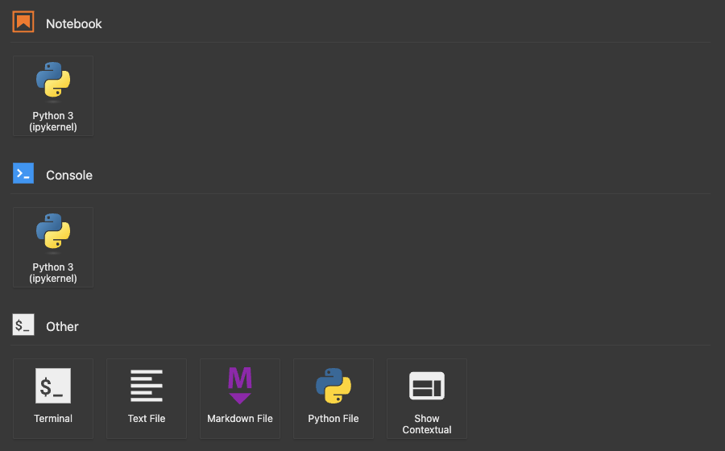
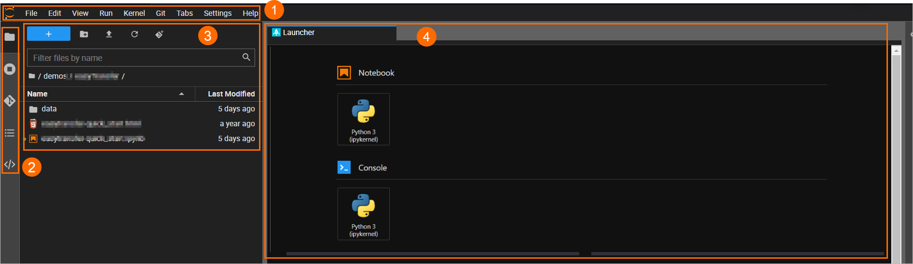
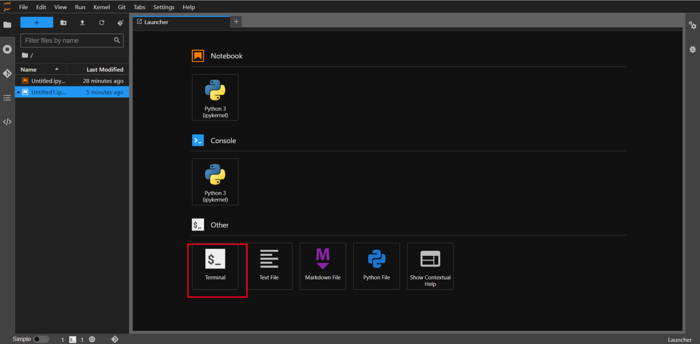
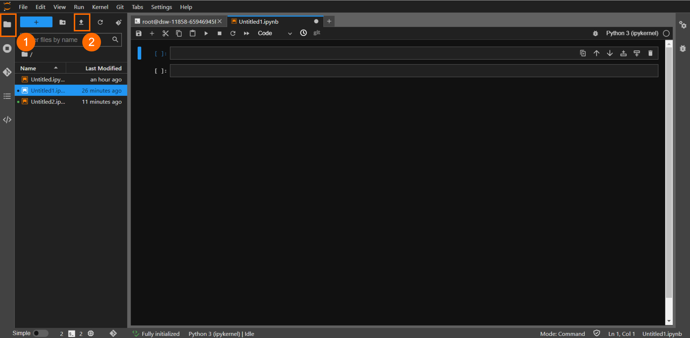
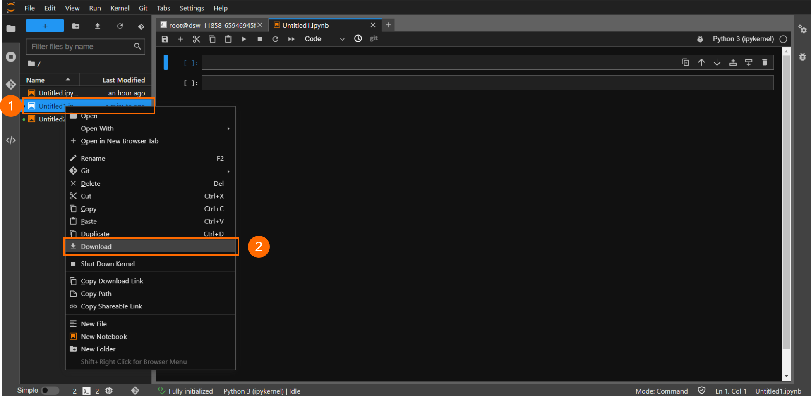

# 使用 ModelScope Notebook 搭建 GPU 训练环境

## 为什么推荐魔搭（ModelScope）

### 推荐理由

魔搭社区的 ModelScope Notebook 适合作为本仓库的入门实验环境：在国内通过浏览器就能访问，平台预置开发环境，并提供免费的 CPU 环境和限时 GPU 额度。你可以先完成账号准备，再运行代码、观察训练结果，不必先为本地电脑配置显卡。ModelScope Notebook 与阿里云 PAI-DSW 合作提供计算资源，支持 Jupyter 和 WebIDE。[Notebook 官方介绍](https://modelscope.cn/docs/notebook/intro)

对于本仓库入门阶段的张量计算、反向传播和小型网络训练，A10 的算力与 24GB 显存足以满足实验需要。本文先用一个现成的 CPU Notebook 带你熟悉操作；后续尝试 GPU 练习或单卡微调时，再按对应课程检查模型规模、显存和依赖要求。

### 硬件配置

截至 2026 年 11 月，官方资料提供的两种环境如下：

| 环境 | CPU 与系统内存 | GPU | 适合的用途 |
| --- | --- | --- | --- |
| CPU 环境 | 8 核 CPU、32GB 内存 | 无 | 获取代码、上传文件、数据预处理和 CPU 练习 |
| GPU 环境 | 8 核 CPU、32GB 内存 | NVIDIA A10，24GB 显存 | CUDA 运算、小规模训练和 GPU 推理 |

GPU 型号和显存容量见 [ModelScope 官方 Cookbook](https://github.com/modelscope/ms-cookbook/blob/main/content/chapters/chapter-04.md)，CPU 与系统内存规格见 [Notebook 官方介绍](https://modelscope.cn/docs/notebook/intro)。这里的 24GB 是显卡的显存，用于容纳模型参数和中间计算结果；32GB 是主机的系统内存。具体训练任务能否运行，还取决于模型规模、数值精度、序列长度和批量大小。

### 免费资源（2026 年 11 月）

以下信息核对于 2026 年 11 月 16 日，实际可用资源和剩余额度以自己的 Notebook 页面为准。

| 免费资源 | 官方说明 |
| --- | --- |
| CPU 环境 | 长期使用 |
| GPU 环境 | 新用户初始额度；官方不同页面分别写 32 小时、36 小时 |
| 实例存储 | `/mnt/workspace` 下提供 100GB 持久化存储，重要文件仍需自行备份 |

GPU 额度的两个来源目前存在差异：[Notebook 介绍](https://modelscope.cn/docs/notebook/intro)写初始 36 小时，[新版编辑器说明](https://modelscope.cn/docs/notebook/new-editor)写新用户 32 小时。两者均未承诺每周刷新，不能将这笔初始额度理解为每周配额。CPU 和存储规则也见 Notebook 官方介绍。

以 32 小时为一个学习周期，可以安排 8 次每次 4 小时的实验，或 16 次每次 2 小时的练习，对于分章节调试和验证基础机制比较充裕。

### 建议的使用方式

> 节省预算的实践：先用 CPU 准备，再用 GPU 执行。
>
> 先在 CPU 环境中配置基础环境、获取课程代码、上传预置文件和数据，并完成不依赖 GPU 的预处理和练习。准备就绪后，再启动 GPU 实例进行需要 GPU 的训练和推理，实验结束后及时停止实例。
>
> 本文第 3–5 节的文件准备和入门 Notebook 可以在 CPU 实例中完成，实际需要 GPU 时再按第 2 节切换。切换后确认能找到准备好的文件，并选择对应镜像的 Python 内核；两种环境的镜像和依赖可能不同，额外依赖按目标课程补充。

## 开始前的补充说明

### 付费算力成本参考

如果改用面向个人开发者的 GPU 租赁平台，并计划每周实际使用 32 小时，可以先按约 1.5–2 元/小时、约 50–65 元/周估算单卡实验预算。以下是 2026 年 11 月 16 日核对的平台公开报价：

| 平台与机型 | 报价口径 | 单卡小时价 | 运行 32 小时的估算费用 |
| --- | --- | --- | --- |
| [NextX：A10 24GB](https://nextx.cc/) | 官网展示参考价，实际租价以控制台机主标价为准 | 1.58 元 | 50.56 元 |
| [AutoDL：RTX 3090 24GB](https://www.autodl.com/market/list) | 西北 B 区所查实例的普通按量挂牌价，未使用会员折扣 | 1.56–1.66 元 | 49.92–53.12 元 |
| [Featurize：RTX 3090](https://featurize.cn/vm/available) | 平台实例列表的按量挂牌价 | 1.62 元 | 51.84 元 |
| [Featurize：RTX 4090](https://featurize.cn/vm/available) | 平台实例列表的按量挂牌价 | 1.87 元 | 59.84 元 |

例如，按 NextX 展示的 A10 参考价计算，`1.58 元/小时 × 32 小时 = 50.56 元`。RTX 3090、RTX 4090 是用于入门实验预算对照的其他 24GB 显卡，性能与配套 CPU、内存配置不同，不能当作 A10 同配置报价。

这些是预算参考，不是成交或库存保证：NextX 明确说明首页是参考展示价；核查时表中的 AutoDL 样本与 Featurize 机型均显示已租完或售罄。实际租用时需要重新查看库存、价格、CPU 和内存配额，以及额外存储、网络等收费。

这里的“每周 32 小时”是实验用量的估算假设，不是已经确认的魔搭每周发放规则。在免费额度内先完成这些实验，可以减少起步阶段的算力支出。

### 如何使用本教程

下面从注册、实名认证和账号绑定开始，逐步完成具体操作。整体路线是：注册登录 → 准备实例与文件 → 进入 JupyterLab → 打开并运行现成的课程 Notebook → 保存文件并停止实例。第 5 节直接使用仓库中的《PyTorch 数据接口与训练生命周期》，熟悉操作后再继续做课程中的 TODO 练习。

每段操作都会注明是在平台网页、JupyterLab 终端还是 Notebook 中执行。本文的现场截图采集于 2026 年 11 月 16 日，其余图片来自官方文档；图中的镜像名、额度和示例文件名只用于辨认界面。

## 1. 注册登录

这一流程涉及两个账号：ModelScope 账号用于进入魔搭社区和 Notebook 页面，阿里云账号用于关联底层云资源。先准备好自己的阿里云账号并完成实名认证，再回到魔搭授权绑定，会更容易按顺序完成操作。

### 1.1 注册并登录 ModelScope

打开 [ModelScope 魔搭社区](https://modelscope.cn/)，通过页面上的登录入口登录。首次使用时，按页面提示完成账号注册；已有账号则直接登录。

登录后，打开[我的 Notebook](https://modelscope.cn/my/mynotebook)。如果尚未绑定阿里云账号，页面会提示先进行绑定。这是领取免费 Notebook 资源前需要完成的一步。[官方前置条件与绑定说明](https://modelscope.cn/docs/notebook/instance-management)



*图 1：官方文档中的“去绑定”提示，展示的是旧版模型详情页入口。本文从“我的 Notebook”进入；两者都要求先关联阿里云账号。图片来源：[ModelScope《Notebook 实例创建与管理》](https://modelscope.cn/docs/notebook/instance-management)。*

### 1.2 准备阿里云账号

在另一个浏览器标签页打开[阿里云官网](https://www.aliyun.com/)。已有阿里云账号时，登录准备与魔搭绑定的那个账号；尚未注册时，进入注册页面，选择手机号或账号密码注册，并按页面提示完成验证。

阿里云也支持通过支付宝等已有账号快捷登录，具体入口见[阿里云《注册阿里云账号》](https://help.aliyun.com/zh/document_detail/324609.html)。完成登录后，继续检查阿里云账号本身的实名认证状态。

### 1.3 完成阿里云实名认证

个人学习者可以使用个人实名认证。下面以阿里云官方文档推荐的个人支付宝认证为例，需要准备手机支付宝 App，以及已经实名认证的个人支付宝账号。

1. 打开阿里云[账号认证页面](https://myaccount.console.aliyun.com/certificate)。如果当前账号已经认证通过，可以直接进入下一步的魔搭绑定流程。
2. 未认证时，在个人认证区域选择“个人支付宝认证”。
3. 用手机支付宝 App 扫描页面二维码，阅读手机端的服务授权内容，确认后完成授权。
4. 回到阿里云账号中心，检查实名认证状态是否为“已通过”。

操作依据：[阿里云《个人实名认证》](https://help.aliyun.com/zh/account/verify-your-identity-individual-account)。如果页面提供其他认证方式，可按该文档中的对应流程办理。

支付宝已经实名，并不代表阿里云账号已经实名。 两者的认证状态不会自动同步，需要以阿里云账号中心显示的结果为准。[阿里云《实名认证概览》](https://help.aliyun.com/zh/account/account-verification-overview)

### 1.4 回到 ModelScope，授权绑定阿里云账号

保持已认证的阿里云账号处于登录状态，返回[我的 Notebook](https://modelscope.cn/my/mynotebook)，按页面提示进入账号绑定。

1. 在阿里云登录或授权页面，核对当前账号是否就是刚才完成实名认证的账号。
2. 阅读授权项目及协议。ModelScope 官方说明要求勾选绑定页面列出的全部授权项，缺少选项可能导致绑定失败；确认接受后再提交授权。
3. 完成授权后返回魔搭，确认页面已显示账号关联完成，并能查看 Notebook 资源及剩余额度。

绑定通常只需完成一次。后续再次使用 Notebook 时，按页面要求保持所绑定的阿里云账号处于登录状态即可。[官方绑定步骤](https://modelscope.cn/docs/notebook/intro)

### 1.5 确认注册登录流程已经完成

进入下一部分前，检查以下三项：

- 能正常登录 ModelScope 并打开“我的 Notebook”。
- 所绑定的阿里云账号已完成实名认证。
- Notebook 页面已完成账号关联，可以查看资源选项和剩余时长。

如果仍提示需要绑定，先核对两边登录的账号，再检查授权是否完成；如果提示未实名认证，回到阿里云账号中心查看状态。账号准备完成后，下一部分再选择运行环境并启动 GPU 实例。


## 2. 启动 GPU 实例并进入开发环境

### 2.1 在免费实例列表中选择 GPU

执行位置：ModelScope 平台网页。

1. 打开[我的 Notebook](https://modelscope.cn/my/mynotebook)，选择“免费实例”。
2. 找到 GPU 环境这一行，确认资源规格包含“显存 24G”，并查看剩余额度。
3. 首次启动时，选择平台提供的 NVIDIA CUDA / PyTorch 镜像。不必为了和截图完全一致而切换版本。
4. 如果 CPU 环境仍在运行，先保存文件并确认没有正在执行的任务，再关闭 CPU 实例。免费实例同时只支持运行一种类型；CPU 运行时，GPU 的“启动”按钮不可用。
5. 点击 GPU 这一行右侧的“启动”，如出现滑块安全验证，由你本人完成。等待页面显示运行状态，再通过“查看”或相应入口打开开发界面。



*图 2：当前页面实拍。看第二行的 GPU 资源规格，再点击该行最右侧的“启动”。图中的“31 小时 47 分钟”是拍摄账号的剩余时间，不是新用户额度或每周额度。*

如果页面提示资源不足、额度耗尽或授权失效，先按提示处理。本文第 5 节选用的 Notebook 默认使用 CPU，也可以先启动 CPU 环境，沿用后续的 JupyterLab 进入方式完成学习。启动操作依据：[官方实例管理说明](https://modelscope.cn/docs/notebook/instance-management)。

### 2.2 从 VS Code 界面进入 JupyterLab

刚进入查看实例的页面时，通常先看到一个 VS Code 风格的网页 IDE，页面顶部显示“Code Editor”。接下来需要从右上角的入口进入 JupyterLab，并在 JupyterLab 中新建、打开和运行 Notebook。本文后面的文件与终端操作也以 JupyterLab 为准。

看到编辑器并不意味着 GPU 已经连接。先查看右上角状态，再按下面的顺序操作：

1. 如果显示“连接运行时”，点击后选择 GPU 类型及可用实例，完成连接，并确认顶部实例规格为 GPU。
2. 如果已经显示“实例运行中”，将鼠标移到这个按钮上，展开菜单，然后点击“Jupyter Notebook”。这是当前页面从 VS Code 风格 IDE 进入 JupyterLab 的入口。
3. 如果新页面要求登录阿里云，使用第 1 节中已经实名认证并绑定魔搭的同一个阿里云账号登录；完成后继续访问。若没有自动跳回，可以回到编辑器重新点击“Jupyter Notebook”。
4. 登录后进入 JupyterLab，顶部会出现 File、Edit、Run、Kernel 等菜单，左侧是文件浏览区。如果页面恢复的是上次打开的终端或文件，点击文件浏览区上方的“+”（New Launcher），打开 Launcher（启动器）。
5. 在启动器的 Notebook 区域点击“Python 3 (ipykernel)”新建 Notebook，或从左侧双击已有 `.ipynb`，选择内核后运行代码。注意不要选中 Console 区域的同名 Python 入口；目录准备与实际运行步骤见第 3–5 节。



*图 3：2026 年 11 月 16 日的实际界面。将鼠标移到右上角“实例运行中”，再点击菜单第一项“Jupyter Notebook”；下方“切换实例”和“停止实例”用于其他操作。此图来自已经运行的 CPU 实例，两种实例可按同样入口进入 JupyterLab。*

<details>
<summary>如果你看到的是旧版“查看实例”入口</summary>

官方文档的旧版截图将菜单项写作“查看实例”。如果你看到这个名称，先点击它；如果打开后仍是 VS Code 风格 IDE，再从该界面右上角的 JupyterLab 或 Notebook 切换入口进入 JupyterLab。已经直接打开 JupyterLab 的读者可以继续下一节。



*图 3a：官方旧版“查看实例”入口，供界面对照。它与图 3 中当前页面的按钮名称不同。[图片及说明来源：新版编辑器文档](https://modelscope.cn/docs/notebook/new-editor)。*

</details>



*图 3b：登录阿里云后实际进入的 JupyterLab 启动器。上方 Notebook 区域用于新建 `.ipynb`；中间 Console 区域打开交互控制台；下方 Other 区域的 Terminal 用于执行终端命令。本文使用仓库已有的 Notebook，获取文件后从左侧文件区打开即可。*

## 3. 打开终端，确定文件存放位置

### 3.1 认识 JupyterLab 界面



*图 4：①顶部菜单；②侧边栏；③文件浏览区；④主工作区。左侧用于寻找文件，右侧用于打开 Notebook 或终端。[图片来源：官方实例管理说明](https://modelscope.cn/docs/notebook/instance-management)。*

点击文件浏览区上方的 “+” 打开 Launcher，再在 Other 区域点击 Terminal。终端用于执行 `git`、查看目录等命令；它与运行 Python 代码的 Notebook 单元不是同一个输入框。



*图 5：点击红框中的 Terminal。若当前已经有打开的 Notebook，也可以先点左上角“+”回到 Launcher。[图片来源：官方实例管理说明](https://modelscope.cn/docs/notebook/instance-management)。*

### 3.2 将实验文件放在 /mnt/workspace

执行位置：JupyterLab 终端。

```bash
cd /mnt/workspace
pwd
df -h /mnt/workspace
```

`pwd` 应输出 `/mnt/workspace`，`df` 用于查看可用空间。若该目录不存在，先确认自己已进入运行实例的终端。

本教程采用以下目录布局：

```text
/mnt/workspace/
└── llm-algo-leetcode/             # 克隆的课程仓库
    └── 00_Prerequisites/
        └── 12_PyTorch_Minimal_Training_Interface.ipynb
```

官方为免费 PAI-DSW Notebook 提供 `/mnt/workspace` 持久化存储；其他路径的数据可能在实例关闭后清除。仍应将重要产物下载备份。[存储规则](https://modelscope.cn/docs/notebook/intro)

新版编辑器左侧的 ModelScope Workspace 是账号关联的 Notebook 存储区，不能当成终端里的 `/mnt/workspace`。本文的课程仓库和 Notebook 统一在实例目录中操作，运行后下载到本地备份。[两种目录的区别](https://modelscope.cn/docs/notebook/new-editor)

## 4. 获取课程仓库

### 4.1 首次克隆

执行位置：JupyterLab 终端。

下面以本文使用的个人 fork 为例。其他读者请将仓库地址换成自己的 fork；只运行原课程也可以使用 `https://github.com/datawhalechina/llm-algo-leetcode.git`。

```bash
cd /mnt/workspace
git clone https://github.com/hansenz42/llm-algo-leetcode.git llm-algo-leetcode
cd /mnt/workspace/llm-algo-leetcode
git remote -v
git log -1 --oneline
ls 00_Prerequisites tools requirements
```

看到课程目录、`tools` 和 `requirements`，说明仓库已放到正确位置。命令中的目标目录统一为 `llm-algo-leetcode`，后面的示例沿用这个路径。

如果提示目标目录已经存在，不要再次克隆或删除目录。先进入已有仓库，查看是否有自己的修改：

```bash
cd /mnt/workspace/llm-algo-leetcode
git status --short
```

只有在修改已经妥善保存、准备同步远端时，才执行 `git pull --ff-only`；如果出现分支分歧或冲突提示，先处理 Git 状态。

### 4.2 GitHub 无法访问时，用 ZIP 上传

在本地浏览器打开仓库，使用 GitHub 的 Code → Download ZIP 下载。回到 JupyterLab，在文件浏览器定位到 `/mnt/workspace`，点击上传箭头上传 ZIP，然后在终端解压并将目录命名为 `llm-algo-leetcode`。例如 ZIP 内的目录名为 `llm-algo-leetcode-main` 时：

```bash
cd /mnt/workspace
unzip llm-algo-leetcode-main.zip
mv -n llm-algo-leetcode-main llm-algo-leetcode
```

以上适用于目标目录尚不存在的首次导入；已有目录时不要混合覆盖。ZIP 副本不含 `.git`，可以运行课程，但后续不能直接用 `git pull` 更新，需重新下载或恢复 Git 克隆方式。



*图 6：先在①文件区进入目标目录，再点②上传箭头。使用本地尚未推送的教程时，也可通过此入口上传自己的 `.ipynb` 或其他文件。[图片来源：官方数据存储说明](https://modelscope.cn/docs/notebook/data-storage)。*

## 5. 实战：直接运行一个课程 Notebook

本次实战使用仓库已有的 [12. PyTorch 数据接口与训练生命周期](./12_PyTorch_Minimal_Training_Interface.ipynb)。它包含完整代码，只依赖 `torch`，使用自行生成的小样本，覆盖数据加载、批次组装、训练、验证和指标评价。你可以直接运行，无需先填写 TODO 或下载模型、数据集。

这个 Notebook 默认使用 CPU，在魔搭的 CPU 或 GPU 实例中都可以学习；即使打开的是 GPU 实例，原代码也会按 CPU 路径执行。首次上手可以用 CPU 环境节省额度，需要 GPU 的后续练习再切换实例。

### 5.1 打开 Notebook 并选择内核

执行位置：JupyterLab。

1. 在左侧文件浏览区进入 `/mnt/workspace/llm-algo-leetcode/00_Prerequisites`。
2. 双击 `12_PyTorch_Minimal_Training_Interface.ipynb`，在右侧打开课程。
3. 如果弹出内核选择框，选择平台提供的 `Python 3 (ipykernel)`；已有内核时，可以从顶部 Kernel → Change Kernel… 查看和切换。
4. 等待内核准备完成，再开始运行。如果希望保留原课程文件，可以先另存为自己的副本。

文件区和主工作区的位置见图 4。这里直接打开现有 `.ipynb`，不需要在 Launcher 中另建空白 Notebook，也不需要把本文代码逐段复制进去。

选择平台的 PyTorch 镜像及其默认内核后，先沿用预装依赖，不必先重装 PyTorch。2026 年 11 月 16 日，我们曾在新启动的官方 GPU 镜像 `ubuntu22.04-cuda12.1.0-py312-torch2.3.1-tf2.16.1-1.40.1` 中实测：默认内核为 Python `3.11.11`、PyTorch `2.3.1+cu121`，无需安装即可导入并执行 GPU 计算，验证后实例已停止。[实测记录](../docs/public/00_Prerequisites/modelscope_notebook/clean-gpu-verification-20261116.json)。这条记录用于说明镜像自带 PyTorch，不是本节要求你重复执行的操作。

### 5.2 从头运行并观察结果

先阅读每一小节的说明，再选中其代码单元，按 Shift + Enter 依次运行。左侧显示 `[*]` 时表示正在执行，变成编号后表示该单元已完成。这个 Notebook 没有待填写的 TODO，也可以通过顶部 Run → Run All Cells 从头运行全部单元。

运行时重点观察以下内容：

| 内容 | 在 Notebook 中查看什么 |
| --- | --- |
| 数据加载与组批 | `batch` 的字段、形状，以及 `Dataset / DataLoader`、`collate_fn` 的通过提示 |
| 输入与标签 | 变长序列如何补齐，`attention_mask` 和 `labels` 如何对应 |
| 训练与验证 | `train_loss`、`validation_loss`，以及“数据、更新与验证生命周期通过” |
| 模型评价 | `mae`、`mse`、`rmse`、`sample_count`，以及“模型评价指标与参数不变性通过” |

本节完成标志：代码单元依次执行结束，没有未处理的报错，并看到最后的“✅ 模型评价指标与参数不变性通过”。具体损失和指标数值会随模型初始化变化，不需要与别人的输出完全相同。

### 5.3 接着做 TODO 练习

熟悉 Notebook 的操作后，就可以进入 `02_PyTorch_Algorithms`，选择目标课程填写 TODO，再运行它自带的测试。基础 PyTorch 题先沿用当前内核，缺少额外包时按该题的导入单元补充；例如热身题还使用 `einops`。

> 上面“运行全部”的方式适用于本节选用的完整示例。做 TODO 题时，应依次运行导入、自己的实现和测试；暂时不要执行后面的“参考代码与解析”，以免其中的同名定义覆盖自己的代码。未完成的 TODO 抛出 `NotImplementedError` 是题目预期行为。

## 6. 保存文件、停止实例与下次继续

### 6.1 保存 Notebook 并下载备份

按 Ctrl + S（macOS 浏览器可用 Command + S）保存当前 Notebook。运行输出会随 `.ipynb` 文件一起保存。

在左侧文件浏览区找到刚才运行的 Notebook，右键选择 Download，确认本地电脑已经收到 `.ipynb` 文件。如果另存了自己的副本，就下载该副本。这个示例不需要额外打包训练目录。



*图 7：①选中要保存到本地的 `.ipynb`；②右键选择 Download。图片中的文件名仅作示意。[图片来源：官方数据存储说明](https://modelscope.cn/docs/notebook/data-storage)。*

### 6.2 停止计算实例

返回 ModelScope 的实例管理页，使用当前运行实例对应的停止入口；若在新版编辑器中，可以从图 3 的“实例运行中”菜单选择“停止实例”。确认页面状态回到“已停止”，再离开。

关闭 Notebook 标签页或浏览器，不等于停止云端实例。使用 GPU 时，完成练习后及时停止实例，可以减少额度消耗。[实例使用说明](https://modelscope.cn/docs/notebook/intro)

### 6.3 下次启动后继续学习

重新启动需要的 CPU 或 GPU 实例并进入 JupyterLab，在 `/mnt/workspace/llm-algo-leetcode/00_Prerequisites` 中打开之前保存的 Notebook 或自己的副本，选择内核后从头运行。

Notebook 文件会保存代码和上次的输出，但不会保留已停止内核中的 Python 变量。这个小示例直接从头运行即可，不需要额外恢复训练检查点。

如果文件缺失，可通过图 6 的上传入口重新上传本地备份；如果课程仓库也已丢失，先按第 4 节重新获取仓库。再次结束学习时，保存文件并停止实例。

## 7. 常见问题与完成检查

| 现象 | 优先检查与处理 |
| --- | --- |
| GPU 资源无法启动 | 查看剩余额度、资源库存和授权提示；本节示例也可先在 CPU 环境中学习 |
| 新版编辑器能打开，但找不到 Notebook 操作界面 | 展开右上角“实例运行中”，点击“Jupyter Notebook”进入 JupyterLab，详见 2.2 |
| 点击“Jupyter Notebook”后出现阿里云登录页 | 登录已经绑定魔搭的同一个阿里云账号，再继续访问 JupyterLab |
| 把 `git clone` 粘进 Python 单元后报错 | 将第 4 节的命令放到 Terminal 执行 |
| `No module named torch` | 检查是否选择了平台 PyTorch 镜像的默认内核，或误选了自己创建的空环境；不要先覆盖安装平台的 PyTorch |
| 热身题提示 `No module named einops` | 在该 Notebook 的代码单元中执行 `%pip install einops`，然后重启内核并从导入单元重新运行 |
| `git clone` 网络失败 | 用 4.2 的 ZIP 上传方式 |
| 找不到课程 Notebook | 核对仓库路径及 `00_Prerequisites` 目录，文件名见 5.1 |
| 出现 `NameError`，提示变量或函数未定义 | 前面的定义单元尚未运行，或内核已经重启；本节示例从头运行即可 |
| 停止后文件消失 | 核对文件是否位于实例的 `/mnt/workspace`，必要时上传本地备份 |
| 做 TODO 题时遇到 `NotImplementedError` | 完成对应 TODO，移除占位异常，再运行定义和测试单元 |

完成本教程后，应能确认：

- [ ] 已完成账号绑定，能够启动实例并进入 JupyterLab。
- [ ] 仓库位于 `/mnt/workspace/llm-algo-leetcode`。
- [ ] 已打开并运行 `12_PyTorch_Minimal_Training_Interface.ipynb`。
- [ ] 已看到最后的模型评价通过提示。
- [ ] Notebook 已保存，并下载到本地备份。
- [ ] 在平台页面确认实例已停止。

## 参考资料

- [NextX GPU Cloud](https://nextx.cc/)：A10 展示参考价，实际费用以平台控制台为准。
- [AutoDL 算力市场](https://www.autodl.com/market/list)、[Featurize 实例列表](https://featurize.cn/vm/available)：个人单卡实验的按量价格对照。
- [ModelScope Notebook 介绍](https://modelscope.cn/docs/notebook/intro)：资源、持久化和运行限制。
- [新版编辑器](https://modelscope.cn/docs/notebook/new-editor)：运行时连接、账号 Workspace 与实例目录。
- [Notebook 实例创建与管理](https://modelscope.cn/docs/notebook/instance-management)：实例、JupyterLab 和终端入口。
- [Notebook 环境配置与管理](https://modelscope.cn/docs/notebook/environment-setup)：Conda 持久化。
- [Notebook 数据存储](https://modelscope.cn/docs/notebook/data-storage)：上传、下载和导出。
- [JupyterLab 文件操作](https://jupyterlab.readthedocs.io/en/stable/user/files.html)：文件与 Launcher 操作。
- [仓库使用指南](../docs/guide.md)、[后训练实验 Quickstart](../topic_discussion/post_training_optimization/quickstart.md)：继续运行课程时的环境入口。
