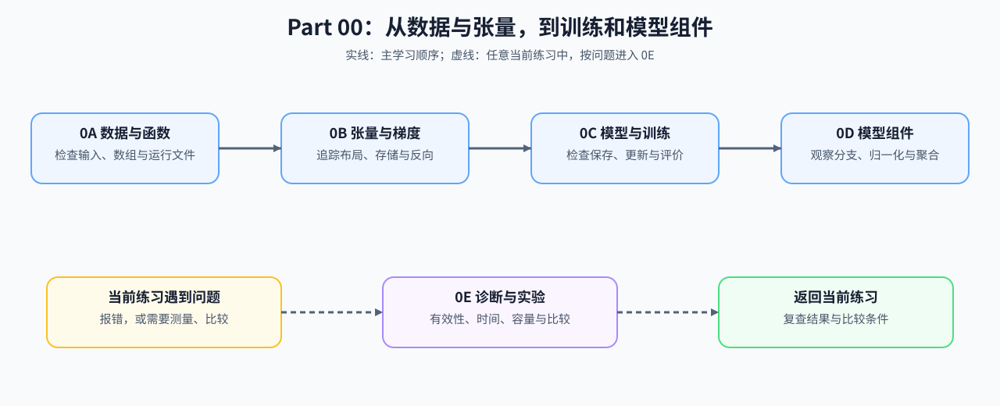

# 第零部分：Python、PyTorch 与实验基础

## Part 概览

模型代码中的形状错误、梯度中断、状态遗漏和计时偏差，往往来自基础接口没有对齐。Part 00 从数据与函数开始，逐步学习张量、模型对象、训练更新和模型组件，并用小规模 CPU 示例检查结果。

## 学习路线

初学者按 0A → 0B → 0C → 0D 阅读；熟悉 Python 和 NumPy 时可从 0B 开始。运行出错、需要测量时间或准备比较改动时，随时进入 0E，无需等其余组全部读完。图中实线表示主学习顺序，虚线表示按问题进入诊断与测量。

## 五组入口

| 学习组 | 遇到的问题 | 完成后能检查什么 |
|:---|:---|:---|
| [0A Python、NumPy 与工程入口](./0A.md) | 数据如何组织，数组维度如何表达，配置与文件怎样管理？ | 函数输入、形状变换、对象状态和运行路径 |
| [0B PyTorch 张量与自动求导](./0B.md) | 张量是否共享存储，维度怎样变化，梯度从哪里来？ | 张量布局、索引结果、反向梯度与梯度模式 |
| [0C 模型与训练生命周期](./0C.md) | 哪些状态被注册、保存和更新，训练与验证怎样连接？ | 模型状态、恢复续跑、参数更新与评价指标 |
| [0D Transformer Block 与模型组件](./0D.md) | Attention、激活和归一化怎样更新同一条隐状态？ | 分支增量、组件输出、局部梯度与多头形状 |
| [0E 运行诊断与实验基础](./0E.md) | 运行是否有效，时间和容量怎样测量与比较？ | 首个失败点、计时样本、容量估算和实验条件 |

## 后续衔接

根据已经掌握的代码对象选择后续入口：Part 01 解释资源与执行条件，机制页和专题进一步展开具体方法。

| 接下来要解决的问题 | 优先入口 |
|:---|:---|
| 理解梯度、损失归约和有效参数更新 | [反向传播与训练机制](../topic_discussion/backpropagation_training_mechanism/intro.md) |
| 理解模型组件怎样组合与演进 | [Part 02 模型组件](../02_PyTorch_Algorithms/2_1.md)、[大模型架构演进](../topic_discussion/llm_architecture_evolution/intro.md) |
| 从时间、容量现象定位性能问题 | [性能分析](../topic_discussion/performance_analysis/intro.md) |
| 估算规模、访存和通信，或开始编写计算内核 | [Part 01 硬件、数学与系统](../01_Hardware_Math_and_Systems/intro.md) |

## 环境说明

使用 [`BASE-CPU`](../docs/guide.md#base-cpu) 运行本部分的参考代码与验证。后续 GPU、编译工具链或多卡实验，按目标页面的环境说明准备。
