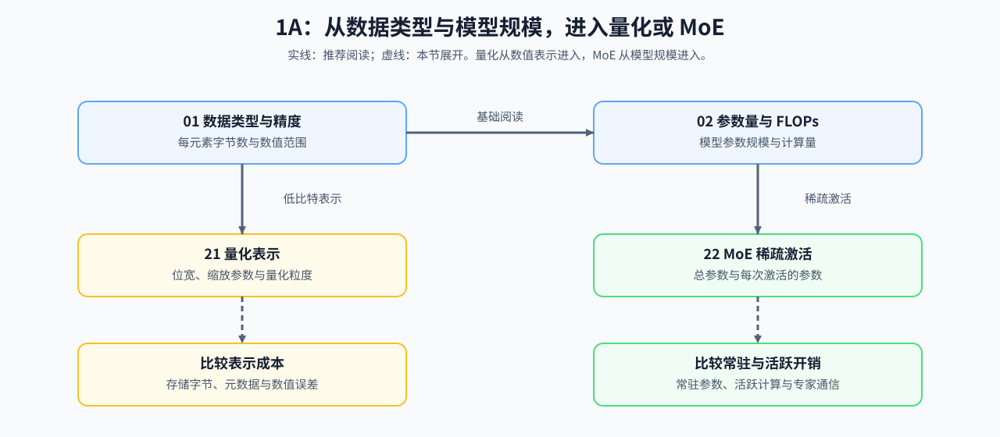

# Group 1A: Numerics and Scale | 1A: 数值与规模

本组把模型配置转换成可复查的容量与计算预算。

## Group Goal | 学习目标

先根据数据类型换算参数和训练状态的存储量，再根据模型结构估算参数量与 FLOPs；量化和 MoE 两条分支分别解释表示成本与活跃计算。计算时记录模型结构、数据类型和状态组成；验证性能时，再固定输入形状、批量与执行环境，测量时间、内存和数值误差。

## Learning Entries | 学习入口

| 小节 | 核心职责 | 在组内的位置 |
|:---|:---|:---|
| [01](./01_Data_Types_and_Precision.ipynb) | 计算数据类型、参数和训练状态的理论字节数 | 核心入口 |
| [02](./02_LLM_Params_and_FLOPs.ipynb) | 估算参数量、前向与训练 FLOPs | 核心账本 |
| [21](./21_Quantization_Theory_and_INT4_INT8.ipynb) | 计算量化表示、元数据和误差 | 表示分支 |
| [22](./22_MoE_Parameter_and_Compute.ipynb) | 区分总参数、活跃参数、活跃计算和通信量 | 稀疏架构分支 |

## Core Calculations and Extensions | 核心账本与扩展分支

| 路线 | 阅读顺序 | 能计算或检查什么 | 后续学习入口 |
|:---|:---|:---|:---|
| 核心账本 | [01 数据类型与精度](./01_Data_Types_and_Precision.ipynb) → [02 参数量与 FLOPs](./02_LLM_Params_and_FLOPs.ipynb) | 状态字节、参数量、前向与训练计算量 | [反向传播与训练机制](../topic_discussion/backpropagation_training_mechanism/intro.md)、[性能分析](../topic_discussion/performance_analysis/intro.md) |
| 表示分支 | [01 数据类型与精度](./01_Data_Types_and_Precision.ipynb) → [21 量化理论](./21_Quantization_Theory_and_INT4_INT8.ipynb) | 量化范围、缩放参数、粒度、误差和元数据 | [量化与压缩](../topic_discussion/quantization_compression/intro.md) |
| 稀疏架构分支 | [01](./01_Data_Types_and_Precision.ipynb) → [02](./02_LLM_Params_and_FLOPs.ipynb) → [22 MoE 参数与计算](./22_MoE_Parameter_and_Compute.ipynb) | 总参数、活跃参数、活跃 FLOPs 和专家通信量 | [大模型架构演进](../topic_discussion/llm_architecture_evolution/intro.md)；通信量继续进入 [1C](./1C.md) |
