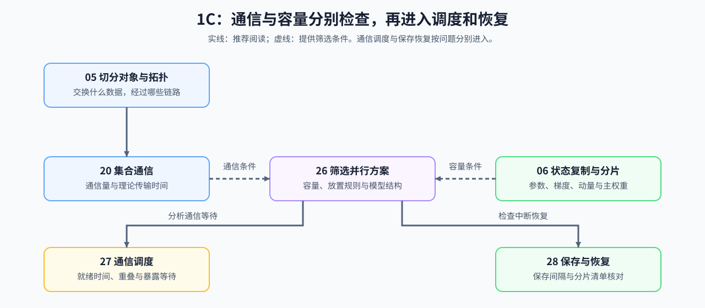

# Group 1C: Communication, Parallelism and Fault Tolerance | 1C: 通信、并行与容错

本组解释多设备切分带来的容量收益、通信代价和恢复要求。

## Group Goal | 学习目标

这一组回答三个问题：切分什么状态或计算，每一步发送哪些数据，中断前后需要保存和核对什么。先回看[01](./01_Data_Types_and_Precision.ipynb)／[02](./02_LLM_Params_and_FLOPs.ipynb)的规模账本和[03](./03_GPU_Architecture_and_Memory.ipynb)的设备资源即可进入；通信与容量两路信息汇合后筛选候选，再按问题比较调度等待或保存恢复成本。

## Learning Entries | 学习入口

| 小节 | 核心职责 | 学习角色 |
|:---|:---|:---|
| [05](./05_Communication_Topologies.ipynb) | 识别切分对象、通信原语和拓扑域 | 通信分类入口 |
| [20](./20_NCCL_and_AllReduce_Basics.ipynb) | 展开 All-Reduce 的数据流与理论代价 | 集合通信机制 |
| [06](./06_VRAM_Calculation_and_ZeRO.ipynb) | 估算显存开销与 ZeRO 收益 | 训练状态分片账本 |
| [26](./26_Parallel_Strategy_Decision_Framework.ipynb) | 按训练状态、模型、上下文、专家和请求筛选并行策略 | 并行候选入口 |
| [27](./27_Communication_Scheduling_Optimization.ipynb) | 比较分桶就绪、发送载荷与通信尾部等待 | 通信重叠入口 |
| [28](./28_Fault_Tolerance_and_Checkpointing.ipynb) | 比较保存间隔成本，核对状态角色与分片清单 | 恢复准备入口 |

## Inputs and Follow-up Paths | 两路输入与后续分支

CPU例子用同一份状态、梯度或清单核对变化；多卡通信时间与加载恢复结果，再由对应实际实验验证。

| 路径 | 阅读顺序 | 交付对象 | 首先进入的专题 |
|:---|:---|:---|:---|
| 通信条件 | [05 通信拓扑](./05_Communication_Topologies.ipynb) → [20 NCCL 与 AllReduce](./20_NCCL_and_AllReduce_Basics.ipynb) | 链路、集合通信语义、通信量与理论时间 | [通信与并行](../topic_discussion/communication_parallelism/intro.md) |
| 容量条件 | [06 显存计算与 ZeRO](./06_VRAM_Calculation_and_ZeRO.ipynb) | 参数、梯度、Adam动量与可选主权重的复制／分片账本 | [反向传播与训练机制](../topic_discussion/backpropagation_training_mechanism/intro.md)、[通信与并行](../topic_discussion/communication_parallelism/intro.md) |
| 候选汇合 | 两路输入 → [26 并行策略决策](./26_Parallel_Strategy_Decision_Framework.ipynb) | 容量、任务、结构与允许放置域的筛选结果，以及独立轴假设 | [通信与并行](../topic_discussion/communication_parallelism/intro.md)；MoE／EP同时进入[大模型架构演进](../topic_discussion/llm_architecture_evolution/intro.md) |
| 通信分支 | [26](./26_Parallel_Strategy_Decision_Framework.ipynb) → [27 通信调度](./27_Communication_Scheduling_Optimization.ipynb) | 每rank发送量、就绪顺序与反向结束后的通信等待 | [性能优化·测量与诊断方法](../topic_discussion/performance_optimization/methods/intro.md) → [性能优化](../topic_discussion/performance_optimization/intro.md) |
| 恢复分支 | [26](./26_Parallel_Strategy_Decision_Framework.ipynb) → [28 容错与检查点](./28_Fault_Tolerance_and_Checkpointing.ipynb) | 状态角色、间隔成本与分片元数据；加载后还需核对下一次更新 | [通信与并行](../topic_discussion/communication_parallelism/intro.md)、[后训练优化](../topic_discussion/post_training_optimization/intro.md) |
