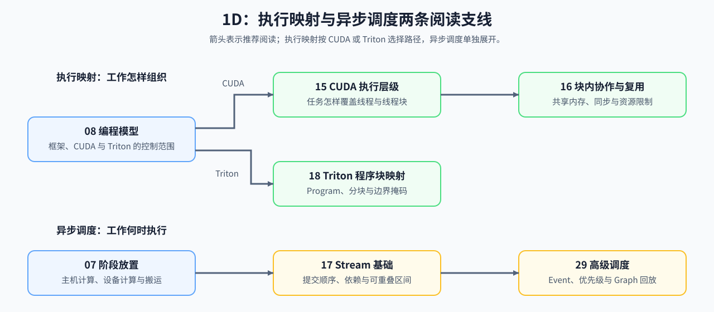

# Group 1D: Execution Models, Asynchrony and Operator Mapping | 1D: 执行模型、异步调度与算子映射

本组回答程序怎样进入实际执行单元。

## Group Goal | 学习目标

先比较任务留在主机或迁移到设备的计算与搬运成本，再学习框架、CUDA 或 Triton 怎样组织执行。执行映射支线检查数据覆盖、片上资源和边界；异步调度支线检查输入就绪、队列顺序与跨队列依赖。CPU 计算器给出指定假设下的资源量和完成时间，实际重叠仍需用执行轨迹核对。

## Learning Entries | 学习入口

| 小节 | 核心职责 | 学习角色 |
|:---|:---|:---|
| [07](./07_CPU_GPU_Heterogeneous_Scheduling.ipynb) | 比较主机计算、设备计算和数据搬运的放置成本 | 阶段放置入口 |
| [08](./08_Programming_Models_CUDA_Triton.ipynb) | 比较框架、CUDA 与 Triton 提供的控制范围 | 编程模型入口 |
| [15](./15_CUDA_Execution_Model.ipynb) | 将张量任务映射到 Grid、Block、Warp 和 Thread | CUDA 映射入口 |
| [16](./16_Warp_Block_SharedMemory_Basics.ipynb) | 检查块内协作、片上复用和同步条件 | CUDA 片上资源分支 |
| [18](./18_Triton_Block_Model.ipynb) | 用 Program、tile 和 mask 覆盖输入空间 | Triton 映射分支 |
| [17](./17_CUDA_Stream_and_Asynchrony.ipynb) | 区分提交顺序、执行顺序和可重叠区间 | 异步执行入口 |
| [29](./29_CUDA_Stream_Advanced_Scheduling.ipynb) | 用 Event、优先级和 Graph 组织复杂依赖 | 高级调度分支 |

## Execution and Scheduling Paths | 两条执行支线

执行映射决定每项工作怎样落到硬件，异步调度决定这些工作何时具备执行条件。按问题选择支线，再用固定工作负载核对执行路径与端到端时间。

| 支线 | 阅读顺序 | 能计算或检查什么 | 后续学习入口 |
|:---|:---|:---|:---|
| 执行映射 | [08](./08_Programming_Models_CUDA_Triton.ipynb) → CUDA：[15](./15_CUDA_Execution_Model.ipynb) → [16](./16_Warp_Block_SharedMemory_Basics.ipynb)；Triton：[18](./18_Triton_Block_Model.ipynb) | 映射粒度、片上复用、资源门槛和边界处理 | [算子优化](../topic_discussion/operator_optimization/intro.md) |
| 异步调度 | [07](./07_CPU_GPU_Heterogeneous_Scheduling.ipynb) → [17](./17_CUDA_Stream_and_Asynchrony.ipynb) → [29](./29_CUDA_Stream_Advanced_Scheduling.ipynb) | 阶段依赖、可重叠区间、事件与回放条件 | [性能分析](../topic_discussion/performance_analysis/intro.md) → [性能优化](../topic_discussion/performance_optimization/intro.md) |
| 证据与后端 | 两条支线 → 性能记录；图、形状和融合条件 → [1E 编译与后端](./1E.md) | 时间线、资源指标、实现候选与后端约束 | [算子优化](../topic_discussion/operator_optimization/intro.md)、[推理优化](../topic_discussion/inference_optimization/intro.md) |
