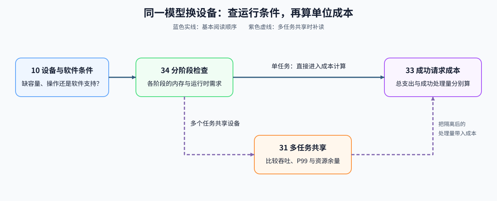

# Group 1F: Hardware Adaptation and System Constraints | 1F: 硬件适配与系统约束

把一个模型迁移到另一种设备，可能遇到容量够却无法加载、预处理能跑但生成失败、共享后尾延迟上升，以及设备便宜却单位成本更高等问题。本组沿着这次迁移，依次检查缺少的运行条件、各阶段的资源需求，以及运行后的隔离与成本取舍。

## Group Goal | 学习目标

主线按 10 → 34 → 33 阅读：先筛选设备与软件条件，再按阶段核对执行需求，最后比较同一持有期的成本。只有需要多个任务共享设备时，才在 34 与 33 之间进入 31；单任务迁移无需先学习资源切片。

## Learning Entries | 学习入口

| 遇到的问题 | 阅读入口 | 本节要算清或查清什么 |
|:---|:---|:---|
| 容量够、峰值高，却缺少运行所需的操作或软件支持 | [10 芯片与软件栈](./10_Domestic_AI_Chips_Overview.ipynb) | 哪项容量、精度、操作或软件条件未满足；迁移工期与功率是否超限 |
| 预处理与生成需求不同，某一阶段无法执行 | [34 异构加速器与运行时](./34_Heterogeneous_Accelerators_and_Runtime_Constraints.ipynb) | 各阶段各需多少内存、什么数据类型和运行时；设备之间还缺哪些交接检查 |
| 多个任务共享后尾延迟上升，隔离又损失吞吐或容量弹性 | [31 GPU 虚拟化与 MIG](./31_GPU_Virtualization_and_MIG.ipynb) | 理想切片的资源余量，以及给定服务指标能否同时满足吞吐和延迟要求 |
| 采购价低，但空闲、能耗或迁移让每个成功请求更贵 | [33 TCO 与成本](./33_TCO_and_Cost_Model.ipynb) | 总支出和成功请求分母分别怎样变化；现金支出与折旧分摊有何区别 |

## Main Path and Multi-Tenant Branch | 主线与多租户分支

容量、精度和软件支持先用给定条件计算；加载、数据交接和功能结果则要在目标设备上检查。真实路径能够执行后，再固定工作负载测量质量、时间和资源，成本模型才能使用这些结果比较方案。编译产物与形状条件可回看 [1E 编译与后端](./1E.md)，搬运时间估算可回看 [07 异构调度](./07_CPU_GPU_Heterogeneous_Scheduling.ipynb)。

| 路径 | 阅读顺序 | 带到后续实验的问题 | 后续入口 |
|:---|:---|:---|:---|
| 单任务迁移 | [10](./10_Domestic_AI_Chips_Overview.ipynb) → [34](./34_Heterogeneous_Accelerators_and_Runtime_Constraints.ipynb) → [33](./33_TCO_and_Cost_Model.ipynb) | 能否完成加载和整条执行路径；在实际处理量下成本多少 | [部署与异构系统](../topic_discussion/deployment_heterogeneous/intro.md) |
| 多任务共享 | [34](./34_Heterogeneous_Accelerators_and_Runtime_Constraints.ipynb) → [31](./31_GPU_Virtualization_and_MIG.ipynb) → [33](./33_TCO_and_Cost_Model.ipynb) | 干扰发生在哪里；隔离是否满足服务目标；剩余资源能否利用 | [性能分析](../topic_discussion/performance_analysis/intro.md)、[部署与异构系统](../topic_discussion/deployment_heterogeneous/intro.md) |
| 路径可运行后比较收益 | 保持模型、输入与质量要求一致，采集重复测量结果 | 时间、容量和单位成本是否改善，有无新增失败或回退 | [性能优化](../topic_discussion/performance_optimization/intro.md) |
