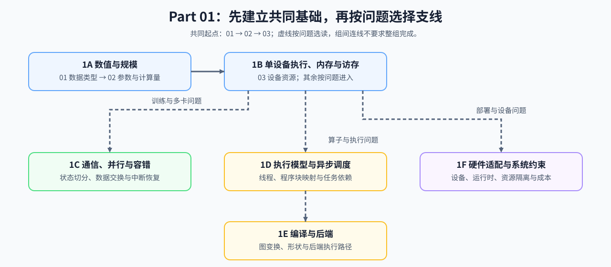

# Part 01: Hardware, Math, and Systems | 第一部分：硬件、数学与系统

## Part Overview | Part 概览

模型权重能装入显存，训练状态却可能放不下；减少了中间张量读写，完整请求也未必更快。Part 01 从数据类型、参数量和计算量出发，解释容量、访存、通信、执行与软件支持怎样影响这些结果。各节用CPU上的计算器和给定记录核对数量、条件与变化，再把问题带到后续实现和实验。

## Learning Path | 学习路线

默认先读01数据类型、02参数与计算量、03设备资源，即可按当前问题进入分支。1A的量化／MoE、1B的注意力／矩阵／片上复用均按需选读；进入其他组时，再回补具体小节，不要求先读完整个1A或1B。

| 学习方式 | 推荐入口 | 能完成的判断 |
|:---|:---|:---|
| 建立共同基础 | [01 数据类型](./01_Data_Types_and_Precision.ipynb) → [02 参数与计算量](./02_LLM_Params_and_FLOPs.ipynb) → [03 设备资源](./03_GPU_Architecture_and_Memory.ipynb) | 状态占多少空间、计算量有多大、设备约束来自哪里 |
| 训练或多卡问题 | [1C 通信、并行与容错](./1C.md) | 应切分什么、交换什么，以及恢复代价是否可接受 |
| 算子或执行路径问题 | 执行映射与异步依赖看[1D](./1D.md)；图变换与版本复用看[1E](./1E.md) | 映射哪些工作、减少哪些调用或读写、实现还需什么条件 |
| 部署与设备选型问题 | [1F 硬件适配与系统约束](./1F.md) | 给定设备与软件声明缺什么，容量、隔离和成本怎样比较 |

## Group Overview | 六组学习入口

| 学习组 | 要回答的问题 | 核心入口 | 交给后续专题的输入 |
|:---|:---|:---|:---|
| [1A 数值与规模](./1A.md) | 模型、训练状态和稀疏结构分别需要多少存储与计算？ | [01 数据类型与精度](./01_Data_Types_and_Precision.ipynb) → [02 参数量与 FLOPs](./02_LLM_Params_and_FLOPs.ipynb) | 量化、模型架构与性能候选的资源账本 |
| [1B 单设备执行、内存与访存](./1B.md) | 工作集、KV 状态、矩阵计算和访存约束怎样形成单卡瓶颈？ | [03 GPU 架构与显存](./03_GPU_Architecture_and_Memory.ipynb) | 推理、性能优化与算子优化的容量和关键路径假设 |
| [1C 通信、并行与容错](./1C.md) | 状态怎样切分，通信何时暴露，恢复前要保存与核对什么？ | 通信从[05](./05_Communication_Topologies.ipynb)进入；容量从[06](./06_VRAM_Calculation_and_ZeRO.ipynb)进入 | 每rank发送载荷、常驻状态、并行候选与分片清单 |
| [1D 执行模型、异步调度与算子映射](./1D.md) | 任务如何落到主机、设备、线程、Warp、Block 或 Program？ | 映射从[08](./08_Programming_Models_CUDA_Triton.ipynb)进入；阶段放置从[07](./07_CPU_GPU_Heterogeneous_Scheduling.ipynb)进入 | 算子实现与性能优化的执行依赖 |
| [1E 编译与后端](./1E.md) | 图、形状和融合怎样变成后端可执行的路径？ | [09 图优化与编译器](./09_AI_Compilers_and_Graph_Optimization.ipynb) | 算子优化和部署中的后端约束 |
| [1F 硬件适配与系统约束](./1F.md) | 设备、运行时、隔离和成本能否共同满足任务条件？ | [10 加速器选型与软件栈](./10_Domestic_AI_Chips_Overview.ipynb) → [34 异构加速器与运行时](./34_Heterogeneous_Accelerators_and_Runtime_Constraints.ipynb) | 候选缺项、阶段交接账目与同负载成本假设 |

## Topic Connections | 跨专题入口

带着计算出的字节数、发送载荷或执行条件进入对应路线。模型结构与反向更新可从组合路线学习，也可分别回查两个独立基础专题；测量、归因与方案比较统一进入性能优化。

| 从 Part 01 带走的对象 | 首先进入 | 后续使用 |
|:---|:---|:---|
| 数据类型、训练状态字节和训练计算量 | [模型架构与训练](../topic_discussion/model_architecture_and_training/intro.md) | 单独回查[反向传播与训练机制](../topic_discussion/backpropagation_training_mechanism/intro.md)；应用于[后训练优化](../topic_discussion/post_training_optimization/intro.md) |
| 参数量、活跃计算、KV 状态和稀疏结构账本 | [大模型架构演进](../topic_discussion/llm_architecture_evolution/intro.md) | [推理优化](../topic_discussion/inference_optimization/intro.md)、[通信与并行](../topic_discussion/communication_parallelism/intro.md) |
| 计算、带宽、容量和关键路径假设 | [性能优化·测量与诊断方法](../topic_discussion/performance_optimization/methods/intro.md) | [性能优化](../topic_discussion/performance_optimization/intro.md)中的候选比较与组合复测 |
| 量化表示、累加精度和低精度执行条件 | [量化与压缩](../topic_discussion/quantization_compression/intro.md) | [推理优化](../topic_discussion/inference_optimization/intro.md)、[部署与异构系统](../topic_discussion/deployment_heterogeneous/intro.md) |
| 执行层级、矩阵路径、片上复用和图变换条件 | [算子优化](../topic_discussion/operator_optimization/intro.md) | [性能优化](../topic_discussion/performance_optimization/intro.md) |
| 设备能力、后端支持、隔离和成本约束 | [部署与异构系统](../topic_discussion/deployment_heterogeneous/intro.md) | 目标设备上的加载、服务与回归验证 |

## Environment Notes | 环境说明

- **默认环境：** 使用 [`BASE-CPU`](../docs/guide.md#base-cpu) 运行资源账本与机制练习。
- **扩展实验：** 需要 GPU、编译工具链或多卡运行时的内容，按对应专题 Quickstart 准备环境。
