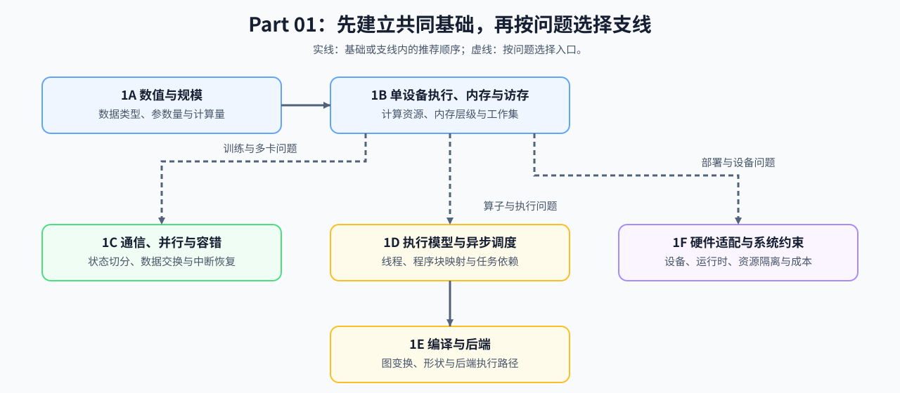

# Part 01: Hardware, Math, and Systems | 第一部分：硬件、数学与系统

## Part Overview | Part 概览

Part 01 把模型规模、设备资源和执行约束连接起来。学习者从数据类型、参数量和计算量出发，逐步理解单设备访存、多设备通信、程序执行、编译后端和设备运行时怎样共同限制训练与推理；完成后能够把一个模型或工作负载转成资源假设，并知道下一步应验证什么。

## Learning Path | 学习路线

先以 1A 和 1B 建立数量级、硬件层次和单设备工作集，再按实际问题选择通信并行、执行映射、编译后端或设备适配分支。

| 学习方式 | 推荐入口 | 能完成的判断 |
|:---|:---|:---|
| 建立共同基础 | [1A 数值与规模](./1A.md) → [1B 单设备执行、内存与访存](./1B.md) | 参数、状态、计算量和工作集是否落在可用资源内 |
| 训练或多卡问题 | [1C 通信、并行与容错](./1C.md) | 应切分什么、交换什么，以及恢复代价是否可接受 |
| 算子或执行路径问题 | [1D 执行模型、异步调度与算子映射](./1D.md) → [1E 编译与后端](./1E.md) | 程序如何映射到设备，后端是否能生成目标执行路径 |
| 部署与设备选型问题 | [1F 硬件适配与系统约束](./1F.md) | 模型产物、运行时和成本是否允许进入目标设备 |

## Group Overview | 六组学习入口

| 学习组 | 要回答的问题 | 核心入口 | 交给后续专题的输入 |
|:---|:---|:---|:---|
| [1A 数值与规模](./1A.md) | 模型、训练状态和稀疏结构分别需要多少存储与计算？ | [01 数据类型与精度](./01_Data_Types_and_Precision.ipynb) → [02 参数量与 FLOPs](./02_LLM_Params_and_FLOPs.ipynb) | 量化、模型架构与性能候选的资源账本 |
| [1B 单设备执行、内存与访存](./1B.md) | 工作集、KV 状态、矩阵计算和访存约束怎样形成单卡瓶颈？ | [03 GPU 架构与显存](./03_GPU_Architecture_and_Memory.ipynb) | 推理、性能分析与算子优化的容量和关键路径假设 |
| [1C 通信、并行与容错](./1C.md) | 状态怎样切分，通信何时暴露，系统中断后怎样恢复？ | [05 通信拓扑](./05_Communication_Topologies.ipynb) → [06 显存计算与 ZeRO](./06_VRAM_Calculation_and_ZeRO.ipynb) | 通信并行的策略、载荷和恢复条件 |
| [1D 执行模型、异步调度与算子映射](./1D.md) | 任务如何落到主机、设备、线程、Warp、Block 或 Program？ | [07 CPU/GPU 异构调度](./07_CPU_GPU_Heterogeneous_Scheduling.ipynb) → [08 CUDA/Triton 编程模型](./08_Programming_Models_CUDA_Triton.ipynb) | 算子实现与性能优化的执行依赖 |
| [1E 编译与后端](./1E.md) | 图、形状和融合怎样变成后端可执行的路径？ | [09 图优化与编译器](./09_AI_Compilers_and_Graph_Optimization.ipynb) | 算子优化和部署中的后端约束 |
| [1F 硬件适配与系统约束](./1F.md) | 设备、运行时、隔离和成本能否共同满足交付条件？ | [10 芯片与软件栈](./10_Domestic_AI_Chips_Overview.ipynb) → [34 异构加速器与运行时](./34_Heterogeneous_Accelerators_and_Runtime_Constraints.ipynb) | 部署与异构系统的准入条件 |

## Topic Connections | 跨专题入口

Part 01 先给出理论账本、资源上界和执行条件。基础支撑专题把这些对象组织成分析方法，主线与横向专题再据此选择机制并验证真实收益。

| 从 Part 01 带走的对象 | 首先进入 | 后续使用 |
|:---|:---|:---|
| 数据类型、训练状态字节和训练计算量 | [反向传播与训练机制](../topic_discussion/backpropagation_training_mechanism/intro.md) | [后训练优化](../topic_discussion/post_training_optimization/intro.md) |
| 参数量、活跃计算、KV 状态和稀疏结构账本 | [大模型架构演进](../topic_discussion/llm_architecture_evolution/intro.md) | [推理优化](../topic_discussion/inference_optimization/intro.md)、[通信与并行](../topic_discussion/communication_parallelism/intro.md) |
| 计算、带宽、容量和关键路径假设 | [性能分析](../topic_discussion/performance_analysis/intro.md) | [性能优化](../topic_discussion/performance_optimization/intro.md) |
| 量化表示、累加精度和低精度执行条件 | [量化与压缩](../topic_discussion/quantization_compression/intro.md) | [推理优化](../topic_discussion/inference_optimization/intro.md)、[部署与异构系统](../topic_discussion/deployment_heterogeneous/intro.md) |
| 执行层级、矩阵路径、片上复用和图变换条件 | [算子优化](../topic_discussion/operator_optimization/intro.md) | [性能优化](../topic_discussion/performance_optimization/intro.md) |
| 设备能力、后端支持、隔离和成本约束 | [部署与异构系统](../topic_discussion/deployment_heterogeneous/intro.md) | 目标设备上的加载、服务与回归验证 |

## Environment Notes | 环境说明

- **默认环境：** 使用 [`BASE-CPU`](../docs/guide.md#base-cpu) 运行资源账本与机制练习。
- **扩展实验：** 需要 GPU、编译工具链或多卡运行时的内容，按对应专题 Quickstart 准备环境。
