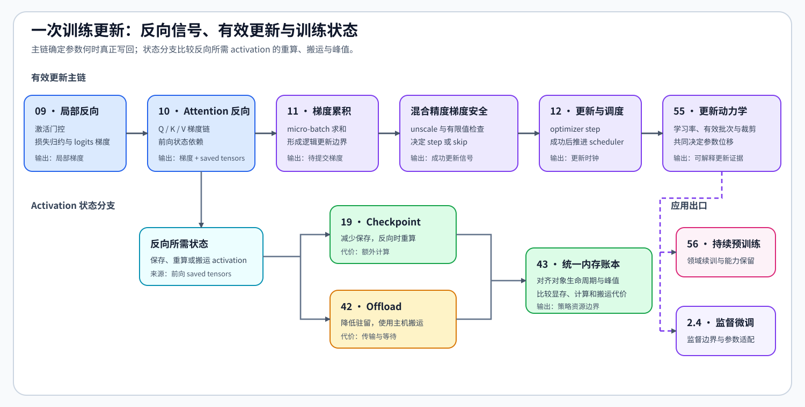

# Group 2.3: Backpropagation and Training Control | 2.3: 反向传播与训练控制

处理完一个批次，参数是否已经更新？显存不足时，少保存一些激活又会增加多少计算或搬运？本组从损失与Attention的局部梯度开始，接着学习梯度累积、混合精度和优化器更新，再比较训练状态的保存、重算与卸载。

## Group Asset Overview | 组内资产总览

| 页 | 处理的对象 | 成熟框架入口 | 产生的结果 |
|:---|:---|:---|:---|
| [09 激活与损失反向传播](./09_Activation_and_Loss_Backward.ipynb) | ReLU、交叉熵与 logits 梯度 | PyTorch · Autograd / `CrossEntropyLoss` | 局部梯度对照 |
| [10 Attention 反向传播与自定义 Autograd](./10_Attention_Backward_and_Custom_Autograd.ipynb) | Q、K、V、Softmax 与反向所需的保存张量 | PyTorch · `scaled_dot_product_attention` / `gradcheck` | `dQ/dK/dV` 与保存张量清单 |
| [11 梯度累积](./11_Gradient_Accumulation.ipynb) | 微批次、梯度累积与有效批次 | Accelerate · `Accelerator.accumulate` | 一次逻辑更新使用的梯度 |
| [TRAIN-MIXED-PRECISION-BACKWARD 混合精度反向传播与梯度安全](./TRAIN-MIXED-PRECISION-BACKWARD_Mixed_Precision_Backward.ipynb) | 损失缩放、有限值、裁剪与跳步 | PyTorch · `autocast` / `GradScaler` | 参数更新或跳步的结果与梯度 |
| [12 优化器更新与学习率调度](./12_Optimizer_Updates_and_Learning_Rate_Scheduling.ipynb) | 优化器更新与学习率调度的推进次数 | PyTorch · `LambdaLR` | 成功更新后的学习率与计数 |
| [55 训练更新动力学](./55_Training_Update_Dynamics.ipynb) | 学习率、有效批次、裁剪与参数 | PyTorch · `clip_grad_norm_` / `SGD` | 参数位移与更新记录 |
| [19 激活检查点](./19_Activation_Checkpointing.ipynb) | 激活保存范围与反向重算 | PyTorch · `checkpoint` | 显存节省量与重算时间 |
| [42 激活卸载](./42_Activation_Offload.ipynb) | 激活存放位置与往返搬运 | PyTorch · `saved_tensors_hooks` | 搬运量、计算未覆盖的等待与显存变化 |
| [43 统一训练内存账本](./43_Unified_Training_Memory_Ledger.ipynb) | 参数、梯度、优化器状态和激活 | PyTorch profiler（`memory_snapshot`） | 显存峰值发生的阶段与主要占用 |
| [56 持续预训练与能力保留](./56_Continual_Pretraining_and_Retention.ipynb) | 全序列领域续训与能力保留 | Transformers · `AutoModelForCausalLM` | 领域增益、保留集变化与恢复条件 |

## Learning Path | 学习路径

### 基础入口

| 想先弄清的问题 | 回看入口 | 读后能解释什么 |
|:---|:---|:---|
| 梯度怎样沿计算图回到参数 | [Part 00 · 07 自动求导](../00_Prerequisites/07_PyTorch_Autograd_and_Backward.ipynb)、[Part 00 · 08 梯度控制](../00_Prerequisites/08_PyTorch_Grad_Hygiene_and_No_Grad.ipynb) | 多条分支怎样贡献梯度，何时停止记录或清理梯度 |
| 一次参数更新何时完成 | [Part 00 · 11 优化器与损失](../00_Prerequisites/11_PyTorch_Optimizers_and_Loss.ipynb)、[Part 00 · 12 最小训练接口](../00_Prerequisites/12_PyTorch_Minimal_Training_Interface.ipynb) | 优化器改变参数与学习率调度分别在何时执行 |
| Attention反向需要哪些前向结果 | [Part 00 · 16 Attention](../00_Prerequisites/16_Attention_Mechanism_Intro.ipynb)、[Part 01 · 04 Attention 内存](../01_Hardware_Math_and_Systems/04_Attention_Memory_Optimization.ipynb)、[Part 01 · 14 FlashAttention 内存模型](../01_Hardware_Math_and_Systems/14_FlashAttention_Memory_Model.ipynb) | Q、K、V与Softmax怎样参与反向，分块怎样改变保存量 |
| 精度与训练状态怎样影响显存 | [Part 01 · 01 精度](../01_Hardware_Math_and_Systems/01_Data_Types_and_Precision.ipynb)、[Part 01 · 03 GPU 内存](../01_Hardware_Math_and_Systems/03_GPU_Architecture_and_Memory.ipynb)、[Part 01 · 06 训练状态](../01_Hardware_Math_and_Systems/06_VRAM_Calculation_and_ZeRO.ipynb)、[Part 01 · 12 TensorCore](../01_Hardware_Math_and_Systems/12_TensorCore_and_Mixed_Precision.ipynb) | 各类状态占多少字节，低精度计算需要哪些条件 |
| 怎样比较两次GPU运行 | [Part 00 · 17–20 运行诊断与实验](../00_Prerequisites/0E.md)、[Part 01 · 13 瓶颈分析](../01_Hardware_Math_and_Systems/13_Profiling_and_Bottleneck_Analysis.ipynb) | 怎样选择基线、测量时间与显存，并观察重复运行的变化 |

### 组内路径

- 反向信号：[Part 00 · 07 PyTorch 自动求导与反向传播](../00_Prerequisites/07_PyTorch_Autograd_and_Backward.ipynb) → [09 激活与损失反向传播](./09_Activation_and_Loss_Backward.ipynb) → [10 Attention 反向传播与自定义 Autograd](./10_Attention_Backward_and_Custom_Autograd.ipynb)。
- 有效更新：[11 梯度累积](./11_Gradient_Accumulation.ipynb) → [TRAIN-MIXED-PRECISION-BACKWARD 混合精度反向传播与梯度安全](./TRAIN-MIXED-PRECISION-BACKWARD_Mixed_Precision_Backward.ipynb) → [12 优化器更新与学习率调度](./12_Optimizer_Updates_and_Learning_Rate_Scheduling.ipynb) → [55 训练更新动力学](./55_Training_Update_Dynamics.ipynb)。先检查混合精度下的梯度与参数更新结果，再按约定决定学习率调度是否推进。
- 训练状态：[19 激活检查点](./19_Activation_Checkpointing.ipynb) 与 [42 激活卸载](./42_Activation_Offload.ipynb) 是重算和搬运两条并列策略，随后在 [43 统一训练内存账本](./43_Unified_Training_Memory_Ledger.ipynb) 中统一比较驻留量、峰值和时间代价。
- 应用出口：需要全序列领域续训时，从 55 进入 [56 持续预训练与能力保留](./56_Continual_Pretraining_and_Retention.ipynb)；需要监督微调与参数适配时进入 [2.4 监督微调与参数适配](./2_4.md)。

从计算图到训练状态的连续解释见[反向传播与训练机制专题](../topic_discussion/backpropagation_training_mechanism/intro.md)。

续训还需要知道模型已经使用了哪些数据。先用[Part 00 · 10 状态与恢复](../00_Prerequisites/10_PyTorch_State_dict_and_Persistence.ipynb)保存模型、优化器和随机状态，再按[数据工程的读取进度说明](../topic_discussion/data_engineering/03_data_mixture_and_curriculum.md#pretraining-reading-progress)核对文档位置与已完成更新；已预取但尚未用于更新的内容也随之处理。在线训练中，采样、反馈与更新的对应关系见[在线批次恢复](../topic_discussion/data_engineering/06_pipeline_lineage_and_downstream_validation.md#online-batch-recovery)。

## Environment Notes | 环境说明

| 使用范围 | 环境 | 入口 |
|:---|:---|:---|
| 基础机制练习、题目与测试 | `BASE-CPU` | [基础环境说明](../docs/gpu_environment_assets.md#base-cpu) |
| PyTorch、Transformers 与 Accelerate 一致性核对 | `TRAIN-CPU` | [训练机制 Quickstart](../topic_discussion/backpropagation_training_mechanism/quickstart.md#train-cpu-quickstart) |
| 真实模型的数值、参数更新、时间与显存测量 | `TRAIN-CUDA-MECHANISM` | 各页 Step 5 与[训练机制 Quickstart](../topic_discussion/backpropagation_training_mechanism/quickstart.md#train-cuda-mechanism-quickstart) |
