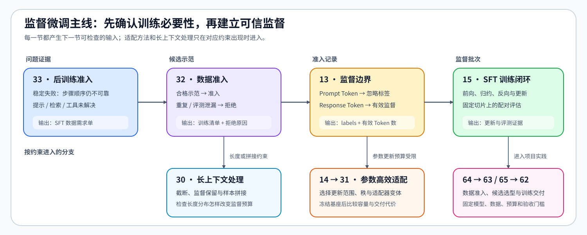

# Group 2.4: Supervised Fine-Tuning and Adaptation | 2.4: 监督微调与参数适配

本组先判断是否需要更新模型参数，再依次检查数据、监督目标、参数更新、评估和保存；遇到长度或显存约束时，再加入长上下文或参数高效适配方法。[2.3](./2_3.md) 解释通用反向传播与参数更新，本组把它们用于 SFT；梯度、更新时钟或训练状态异常时返回 2.3，数据、模板、参数范围和行为质量问题留在本组处理。

## Pages and Frameworks | 页面与框架

直接列出的框架已经在 Notebook 中执行 CPU 框架核对；括号中的框架表示尚未接入代码的后续入口。

| 页 | 核心问题 | 成熟框架入口 | 何时阅读 |
|:---|:---|:---|:---|
| [33](./33_Fine_Tuning_Readiness.ipynb) | 稳定失败是否需要参数更新，应进入哪个后训练阶段 | TRL · `SFTConfig` / `DPOConfig` / `GRPOConfig` | 先判断是否需要更新参数 |
| [32](./32_Data_Engineering_for_SFT.ipynb) | 数据如何去重、去污染并形成可训练清单 | Hugging Face Datasets · `Dataset` / `Features` | 训练前检查数据 |
| [PT-SYNTHETIC-DATA](./PT-SYNTHETIC-DATA_Instruction_Generation_and_Verifier_Admission.ipynb) | 稀缺任务怎样生成可追溯候选，并经训练集与批内去重、污染和验证器检查进入 SFT 审计 | Hugging Face Datasets · `Dataset.from_list` / `Dataset.filter` | 真实示范不足，需要补充训练覆盖时 |
| [13](./13_SFT_Training_Loop.ipynb) | 哪些 Token 参与监督，SFT 损失如何对齐与归约 | Transformers · `AutoModelForCausalLM` | 确定监督 Token 与损失 |
| [15](./15_End_to_End_Fine_Tuning_Experiment.ipynb) | 已验证的损失与参数集合如何形成有效更新、评估和记录 | Accelerate · `Accelerator`；TRL · `SFTTrainer` | 执行更新、评估与保存 |
| [14](./14_LoRA_Tutorial.ipynb) | 哪些参数更新，低秩路径如何缩放与合并 | PEFT · `LoraConfig` / `get_peft_model` / `merge_and_unload` | 需要减少可训练参数时 |
| [30](./30_Long_Context_Fine_Tuning.ipynb) | 长度分布、窗口预算、Packing 与课程如何协调 | Hugging Face Datasets · `Dataset`；TRL · `pack_dataset` | 出现截断或 Packing 问题时 |
| [31](./31_LoRA_Variants_Theory.ipynb) | LoRA、rsLoRA、DoRA 如何在同预算下比较 | PEFT · `LoraConfig` / `get_peft_model` | 比较 LoRA 变体时 |

## Learning Path | 学习路径

- 先读 [33](./33_Fine_Tuning_Readiness.ipynb)，判断问题是否需要参数更新；决定进入 SFT 后，再检查数据与监督目标。
- 基本顺序是 [32](./32_Data_Engineering_for_SFT.ipynb) → [13](./13_SFT_Training_Loop.ipynb) → [15](./15_End_to_End_Fine_Tuning_Experiment.ipynb)，依次确定数据、监督损失和训练过程；真实示范不足时，在32之后使用 [PT-SYNTHETIC-DATA](./PT-SYNTHETIC-DATA_Instruction_Generation_and_Verifier_Admission.ipynb) 生成并验证候选，再返回32执行最终切分审计。
- 使用 LoRA 时，[13](./13_SFT_Training_Loop.ipynb) 确定监督目标，[14](./14_LoRA_Tutorial.ipynb) 限定可训练参数，然后在 [15](./15_End_to_End_Fine_Tuning_Experiment.ipynb) 执行训练；需要比较秩、缩放和变体时再读 [31](./31_LoRA_Variants_Theory.ipynb)。
- 当截断、监督保留或跨样本拼接成为问题时，在 [32](./32_Data_Engineering_for_SFT.ipynb) 和 [13](./13_SFT_Training_Loop.ipynb) 之后进入 [30](./30_Long_Context_Fine_Tuning.ipynb)。
- 后续学习：完成数据、损失和训练过程后，进入 [2.5](./2_5.md) 学习偏好与奖励驱动更新；跨页核对公式时使用[后训练公式索引](../topic_discussion/post_training_optimization/formula_reference.md)。

## Project Validation | 项目验证顺序

固定模型、数据和预算后，先用 64 检查训练数据，再根据显存与训练方式选择 63 或 65，最后由 62 执行训练、恢复和评测。执行配置见 [2.10](./2_10.md)，当前实验状态与复测标签见[后训练优化实验资产表](../topic_discussion/post_training_optimization/experiment_assets.md)。

| 项目 | 何时进入 | 直接输入 | 主要输出 | 验证内容 |
|:---|:---|:---|:---|:---|
| [64 SFT 数据质量](./64_SFT_Data_Quality_Project.ipynb) | 原始数据准备进入训练前 | 数据版本、模板与独立评测切分 | 数据准入 manifest、样本与切分哈希 | 去重、污染、模板与切分 |
| [63 LoRA 变体对比](./63_LoRA_Variants_Benchmark.ipynb) | 默认采用参数高效微调并需要选择更新范围或秩 | 64 的数据准入 manifest | LoRA 选型 manifest 与可用适配器 | 更新范围、秩、显存与质量 |
| [65 QLoRA 选型](./65_QLoRA_Selection_Project.ipynb) | 冻结基座后仍受显存或 batch 容量限制 | 64 的数据准入 manifest | QLoRA 配对结果、适配器哈希与运行 manifest | 量化基座与适配器的兼容性 |
| [62 SFT 训练交付](./62_Instruction_Fine_Tuning_Project.ipynb) | 数据和参数更新方案已经确定 | 63 或兼容的 65 运行 manifest | checkpoint、适配器、恢复记录、评测报告与交付 manifest | 训练、恢复、评测与交付 |

## Environment Notes | 环境说明

| 运行目标 | 环境入口 | 适用内容 |
|:---|:---|:---|
| 基础机制练习 | [`BASE-CPU`](../docs/gpu_environment_assets.md#base-cpu) | 33、32、PT-SYNTHETIC-DATA、13、14、15、30、31 的 Step 4 与测试 |
| 成熟框架核对 | [`PT-CPU`](../topic_discussion/post_training_optimization/quickstart.md#pt-cpu-quickstart) | 上述机制页的“框架一致性核对”；该环境包含基础练习依赖 |
| 真实实验与交付 | 各页 Step 5 或项目环境说明 | 14、15、30、31 的可选 GPU 实测；64 的 CPU 准入；63、65、62 的隔离项目环境 |
