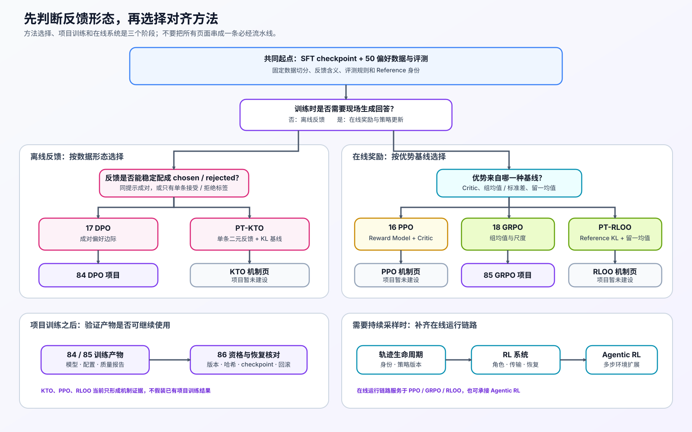

# Group 2.5: Preference Optimization and Alignment | 2.5: 偏好优化与对齐

模型已经能按示范回答，接下来怎样利用“哪条更好”或“任务是否完成”的反馈继续学习？已有两条回答的比较标签，可以从离线偏好方法开始；由当前模型重新生成回答、获得奖励后再更新，则进入在线分支。先辨认手里的反馈，再选择训练方法。

## Pages and Frameworks | 页面与框架

直接列出的框架已经接入 Notebook 的 CPU 核对或 GPU 实验；括号中的框架表示尚未接入代码的后续入口。

| 页 | 核心问题 | 成熟框架入口 | 何时阅读 |
|:---|:---|:---|:---|
| [50 偏好数据与对齐评测](./50_Preference_Data_and_Evaluation.ipynb) | 偏好对如何隔离，训练结果如何接受固定协议评测 | Hugging Face Datasets · `Dataset` | 先固定数据与评测规则 |
| [PT-REWARD-SIGNAL 奖励、价值与优势信号](./PT-REWARD-SIGNAL_Reward_Model_Value_and_Advantage.ipynb) | 即时奖励、累计回报、价值估计与优势分别怎样参与更新 | TRL · `selective_log_softmax` / `nanstd` | 区分在线算法的更新信号时 |
| [17 直接偏好优化损失](./17_DPO_Loss_Tutorial.ipynb) | 优选／非优选回答与冻结参考模型怎样形成离线 DPO 目标 | TRL · `DPOTrainer` | 使用成对偏好数据时 |
| [PT-KTO 二元反馈对齐](./PT-KTO_Binary_Feedback_Alignment.ipynb) | 单条点赞、点踩或验收标签如何形成 KTO 目标 | TRL · `KTOTrainer` | 只有单条二元反馈时 |
| [PT-REWARD-MODEL 奖励模型训练、校准与过度优化](./PT-REWARD-MODEL_Reward_Model_Training_and_Calibration.ipynb) | 偏好对如何训练标量奖励，怎样校准并识别过度优化 | TRL · `RewardTrainer` | 需要学习标量奖励时 |
| [16 RLHF / PPO 资源与状态](./16_RLHF_PPO_Memory.ipynb) | 策略、参考、奖励与价值模型各自计算什么、保存什么 | TorchRL · `ClipPPOLoss` | 使用价值模型（Critic）的在线训练时 |
| [18 组相对策略优化与可验证奖励](./18_GRPO_Loss_Tutorial.ipynb) | 组采样和组内基线如何形成相对优势 | TRL · `GRPOTrainer` | 有可验证奖励和组采样时 |
| [PT-RLOO 留一基线策略优化](./PT-RLOO_Leave_One_Out_Policy_Optimization.ipynb) | 同组多回答如何用留一基线形成在线策略更新 | TRL · `RLOOTrainer` | 不使用 Critic、采用留一基线时 |
| [PT-ROLLOUT-LIFECYCLE 轨迹与策略新鲜度](./PT-ROLLOUT-LIFECYCLE_Rollout_and_Policy_Freshness.ipynb) | 怎样核对回答由哪个策略生成，判断已有轨迹能否用于当前更新 | verl · rollout correction / vLLM rollout；（TRL · `PPOTrainer` / `GRPOTrainer` / `RLOOTrainer`） | 持续生成并复用轨迹时 |
| [PT-AGENTIC-RL 环境轨迹与奖励归因](./PT-AGENTIC-RL_Environment_Trajectory_and_Credit_Assignment.ipynb) | 模型动作、工具观察和环境反馈如何形成可训练的多步轨迹 | Gymnasium · `Env` / `check_env` | 训练包含工具调用的多步行为时 |
| [PT-RL-SYSTEM 采样、训练与奖励系统](./PT-RL-SYSTEM_Rollout_Training_and_Reward_System.ipynb) | 生成、奖励／参考评分与参数更新怎样分工和交换数据 | verl · vLLM rollout / FSDP actor；（TRL · `PPOTrainer` / `GRPOTrainer` / `RLOOTrainer`） | 拆分生成、评分与训练角色时 |
| [51 在线 DPO](./51_Online_DPO.ipynb) | 在线反馈何时采用、延迟、回滚或停止 | Hugging Face Datasets · `Dataset`；TRL · `DPOConfig` | 持续接收新反馈时 |

## Learning Path | 学习路径

先用[50 偏好数据与对齐评测](./50_Preference_Data_and_Evaluation.ipynb)固定数据切分、反馈含义和评测规则，再根据下表选择分支。在线方法先读[PT-REWARD-SIGNAL 奖励、价值与优势信号](./PT-REWARD-SIGNAL_Reward_Model_Value_and_Advantage.ipynb)，区分一次反馈、累计回报、预期回报与相对基线的好坏；具体奖励与优势的计算回到对应算法页。

| 已有训练信号 | 是否在线生成 | 比较基线 | 对应页面 | 项目验证 |
|:---|:---:|:---|:---|:---|
| 同一提示的优选／非优选回答 | 否 | 冻结参考模型下的回答概率比 | [17 DPO](./17_DPO_Loss_Tutorial.ipynb) | [84 DPO 项目](./84_DPO_Preference_Project.ipynb) |
| 单条回答的接受 / 拒绝标签 | 否 | 独立 KL 样本基线 | [PT-KTO 二元反馈对齐](./PT-KTO_Binary_Feedback_Alignment.ipynb) | 暂无独立项目 |
| 学习到的标量奖励，并训练价值模型 | 是 | 价值估计与广义优势估计（GAE） | [PT-REWARD-MODEL 奖励模型训练、校准与过度优化](./PT-REWARD-MODEL_Reward_Model_Training_and_Calibration.ipynb) → [16 PPO](./16_RLHF_PPO_Memory.ipynb) | 暂无独立项目 |
| 同提示多回答的奖励 | 是 | 组均值与可选标准差 | [18 GRPO](./18_GRPO_Loss_Tutorial.ipynb) | [85 GRPO 项目](./85_GRPO_Groupwise_Alignment_Project.ipynb) |
| 同提示多回答的奖励 | 是 | 排除当前回答的留一均值 | [PT-RLOO 留一基线策略优化](./PT-RLOO_Leave_One_Out_Policy_Optimization.ipynb) | 暂无独立项目 |

### 在线更新与系统验证

算法页先确定训练信号和损失。持续生成时，策略参数会变化，已有回答可能来自旧策略；遇到工具调用，还要把动作、环境反馈与最终结果对应起来。再按需要检查这些记录怎样在生成、评分和训练之间传递。

| 场景 | 后续入口 | 解决的问题 |
|:---|:---|:---|
| 在线 DPO | [17 直接偏好优化损失](./17_DPO_Loss_Tutorial.ipynb) 或 [84 DPO 偏好优化项目](./84_DPO_Preference_Project.ipynb) → [51 在线 DPO](./51_Online_DPO.ipynb) | 固定反馈窗口，并决定采用、延迟或回滚 |
| PPO / GRPO / RLOO 持续采样 | [PT-ROLLOUT-LIFECYCLE 轨迹与策略新鲜度](./PT-ROLLOUT-LIFECYCLE_Rollout_and_Policy_Freshness.ipynb) → [PT-RL-SYSTEM 采样、训练与奖励系统](./PT-RL-SYSTEM_Rollout_Training_and_Reward_System.ipynb) | 核对生成策略、旧回答使用条件，以及各阶段显存与数据交换 |
| 多步工具和环境交互 | [PT-AGENTIC-RL 环境轨迹与奖励归因](./PT-AGENTIC-RL_Environment_Trajectory_and_Credit_Assignment.ipynb) | 表达环境状态、模型动作、工具观察、终态 / 过程奖励与信用分配 |

## Project Validation | 项目验证顺序

固定 SFT 起点、数据与评测规则后，84和85分别形成离线偏好与组内奖励候选，二者并列。86读取已有候选，核对来源与适配器文件，并按可用状态选择恢复建议；实际加载检查点续训要另外验证。项目目录见[2.10 项目验证与工程收口](./2_10.md)，当前实验状态与复测标签见[后训练优化实验资产表](../topic_discussion/post_training_optimization/experiment_assets.md)。

| 项目 | 何时进入 | 直接输入 | 主要输出 | 验证内容 |
|:---|:---|:---|:---|:---|
| [84 DPO 偏好优化](./84_DPO_Preference_Project.ipynb) | 已有隔离偏好数据与 SFT 基线 | SFT checkpoint、偏好数据 manifest 与评测协议 | DPO 模型或适配器、质量报告与运行 manifest | 偏好边际、质量与训练稳定性 |
| [85 GRPO 组内对齐](./85_GRPO_Groupwise_Alignment_Project.ipynb) | 已有可执行验证器、组采样配置与 SFT 基线 | SFT checkpoint、奖励规范与固定工作负载 | GRPO 模型或适配器、奖励 / 质量报告与运行 manifest | 奖励、质量与训练稳定性 |
| [86 在线后训练生命周期与恢复](./86_DPO_Online_Benchmark.ipynb) | 84或85已保存候选清单与适配器 | 候选清单、SFT来源、适配器与可用状态记录 | 文件核对结果、恢复建议与待评测候选清单 | 候选来源、目录哈希与恢复动作选择 |

## Environment Notes | 环境说明

| 运行目标 | 环境入口 | 适用内容 |
|:---|:---|:---|
| 基础机制练习 | [`BASE-CPU`](../docs/gpu_environment_assets.md#base-cpu) | 本组机制页的 Step 4 与测试 |
| 成熟框架核对 | [`PT-CPU`](../topic_discussion/post_training_optimization/quickstart.md#pt-cpu-quickstart) | 本组带“框架一致性核对”层级的机制页；该环境包含基础练习依赖 |
| 单卡系统机制 | [`PT-VERL-CUDA`](../topic_discussion/post_training_optimization/quickstart.md#pt-verl-cuda-quickstart) | 轨迹准入、阶段耗时与缓存驻留对照 |
| 真实实验与项目 | 各页 Step 5 或项目环境说明 | 奖励模型、奖励信号、DPO、GRPO 的可选 GPU 实测；84、85 的隔离训练环境；86 的生命周期验证环境 |
