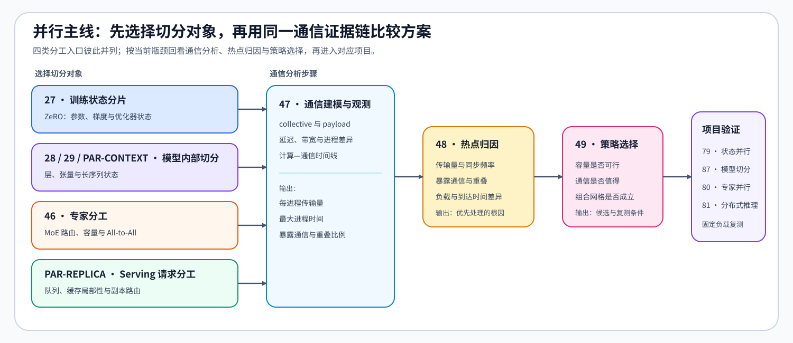

# Group 2.9: Communication and Parallelism | 2.9: 通信与并行

本组从“切分什么”和“切分后怎样通信”两个维度组织并行机制。训练状态、层、张量、序列、专家和 Serving 请求是六种并列分工对象；每种方案都用 collective、payload、同步频率、overlap、负载不均和扩展效率分析通信代价。相关机制同时服务分布式训练与分布式推理。



## Group Overview | 组概览

本组按并列的切分对象组织机制：27 解释训练状态分片，28 解释层与 stage，29 解释矩阵和 Attention 张量，PAR-CONTEXT 解释长序列切分，46 解释 MoE token 到专家的动态分发，PAR-REPLICA 解释 Serving 请求到模型副本的路由。选定分工方式后，再沿 `47 → 48 → 49` 建立通信模型、定位暴露热点并比较组合策略。跨页使用的通信成本、并行度和扩展效率公式集中在[通信与并行公式索引](../topic_discussion/communication_parallelism/formula_reference.md)。

```text
并行切分维度                         通信分析与决策
├─ 27 训练状态切分：ZeRO            47 通信 Profiling
├─ 28 层切分：Pipeline Parallel       ↓
├─ 29 张量切分：Tensor Parallel      48 热点归因与缓解
├─ PAR-CONTEXT 序列切分：CP           ↓
├─ 46 专家切分：Expert Parallel       ↓
└─ PAR-REPLICA 请求分工：副本路由    49 并行组合与策略选型
```

## Group Asset Overview | 组内资产总览

| 页 | 职责作用 | 推荐实现入口 | 定位 |
|:---|:---|:---|:---|
| [27](./27_ZeRO_Optimizer_Sim.ipynb) | 比较参数、梯度和优化器状态的复制与分片 | PyTorch Distributed / Accelerate | 训练状态切分页 |
| [28](./28_Pipeline_Parallelism_MicroBatch.ipynb) | 比较训练与推理 Pipeline 的 stage、micro-batch 和 bubble | PyTorch Distributed | 层切分页 |
| [29](./29_Tensor_Parallelism_Sim.ipynb) | 比较 MLP、Attention 与 KV Head 的张量切分和 collective | PyTorch Distributed | 张量切分页 |
| [PAR-CONTEXT](./PAR-CONTEXT_Context_and_Sequence_Parallelism.ipynb) | 验证序列分片、分块 Softmax 与 Ring K/V 通信账本 | PyTorch Distributed · `all_gather`；PyTorch · `scaled_dot_product_attention` | 序列切分页 |
| [46](./46_MoE_Expert_Parallel.ipynb) | 看懂 MoE 专家并行的 capacity、dispatch、combine 与 All-to-All | torch.distributed | 专家切分页 |
| [47](./47_Communication_Profiling_with_NCCL.ipynb) | 建立 latency、bandwidth、payload、collective 与时间线证据 | torch.distributed / NCCL | 通信模型与观测页 |
| [PAR-REPLICA](./PAR-REPLICA_Serving_Replica_Routing.ipynb) | 比较 Round-Robin、Queue-Aware 与缓存/会话感知路由 | vLLM / SGLang | Serving 副本路由页 |
| [48](./48_Communication_Hotspots_and_Mitigation.ipynb) | 计算暴露通信时间并比较 overlap 与缓解策略 | torch.profiler / NCCL | 热点归因页 |
| [49](./49_Parallelism_Strategy_Selection.ipynb) | 按容量、通信和 workload 组合并行策略 | PyTorch Distributed / Accelerate | 组合决策页 |
| [79](./79_Distributed_Parallel_Benchmark.ipynb) | 比较 DDP、FSDP 与 ZeRO 的训练状态驻留、通信和扩展效率 | PyTorch Distributed / Accelerate | 训练状态并行项目 |
| [80](./80_MoE_Expert_Parallel_Benchmark.ipynb) | 验证 MoE 容量、路由与通信 | PyTorch Distributed / NCCL | EP 项目 |
| [81](./81_Distributed_Inference_Project.ipynb) | 比较副本路由、模型并行实例与 PD 分离等服务形态 | PyTorch Distributed / vLLM | 分布式推理项目 |
| [87 `PAR-MODEL-INTERNAL`](./87_Model_Internal_Parallel_Benchmark.ipynb) | 汇总 PP、TP、CP 与 Device Mesh 的模型内部切分证据 | PyTorch Distributed / DeviceMesh | 模型内部并行项目 |

## Learning Path | 学习路径

### Recommended Order | 推荐顺序

- 先按问题选择分工维度：训练状态看 [27](./27_ZeRO_Optimizer_Sim.ipynb)，层切分看 [28](./28_Pipeline_Parallelism_MicroBatch.ipynb)，张量切分看 [29](./29_Tensor_Parallelism_Sim.ipynb)，长序列切分看 [PAR-CONTEXT](./PAR-CONTEXT_Context_and_Sequence_Parallelism.ipynb)，MoE 专家切分看 [46](./46_MoE_Expert_Parallel.ipynb)，Serving 请求分发看 [PAR-REPLICA](./PAR-REPLICA_Serving_Replica_Routing.ipynb)。这些机制是按问题分流的并列入口。
- 再按 [47](./47_Communication_Profiling_with_NCCL.ipynb) → [48](./48_Communication_Hotspots_and_Mitigation.ipynb) → [49](./49_Parallelism_Strategy_Selection.ipynb) 建立通信模型、定位热点并形成组合策略；46 用于 MoE workload 的专家路由与 All-to-All 分支。
- 项目验证按目标分流：[79](./79_Distributed_Parallel_Benchmark.ipynb) 比较 DDP / FSDP / ZeRO，[87 `PAR-MODEL-INTERNAL`](./87_Model_Internal_Parallel_Benchmark.ipynb) 比较 PP / TP / CP，[80](./80_MoE_Expert_Parallel_Benchmark.ipynb) 验证 EP，[81](./81_Distributed_Inference_Project.ipynb) 验证分布式推理与 Serving 副本路由，可按目标独立选择。

### Next Steps | 后续衔接

- 看完本组后，进入 [2.10](./2_10.md)，按训练状态、模型内部切分、专家并行或分布式推理目标选择 79、87、80 或 81；四个项目按目标分流。
- 问题转向训练内存账本时回看 [43](./43_Unified_Training_Memory_Ledger.ipynb) 和 [76](./76_Activation_Checkpoint_Offload_Benchmark.ipynb)；转向 kernel 成本与自动调优时进入[算子优化 Task4](../topic_discussion/operator_optimization/05_measurement_profiling_and_autotuning.md)。

## Environment Notes | 环境说明

- **基础练习：** `BASE-CPU` 运行单进程机制代码与答案测试。
- **框架核对：** `PAR-CPU` 使用两个本地 Gloo 进程核对 27、28、29、PAR-CONTEXT、46、47 的 PyTorch Distributed 行为。
- **多卡实测：** `PAR-CUDA-MECHANISM` 使用 NCCL 验证拓扑、overlap、负载不均与扩展效率；本地 Gloo 结果不代表真实多卡性能。
