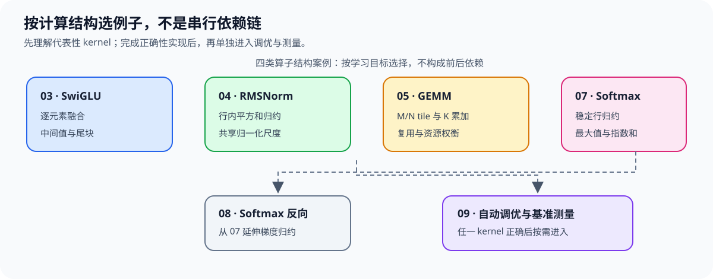

# Group 3.2: Common Kernels and Tuning | 3.2: 常用算子与调优

本组分为基本算子与条件扩展：SwiGLU、RMSNorm、GEMM和Softmax展示逐元素融合、行归约与矩阵分块；持久化、反向和自动调优分别在任务分工、梯度或配置选择成为问题时进入，不要求读完七页才能学习Attention。

## Group Asset Overview | 组内资产总览

| 页面 | 核心问题 | 实现与证据产物 | 在本组中的作用 |
|:---|:---|:---|:---|
| [03 SwiGLU](./03_Triton_Fused_SwiGLU.ipynb) | 门控激活的逐元素计算怎样融合？ | 输出与 PyTorch 参考一致，覆盖尾块 | 前向 kernel 示例 |
| [04 RMSNorm](./04_Triton_Fused_RMSNorm.ipynb) | 行内归约怎样形成归一化输出？ | 多种形状下的数值误差核对 | 前向 kernel 示例 |
| [05 GEMM](./05_Triton_GEMM_Tutorial.ipynb) | 二维 tile 与 K 维累加如何组织矩阵乘法？ | 非方阵/尾块正确性与固定形状微基准 | 矩阵 kernel 示例 |
| [持久化 GEMM 与任务分配](./06_Triton_Persistent_GEMM_and_Tile_Scheduling.ipynb) | 有限 Program 怎样覆盖多个输出块，何时值得改变任务数量？ | CPU 计划、GPU 实际访问与归属、同二进制配对 | GEMM 任务分配分支 |
| [07 Softmax](./07_Triton_Fused_Softmax.ipynb) | 行内最大值与指数和怎样保证稳定归一化？ | 不同形状和边界下对照 PyTorch | 前向 kernel 示例 |
| [08 Softmax 反向](./08_Triton_Softmax_Backward.ipynb) | 上游梯度怎样映射为 Softmax 输入梯度？ | 与 PyTorch autograd 的梯度对照 | 梯度分支 |
| [09 自动调优与基准测量](./09_Triton_Autotune_and_Profiling.ipynb) | 如何限定配置候选并进行可比计时？ | 正确性通过后的候选配置与多输入长度耗时比较 | 可独立进入的方法页 |

## Learning Path | 学习路径

### Recommended Order | 推荐顺序

- **基本算子：** 系统练习时按[03 SwiGLU](./03_Triton_Fused_SwiGLU.ipynb) → [04 RMSNorm](./04_Triton_Fused_RMSNorm.ipynb) → [05 GEMM](./05_Triton_GEMM_Tutorial.ipynb) → [07 Softmax](./07_Triton_Fused_Softmax.ipynb)展开计算结构；按目标进入时，只补当前缺少的融合、归约或矩阵分块知识。
- **梯度分支：** 需要理解 Softmax 反向时，从 [07](./07_Triton_Fused_Softmax.ipynb) 进入 [08](./08_Triton_Softmax_Backward.ipynb)。
- **GEMM 任务分配：** 完成 [05](./05_Triton_GEMM_Tutorial.ipynb) 后，可进入[持久化 GEMM](./06_Triton_Persistent_GEMM_and_Tile_Scheduling.ipynb)，检查一个 Program 多轮处理 tile 的覆盖和状态；该页不要求先完成 TMA 或 Warp 专业化。
- **调优与测量：** 完成任一代表性 kernel 的正确性实现后即可进入 [09](./09_Triton_Autotune_and_Profiling.ipynb) 学习候选搜索与基准测量；不需要先读完所有算子。

### Next Steps | 后续衔接

- 需要实现 Attention kernel 时进入 [3.3](./3_3.md)；推理侧权重、适配器或 KV 状态计算可按需进入 [3.4](./3_4.md)。

## Environment Notes | 环境说明

| 运行目标 | 环境与证据边界 |
|:---|:---|
| 03–09 正确性 | 需要 NVIDIA GPU、CUDA 可用的 PyTorch 与 Triton；环境创建和预检见[算子优化实验 Quickstart](../topic_discussion/operator_optimization/quickstart.md) |
| 05、09短微基准；06独立Step5 | 需要目标GPU实际测量；06按页内配置读取已有记录或显式复测，使用统一Graph承载计时。正确性与CPU计划分别核对 |
