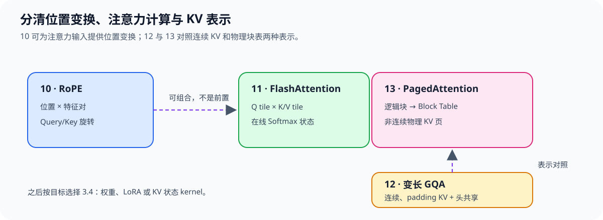

# Group 3.3: Attention Optimization | 3.3: Attention 优化

本组覆盖彼此相关但可独立阅读的工作：RoPE 是位置编码变换，FlashAttention 聚焦注意力计算；变长 GQA 与 PagedAttention 可对照连续 KV 与物理块表寻址。后两者是概念递进，不要求复用同一份实现。

## Group Asset Overview | 组内资产总览

| 页面 | 核心问题 | 实现与证据产物 | 在本组中的作用 |
|:---|:---|:---|:---|
| [10 RoPE](./10_Triton_Fused_RoPE.ipynb) | 如何按位置索引变换 Query/Key？ | RoPE 输出与参考实现数值核对 | 位置编码分支 |
| [11 FlashAttention](./11_Triton_Flash_Attention.ipynb) | 如何分块计算注意力并避免显式保存完整分数矩阵？ | Triton 前向结果与 PyTorch SDPA 核对 | 注意力计算主线 |
| [12 变长GQA](./12_Triton_Variable_Length_GQA.ipynb) | 如何在不同有效长度下映射共享 KV 头？ | GQA/MQA 与变长掩码数值核对 | 连续 KV 分支 |
| [13 PagedAttention](./13_Triton_PagedAttention.ipynb) | 如何通过块表访问非连续 KV Cache？ | 间接寻址与 Online Softmax 核对 | 分页 KV 分支 |

## Learning Path | 学习路径

### Recommended Order | 推荐顺序

- 关注位置编码时读[10 RoPE](./10_Triton_Fused_RoPE.ipynb)；关注注意力核时从[11 FlashAttention](./11_Triton_Flash_Attention.ipynb)开始。研究KV头映射与长度掩码时读[12 变长GQA](./12_Triton_Variable_Length_GQA.ipynb)，再对照[13 PagedAttention](./13_Triton_PagedAttention.ipynb)中的物理块表寻址。12→13是表示方式的对照路径，不是代码调用依赖。

### Next Steps | 后续衔接

- 需要比较权重量化、LoRA 路由或 KV Cache 量化等推理算子时，按目标进入 [3.4](./3_4.md)；不必先完成本组全部页面。

## Environment Notes | 环境说明

| 运行目标 | 环境与证据边界 |
|:---|:---|
| 10–13 kernel 正确性 | 需要 NVIDIA GPU、CUDA 可用的 PyTorch 与 Triton；环境创建和预检见[算子优化实验 Quickstart](../topic_discussion/operator_optimization/quickstart.md) |
| Attention / KV 性能判断 | 本组数值对照只验证机制正确性；性能主张须使用目标设备上的独立基准与测量协议 |
