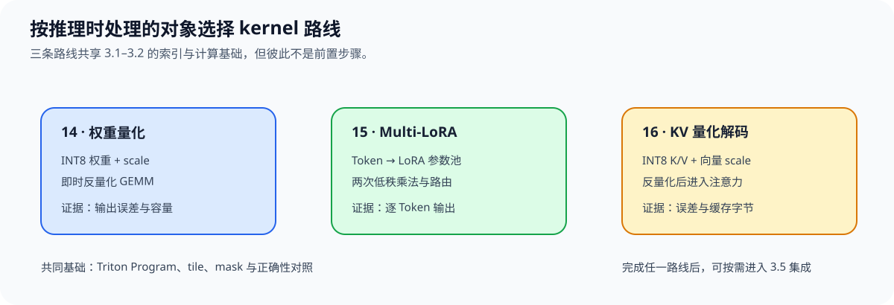

# Group 3.4: Inference-Side Triton Kernels | 3.4: 推理侧 Triton 内核

本组按推理时处理的对象分为三条实现路线：权重、按请求路由的 LoRA 适配器，以及 KV Cache 状态。三者共享 kernel 实现基础，但不是彼此的前置步骤。

## Group Asset Overview | 组内资产总览

| 页面 | 核心问题 | 实现与证据产物 | 在本组中的作用 |
|:---|:---|:---|:---|
| [14 权重量化](./14_Triton_Quantization.ipynb) | 量化权重如何参与 GEMM 计算？ | 与同一反量化权重的参考 GEMM 对照输出误差 | 权重路线 |
| [15 Multi-LoRA](./15_Triton_Multi_LoRA.ipynb) | 一个 batch 中不同 Token 如何选择 LoRA 参数？ | 动态路由输出与参考计算对照 | 适配器路线 |
| [16 KV Cache 量化](./16_Triton_KV_Cache_Quantized_Decode.ipynb) | 低比特 K/V 状态如何参与解码注意力？ | 解码输出误差与缓存容量对照 | KV 状态路线 |

## Learning Path | 学习路径

### Recommended Order | 推荐顺序

- **权重路线：** 阅读 [14](./14_Triton_Quantization.ipynb)，关注量化值、scale 与 GEMM 输出误差。
- **适配器路线：** 阅读 [15](./15_Triton_Multi_LoRA.ipynb)，关注词元到 LoRA 参数池的路由；该练习独立于权重量化。
- **KV 状态路线：** 阅读 [16](./16_Triton_KV_Cache_Quantized_Decode.ipynb)，关注缓存压缩和解码误差；需要理解量化值与缩放信息时可先看 [14 权重量化](./14_Triton_Quantization.ipynb)，再区分权重通道与 KV 向量的缩放索引。

### Next Steps | 后续衔接

- 需要把本组某条 kernel 路线接入 PyTorch 或模型组件时，进入 [3.5](./3_5.md)；不要求三条路线全部完成。

## Environment Notes | 环境说明

| 运行目标 | 环境与证据边界 |
|:---|:---|
| 14–16 kernel 正确性 | 需要 NVIDIA GPU、CUDA 可用的 PyTorch 与 Triton；环境创建和预检见[算子优化实验 Quickstart](../topic_discussion/operator_optimization/quickstart.md) |
| 推理收益判断 | 输出误差与缓存字节数不代表服务端延迟、吞吐或调度收益；需在对应推理后端另行验证 |
