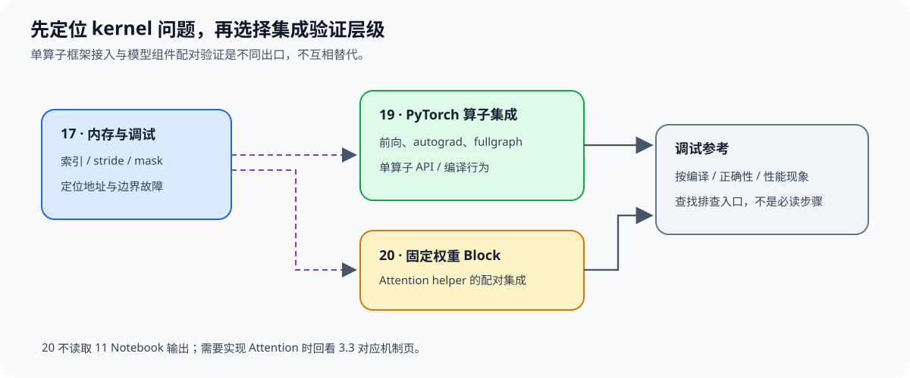

# Group 3.5: Debugging, Compilation and Integration | 3.5: 调试、编译与集成

本组分别检查 kernel 错误、编译产物和集成行为：17 定位内存与索引错误，18 连接源码、特化产物和真实 CUDA 事件。需要接入 PyTorch 时进入 19，检查自动微分与编译图；需要验证模型组件时进入 20，在固定权重 Block 中核对共享 Attention helper。20 不读取 11 Notebook 的执行结果。

## Group Asset Overview | 组内资产总览

| 页面 | 核心问题 | 实现与证据产物 | 在本组中的作用 |
|:---|:---|:---|:---|
| [17 内存模型与调试](./17_Triton_Memory_Model_and_Debug.ipynb) | 如何区分步长换算与尾块填值错误？ | 不同输入／输出布局、存储间隙及逐块点积核对 | 调试基础 |
| [18 编译产物与实际执行核对](./18_Triton_Compilation_Artifacts_and_Execution.ipynb) | 同一源码生成哪份特化代码，本次实际启动了哪份？ | 数值、产物摘要、对象启动记录、导出文件与 CUDA 入口核对 | 编译与执行身份核对 |
| [19 PyTorch 算子集成](./19_Triton_PyTorch_Op_Integration.ipynb) | Triton 算子如何接入 PyTorch、自动微分和编译图？ | 前向、梯度与 fullgraph 核对 | PyTorch 集成路线 |
| [20 LLaMA风格Block集成](./20_Triton_Llama3_Block_Project.ipynb) | 拆头、因果Attention和合头怎样保留组件含义，替换是否影响完整调用？ | 分段数值与目标路径核对；独立Step5配置、配对保存和读取 | 模型组件集成路线 |

## Learning Path | 学习路径

### Recommended Order | 推荐顺序

- **编译与执行：** 完成基础 kernel 后，从 [09 的编译／搜索／稳态区分](./09_Triton_Autotune_and_Profiling.ipynb) 进入[编译产物核对](./18_Triton_Compilation_Artifacts_and_Execution.ipynb)。该页独立构造输入，不要求先完成 Attention 或模型组件项目。
- **PyTorch 算子集成：** 需要核对自定义算子的前向、自动微分或编译图时，进入 [19](./19_Triton_PyTorch_Op_Integration.ipynb)；遇到索引/掩码错误时先用 [17](./17_Triton_Memory_Model_and_Debug.ipynb) 补足调试方法。
- **模型组件集成：** [20 Block集成](./20_Triton_Llama3_Block_Project.ipynb)提供共享Attention实现，练习布局适配、因果调用与分段核对；无需先运行11。独立Step5默认显示计划，新协议尚未登记实测；已有证据范围见[实验资产表](../topic_discussion/operator_optimization/experiment_assets.md)。修改Attention算法时再回看[3.3](./3_3.md)。
- **故障查找：** 地址、掩码与并发写入问题见 [17](./17_Triton_Memory_Model_and_Debug.ipynb)；结果正确但耗时异常时，先按 [09](./09_Triton_Autotune_and_Profiling.ipynb) 核对输入、预热和计时范围。

### Next Steps | 后续衔接

- 按项目或集成目标回看 [3.1](./3_1.md)–[3.4](./3_4.md) 中对应的布局、算子或推理 kernel；无需将四组全部重读。

## Environment Notes | 环境说明

| 运行目标 | 环境与证据边界 |
|:---|:---|
| 17、19、20 运行级核对 | 目标 Triton kernel 需要 NVIDIA GPU、CUDA 可用的 PyTorch 与 Triton；环境创建和预检见[算子优化实验 Quickstart](../topic_discussion/operator_optimization/quickstart.md) |
| 编译产物与实际执行核对 | 复用同一环境；额外需要 profiler 能采集 CUDA 活动。只有 CPU 标记或编译结果时，不能登记为设备路径通过；不要求 Nsight 硬件计数器 |
