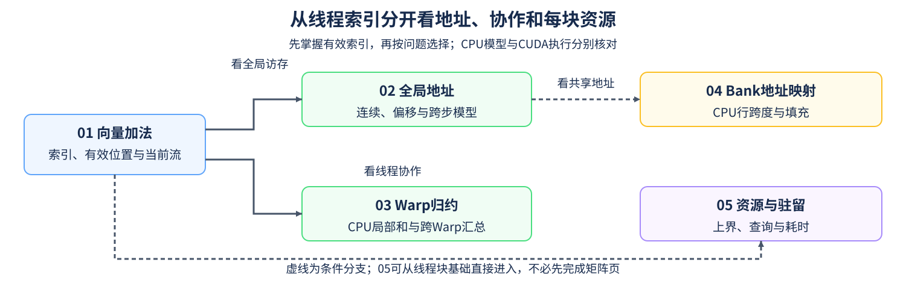

# Group 4.1: CUDA Execution, Memory Access and Resources | 4.1: CUDA 执行、访存与资源

同一批元素可以映射到不同线程地址，正确结果却不说明访问和资源安排同样有效。本组先用CUDA向量加法建立索引，再分别检查全局地址、Warp归约、共享内存Bank映射，以及每块资源对驻留的限制；其中Warp归约和Bank练习使用CPU模型，真实线程协作在后续内核中核对。

## Group Asset Overview | 组内资产总览

| 页面 | 核心问题 | 实现与证据产物 | 何时进入 |
|:---|:---|:---|:---|
| [01 CUDA向量加法](./01_CUDA_Custom_Kernel_Intro.ipynb) | 线程索引怎样覆盖有效输出？ | CUDA编译、向量数值、尾块及当前流核对 | 初次编写CUDA内核 |
| [02 全局内存合并访问](./02_CUDA_Global_Memory_Coalescing.ipynb) | 连续、偏移和跨步地址怎样覆盖sector？ | 给定地址模型；连续拷贝与尾部数值核对，不采集事务计数 | 需要解释全局访问方式 |
| [03 Warp原语](./03_Warp_Level_Primitives.ipynb) | Warp局部和怎样合成块级结果？ | CPU逐轮lane状态、部分Warp与两级汇总；不执行设备Shuffle | 需要理解归约与协作范围 |
| [04 Bank冲突](./04_Bank_Conflict_Deep_Dive.ipynb) | 行跨度与字地址怎样区分广播及不同字请求？ | CPU地址、Bank内字／lane分组与填充模型；不测硬件冲突计数 | 需要分析共享内存布局 |
| [05 资源与驻留](./05_CUDA_Block_Resources_and_Residency.ipynb) | 同一内核的资源预留怎样限制驻留？ | CPU上界、CUDA查询、数值与独立计时 | 需要区分容量预测和实际速度 |

## Learning Path | 学习路径

### Recommended Order | 推荐顺序

- 先读[01](./01_CUDA_Custom_Kernel_Intro.ipynb)，再按问题选择[02](./02_CUDA_Global_Memory_Coalescing.ipynb)的全局地址或[03](./03_Warp_Level_Primitives.ipynb)的归约协作；两条路径没有相互调用关系。
- 分析共享内存地址时进入[04](./04_Bank_Conflict_Deep_Dive.ipynb)，再到4.2观察真实分块复用。分析每块资源时，可在理解线程块和共享内存后直接进入[05](./05_CUDA_Block_Resources_and_Residency.ipynb)，不必先完成矩阵计算。
- 03／04的模型解释算法和地址条件；设备指令、同步和性能分别由相应实现与测量核对，不从CPU结果推断。

### Prerequisites | 按需前置

- [Part01·15 CUDA执行模型](../01_Hardware_Math_and_Systems/15_CUDA_Execution_Model.ipynb)：线程、Warp、Block与SM。
- [Part01·16 块内共享复用](../01_Hardware_Math_and_Systems/16_Warp_Block_SharedMemory_Basics.ipynb)：共享内存的协作范围与同步前提。

### Next Steps | 后续衔接

- 把线程映射扩展到输入子块复用时，进入[4.2](./4_2.md)；全局访存和协作也可与[Part03对应Triton内核](../03_Triton_Kernels/intro.md)比较。
- 在[算子优化路线](../topic_discussion/operator_optimization/intro.md)中，02／03／04按需支撑Task2，05支撑Task4的资源与配置分析。

## Environment Notes | 环境说明

| 运行目标 | 环境入口 | 条件 |
|:---|:---|:---|
| 03／04及05的CPU推导 | [基础环境](../docs/guide.md#base-cpu) | 不需要GPU或CUDA编译器 |
| 01／02／05的CUDA部分 | [算子环境与工具链检查](../topic_discussion/operator_optimization/quickstart.md#triton-environment) | NVIDIA GPU、CUDA PyTorch、本机Toolkit与主机编译器；PyTorch能用不代表工具链齐备 |
