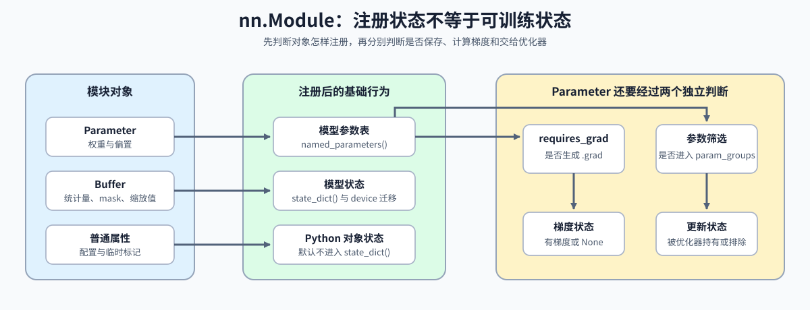

# 09. PyTorch nn Module Basics | PyTorch nn.Module 基础

**难度：** Medium | **环境：** CPU-first | **标签：** `PyTorch`, `模型封装`, `状态管理` | **目标人群：** 准备阅读模型定义与训练代码的学习者

> 🚀 **云端运行环境**
>
> 本章节的实战代码可以点击以下链接在免费 GPU 算力平台上直接运行：
>
> [](https://colab.research.google.com/github/datawhalechina/llm-algo-leetcode/blob/main/00_Prerequisites/09_PyTorch_nn_Module_Basics.ipynb)
> [](https://modelscope.cn/my/mynotebook) *(国内推荐：魔搭社区免费实例)*


## 本节导读

模型模块把参数、缓冲区、子模块、前向计算和运行模式组织成可递归组合的对象。初始化与注册方式决定状态能否参与更新、迁移和保存。

完成本节后，你应能区分参数、缓冲区和普通属性，检查初始化尺度，并判断冻结状态与模型注册状态是否一致。

**关键词：** `nn.Module`, `initialization`, `Parameter`, `train/eval`, `requires_grad`



## 前置阅读
**导语：** Tensor 与梯度进入模型对象后，参数注册决定优化器能够更新哪些状态。
- [08. PyTorch Grad Hygiene and No-Grad | PyTorch 梯度习惯与无梯度模式](./08_PyTorch_Grad_Hygiene_and_No_Grad.md)
- [0C 组页](./0C.md)

## Q1：如何把层和子模块组织成可调用的 `nn.Module`？

模型不是一组散落函数，而是可调用、可递归组合的对象。`__init__()` 注册参数和子模块，`forward()` 描述数据流，`model(x)` 通过模块调用入口触发前向；模块构造完成后，还需要为参数设置与层规模匹配的初始尺度。


```python
import torch
import torch.nn as nn


class SimpleLinear(nn.Module):
    def __init__(self, in_features, out_features):
        super().__init__()
        # `Parameter` 会被自动注册进模型参数里。
        self.weight = nn.Parameter(torch.empty(out_features, in_features))
        self.bias = nn.Parameter(torch.zeros(out_features))
        nn.init.xavier_uniform_(self.weight)

    def forward(self, x):
        # `forward()` 定义计算逻辑，真正调用时写 `model(x)`。
        return x @ self.weight.t() + self.bias


class TwoLayerMLP(nn.Module):
    def __init__(self, input_dim, hidden_dim, output_dim):
        super().__init__()
        # 子模块会递归参与参数注册和状态管理。
        self.fc1 = SimpleLinear(input_dim, hidden_dim)
        self.act = nn.GELU()
        self.fc2 = SimpleLinear(hidden_dim, output_dim)

    def forward(self, x):
        # 典型的模块组合：线性层 -> 激活 -> 线性层。
        return self.fc2(self.act(self.fc1(x)))


def count_parameters(module):
    """统计模块及其子模块中已注册参数的总元素数。"""
    return sum(param.numel() for param in module.parameters())


model = TwoLayerMLP(4, 8, 2)
print('参数总量：', count_parameters(model))
print('named_parameters：', [name for name, _ in model.named_parameters()])

```

## Q1 验证：参数注册、子模块和前向输出是否正确？

这里直接检查两件事：自定义层能不能跑，MLP 的输出 shape 和参数总量是否符合预期。


```python
def test_simple_linear():
    layer = SimpleLinear(2, 1)
    with torch.no_grad():
        layer.weight.copy_(torch.tensor([[2.0, -1.0]]))
        layer.bias.copy_(torch.tensor([0.5]))
    x = torch.tensor([[3.0, 4.0]])
    y = layer(x)
    assert torch.allclose(y, torch.tensor([[2.5]]))
    print('✅ SimpleLinear 通过')


def test_two_layer_mlp():
    model = TwoLayerMLP(4, 8, 2)
    x = torch.randn(3, 4)
    y = model(x)
    assert y.shape == (3, 2)
    expected_params = (4 * 8 + 8) + (8 * 2 + 2)
    assert count_parameters(model) == expected_params
    print('✅ TwoLayerMLP 通过')


test_simple_linear()
test_two_layer_mlp()

```

## Q2：参数初始化为什么需要同时考虑尺度与可复现性？

初始化决定训练开始时信号和梯度的尺度。线性层可根据输入、输出维度设置 Xavier 范围，bias 通常从零开始；固定随机种子则让同一初始化方案可复查。初始化策略仍应结合后续激活函数和残差结构选择。


```python
def reset_linear_parameters(layer, seed):
    """按 Xavier uniform 重置 CPU 线性层，并返回初始化尺度摘要。"""
    if not isinstance(layer, nn.Linear):
        raise TypeError('layer 必须是 nn.Linear')
    if not isinstance(seed, int) or seed < 0:
        raise ValueError('seed 必须是非负整数')
    generator = torch.Generator().manual_seed(seed)
    with torch.no_grad():
        nn.init.xavier_uniform_(layer.weight, generator=generator)
        if layer.bias is not None:
            nn.init.zeros_(layer.bias)
    bound = (6.0 / (layer.in_features + layer.out_features)) ** 0.5
    return {
        'fan_in': layer.in_features,
        'fan_out': layer.out_features,
        'xavier_bound': bound,
        'weight_std': float(layer.weight.std()),
    }


linear_a = nn.Linear(4, 8)
linear_b = nn.Linear(4, 8)
linear_c = nn.Linear(4, 8)
initialization = reset_linear_parameters(linear_a, seed=7)
reset_linear_parameters(linear_b, seed=7)
reset_linear_parameters(linear_c, seed=11)
print('初始化摘要：', initialization)

```

## Q2 验证：随机种子、Xavier 范围和 bias 起点是否正确？

相同种子应得到相同参数，不同种子应改变权重；所有权重应位于理论 Xavier 范围内，bias 从零开始。


```python
assert torch.equal(linear_a.weight, linear_b.weight)
assert not torch.equal(linear_a.weight, linear_c.weight)
assert torch.count_nonzero(linear_a.bias) == 0
assert float(linear_a.weight.abs().max()) <= initialization['xavier_bound'] + 1e-6
assert initialization['weight_std'] > 0
assert linear_a(torch.ones(2, 4)).shape == (2, 8)
print('✅ 参数初始化尺度与可复现性通过')

```

## Q3：`Parameter`、`buffer` 和普通属性分别会进入哪里？

阅读一个模块时，先用“是否训练、是否保存、是否随模块迁移”三件事判断对象的归属。参数只有交给优化器且具有梯度时才会更新；缓冲区默认保存，但可用 `persistent=False` 排除。

| 对象 | 会被优化器更新 | 进入 `state_dict()` | 随模块迁移 device | 常见用途 |
|:---|:---:|:---:|:---:|:---|
| `Parameter` | 已交给优化器且有梯度时 | 是 | 是 | 权重、偏置 |
| `buffer` | 否 | 默认保存 | 是 | mask、统计量、固定缩放值 |
| 普通属性 | 否 | 否 | 否 | 配置、名称、临时标记 |


```python
class ToyModule(nn.Module):
    def __init__(self):
        super().__init__()
        self.weight = nn.Parameter(torch.tensor([1.0]))
        # `buffer` 常用于 mask、统计量、缓存这类“要保存但不训练”的状态。
        self.register_buffer('scale', torch.tensor([2.0]))
        # 普通属性不会进入 state_dict，也不会随模块自动迁移到其他 device。
        self.name = 'toy'

    def forward(self, x):
        return x * self.weight * self.scale


m = ToyModule()
print('parameters：', [n for n, _ in m.named_parameters()])
print('buffers：', [n for n, _ in m.named_buffers()])
print('state_dict keys：', list(m.state_dict().keys()))

```

## Q3 验证：state_dict 是否同时包含参数和 buffer？

这里确认 `state_dict()` 会包含参数和 buffer，但不会把普通属性当成可保存状态。


```python
m = ToyModule()
keys = list(m.state_dict().keys())
assert 'weight' in keys
assert 'scale' in keys
assert 'name' not in keys
m.register_buffer('temporary_mask', torch.ones(1), persistent=False)
assert 'temporary_mask' in dict(m.named_buffers())
assert 'temporary_mask' not in m.state_dict()
print('✅ state_dict 结构通过')

```

## Q4：`train/eval` 与梯度模式分别控制什么？

`train()` 与 `eval()` 改变 Dropout、BatchNorm 等模块的运行行为，`torch.no_grad()` 控制是否记录计算图；两者解决不同问题。验证阶段通常同时使用 `model.eval()` 与 `torch.no_grad()`，训练阶段则恢复 `model.train()`。


```python
class ModeAwareBlock(nn.Module):
    def __init__(self):
        super().__init__()
        self.dropout = nn.Dropout(p=1.0)

    def forward(self, x):
        # 乘法确保 eval 路径也产生一个新结果，便于单独检查梯度模式。
        return self.dropout(x) * 1.0


mode_model = ModeAwareBlock()
mode_input = torch.ones(2, 3, requires_grad=True)
mode_model.train()
train_output = mode_model(mode_input)
mode_model.eval()
with torch.no_grad():
    eval_output = mode_model(mode_input)
print('train / eval output：', train_output, eval_output)

```

## Q4 验证：模块模式与梯度模式是否彼此独立？

训练态的 Dropout 会改变输出；验证态恢复确定性行为，而 `no_grad()` 额外保证验证输出不连接计算图。


```python
assert mode_model.training is False
assert torch.equal(train_output, torch.zeros_like(train_output))
assert torch.equal(eval_output, mode_input)
assert train_output.requires_grad
assert not eval_output.requires_grad
print('✅ train/eval 与梯度模式检查通过')

```

## Q5：冻结参数后，注册状态与可训练状态有什么不同？

`requires_grad=False` 只关闭该参数的梯度计算，不会把参数移出模块，也不会让它消失在 `state_dict()` 中。构造优化器时应显式筛选可训练参数，避免把“已注册”和“应更新”混为一谈。

| 检查维度 | 判断入口 | 冻结参数的结果 |
|:---|:---|:---|
| 是否注册 | `named_parameters()` | 仍然存在 |
| 是否保存 | `state_dict()` | 仍然保存 |
| 是否计算梯度 | `requires_grad` 与 `.grad` | 关闭，反向后 `.grad` 为 `None` |
| 是否交给优化器 | `optimizer.param_groups` | 取决于构造优化器时是否筛选 |


```python
def split_parameter_roles(module):
    """按 requires_grad 划分已注册参数，返回名称列表。"""
    trainable = []
    frozen = []
    for name, parameter in module.named_parameters():
        (trainable if parameter.requires_grad else frozen).append(name)
    return {'trainable': trainable, 'frozen': frozen}


model = TwoLayerMLP(4, 8, 2)
for parameter in model.fc1.parameters():
    parameter.requires_grad_(False)

roles = split_parameter_roles(model)
optimizer = torch.optim.SGD(
    [parameter for parameter in model.parameters() if parameter.requires_grad],
    lr=0.1,
)
print('parameter roles：', roles)

```

## Q5 验证：冻结参数是否仍被保存但不产生梯度？

冻结后的 `fc1` 仍应出现在参数注册表和 `state_dict()` 中；反向传播后它没有梯度，本例的优化器也只持有 `fc2` 的可训练参数。


```python
x = torch.randn(3, 4)
loss = model(x).pow(2).mean()
loss.backward()

assert roles['frozen'] == ['fc1.weight', 'fc1.bias']
assert roles['trainable'] == ['fc2.weight', 'fc2.bias']
assert {'fc1.weight', 'fc1.bias'} <= dict(model.named_parameters()).keys()
assert {'fc1.weight', 'fc1.bias'} <= set(model.state_dict())
assert all(parameter.grad is None for parameter in model.fc1.parameters())
assert all(parameter.grad is not None for parameter in model.fc2.parameters())
assert sum(len(group['params']) for group in optimizer.param_groups) == 2
print('✅ 冻结与可训练参数语义通过')

```

## 相关阅读

模块对象建立后，下一页继续处理状态的序列化、恢复和结构迁移。

- [10. PyTorch State, Checkpoint, and Recovery | PyTorch 状态、Checkpoint 与恢复](./10_PyTorch_State_dict_and_Persistence.md)
