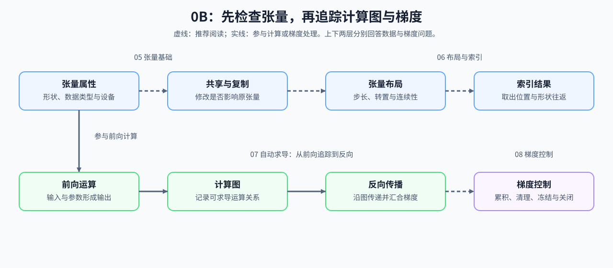

# Group 0B: PyTorch Tensors and Autograd | 0B: PyTorch 张量与自动求导

本组把 Python / NumPy 的数组表达转换为 PyTorch Tensor、layout 和 Autograd 操作。学习者将用 dtype、device、共享存储、shape、索引、计算图和梯度状态阅读基础算子与训练代码，并能定位输入契约、布局或梯度路径中的问题。

## Group Overview | 组概览

05 建立 Tensor 的 shape、dtype、device 与存储语义；随后进入 06 的 layout / indexing 和 07 的 Autograd，最后用 08 管理梯度累积、图切断、推理模式与参数冻结。系统学习按 05 → 06 → 07 → 08；若要尽快进入 Part 2，优先完成 06、07，再按问题回查 05、08。

## Group Asset Overview | 组内资产总览

| 页 | 核心职责 | Q 数 | 验证数 | 覆盖 Q | 定位 |
|:---|:---|:---:|:---:|:---|:---|
| [05](./05_PyTorch_Tensor_Fundamentals.md) | Tensor 属性、共享存储、dtype/device 转换与索引契约 | 4 | 4 | Q1, Q2, Q3, Q4 | 起步页 |
| [06](./06_PyTorch_Tensor_Layout_and_Indexing.md) | layout、连续化、mask、查表与 head 输入整理 | 5 | 5 | Q1, Q2, Q3, Q4, Q5 | 布局与索引 |
| [07](./07_PyTorch_Autograd_and_Backward.md) | 计算图、VJP、保存张量、自定义反向与分支梯度汇合 | 6 | 6 | Q1–Q6 | 核心页 |
| [08](./08_PyTorch_Grad_Hygiene_and_No_Grad.md) | 梯度模式、清理、切断与参数冻结 | 4 | 4 | Q1, Q2, Q3, Q4 | 梯度控制 |

## Next Steps | 后续衔接

- 完成本组后进入 [0C](./0C.md)，把 Tensor、计算图和梯度控制接到 `nn.Module`、Optimizer 与 Loss；遇到模型定义或训练循环问题时，可回看 06 和 07。NumPy 学习者优先回看 05 和 06，Python 学习者可先回看 0A 的对象与维度表达。

## Environment Notes | 环境说明

- 默认按 `CPU-first` 阅读，优先把 Tensor、layout 和计算图关系看懂；单页如有额外环境要求，以页面说明为准。
