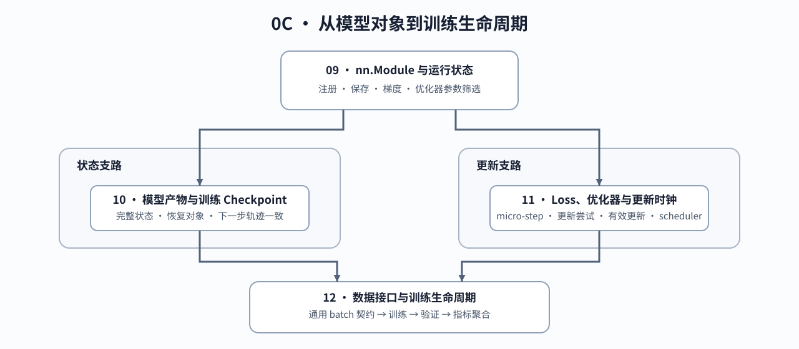

# Group 0C: PyTorch Model and Training Lifecycle | 0C: PyTorch 模型与训练生命周期

## Group Overview | 组概览

参数出现在模型中，并不意味着它一定被更新；保存了权重，也不意味着能从同一进度继续训练。本组从模块注册出发，分别检查保存恢复和参数更新，再用批次输入连接训练、验证与评价。

## Group Asset Overview | 组内资产总览

| 页面 | 要回答的问题 | 运行时观察什么 |
|:---|:---|:---|
| [09 模型模块](./09_PyTorch_nn_Module_Basics.md) | 参数、缓冲区和普通属性怎样参与保存、迁移与梯度计算？ | 注册字段、初始化、运行模式与冻结参数 |
| [10 状态保存与恢复](./10_PyTorch_State_dict_and_Persistence.md) | 模型状态与训练检查点各需保存什么？ | 独立快照、加载差异、早停状态与恢复后的下一步更新 |
| [11 损失与优化器](./11_PyTorch_Optimizers_and_Loss.md) | 梯度累积、更新尝试与学习率推进怎样对齐？ | 参数变化、优化器状态、跳过更新与调度器步数 |
| [12 数据接口与训练](./12_PyTorch_Minimal_Training_Interface.md) | 单样本怎样成为批次，并用于训练、验证和评价？ | 输入与监督位置、独立验证样本和按样本汇总的指标 |

## Learning Path | 学习路径

### Recommended Order | 推荐顺序

先读 09，再分别进入 10 的保存恢复和 11 的参数更新，最后读 12。恢复训练时，模型、优化器、调度器、随机状态、训练进度和验证状态必须对应同一保存时刻；具体保存与续跑检查在 10 展开。

### Next Steps | 后续衔接

- 观察模型内部组件，进入 [0D Transformer Block 与模型组件](./0D.md)。
- 推导梯度尺度与有效更新，进入[反向传播与训练机制](../topic_discussion/backpropagation_training_mechanism/intro.md)。
- 构造提示—回答监督标签，进入 [Part 02 · SFT 训练循环](../02_PyTorch_Algorithms/13_SFT_Training_Loop.md)。

## Environment Notes | 环境说明

使用 [`BASE-CPU`](../guide.md#base-cpu)，用小张量检查接口、状态与训练过程。
