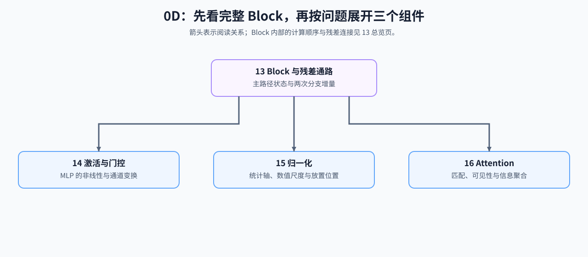

# Group 0D: Transformer Block Dataflow and Component Basics | 0D: Transformer Block 数据流与组件基础

本组建立单个 Transformer Block 的前向数据流。13 先给出 residual stream 和两次分支更新，14–16 再分别解释 MLP 非线性、归一化统计和 Attention 信息聚合。四节共同回答一个基础问题：不同组件怎样在保持 `[B, S, H]` 外部契约的同时更新 hidden state。

## Group Overview | 组概览

Embedding 在 Block stack 之前把 token IDs 映射为 hidden states。进入 Block 后，Norm 控制分支读取尺度，Attention 形成 token-mixing 更新，MLP 形成 channel-mixing 更新；两个分支依次写回同一条 residual stream。

| 对象 | 局部职责 | 输入输出契约 | 主要归属 |
|:---|:---|:---|:---|
| Residual stream | 保存并传递 Block 主路径状态 | `[B, S, H] → [B, S, H]` | 13 |
| MLP / activation | 逐 token 执行通道扩张、非线性或门控，再恢复 hidden 维 | `H → H_ffn → H` | 14 |
| Norm | 确定统计轴、缩放公式和 residual 中的放置位置 | `[B, S, H] → [B, S, H]` | 15 |
| Attention | 根据 Q/K 匹配和 mask 聚合 V，再合并多头布局 | `[B, S, H] → [B, S, H]` | 16 |

## Group Asset Overview | 组内资产总览

| 页 | 核心问题 | 验证出口 | 后续承接 |
|:---|:---|:---|:---|
| [13](./13_Transformer_Block_Dataflow_and_Residual_Stream.md) | 主路径和两个分支更新怎样组成一个 Block | shape、增量写回、层间状态推进 | Block 组装与深层稳定性 |
| [14](./14_Activation_Functions.md) | 激活与门控怎样进入 MLP 分支 | 输出、局部梯度、Dense/Gated FFN shape | SwiGLU 与 FFN 演进 |
| [15](./15_Normalization_Techniques.md) | 统计轴、公式和 residual 位置有何差异 | train/eval、`eps`、LayerNorm/RMSNorm、Pre/Post-Norm | 归一化演进 |
| [16](./16_Attention_Mechanism_Intro.md) | QKV、mask 与多头布局怎样形成 token 聚合 | 最小闭环、可见性、shape、序列边界 | MHA/GQA、RoPE、KV Cache |

## Learning Path | 学习路径

### Recommended Order | 推荐顺序

按编号阅读即可：

1. [13](./13_Transformer_Block_Dataflow_and_Residual_Stream.md)：先建立 Block 和 residual stream 总图。
2. [14](./14_Activation_Functions.md)：理解第二个分支中的非线性与门控 FFN。
3. [15](./15_Normalization_Techniques.md)：补齐两个分支入口处的统计控制。
4. [16](./16_Attention_Mechanism_Intro.md)：展开第一个分支中的匹配、可见性与聚合。

13 提供共同骨架，14–16 分别展开三个组件视角。它们在 Part 02 的 RMSNorm、SwiGLU、Attention 与 LLaMA Block 页面重新汇合。

### Connection to Later Topics | 后续专题衔接

| 后续问题 | 进入位置 |
|:---|:---|
| RMSNorm、SwiGLU、GQA 和 residual 设计为什么演进 | [大模型架构演进](../topic_discussion/llm_architecture_evolution/intro.md) |
| 局部反向依赖、保存状态与深层梯度 | [反向传播与训练机制](../topic_discussion/backpropagation_training_mechanism/intro.md) |
| Attention、Norm、MLP 的真实实现与 Block 组装 | Part 02 的 01–05 机制页 |
| 组件的时间、显存、内核与推理状态代价 | [性能分析](../topic_discussion/performance_analysis/intro.md)、[推理优化](../topic_discussion/inference_optimization/intro.md) |

## Environment Notes | 环境说明

- 全组为 `CPU-first`，使用小张量验证数据流、局部公式和 shape contract。
- 本组不通过小规模前向结果判断架构优劣、训练稳定性或真实执行性能。
