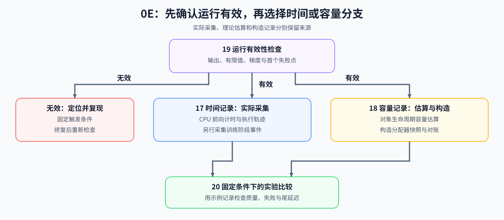

# Group 0E: Runtime Diagnostics and Experiment Foundations | 0E: 运行诊断与实验基础

## Group Overview | 组概览

先判断运行是否有效，再解释耗时与容量。19 定位错误和非有限值；17 实际采集 CPU 计时与阶段事件；18 估算对象容量，并使用构造的分配器快照练习对账；20 练习固定条件下的比较与判断。

## Learning Entries | 组内学习入口

| 页面 | 何时进入 | 运行时得到什么 |
|:---|:---|:---|
| [19 调试与异常定位](./19_Debugging_and_Anomaly_Localization.md) | 报错、非有限值、输出或梯度异常 | 异常类别、首个失败点与最小复现 |
| [17 性能分析基础](./17_PyTorch_Profiling_Basics.md) | 运行有效，但耗时异常 | 实际 CPU 前向计时与执行轨迹，以及另行采集的训练阶段事件 |
| [18 显存账本与运行时证据](./18_Memory_Profiling_and_Optimization.md) | 容量不足，或不清楚哪些对象同时存在 | 生命周期容量估算、构造快照与估算差额 |
| [20 性能证据与实验设计](./20_Performance_Evidence_and_Experiment_Design.md) | 需要比较改动或判断回归 | 基于示例记录的质量、失败率、尾延迟与复测判断 |

## Learning Path | 学习路径

### Recommended Order | 推荐顺序

完整阅读按 19 → 17 → 18 → 20；按问题排查时，运行有效后选择时间或容量分支，再进入 20 比较结果。17 的实际计时、18 的理论估算与构造快照、20 的示例记录分别保留来源，不能当作同一次 GPU 实验的测量结果。

### Next Steps | 后续衔接

- 分析时间线、对象驻留和瓶颈，进入[性能分析专题](../topic_discussion/performance_analysis/intro.md)。
- 将计算量、字节数与耗时联系起来，进入 [Part 01 · 性能分析与瓶颈定位](../01_Hardware_Math_and_Systems/13_Profiling_and_Bottleneck_Analysis.md)。
- 根据诊断选择和复测改动，进入[性能优化专题](../topic_discussion/performance_optimization/intro.md)。

## Environment Notes | 环境说明

使用 [`BASE-CPU`](../guide.md#base-cpu) 完成本组练习。真实 CUDA 时间与分配器峰值由后续实验采集，环境按目标页面说明准备。
