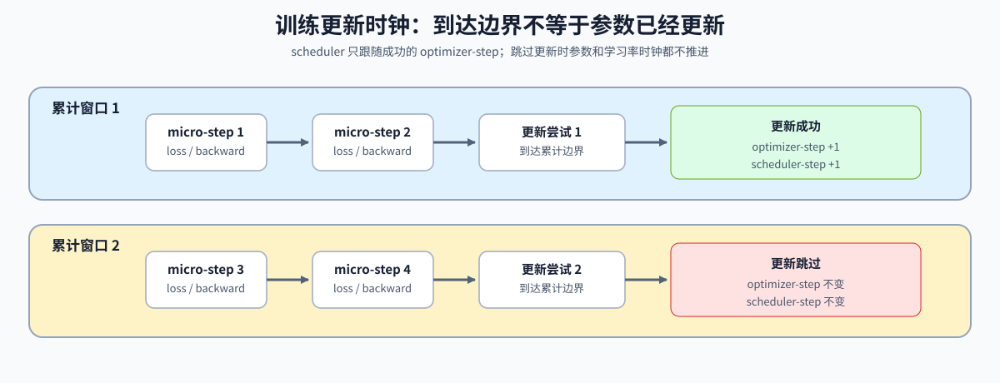

# 11. PyTorch Optimizers and Loss | PyTorch 优化器与损失函数

**难度：** Medium | **环境：** CPU-first | **标签：** `PyTorch`, `损失函数`, `优化器` | **目标人群：** 准备理解训练更新机制的学习者

> 🚀 **云端运行环境**
>
> 本章节的实战代码可以点击以下链接在免费 GPU 算力平台上直接运行：
>
> [](https://colab.research.google.com/github/datawhalechina/llm-algo-leetcode/blob/main/00_Prerequisites/11_PyTorch_Optimizers_and_Loss.ipynb)
> [](https://modelscope.cn/my/mynotebook) *(国内推荐：魔搭社区免费实例)*


## 本节导读

损失函数把任务目标转换为可求导标量，优化器再把梯度、学习率和内部状态组合成参数更新。不同更新规则会保存不同状态并产生不同参数轨迹。

完成本节后，你应能手算一次基本更新，解释优化器状态的作用，并判断梯度累计、参数更新和学习率推进是否位于正确时刻。

**关键词：** `loss`, `SGD`, `AdamW`, `optimizer step`, `scheduler`



## 前置阅读
**导语：** 参数必须先注册到模型，反向传播也必须已经产生梯度，优化器才能执行更新。
- [09. PyTorch nn.Module Basics | PyTorch nn.Module 基础](./09_PyTorch_nn_Module_Basics.md)
- [08. PyTorch Grad Hygiene and No-Grad | PyTorch 梯度控制](./08_PyTorch_Grad_Hygiene_and_No_Grad.md)
- [0C 组页](./0C.md)

## Q1：loss 和 optimizer 分别解决什么问题？

回归和分类使用不同的目标契约，但都必须把一个 batch 的误差归约成标量，才能从该标量启动反向传播。优化器不定义任务目标，只消费参数上的梯度。


```python
import torch
import torch.nn as nn
import torch.nn.functional as F


def mse_loss(pred, target):
    # 回归任务里，loss 通常就是把误差压成一个标量。
    return torch.mean((pred - target) ** 2)


def cross_entropy_loss(logits, target):
    # 分类任务里，logits 是未归一化分数，target 是类别 id。
    return F.cross_entropy(logits, target)


pred = torch.tensor([[1.0, 3.0], [2.0, 4.0]])
target = torch.tensor([[1.0, 1.0], [3.0, 5.0]])
print('MSE 示例：', mse_loss(pred, target).item())

logits = torch.tensor([[2.0, 0.5], [0.1, 1.2]])
labels = torch.tensor([0, 1])
print('CrossEntropy 示例：', cross_entropy_loss(logits, labels).item())

```

## Q1 验证：基本 loss 的数值是否正确？

这里直接检查 MSE 和交叉熵的调用是否返回预期数值。


```python
pred = torch.tensor([[1.0, 3.0], [2.0, 4.0]])
target = torch.tensor([[1.0, 1.0], [3.0, 5.0]])
loss = mse_loss(pred, target)
assert torch.allclose(loss, torch.tensor(1.5))

logits = torch.tensor([[2.0, 0.5], [0.1, 1.2]])
labels = torch.tensor([0, 1])
ce = cross_entropy_loss(logits, labels)
assert torch.allclose(ce, F.cross_entropy(logits, labels))
print('✅ loss 基本验证通过')

```

## Q2：SGD 的一次参数更新由哪些量决定？

最基础的 SGD 更新由当前参数、梯度和学习率决定；加入 momentum 后，优化器还要保存跨 step 的动量状态。先把手算结果与 PyTorch 更新对齐，才能分清参数、梯度与 optimizer state。


```python
def manual_sgd_step(parameter, gradient, learning_rate):
    """计算不含 momentum 和 weight decay 的一次 SGD 更新。"""
    return parameter - learning_rate * gradient


weight = nn.Parameter(torch.tensor([2.0]))
weight.grad = torch.tensor([3.0])
optimizer = torch.optim.SGD([weight], lr=0.1)
expected = manual_sgd_step(weight.detach(), weight.grad, learning_rate=0.1)
optimizer.step()
print('更新后参数：', weight.item(), '手算结果：', expected.item())

```

## Q2 验证：PyTorch SGD 是否与手算更新一致？

无 momentum 时，两条更新路径应得到相同参数；启用 momentum 后，optimizer state 中应出现跨 step 保存的缓冲区。


```python
weight = nn.Parameter(torch.tensor([2.0]))
weight.grad = torch.tensor([3.0])
optimizer = torch.optim.SGD([weight], lr=0.1)
optimizer.step()
assert torch.allclose(weight.detach(), torch.tensor([1.7]))
assert optimizer.state_dict()['state'] == {}

momentum_weight = nn.Parameter(torch.tensor([2.0]))
momentum_optimizer = torch.optim.SGD([momentum_weight], lr=0.1, momentum=0.9)
momentum_weight.grad = torch.tensor([3.0])
momentum_optimizer.step()
state = momentum_optimizer.state[momentum_weight]
assert 'momentum_buffer' in state
print('✅ SGD 更新与 momentum state 通过')

```

## Q3：AdamW 为什么需要保存一阶、二阶矩状态？

AdamW 不只读取当前梯度，还维护梯度的一阶矩与二阶矩估计，并独立应用 weight decay。这些状态解释了为什么完整 checkpoint 必须保存 optimizer state，也解释了优化器状态为何会增加训练内存。


```python
parameter = nn.Parameter(torch.tensor([1.0, -1.0]))
optimizer = torch.optim.AdamW([parameter], lr=0.01, weight_decay=0.1)
for gradient in (torch.tensor([0.5, -0.25]), torch.tensor([0.25, -0.5])):
    optimizer.zero_grad(set_to_none=True)
    parameter.grad = gradient.clone()
    optimizer.step()

state = optimizer.state[parameter]
print('AdamW state keys：', sorted(state.keys()))
print('step：', state['step'].item())

```

## Q3 验证：AdamW 状态是否随 optimizer step 更新？

连续执行两个 step 后，步数、一阶矩和二阶矩都应存在，而且状态 shape 应与参数一致。


```python
assert int(state['step'].item()) == 2
assert state['exp_avg'].shape == parameter.shape
assert state['exp_avg_sq'].shape == parameter.shape
assert torch.count_nonzero(state['exp_avg']) == parameter.numel()
assert torch.count_nonzero(state['exp_avg_sq']) == parameter.numel()
print('✅ AdamW optimizer state 通过')

```

## Q4：micro-batch、optimizer step 与 scheduler step 如何对齐？

梯度可以跨多个 micro-batch 累积，但到达累计边界只表示发起一次更新尝试。只有参数更新成功时，optimizer-step 和 scheduler-step 才同时推进。本例各 micro-batch 样本数相同，最后一个窗口不足累计步数时，按实际窗口大小缩放损失；样本数不同时应按样本数加权。代码用给定布尔序列演示更新成功或跳过，并不检测真实混合精度溢出。

| 时钟 | 何时推进 | 代表什么 |
|:---|:---|:---|
| micro-step | 每消费一个 micro-batch | 数据与反向传播进度 |
| update attempt | 到达累计窗口边界 | 尝试应用当前累计梯度 |
| optimizer-step | 执行一次未跳过的优化器更新 | 有效更新次数；零梯度时参数也可能不变 |
| scheduler-step | optimizer-step 成功之后 | 学习率计划与有效更新对齐 |


```python
def run_accumulated_updates(
    model, batches, optimizer, scheduler, accumulation_steps, update_success_pattern
):
    """按累计边界执行 optimizer 与 scheduler，并返回可核对的时间线。"""
    if accumulation_steps <= 0:
        raise ValueError('accumulation_steps must be positive')
    optimizer.zero_grad(set_to_none=True)
    timeline = []
    optimizer_steps = 0
    update_attempts = 0
    total_micro_steps = len(batches)
    for micro_step, (x, target) in enumerate(batches, start=1):
        window_start = ((micro_step - 1) // accumulation_steps) * accumulation_steps
        window_size = min(accumulation_steps, total_micro_steps - window_start)
        loss = mse_loss(model(x), target) / window_size
        loss.backward()
        reaches_boundary = micro_step % accumulation_steps == 0 or micro_step == len(batches)
        update_succeeded = None
        if reaches_boundary:
            if update_attempts >= len(update_success_pattern):
                raise ValueError('update_success_pattern is shorter than update attempts')
            update_succeeded = bool(update_success_pattern[update_attempts])
            update_attempts += 1
            if update_succeeded:
                optimizer.step()
                scheduler.step()
                optimizer_steps += 1
            optimizer.zero_grad(set_to_none=True)
        timeline.append({
            'micro_step': micro_step,
            'update_attempt': reaches_boundary,
            'update_succeeded': update_succeeded,
            'optimizer_step': optimizer_steps,
            'learning_rate': optimizer.param_groups[0]['lr'],
            'window_size': window_size,
        })
    return timeline


model = nn.Linear(1, 1)
optimizer = torch.optim.SGD(model.parameters(), lr=0.1)
scheduler = torch.optim.lr_scheduler.StepLR(optimizer, step_size=1, gamma=0.5)
batches = [(torch.tensor([[float(i)]]), torch.tensor([[2.0 * i + 1.0]])) for i in range(1, 6)]
timeline = run_accumulated_updates(
    model, batches, optimizer, scheduler, accumulation_steps=2,
    update_success_pattern=[True, False, True],
)
print(timeline)

```

## Q4 验证：scheduler 是否只在参数更新后推进？

五个 micro-batch、每两个累计一次，会形成三次更新尝试；第二次尝试被跳过，因此只产生两次 optimizer-step 和两次 scheduler-step。最后一个窗口只有一个 micro-batch，其 loss 不再额外除以 2。


```python
assert [item['update_attempt'] for item in timeline] == [False, True, False, True, True]
assert [item['update_succeeded'] for item in timeline] == [None, True, None, False, True]
assert [item['optimizer_step'] for item in timeline] == [0, 1, 1, 1, 2]
assert [item['window_size'] for item in timeline] == [2, 2, 2, 2, 1]
assert timeline[0]['learning_rate'] == 0.1
assert timeline[1]['learning_rate'] == 0.05
assert timeline[3]['learning_rate'] == 0.05
assert timeline[4]['learning_rate'] == 0.025
assert all(parameter.grad is None for parameter in model.parameters())
print('✅ micro-batch / optimizer / scheduler 对齐通过')

```

## Q5：为什么优化器需要 parameter groups？

同一模型中的参数不一定共享更新规则。常见做法是对矩阵权重应用 weight decay，而让 bias 与归一化参数使用零衰减；parameter groups 把参数集合和各自的学习率、衰减系数绑定在一起。


```python
weight = nn.Parameter(torch.tensor([1.0]))
bias = nn.Parameter(torch.tensor([1.0]))
optimizer = torch.optim.AdamW([
    {'params': [weight], 'weight_decay': 0.1},
    {'params': [bias], 'weight_decay': 0.0},
], lr=0.1)

# 零梯度隔离了 weight decay 的影响，便于直接观察两组规则。
weight.grad = torch.zeros_like(weight)
bias.grad = torch.zeros_like(bias)
optimizer.step()
print('weight / bias：', weight.item(), bias.item())

```

## Q5 验证：不同参数组是否执行了不同衰减规则？

两组共享学习率，但只有 weight 所在组启用衰减；在零梯度条件下，weight 应缩小而 bias 保持不变。


```python
assert len(optimizer.param_groups) == 2
assert optimizer.param_groups[0]['weight_decay'] == 0.1
assert optimizer.param_groups[1]['weight_decay'] == 0.0
assert torch.allclose(weight.detach(), torch.tensor([0.99]))
assert torch.allclose(bias.detach(), torch.tensor([1.0]))
print('✅ parameter groups 与 weight decay 规则通过')

```

## 相关阅读

掌握更新规则后，继续检查批次如何形成，以及更新规则如何进入完整训练循环。

- [12. PyTorch Data Interface and Training Lifecycle | PyTorch 数据接口与训练生命周期](./12_PyTorch_Minimal_Training_Interface.md)
