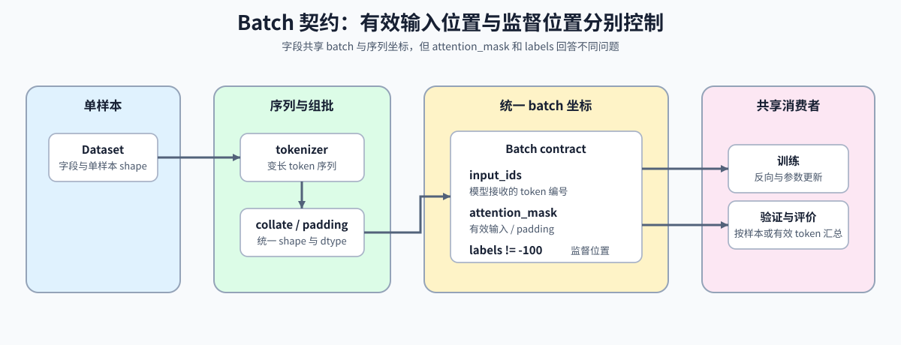

# 12. PyTorch Minimal Training Interface | PyTorch 数据接口与训练生命周期

**难度：** Medium | **环境：** CPU-first | **标签：** `PyTorch`, `batch 契约`, `训练生命周期` | **目标人群：** 准备把数据入口与模型更新接成训练闭环的学习者

> 🚀 **云端运行环境**
>
> 本章节的实战代码可以点击以下链接在免费 GPU 算力平台上直接运行：
>
> [](https://colab.research.google.com/github/datawhalechina/llm-algo-leetcode/blob/main/00_Prerequisites/12_PyTorch_Minimal_Training_Interface.ipynb)
> [](https://modelscope.cn/my/mynotebook) *(国内推荐：魔搭社区免费实例)*


## 本节导读

训练生命周期从原始样本开始，经过分词、批次组装、模型计算、损失、反向传播和参数更新，最后进入独立验证与指标评价。任一接口不一致都会使错误沿后续阶段传播。

完成本节后，你应能追踪单样本如何成为模型输入，检查训练与验证边界，并确认评价指标按完整样本集合汇总。

**关键词：** `Dataset`, `DataLoader`, `batch contract`, `train/validate`, `evaluation metrics`



## 前置阅读
**导语：** 先回顾优化器与损失函数如何消费模型输出，再从本页建立训练循环的数据入口。
- [11. PyTorch Optimizers and Loss | PyTorch 优化器与损失函数](./11_PyTorch_Optimizers_and_Loss.md)
- [0C 组页](./0C.md)

## Q1：Dataset 和 DataLoader 分别解决什么问题？

`Dataset` 定义单样本字段，`DataLoader` 负责采样、组批与迭代。样本级逻辑和 batch 级逻辑分开后，`attention_mask`、`labels`、`position_ids` 等字段才能在明确的位置生成和校验。


```python
import torch
import torch.nn as nn
from torch.utils.data import Dataset, DataLoader


class ToyDataset(Dataset):
    def __init__(self, sample_ids=(0, 1, 2, 3)):
        self.sample_ids = tuple(sample_ids)

    def __len__(self):
        return len(self.sample_ids)

    def __getitem__(self, idx):
        idx = self.sample_ids[idx]
        # 样本编号决定输入和标签，训练与验证使用不同编号。
        return {
            'input_ids': torch.tensor([idx], dtype=torch.long),
            'attention_mask': torch.tensor([1], dtype=torch.long),
            'labels': torch.tensor([idx % 2], dtype=torch.long),
        }


loader = DataLoader(ToyDataset(), batch_size=2, shuffle=False)
for batch in loader:
    print('batch keys:', list(batch.keys()))
    print('input_ids shape:', batch['input_ids'].shape, 'labels shape:', batch['labels'].shape)

```

## Q1 验证：batch 输出 shape 是否稳定？

这里直接确认 `DataLoader` 取出来的 batch 维度是否符合预期。你要记住的是，batch 不一定总是 tuple，dict batch 在大模型训练里更常见。


```python
loader = DataLoader(ToyDataset(), batch_size=2, shuffle=False)
batches = list(loader)
assert len(batches) == 2
batch = batches[0]
assert batch['input_ids'].shape == (2, 1)
assert batch['attention_mask'].shape == (2, 1)
assert batch['labels'].shape == (2, 1)
print('✅ Dataset / DataLoader 通过')

```

## Q2：`collate_fn` 怎样把单样本组织成 batch？

`Dataset` 返回单样本，`collate_fn` 决定同一批样本如何按字段堆叠。输出必须明确字段名、batch 维和 dtype，训练循环才能稳定解包。


```python
def collate_pair(batch):
    # 自定义 collate 时，先把单样本拆开，再按当前任务需求重组。
    # torch.stack 新增 batch 维，同时保留每条样本原有的序列维。
    input_ids = torch.stack([item['input_ids'] for item in batch], dim=0)
    attention_mask = torch.stack([item['attention_mask'] for item in batch], dim=0)
    labels = torch.stack([item['labels'] for item in batch], dim=0)
    return {
        'input_ids': input_ids,
        'attention_mask': attention_mask,
        'labels': labels,
    }


loader = DataLoader(ToyDataset(), batch_size=2, shuffle=False, collate_fn=collate_pair)
for batch in loader:
    print('collate 后 keys:', list(batch.keys()))
    print('input_ids:', batch['input_ids'].tolist(), 'labels:', batch['labels'].tolist())

```

## Q2 验证：自定义 collate 是否保留了 batch 与序列维？

自定义 `collate_fn` 仍应得到 `[batch, sequence]`，不能在组批时把单样本的序列维压平。


```python
loader = DataLoader(ToyDataset(), batch_size=2, shuffle=False, collate_fn=collate_pair)
batch = next(iter(loader))
assert batch['input_ids'].shape == (2, 1)
assert batch['attention_mask'].shape == (2, 1)
assert batch['labels'].shape == (2, 1)
print('✅ collate_fn 通过')

```

## Q3：变长 tokenizer 输出怎样成为统一 batch？

tokenizer 把文本变成不同长度的 token 序列；batch 层再完成截断、补齐和字段派生。三类字段承担不同职责：`input_ids` 保存 token 编号，`attention_mask` 区分有效 token 与 padding，`labels` 指定哪些位置参与损失。下面从 tokenizer 输出开始，验证长度对齐、padding mask 和 labels 屏蔽是否满足训练接口契约。

```python
PAD_ID = 0
BOS_ID = 1
EOS_ID = 2


def tokenize_for_contract(text, max_length):
    """生成确定性的 token 序列，用于演示截断契约而非复现真实分词算法。"""
    content_ids = [10 + (ord(char) % 50) for char in text]
    token_ids = [BOS_ID, *content_ids, EOS_ID]
    return token_ids[:max_length]


def collate_tokenized_texts(texts, max_length):
    """将变长 tokenizer 输出整理为 input_ids、attention_mask 与 labels。"""
    tokenized = [tokenize_for_contract(text, max_length) for text in texts]
    batch_length = max(len(token_ids) for token_ids in tokenized)

    input_rows = []
    mask_rows = []
    label_rows = []
    for token_ids in tokenized:
        pad_length = batch_length - len(token_ids)
        input_rows.append(token_ids + [PAD_ID] * pad_length)
        mask_rows.append([1] * len(token_ids) + [0] * pad_length)
        label_rows.append(token_ids + [-100] * pad_length)

    return {
        'input_ids': torch.tensor(input_rows, dtype=torch.long),
        'attention_mask': torch.tensor(mask_rows, dtype=torch.long),
        'labels': torch.tensor(label_rows, dtype=torch.long),
    }


tokenized_batch = collate_tokenized_texts(['batch', 'io'], max_length=6)
print({key: value.tolist() for key, value in tokenized_batch.items()})
```

## Q3 验证：截断、padding 与忽略标签是否使用同一坐标？

三个字段应具有相同 shape；padding 位置的 `attention_mask` 为 0，对应 `labels` 必须为 `-100`。


```python
assert tuple(tokenized_batch['input_ids'].shape) == (2, 6)
assert tokenized_batch['input_ids'].shape == tokenized_batch['attention_mask'].shape == tokenized_batch['labels'].shape
assert torch.equal(tokenized_batch['attention_mask'].eq(0), tokenized_batch['labels'].eq(-100))
assert tokenized_batch['attention_mask'][1].tolist() == [1, 1, 1, 1, 0, 0]
print('✅ tokenizer 输出与 padding 契约通过')

```

## Q4：有效输入位置与监督位置为什么需要分别表示？

`attention_mask` 说明哪些位置属于有效输入，`labels != -100` 说明哪些位置参与损失。一个有效输入位置可以提供上下文但不直接贡献监督，因此两种 mask 不能互相替代。

| 字段或条件 | 控制对象 | 典型取值 |
|:---|:---|:---|
| `attention_mask` | 位置是否属于有效输入 | 有效位置为 1，padding 为 0 |
| `labels` | 每个位置的目标值 | 目标编号或 `-100` |
| `labels != -100` | 位置是否贡献监督损失 | 由任务的数据契约决定 |


```python
def pad_to_max_len(tensors, pad_value):
    # 先按最长样本补齐，再把 batch 维堆起来。
    max_len = max(t.size(0) for t in tensors)
    padded = []
    for tensor in tensors:
        pad_len = max_len - tensor.size(0)
        if pad_len == 0:
            padded.append(tensor)
            continue
        pad = torch.full((pad_len,), pad_value, dtype=tensor.dtype)
        padded.append(torch.cat([tensor, pad], dim=0))
    return torch.stack(padded, dim=0)


def build_sequence_sample(token_ids, supervised_positions):
    """用布尔位置表构造通用序列输入与监督标签。"""
    if len(token_ids) != len(supervised_positions):
        raise ValueError('token_ids and supervised_positions must have the same length')
    input_ids = torch.tensor(token_ids, dtype=torch.long)
    attention_mask = torch.ones_like(input_ids)
    labels = torch.tensor([
        token_id if is_supervised else -100
        for token_id, is_supervised in zip(token_ids, supervised_positions)
    ], dtype=torch.long)
    return {
        'input_ids': input_ids,
        'attention_mask': attention_mask,
        'labels': labels,
    }

sequence_samples = [
    build_sequence_sample([11, 12, 13, 14, 15], [False, True, True, False, True]),
    build_sequence_sample([21, 22, 23], [True, False, True]),
]

# padding 只是把变长样本对齐到同一 batch 形状。
sequence_batch = {
    'input_ids': pad_to_max_len([item['input_ids'] for item in sequence_samples], pad_value=0),
    'attention_mask': pad_to_max_len([item['attention_mask'] for item in sequence_samples], pad_value=0),
    'labels': pad_to_max_len([item['labels'] for item in sequence_samples], pad_value=-100),
}

print('input_ids shape:', tuple(sequence_batch['input_ids'].shape))
print('attention_mask row1:', sequence_batch['attention_mask'][1].tolist())
print('labels row0:', sequence_batch['labels'][0].tolist())
print('labels row1:', sequence_batch['labels'][1].tolist())

```

## Q4 验证：有效位置、监督位置与 padding 是否使用同一坐标？

三个字段必须具有相同 shape；未监督但有效的位置保留 `attention_mask=1` 和 `labels=-100`，padding 则同时使用 `attention_mask=0` 与 `labels=-100`。


```python
assert tuple(sequence_batch['input_ids'].shape) == (2, 5)
assert sequence_batch['input_ids'].shape == sequence_batch['attention_mask'].shape == sequence_batch['labels'].shape
assert sequence_batch['input_ids'][0].tolist() == [11, 12, 13, 14, 15]
assert sequence_batch['labels'][0].tolist() == [-100, 12, 13, -100, 15]
assert sequence_batch['input_ids'][1].tolist() == [21, 22, 23, 0, 0]
assert sequence_batch['attention_mask'][1].tolist() == [1, 1, 1, 0, 0]
assert sequence_batch['labels'][1].tolist() == [21, -100, 23, -100, -100]
assert sequence_batch['attention_mask'][0, 0].item() == 1
assert sequence_batch['labels'][0, 0].item() == -100
print('✅ 输入位置、监督位置与 padding 对齐通过')

```

## Q5：batch 怎样适配并验证为模型可消费的输入？

数据 batch 可以同时包含模型输入与监督标签。适配层负责迁移 device、筛出 `forward()` 所需字段，并把 `labels` 单独交给损失函数；契约检查则在执行前验证字段、首维、shape 和 dtype。


```python
class MaskedMeanRegressor(nn.Module):
    def forward(self, input_ids, attention_mask):
        mask = attention_mask.to(dtype=torch.float32)
        values = input_ids.to(dtype=torch.float32)
        return (values * mask).sum(dim=1) / mask.sum(dim=1).clamp_min(1.0)


def adapt_batch_for_model(batch, device):
    """迁移 batch，并拆分模型输入与监督标签。"""
    moved = {key: value.to(device) for key, value in batch.items()}
    model_inputs = {
        'input_ids': moved['input_ids'],
        'attention_mask': moved['attention_mask'],
    }
    return model_inputs, moved['labels'].squeeze(-1)


def validate_batch_contract(batch, required_keys, expected_batch_size):
    """检查训练 batch 的字段、首维、shape 对齐和整数 dtype。"""
    missing_keys = [key for key in required_keys if key not in batch]
    if missing_keys:
        return {'valid': False, 'errors': [f'missing keys: {missing_keys}']}

    errors = []
    shapes = {key: tuple(batch[key].shape) for key in required_keys}
    for key in required_keys:
        if batch[key].ndim < 1 or batch[key].shape[0] != expected_batch_size:
            errors.append(f'{key}: invalid batch dimension {shapes[key]}')
        if batch[key].dtype != torch.long:
            errors.append(f'{key}: expected torch.long, got {batch[key].dtype}')
    if len(set(shapes.values())) != 1:
        errors.append(f'field shapes are not aligned: {shapes}')
    return {'valid': not errors, 'errors': errors, 'shapes': shapes}


model = MaskedMeanRegressor()
batch = next(iter(DataLoader(ToyDataset(), batch_size=2, shuffle=False)))
model_inputs, labels = adapt_batch_for_model(batch, torch.device('cpu'))
predictions = model(**model_inputs)
print('predictions / labels shape：', predictions.shape, labels.shape)

```

## Q5 验证：适配结果与失败报告是否都足够明确？

适配结果应只把模型需要的字段传入 `forward()`，同时保留 labels 供损失计算；合法 batch 应通过检查，缺少字段时应在模型前向之前给出明确报告。


```python
required_keys = ('input_ids', 'attention_mask', 'labels')
report = validate_batch_contract(batch, required_keys, expected_batch_size=2)
assert report['valid']
assert report['shapes']['input_ids'] == (2, 1)
assert set(model_inputs) == {'input_ids', 'attention_mask'}
assert predictions.shape == labels.shape == (2,)
broken_batch = {key: value for key, value in batch.items() if key != 'attention_mask'}
broken_report = validate_batch_contract(broken_batch, required_keys, expected_batch_size=2)
assert not broken_report['valid']
assert 'missing keys' in broken_report['errors'][0]
print('✅ batch 适配与输入契约检查通过')

```

## Q6：怎样把数据、更新和验证接成完整训练生命周期？

同一份 batch 契约应同时服务训练和验证。训练阶段启用梯度并执行 optimizer step，验证阶段切换 `eval()` 并关闭梯度记录；两者返回可比较的平均损失。


```python
class TrainableRegressor(nn.Module):
    def __init__(self):
        super().__init__()
        self.projection = nn.Linear(1, 1)

    def forward(self, input_ids, attention_mask):
        mask = attention_mask.to(dtype=torch.float32)
        values = input_ids.to(dtype=torch.float32)
        pooled = (values * mask).sum(dim=1) / mask.sum(dim=1).clamp_min(1.0)
        return self.projection(pooled.unsqueeze(-1)).squeeze(-1)


def run_epoch(model, loader, optimizer=None):
    """使用同一 batch 契约执行训练或验证 epoch。"""
    is_training = optimizer is not None
    model.train(is_training)
    loss_sum = 0.0
    sample_count = 0
    for batch in loader:
        report = validate_batch_contract(batch, ('input_ids', 'attention_mask', 'labels'), batch['input_ids'].shape[0])
        if not report['valid']:
            raise ValueError(report['errors'])
        model_inputs, labels = adapt_batch_for_model(batch, torch.device('cpu'))
        with torch.set_grad_enabled(is_training):
            predictions = model(**model_inputs)
            batch_loss_sum = torch.nn.functional.mse_loss(
                predictions, labels.to(torch.float32), reduction='sum'
            )
            loss = batch_loss_sum / labels.numel()
        if is_training:
            optimizer.zero_grad(set_to_none=True)
            loss.backward()
            optimizer.step()
        loss_sum += float(batch_loss_sum.detach())
        sample_count += labels.numel()
    if sample_count == 0:
        raise ValueError('训练或验证数据不能为空')
    return loss_sum / sample_count


lifecycle_loader = DataLoader(ToyDataset(), batch_size=3, shuffle=False, collate_fn=collate_pair)
lifecycle_model = TrainableRegressor()
lifecycle_optimizer = torch.optim.SGD(lifecycle_model.parameters(), lr=0.05)
before_training = {name: value.detach().clone() for name, value in lifecycle_model.named_parameters()}
train_loss = run_epoch(lifecycle_model, lifecycle_loader, lifecycle_optimizer)
after_training = {name: value.detach().clone() for name, value in lifecycle_model.named_parameters()}
validation_dataset = ToyDataset(sample_ids=(4, 5, 6, 7))
validation_loader = DataLoader(validation_dataset, batch_size=3, shuffle=False, collate_fn=collate_pair)
validation_loss = run_epoch(lifecycle_model, validation_loader)
print({'train_loss': train_loss, 'validation_loss': validation_loss})

```

## Q6 验证：训练更新和验证边界是否正确？

训练 epoch 应更新至少一个参数；验证 epoch 应返回有限损失、保持参数不变，并在结束时让模型处于验证态。


```python
assert any(not torch.equal(before_training[name], after_training[name]) for name in before_training)
before_validation = {name: value.detach().clone() for name, value in lifecycle_model.named_parameters()}
repeat_validation_loss = run_epoch(lifecycle_model, validation_loader)
after_validation = {name: value.detach().clone() for name, value in lifecycle_model.named_parameters()}
assert all(torch.equal(before_validation[name], after_validation[name]) for name in before_validation)
assert torch.isfinite(torch.tensor([train_loss, validation_loss, repeat_validation_loss])).all()
assert abs(validation_loss - repeat_validation_loss) < 1e-8
assert lifecycle_model.training is False
assert set(lifecycle_loader.dataset.sample_ids).isdisjoint(validation_dataset.sample_ids)
print('✅ 数据、更新与验证生命周期通过')

```

## Q7：训练后怎样用 loss 和任务指标评价模型？

loss 是优化目标，任务指标回答模型在目标任务上表现如何。评价时应使用独立的 validation 或 test 数据、关闭梯度并按样本或 token 汇总分子与分母，避免直接平均不同大小 batch 的均值。validation 指标用于调参和选择最佳 checkpoint，test 指标用于最终报告，不应反过来参与模型选择。下面沿用回归示例计算 MAE、MSE 与 RMSE。

| 任务 | 常用评价信号 | 聚合单位 |
|:---|:---|:---|
| 回归 | MAE、RMSE | 样本 |
| 分类 | loss、accuracy，必要时 precision / recall / F1 | 样本或类别 |
| 语言模型 | token loss、perplexity | 非 padding token |


```python
def evaluate_regressor(model, loader):
    """按样本汇总回归误差，返回可比较的评价指标。"""
    model.eval()
    absolute_error_sum = 0.0
    squared_error_sum = 0.0
    sample_count = 0
    with torch.no_grad():
        for batch in loader:
            report = validate_batch_contract(
                batch, ('input_ids', 'attention_mask', 'labels'), batch['input_ids'].shape[0]
            )
            if not report['valid']:
                raise ValueError(report['errors'])
            model_inputs, labels = adapt_batch_for_model(batch, torch.device('cpu'))
            predictions = model(**model_inputs)
            errors = predictions - labels.to(torch.float32)
            absolute_error_sum += float(errors.abs().sum())
            squared_error_sum += float(errors.square().sum())
            sample_count += errors.numel()
    if sample_count == 0:
        raise ValueError('评价数据不能为空')
    mae = absolute_error_sum / sample_count
    mse = squared_error_sum / sample_count
    return {
        'mae': mae,
        'mse': mse,
        'rmse': mse ** 0.5,
        'sample_count': sample_count,
    }


evaluation_loader = DataLoader(
    validation_dataset, batch_size=3, shuffle=False, collate_fn=collate_pair
)
before_evaluation = {
    name: value.detach().clone() for name, value in lifecycle_model.named_parameters()
}
evaluation_metrics = evaluate_regressor(lifecycle_model, evaluation_loader)
after_evaluation = {
    name: value.detach().clone() for name, value in lifecycle_model.named_parameters()
}
print('evaluation metrics：', evaluation_metrics)

```

## Q7 验证：指标是否按全部样本汇总且不修改模型？

评价 loader 的两个 batch 大小分别为 3 和 1；指标仍应按 4 个样本汇总。评价过程不更新参数，并保持模型处于验证态。


```python
assert evaluation_metrics['sample_count'] == len(validation_dataset)
# 一个 batch 三条样本，另一个一条；直接按全部预测重算，核对聚合分母。
all_validation = collate_pair([validation_dataset[i] for i in range(len(validation_dataset))])
all_inputs, all_labels = adapt_batch_for_model(all_validation, torch.device('cpu'))
with torch.no_grad():
    expected_mse = (lifecycle_model(**all_inputs) - all_labels.float()).square().mean().item()
assert abs(evaluation_metrics['mse'] - expected_mse) < 1e-6
assert torch.isfinite(torch.tensor([
    evaluation_metrics['mae'], evaluation_metrics['mse'], evaluation_metrics['rmse']
])).all()
assert abs(evaluation_metrics['rmse'] ** 2 - evaluation_metrics['mse']) < 1e-6
assert abs(evaluation_metrics['mse'] - validation_loss) < 1e-6
assert evaluation_metrics['mae'] <= evaluation_metrics['rmse'] + 1e-6
assert all(torch.equal(before_evaluation[name], after_evaluation[name]) for name in before_evaluation)
assert lifecycle_model.training is False
print('✅ 模型评价指标与参数不变性通过')

```

## 相关阅读

完成通用数据到训练的闭环后，可以继续观察模型内部的 Block 数据流；需要构造提示—回答监督标签时，再进入 SFT 训练循环。

- [13. Transformer Block Dataflow and Residual Stream | Transformer Block 数据流与残差通路](./13_Transformer_Block_Dataflow_and_Residual_Stream.md)
- [13. SFT Training Loop | SFT 训练循环](../02_PyTorch_Algorithms/13_SFT_Training_Loop.md)
- [73. Training Performance Analysis | 训练性能分析](../02_PyTorch_Algorithms/73_Training_Performance_Analysis.md)
