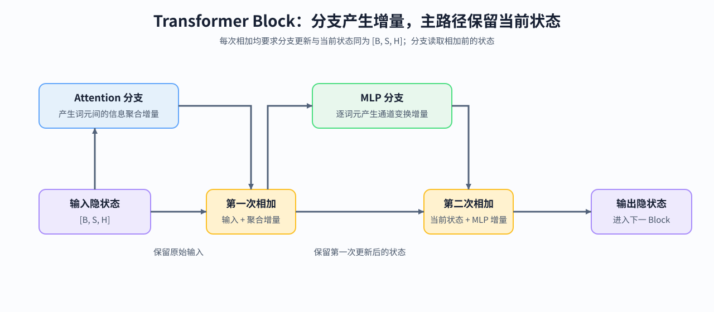

# 13. Transformer Block Dataflow and Residual Stream | Transformer Block 数据流与残差通路

**难度：** Medium | **环境：** CPU-first | **标签：** `Transformer`, `Block`, `Residual` | **目标人群：** 准备理解现代大模型组件如何组装的学习者

> 🚀 **云端运行环境**
>
> 本章节的实战代码可以点击以下链接在免费 GPU 算力平台上直接运行：
>
> [](https://colab.research.google.com/github/datawhalechina/llm-algo-leetcode/blob/main/00_Prerequisites/13_Transformer_Block_Dataflow_and_Residual_Stream.ipynb)
> [](https://modelscope.cn/my/mynotebook) *(国内推荐：魔搭社区免费实例)*


## 本节导读

Transformer Block 不断读取并更新同一条 residual stream。Attention 分支负责 token 间的信息聚合，MLP 分支负责逐 token 的通道变换；两个分支都必须在写回主路径前恢复统一 hidden shape。

完成本节后，你应能追踪一个 Block 的两次 residual update，区分主路径状态与分支更新量，并检查多层堆叠是否保持形状和状态推进。

**关键词：** `hidden state`, `residual stream`, `branch update`, `Block stack`



## 前置阅读
**导语：** 模型对象和训练生命周期说明了 Block 如何被调用与更新；本页进一步观察 Block 内部怎样保持 hidden state 契约。
- [12. PyTorch Data Interface and Training Lifecycle | PyTorch 数据接口与训练生命周期](./12_PyTorch_Minimal_Training_Interface.md)
- [0D 组页](./0D.md)

## Q1：为什么 Block 的输入输出通常保持同一 hidden shape？

Residual addition 要求主路径与更新分支拥有相同 shape。Block 可以在内部拆分 heads 或扩大 MLP 中间维，但写回 residual stream 前必须恢复为 `[batch, sequence, hidden]`。


```python
import torch
import torch.nn as nn


def residual_update(hidden_states, branch_update):
    """检查 residual contract 后，将分支更新写回主路径。"""
    if hidden_states.shape != branch_update.shape:
        raise ValueError(
            f'residual shape mismatch: {tuple(hidden_states.shape)} != {tuple(branch_update.shape)}'
        )
    return hidden_states + branch_update


hidden_states = torch.randn(2, 4, 8)
branch_update = torch.randn_like(hidden_states)
updated_states = residual_update(hidden_states, branch_update)
print('residual shape：', tuple(updated_states.shape))

```

## Q1 验证：Residual addition 是否保持 shape 并拒绝非法更新？

合法更新应保持主路径 shape；hidden 维不一致时应在相加前给出明确错误。


```python
assert updated_states.shape == hidden_states.shape
torch.testing.assert_close(updated_states, hidden_states + branch_update)
try:
    residual_update(hidden_states, torch.randn(2, 4, 4))
except ValueError as error:
    assert 'residual shape mismatch' in str(error)
else:
    raise AssertionError('shape 不一致时 residual update 应失败')
print('✅ residual shape contract 通过')

```

## Q2：Attention 与 MLP 怎样形成两次 residual update？

现代 decoder Block 通常先把 Attention 输出写回 residual stream，再把 MLP 输出写回更新后的主路径。下面用保持 shape 的分支分别表示 token mixing 与 channel mixing，验证两次更新的顺序和 hidden shape 契约。


```python
class ResidualBlockSkeleton(nn.Module):
    """只表示两个 shape-preserving 分支的接口，不替代真实 Attention/MLP。"""

    def __init__(self, hidden_size):
        super().__init__()
        self.attention_branch = nn.Linear(hidden_size, hidden_size, bias=False)
        self.mlp_branch = nn.Sequential(
            nn.Linear(hidden_size, hidden_size * 2, bias=False),
            nn.SiLU(),
            nn.Linear(hidden_size * 2, hidden_size, bias=False),
        )

    def forward(self, hidden_states):
        attention_update = self.attention_branch(hidden_states)
        after_attention = residual_update(hidden_states, attention_update)
        mlp_update = self.mlp_branch(after_attention)
        output = residual_update(after_attention, mlp_update)
        return {
            'input': hidden_states,
            'attention_update': attention_update,
            'after_attention': after_attention,
            'mlp_update': mlp_update,
            'output': output,
        }


torch.manual_seed(0)
block = ResidualBlockSkeleton(hidden_size=8)
block_states = block(torch.randn(2, 4, 8))
print({name: tuple(value.shape) for name, value in block_states.items()})

```

## Q2 验证：两次分支更新是否按顺序写回 residual stream？

五个观察量应保持相同 shape；`after_attention` 必须等于输入加 Attention 更新量，最终输出必须等于更新后的主路径加 MLP 更新量。


```python
assert all(value.shape == block_states['input'].shape for value in block_states.values())
torch.testing.assert_close(
    block_states['after_attention'],
    block_states['input'] + block_states['attention_update'],
)
torch.testing.assert_close(
    block_states['output'],
    block_states['after_attention'] + block_states['mlp_update'],
)
print('✅ Attention/MLP 两次 residual update 通过')

```

## Q3：为什么要区分 residual state 与 branch update？

Residual state 是传给下一分支、下一层的主路径状态；branch update 是当前子层产生的增量。两者 shape 相同，但含义不同。把增量单独记录，才能核对每次写回发生在哪里，而不把“保持 shape”误认为“状态没有变化”。


```python
def root_mean_square(tensor):
    return tensor.pow(2).mean().sqrt()


state_and_update_rms = {
    name: float(root_mean_square(block_states[name]))
    for name in ('input', 'attention_update', 'after_attention', 'mlp_update', 'output')
}
for name, value in state_and_update_rms.items():
    print(f'{name:>18}: RMS={value:.4f}')

```

## Q3 验证：主路径与两个增量能否分别重建？

两个更新量都应为有限值，并分别重建 Attention 写回和 MLP 写回后的状态。这里验证的是状态关系，不据此判断深层训练稳定性。


```python
for name in ('attention_update', 'mlp_update'):
    assert torch.isfinite(block_states[name]).all()
assert not torch.equal(block_states['input'], block_states['after_attention'])
assert not torch.equal(block_states['after_attention'], block_states['output'])
torch.testing.assert_close(
    block_states['output'] - block_states['after_attention'],
    block_states['mlp_update'],
)
print('✅ residual state 与 branch update 已分离验证')

```

## Q4：多个 Block 堆叠时，residual stream 怎样逐层演化？

Block stack 在层间传递同一 hidden-state 契约，每层读取上一层输出并产生新的 residual state。记录逐层状态，可以检查 shape、层数和状态是否真实推进；深层数值与梯度是否稳定，需要进入架构和训练实验继续验证。


```python
class BlockStack(nn.Module):
    def __init__(self, hidden_size, num_blocks):
        super().__init__()
        self.blocks = nn.ModuleList([
            ResidualBlockSkeleton(hidden_size) for _ in range(num_blocks)
        ])

    def forward(self, hidden_states):
        layer_states = [hidden_states]
        for block in self.blocks:
            hidden_states = block(hidden_states)['output']
            layer_states.append(hidden_states)
        return layer_states


stack = BlockStack(hidden_size=8, num_blocks=3)
stack_input = torch.randn(2, 4, 8)
layer_states = stack(stack_input)
print('layer state shapes：', [tuple(state.shape) for state in layer_states])

```

## Q4 验证：层数、shape 和状态推进是否一致？

三个 Block 应产生四个可观察状态；每个状态保持统一 shape，相邻层输出应发生变化。


```python
assert len(layer_states) == 4
assert all(state.shape == stack_input.shape for state in layer_states)
assert all(not torch.equal(left, right) for left, right in zip(layer_states, layer_states[1:]))
assert len(stack.blocks) == 3
print('✅ Block stack 与 residual state 推进通过')

```

## 相关阅读

Block 骨架之后，可以分别深入非线性、统计路径和 token 信息聚合；设计演进和深层稳定性由架构专题继续展开。

- [14. Activation Functions | 激活函数](./14_Activation_Functions.md)
- [15. Normalization Techniques | 归一化技术](./15_Normalization_Techniques.md)
- [16. Attention Mechanism Intro | Attention 机制导论](./16_Attention_Mechanism_Intro.md)
- [大模型架构演进 · Transformer 块与残差主干](../topic_discussion/llm_architecture_evolution/06_block_residual_path.md)
