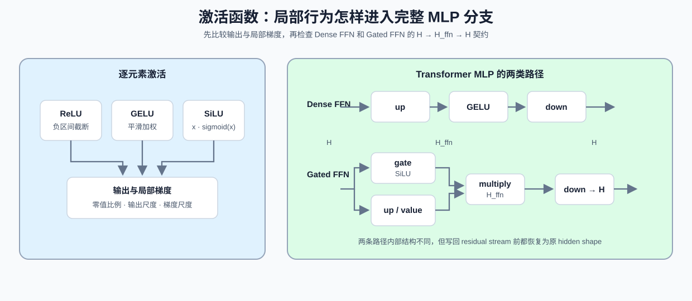

# 14. Activation Functions | 激活函数

**难度：** Medium | **环境：** CPU-first | **标签：** `PyTorch`, `非线性`, `门控激活` | **目标人群：** 准备理解 MLP 与门控结构的学习者

> 🚀 **云端运行环境**
>
> 本章节的实战代码可以点击以下链接在免费 GPU 算力平台上直接运行：
>
> [](https://colab.research.google.com/github/datawhalechina/llm-algo-leetcode/blob/main/00_Prerequisites/14_Activation_Functions.ipynb)
> [](https://modelscope.cn/my/mynotebook) *(国内推荐：魔搭社区免费实例)*


## 本节导读

激活函数改变前向输出和局部梯度，并使多层线性变换不再退化为单个线性映射。在 Transformer MLP 中，激活可以位于单条投影路径，也可以参与 gate/value 两条分支的逐元素调制。

完成本节后，你应能比较 ReLU、GELU、SiLU 的输出和局部梯度，并追踪普通 FFN 与门控 FFN 的 `H → H_ffn → H` shape 路径。

**关键词：** `ReLU`, `GELU`, `SiLU`, `SwiGLU`, `FFN`



## 前置阅读
**导语：** Tensor 运算给出前向值，Autograd 给出局部梯度；13 节则给出 MLP 分支写回 residual stream 的位置。
- [07. PyTorch Autograd and Backward | PyTorch 自动求导与反向传播](./07_PyTorch_Autograd_and_Backward.md)
- [13. Transformer Block Dataflow and Residual Stream | Transformer Block 数据流与残差通路](./13_Transformer_Block_Dataflow_and_Residual_Stream.md)
- [0D 组页](./0D.md)

## Q1：激活函数在模型里解决什么问题？

没有激活函数，多层线性变换仍可合并成一个线性变换。ReLU、GELU 和 SiLU 都引入非线性，但它们对负值、零点附近和大正值的处理不同。


```python
import math
import torch
import torch.nn as nn
import torch.nn.functional as F


def relu(x):
    return torch.where(x > 0, x, torch.zeros_like(x))


def gelu_exact(x):
    return 0.5 * x * (1.0 + torch.erf(x / math.sqrt(2.0)))


def silu(x):
    return x * torch.sigmoid(x)


def activation_summary(x):
    return {
        'relu_mean': float(relu(x).mean().item()),
        'gelu_mean': float(gelu_exact(x).mean().item()),
        'silu_mean': float(silu(x).mean().item()),
    }


x = torch.linspace(-3, 3, steps=7)
print('输入：', x.tolist())
print('ReLU：', relu(x).tolist())
print('GELU：', [round(v, 4) for v in gelu_exact(x).tolist()])
print('SiLU：', [round(v, 4) for v in silu(x).tolist()])

```

## Q1 验证：不同激活的输出形态是否可见？

这里直接把同一组输入喂给不同激活，看看它们对负值、零值和正值的处理是否符合预期。


```python
x = torch.tensor([-2.0, -1.0, 0.0, 1.0, 2.0])
assert torch.allclose(relu(x), F.relu(x))
assert torch.allclose(gelu_exact(x), F.gelu(x), atol=1e-6, rtol=1e-6)
assert torch.allclose(silu(x), F.silu(x))
print('✅ 基本激活函数通过')

```

## Q2：输出形状相似时，梯度行为有什么不同？

激活函数不仅改变输出，也改变局部导数。ReLU 在负半轴的梯度为零，在零点不可导；本例采用 PyTorch ReLU 的零点梯度约定，取值为 0。GELU 与 SiLU 在零点附近保留平滑变化。比较同一输入上的输出和梯度，比只记公式更能解释训练行为。


```python
def value_and_gradient(function, values):
    """返回激活输出以及输出和对输入的梯度。"""
    inputs = values.clone().detach().requires_grad_(True)
    outputs = function(inputs)
    outputs.sum().backward()
    return outputs.detach(), inputs.grad.detach()


points = torch.tensor([-4.0, -1.0, 0.0, 1.0, 4.0])
for name, function in {'relu': relu, 'gelu': gelu_exact, 'silu': silu}.items():
    values, gradients = value_and_gradient(function, points)
    print(name, 'values=', values.tolist(), 'gradients=', gradients.tolist())

```

## Q2 验证：截断区与平滑区是否可观察？

检查 ReLU 负半轴梯度为零，同时确认 GELU 与 SiLU 的输出和梯度均保持有限。


```python
relu_values, relu_gradients = value_and_gradient(relu, points)
gelu_values, gelu_gradients = value_and_gradient(gelu_exact, points)
silu_values, silu_gradients = value_and_gradient(silu, points)
_, reference_relu_gradients = value_and_gradient(F.relu, points)
assert torch.equal(relu_gradients, reference_relu_gradients)
assert relu_gradients[2].item() == 0.0
assert torch.equal(relu_gradients[:2], torch.zeros(2))
assert torch.isfinite(gelu_values).all() and torch.isfinite(gelu_gradients).all()
assert torch.isfinite(silu_values).all() and torch.isfinite(silu_gradients).all()
assert not torch.equal(gelu_gradients[:2], torch.zeros(2))
print('✅ 激活输出与梯度通过')

```

## Q3：激活函数怎样进入普通 FFN 与门控 FFN？

普通 FFN 先把 hidden 维扩张到 `H_ffn`，执行激活后再投影回 `H`。门控 FFN 同时生成 gate 与 value，两条分支必须拥有相同 shape；SwiGLU 用 `SiLU(gate) × value` 调制内容，再由 down projection 恢复 residual stream 的 hidden shape。


```python
def swiglu(gate, value):
    """使用 SiLU 门控 value 分支；两个输入必须同形状。"""
    if gate.shape != value.shape:
        raise ValueError('gate and value must have the same shape')
    return silu(gate) * value


class DenseFFN(nn.Module):
    def __init__(self, hidden_size, intermediate_size):
        super().__init__()
        self.up = nn.Linear(hidden_size, intermediate_size, bias=False)
        self.down = nn.Linear(intermediate_size, hidden_size, bias=False)

    def forward(self, hidden_states):
        return self.down(F.gelu(self.up(hidden_states)))


class GatedFFN(nn.Module):
    def __init__(self, hidden_size, intermediate_size):
        super().__init__()
        self.gate = nn.Linear(hidden_size, intermediate_size, bias=False)
        self.up = nn.Linear(hidden_size, intermediate_size, bias=False)
        self.down = nn.Linear(intermediate_size, hidden_size, bias=False)

    def forward(self, hidden_states):
        return self.down(swiglu(self.gate(hidden_states), self.up(hidden_states)))


torch.manual_seed(0)
ffn_input = torch.randn(2, 4, 8)
dense_ffn = DenseFFN(hidden_size=8, intermediate_size=16)
gated_ffn = GatedFFN(hidden_size=8, intermediate_size=16)
print('input / dense / gated：', ffn_input.shape, dense_ffn(ffn_input).shape, gated_ffn(ffn_input).shape)

```

## Q3 验证：两类 FFN 是否都恢复 residual stream 的 hidden shape？

内部中间维可以扩张，但写回 Block 前必须恢复输入 shape；门控分支的 gate 与 value 不同形时应立即失败。


```python
dense_output = dense_ffn(ffn_input)
gated_output = gated_ffn(ffn_input)
assert dense_output.shape == gated_output.shape == ffn_input.shape

gate = torch.tensor([[-2.0, 0.0, 2.0]])
value = torch.tensor([[3.0, 3.0, 3.0]])
torch.testing.assert_close(swiglu(gate, value), F.silu(gate) * value)
assert swiglu(gate, value)[0, 1].item() == 0.0
try:
    swiglu(torch.ones(2, 3), torch.ones(2, 4))
except ValueError:
    pass
else:
    raise AssertionError('shape mismatch should fail')
print('✅ Dense FFN / Gated FFN shape contract 通过')

```

## Q4：怎样用同一组统计比较激活函数的局部行为？

局部比较可以同时记录输出尺度、零值比例和梯度尺度。单看均值会漏掉 ReLU 的硬截断，也无法看出平滑激活是否保留负半轴梯度；这些统计用于描述机制，不直接替代模型训练和质量对照。


```python
def activation_profile(function, values):
    """汇总激活输出与局部梯度，不把统计量转换成预设标签。"""
    outputs, gradients = value_and_gradient(function, values)
    return {
        'output_mean': float(outputs.mean()),
        'output_std': float(outputs.std(unbiased=False)),
        'zero_fraction': float(outputs.eq(0).float().mean()),
        'gradient_abs_mean': float(gradients.abs().mean()),
        'gradient_abs_max': float(gradients.abs().max()),
    }


sample = torch.linspace(-4, 4, steps=17)
profiles = {name: activation_profile(function, sample) for name, function in {
    'relu': relu,
    'gelu': gelu_exact,
    'silu': silu,
}.items()}
for name, profile in profiles.items():
    print(name, profile)

```

## Q4 验证：统计字段能否区分截断与平滑激活？

ReLU 应出现明显零值比例；GELU 与 SiLU 在该输入上不应产生同样的硬截断。所有统计必须保持有限。


```python
assert profiles['relu']['zero_fraction'] > 0.4
assert profiles['gelu']['zero_fraction'] < profiles['relu']['zero_fraction']
assert profiles['silu']['zero_fraction'] < profiles['relu']['zero_fraction']
for profile in profiles.values():
    assert all(torch.isfinite(torch.tensor(value)) for value in profile.values())
print('✅ 激活统计对照通过')

```

## 相关阅读

继续观察归一化如何控制分支输入尺度，以及激活和门控怎样进入真实 Transformer Block。

- [15. Normalization Techniques | 归一化技术](./15_Normalization_Techniques.md)
- [Part 02 · 02 SwiGLU](../02_PyTorch_Algorithms/02_SwiGLU_Activation.md)
- [Part 02 · 05 LLaMA3 Block](../02_PyTorch_Algorithms/05_LLaMA3_Block_Tutorial.md)
- [大模型架构演进 · MLP / FFN 演进](../topic_discussion/llm_architecture_evolution/07_mlp_ffn_evolution.md)
