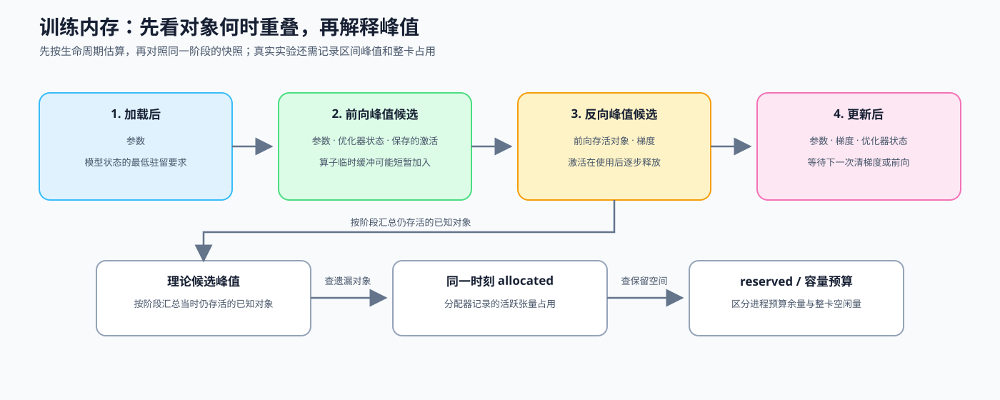

# 18. Memory Profiling and Optimization | 显存账本与运行时证据

**难度：** Medium | **环境：** CPU-first | **标签：** `PyTorch`, `显存账本`, `运行时证据` | **目标人群：** Part 2-4 前置补课者

> 🚀 **云端运行环境**
>
> 本章节的实战代码可以点击以下链接在免费 GPU 算力平台上直接运行：
>
> [](https://colab.research.google.com/github/datawhalechina/llm-algo-leetcode/blob/main/00_Prerequisites/18_Memory_Profiling_and_Optimization.ipynb)
> [](https://modelscope.cn/my/mynotebook) *(国内推荐：魔搭社区免费实例)*


## 本节导读

训练内存不仅包含模型参数，还包含梯度、优化器状态、保存的激活和临时缓冲。这些对象在不同阶段创建、重叠和释放，因此模型能够加载不等于一步训练能够完成。

完成本节后，你应能按对象生命周期估算候选峰值，解释批次、低精度和重计算改变了哪些账本项，并用运行时记录识别理论账本的遗漏。修改一个账本假设后，观察峰值对象和待测代价怎样变化。

**关键词：** `memory ledger`, `lifetime`, `allocated`, `reserved`



## 前置阅读
**导语：** 先从 0E 组页了解诊断顺序，并用 19 节确认运行有效，再把参数、梯度、激活和临时张量放进同一生命周期账本。
- [0E 组页](./0E.md)
- [Part 00 · 19 调试与异常定位](./19_Debugging_and_Anomaly_Localization.md)

## Q1：训练内存账本为什么必须记录对象和生命周期？

模型参数能够放进 GPU，并不代表训练一定不会发生显存不足（OOM）：前向阶段会保存反向计算所需的激活，反向阶段会产生梯度，优化器状态通常在第一次更新前后完成初始化，算子还可能申请临时缓冲。本例估算第一次更新之后的稳定训练阶段：假设每步开始清空梯度，并用一项代表性保存张量和假定临时缓冲演示重叠。它不是当前小模型的完整激活测量。


| 显存对象 | 生命周期 | 是否随 batch 变化 | 主要影响因素 |
|:---|:---|:---:|:---|
| 参数 | 模型加载后持续存在 | 否 | 参数量、dtype |
| 梯度 | backward 中逐步产生，清零方式决定是否保留 | 通常否 | 可训练参数量、梯度 dtype |
| 优化器状态 | 通常在第一次更新时创建，此后持续存在 | 否 | 优化器类型、状态精度 |
| 保存的激活 | forward 产生，backward 使用后逐步释放 | 是 | batch、序列长度、层数 |
| 临时缓冲 | 算子执行期间短暂存在 | 是 | 算子实现、workspace、layout |


```python
import torch
import torch.nn as nn


def pretty_mib(nbytes):
    return f"{nbytes / 1024**2:.2f} MiB"


class TinyLedgerNet(nn.Module):
    def __init__(self):
        super().__init__()
        self.net = nn.Sequential(
            nn.Linear(512, 1024),
            nn.ReLU(),
            nn.Linear(1024, 512),
        )

    def forward(self, x):
        return self.net(x)


model = TinyLedgerNet()
param_count = sum(p.numel() for p in model.parameters())
param_bytes = param_count * 4
grad_bytes = param_count * 4
adam_state_bytes = param_count * 8

batch_size, seq_len, hidden_size = 16, 64, 512
saved_activation_bytes = batch_size * seq_len * hidden_size * 4
temporary_bytes = saved_activation_bytes // 2

components = {
    'parameters_mib': param_bytes / 1024**2,
    'gradients_mib': grad_bytes / 1024**2,
    'optimizer_state_mib': adam_state_bytes / 1024**2,
    'saved_activations_mib': saved_activation_bytes / 1024**2,
    'temporary_mib': temporary_bytes / 1024**2,
}
phase_members = {
    'after_load': ('parameters_mib',),
    'forward_peak': ('parameters_mib', 'optimizer_state_mib', 'saved_activations_mib', 'temporary_mib'),
    'backward_peak': ('parameters_mib', 'gradients_mib', 'optimizer_state_mib', 'saved_activations_mib', 'temporary_mib'),
    'after_update': ('parameters_mib', 'gradients_mib', 'optimizer_state_mib'),
}
phase_totals = {
    phase: sum(components[name] for name in names)
    for phase, names in phase_members.items()
}
ledger = {
    'status': 'estimated',
    'assumptions': 'steady_state; one representative activation; assumed workspace',
    'objects_mib': components,
    'phase_members': phase_members,
    'phase_totals_mib': phase_totals,
    'overlap_upper_bound_mib': max(phase_totals.values()),
}
print('objects:', {name: round(value, 2) for name, value in components.items()})
print('phase totals:', {name: round(value, 2) for name, value in phase_totals.items()})

```

## Q1 验证：对象是否只计入可能出现的阶段？

加载后只应存在参数；反向峰值候选应同时包含梯度、优化器状态、保存的激活和临时缓冲。


```python
assert phase_members['after_load'] == ('parameters_mib',)
assert {'gradients_mib', 'saved_activations_mib', 'temporary_mib'} <= set(phase_members['backward_peak'])
assert ledger['overlap_upper_bound_mib'] == phase_totals['backward_peak']
assert all(value >= 0 for value in components.values())
print('✅ 对象生命周期与候选峰值阶段通过')

```

## Q2：为什么对象大小不能直接相加成真实峰值？

真实峰值取决于对象是否同时存活。加载阶段主要保留参数；前向峰值加入保存的激活和临时缓冲；反向阶段还可能同时存在梯度。理论账本可以给出候选峰值阶段和对象贡献，但 allocator、算子 workspace 和释放时机仍可能让实测结果偏离理论值。

| 阶段 | 新进入或仍存活的主要对象 | 账本能说明什么 |
|:---|:---|:---|
| 加载后 | 参数 | 模型状态的最低驻留要求 |
| 前向峰值候选 | 参数、优化器状态、保存的激活、临时缓冲 | batch 与序列长度带来的动态压力 |
| 反向峰值候选 | 前向对象、梯度 | 多类状态可能重叠的理论上界 |
| 更新后 | 参数、梯度、优化器状态 | 更新阶段结束前的长期状态 |


```python
def summarize_candidate_peak(objects_mib, phases):
    """按生命周期计算候选峰值阶段和该阶段的对象贡献。"""
    if any(value < 0 for value in objects_mib.values()):
        raise ValueError('对象大小不能为负数')
    totals = {phase: sum(objects_mib[name] for name in names) for phase, names in phases.items()}
    peak_phase = max(totals, key=totals.get)
    contributions = {name: objects_mib[name] for name in phases[peak_phase]}
    return {
        'peak_phase': peak_phase,
        'candidate_peak_mib': totals[peak_phase],
        'phase_totals_mib': totals,
        'contributions_mib': contributions,
    }


peak_report = summarize_candidate_peak(components, phase_members)
print('candidate peak:', peak_report)

```

## Q2 验证：候选峰值是否由生命周期重叠决定？

候选峰值必须来自某个明确阶段，并且阶段总量等于该阶段存活对象之和。


```python
assert peak_report['peak_phase'] == 'backward_peak'
assert peak_report['candidate_peak_mib'] == sum(peak_report['contributions_mib'].values())
assert peak_report['phase_totals_mib']['after_load'] < peak_report['candidate_peak_mib']
print('✅ 生命周期重叠与候选峰值计算通过')

```

## Q3：micro-batch 与梯度累积分别改变哪些账本量？

先区分两个 batch：`micro-batch` 是一次真正送入模型的样本数，`effective batch` 是累积若干次梯度后才更新一次参数的总样本数。缩小 micro-batch 会降低单次 activation 峰值；梯度累积可以近似保住 effective batch，但会增加前向 / 反向次数，不会减少参数、梯度或 optimizer state 的长期占用。这里仅记录账本变化和待测代价，不据此选择策略。

| 变化 | 影响的账本项 | 仍需测量的代价 |
|:---|:---|:---|
| 缩小 micro-batch | 单次 activation 峰值 | 单次处理量变小 |
| 增加 gradient accumulation | 在较小 micro-batch 下保持 effective batch | 前向 / 反向次数增加 |
| 两者配合 | 在较小 activation 峰值下维持目标更新规模 | 吞吐和训练时间需要重新测量 |


```python
configs = [
    {"name": "baseline", "micro_batch": 16, "accum_steps": 1, "world_size": 1},
    {"name": "accumulated", "micro_batch": 4, "accum_steps": 4, "world_size": 1},
]

seq_len, hidden_size, dtype_bytes = 64, 512, 2

def mib(nbytes):
    """把字节数转换为便于阅读的 MiB。"""
    return nbytes / 1024**2

for cfg in configs:
    effective_batch = cfg["micro_batch"] * cfg["accum_steps"] * cfg["world_size"]
    activation_bytes = cfg["micro_batch"] * seq_len * hidden_size * dtype_bytes
    forward_backward_rounds = cfg["accum_steps"]
    cfg['effective_batch'] = effective_batch
    cfg['activation_peak_mib'] = mib(activation_bytes)
    cfg['forward_backward_rounds'] = forward_backward_rounds
    print(cfg)

```

## Q3 验证：相同 effective batch 下，micro-batch 与累计轮数是否形成交换？

缩小 micro-batch 应降低 activation 峰值；为了保持相同 effective batch，需要增加 forward/backward 轮数。


```python
assert configs[0]['effective_batch'] == configs[1]['effective_batch']
assert configs[1]['activation_peak_mib'] < configs[0]['activation_peak_mib']
assert configs[1]['forward_backward_rounds'] > configs[0]['forward_backward_rounds']
print('✅ effective batch、activation 峰值和累计轮数关系通过')

```

## Q4：低精度和梯度检查点分别改变哪些对象属性？

如果账本显示保存的激活占比较高，可以观察减少每个元素字节数或降低中间结果保存比例后，账本怎样变化。低精度主要改变元素字节数；梯度检查点改变保存比例，并在反向阶段重算部分前向。下面显式给出“保存比例”和“额外重算比例”，只比较方向，不把它们当成任意模型的固定收益或选择结论。


```python
batch_size, seq_len, hidden_size = 8, 32, 512

def activation_tradeoff(dtype_bytes, saved_fraction, extra_forward_fraction):
    """在给定保存比例假设下比较激活字节数与重算代价。"""
    if dtype_bytes <= 0 or not 0 < saved_fraction <= 1:
        raise ValueError('dtype_bytes 必须为正，saved_fraction 必须位于 (0, 1]')
    if not 0 <= extra_forward_fraction <= 1:
        raise ValueError('extra_forward_fraction 必须位于 [0, 1]')
    full_bytes = batch_size * seq_len * hidden_size * dtype_bytes
    return {
        'saved_activation_mib': full_bytes * saved_fraction / 1024**2,
        'extra_forward_fraction': extra_forward_fraction,
    }

rows = [
    ('fp32 / no checkpoint', activation_tradeoff(4, 1.0, 0.0)),
    ('bf16 / no checkpoint', activation_tradeoff(2, 1.0, 0.0)),
    ('fp32 / save 50%', activation_tradeoff(4, 0.5, 0.5)),
    ('bf16 / save 50%', activation_tradeoff(2, 0.5, 0.5)),
]

for name, result in rows:
    print(name, '->', result)

```

## Q4 验证：dtype 与 checkpoint 是否分别改变字节数和重算代价？

低精度应减少同一保存比例下的字节数；减少保存比例应降低保存的激活，同时增加额外前向计算。


```python
assert rows[1][1]['saved_activation_mib'] < rows[0][1]['saved_activation_mib']
assert rows[2][1]['saved_activation_mib'] < rows[0][1]['saved_activation_mib']
assert rows[3][1]['saved_activation_mib'] < rows[1][1]['saved_activation_mib']
assert rows[2][1]['extra_forward_fraction'] > rows[0][1]['extra_forward_fraction']
print('✅ 元素字节数、保存比例与重算代价关系通过')

```

## Q5：为什么内存会随训练轮次持续增长？

如果占用不是在某一步突然升高，而是每轮训练后都继续增长，先检查是否把带计算图的 Tensor 或损失持续放进列表。这是 Python 引用延长了计算图生命周期，不应笼统归为 allocator 泄漏。`loss.item()` 只保存数字，`detach()` 保留 Tensor 但切断当前计算图，`no_grad()` 则关闭一段代码的梯度追踪；三者解决的不是同一个问题。


```python
import torch
import torch.nn as nn
import torch.nn.functional as F


torch.manual_seed(0)
model = nn.Linear(4, 2)
x = torch.randn(8, 4)
y = torch.randint(0, 2, (8,))

loss_bucket = []
for _ in range(2):
    out = model(x)
    loss = F.cross_entropy(out, y)
    loss_bucket.append(loss)

scalar_bucket = []
for _ in range(2):
    out = model(x)
    loss = F.cross_entropy(out, y)
    scalar_bucket.append(loss.item())

with torch.no_grad():
    pred = model(x)

detached = model(x).detach()

print(f"keep tensor: type={type(loss_bucket[0]).__name__}, grad_fn={loss_bucket[0].grad_fn is not None}")
print(f"keep scalar: type={type(scalar_bucket[0]).__name__}, value={scalar_bucket[0]:.4f}")
print(f"no_grad output requires_grad={pred.requires_grad}")
print(f"detach output requires_grad={detached.requires_grad}, grad_fn={detached.grad_fn}")
print("store tensors only when you really need the graph")

```

## Q5 验证：保存 Tensor、标量和切断计算图是否产生不同状态？

直接保存 loss Tensor 会保留 `grad_fn`；保存标量、使用 `no_grad()` 或 `detach()` 不应继续持有当前计算图。


```python
assert loss_bucket[0].grad_fn is not None
assert isinstance(scalar_bucket[0], float)
assert not pred.requires_grad
assert not detached.requires_grad and detached.grad_fn is None
print('✅ 计算图持有、标量保存、no_grad 和 detach 区分通过')

```

## Q6：如何把理论账本与分配器记录对照？

先使用同一工作负载和同一单位，再区分同一时刻的占用与整个测量区间的峰值。同一时刻的 reserved 与 allocated 之差可以帮助观察分配器保留空间，但不能单独证明碎片化；分别记录的两个峰值未必发生在同一时刻，不能将其差值当成某个瞬间的缓存量。下面根据前面的账本构造一组示例数值，练习对账规则，不调用 CUDA 分配器。

| 对照量 | 计算或读取方式 | 下一项检查 |
|:---|:---|:---|
| 账本差值 | 同一阶段 allocated − 估算值，保留正负号 | 核对状态、保存张量、临时缓冲和估算假设 |
| 同时刻保留差值 | reserved − allocated | 检查缓存与分配历史，不能据此认定碎片化 |
| 设备剩余空间 | 总容量 − 当前整卡占用 | 真实实验还需包含其他进程和非分配器占用 |
| 进程预算余量 | 给定容量预算 − reserved | 判断本例预算是否紧张，不等同于真实设备空闲量 |
| 区间峰值 | 分别读取 allocated 和 reserved 的最大值 | 保留测量范围与峰值时刻，不直接相减归因 |


```python
import math


def reconcile_memory_record(theoretical_peak_mib, allocated_mib, reserved_mib, capacity_mib):
    """对同一阶段的构造快照进行对账，同时保留多项待查信号。"""
    values = (theoretical_peak_mib, allocated_mib, reserved_mib, capacity_mib)
    if any(not math.isfinite(value) or value < 0 for value in values) or capacity_mib <= 0:
        raise ValueError('内存数值必须有限、非负，容量预算必须为正')
    if not allocated_mib <= reserved_mib <= capacity_mib:
        raise ValueError('本例要求 allocated <= reserved <= 容量预算')
    estimate_difference_mib = allocated_mib - theoretical_peak_mib
    allocator_gap_mib = reserved_mib - allocated_mib
    budget_margin_mib = capacity_mib - reserved_mib
    signals = []
    if estimate_difference_mib > theoretical_peak_mib * 0.10:
        signals.append('inspect_estimate_difference')
    if allocator_gap_mib > capacity_mib * 0.10:
        signals.append('inspect_allocator_retained_space')
    if budget_margin_mib < capacity_mib * 0.10:
        signals.append('capacity_pressure')
    return {
        'estimate_difference_mib': estimate_difference_mib,
        'allocator_gap_mib': allocator_gap_mib,
        'budget_margin_mib': budget_margin_mib,
        'signals': signals,
        'alert_fraction': 0.10,
    }


# 只在前述同一账本上构造差值，三项告警可以同时出现。
theoretical_peak_mib = peak_report['candidate_peak_mib']
allocated_mib = theoretical_peak_mib + 3
reserved_mib = allocated_mib + 7
capacity_mib = reserved_mib + 1
runtime_record = reconcile_memory_record(
    theoretical_peak_mib, allocated_mib, reserved_mib, capacity_mib
)
dominant_object = max(peak_report['contributions_mib'], key=peak_report['contributions_mib'].get)
memory_evidence = {
    'evidence_type': 'memory', 'status': 'constructed_example',
    'source': 'same_ledger_with_assumed_runtime_snapshot',
    'unit': 'MiB',
    'candidate_peak_phase': peak_report['peak_phase'],
    'candidate_peak_mib': theoretical_peak_mib,
    'dominant_object': dominant_object,
    'dominant_objects_mib': peak_report['contributions_mib'],
    'allocated_mib': allocated_mib, 'reserved_mib': reserved_mib,
    'capacity_mib': capacity_mib,
    'runtime_reconciliation': runtime_record,
    'interpretation_limit': 'constructed_snapshot_not_gpu_measurement',
}
print('constructed snapshot:', runtime_record)
print('memory evidence:', memory_evidence)

```

## Q6 验证：对账能否同时保留多项信号？

检查账本差值、分配器保留空间和预算压力能否同时出现；低于估算值时保留负差值，不能把未知差异全部归为碎片或泄漏。


```python
assert runtime_record['estimate_difference_mib'] == 3
assert runtime_record['allocator_gap_mib'] == 7
assert runtime_record['budget_margin_mib'] == 1
assert set(runtime_record['signals']) == {
    'inspect_estimate_difference', 'inspect_allocator_retained_space', 'capacity_pressure'
}
below_estimate = reconcile_memory_record(20, 18, 19, 30)
assert below_estimate['estimate_difference_mib'] == -2
assert memory_evidence['status'] == 'constructed_example'
assert memory_evidence['unit'] == 'MiB'
assert memory_evidence['candidate_peak_phase'] == 'backward_peak'
assert memory_evidence['dominant_object'] in memory_evidence['dominant_objects_mib']
assert memory_evidence['interpretation_limit'] == 'constructed_snapshot_not_gpu_measurement'
for invalid in ((20, 22, 21, 30), (20, 22, 31, 30), (20, float('nan'), 25, 30)):
    try:
        reconcile_memory_record(*invalid)
    except ValueError:
        pass
    else:
        raise AssertionError('无效快照不能参与对账')
print('✅ 构造快照、MiB 单位、多项告警与无效输入检查通过')

```

## 相关阅读
**导语：** 完成本节后，可以查阅真实分配器字段，再把容量证据带入 20 节的配对实验；具体训练策略由相应机制和优化专题选择。
- [PyTorch CUDA 显存管理文档](https://docs.pytorch.org/docs/stable/notes/cuda.html)
- [Part 00 · 20 性能证据与实验设计](./20_Performance_Evidence_and_Experiment_Design.md)
- [Part 02 · 76 激活检查点与卸载对比](../02_PyTorch_Algorithms/76_Activation_Checkpoint_Offload_Benchmark.md)
