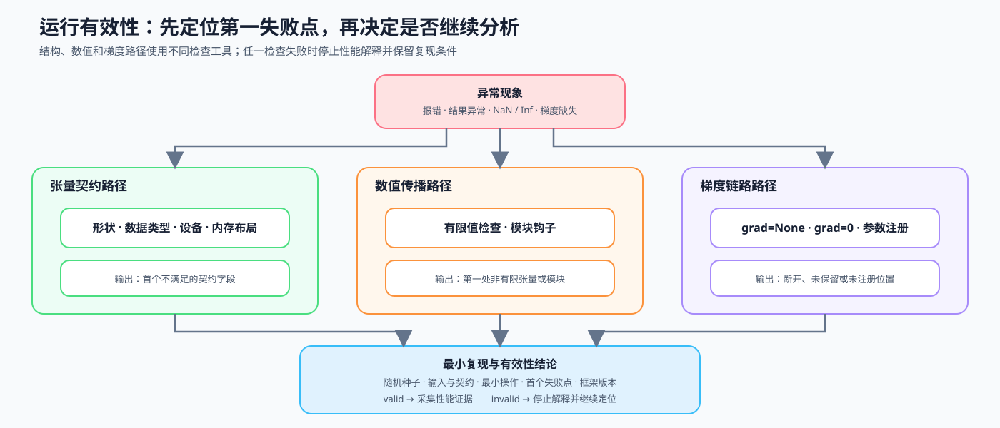

# 19. Debugging and Anomaly Localization | 调试与异常定位

**难度：** Medium | **环境：** CPU-first | **标签：** `调试`, `排错`, `张量健康` | **目标人群：** Part 2-4 前置补课者

> 🚀 **云端运行环境**
>
> 本章节的实战代码可以点击以下链接在免费 GPU 算力平台上直接运行：
>
> [](https://colab.research.google.com/github/datawhalechina/llm-algo-leetcode/blob/main/00_Prerequisites/19_Debugging_and_Anomaly_Localization.ipynb)
> [](https://modelscope.cn/my/mynotebook) *(国内推荐：魔搭社区免费实例)*


## 本节导读

程序报错或训练结果异常时，最先看到的现象不一定最接近原因。更重要的是：正确性没有通过前，耗时和内存结果都不能继续解释为性能证据。非有限损失可能起源于更早的激活或梯度，缺失梯度也可能来自不同的计算图与注册状态。

完成本节后，你应能按张量契约、数值状态和梯度链路缩小范围，定位第一个失败点，形成可重放的最小复现，并输出当前运行能否进入性能分析的有效性结论。

**关键词：** `shape`, `dtype`, `device`, `NaN`




## 前置阅读
**导语：** 先从 0E 组页判断当前现象属于结构、数值还是梯度问题，再进入对应检查路径。
- [0E 组页](./0E.md)

## Q1：怎样先判断一次运行是否值得继续分析？

先按现象选择第一项检查：维度不匹配检查结构契约，CPU / CUDA 混用检查设备，loss 变成 NaN 检查首个非有限值，grad 为 None 检查梯度链路。存在任一异常时，当前运行标记为 `invalid`，先定位和复现，不继续解释性能；所有检查通过后，才标记为 `valid` 并进入时间或内存证据采集。


| 异常类别 | 典型表现 | 第一项检查 |
|:---|:---|:---|
| shape | 维度不匹配、广播错误 | 输入和算子的 shape |
| dtype | 类型不兼容、精度异常 | 输入与参数 dtype |
| device / layout | CPU 与 CUDA 混用、访问路径异常 | device、layout、contiguous |
| numerical | NaN / Inf | 第一个非有限值 |
| gradient | grad 为 None 或梯度异常 | 计算图和参数注册 |


```python
def classify_issue(shape_ok, dtype_ok, device_ok, has_nonfinite, grad_ok):
    """收集异常类别；列表顺序表示教学上的初步检查顺序。"""
    issues = []
    if not shape_ok:
        issues.append('shape')
    if not dtype_ok:
        issues.append('dtype')
    if not device_ok:
        issues.append('device')
    if has_nonfinite:
        issues.append('numerical')
    if not grad_ok:
        issues.append('gradient')
    return issues


def build_validity_summary(issues, first_failure=None, reproducible=False):
    """把正确性检查收口为后续实验可读取的有效性结论。"""
    issue_list = list(issues)
    if any(not isinstance(issue, str) or not issue.strip() for issue in issue_list):
        raise ValueError('异常类别必须是非空字符串')
    run_valid = len(issue_list) == 0
    if run_valid and first_failure is not None:
        raise ValueError('正常运行不能同时声明首个失败点')
    return {
        'evidence_type': 'correctness',
        'status': 'valid' if run_valid else 'invalid',
        'run_valid': run_valid,
        'issues': issue_list,
        'first_failure': first_failure,
        'reproducible': bool(reproducible),
        'next_action': 'collect_performance_evidence' if run_valid else 'localize_and_reproduce',
    }


sample = classify_issue(shape_ok=False, dtype_ok=True, device_ok=False, has_nonfinite=True, grad_ok=False)
primary = sample[0] if sample else 'ok'
sample_validity = build_validity_summary(sample)
healthy_validity = build_validity_summary([])
print('issues:', sample)
print('primary:', primary)
print('validity:', sample_validity)
# 输出示例: issues -> ['shape', 'device', 'numerical', 'gradient']; primary -> shape

```

## Q1 验证：异常分类和运行有效性门槛是否一致？

同时覆盖多种异常与完全正常两条路径；只有正常路径能够继续采集性能证据。

```python
assert sample == ['shape', 'device', 'numerical', 'gradient']
assert primary == 'shape'
assert classify_issue(True, True, True, False, True) == []
assert sample_validity['status'] == 'invalid'
assert sample_validity['next_action'] == 'localize_and_reproduce'
assert healthy_validity['run_valid']
assert healthy_validity['next_action'] == 'collect_performance_evidence'
print('✅ 异常分类与运行有效性门槛通过')
```

## Q2：什么时候先看 shape、dtype、device 和 layout？

遇到报错时，先按由易到难的顺序检查：shape 决定张量的维度和广播方式，dtype 决定数据类型是否兼容，device 决定模型和输入是否在同一计算位置，layout / contiguous 则影响算子能否直接访问这块内存。契约没有对齐前，先不要急着改优化策略；这里用一个 CPU Tensor 演示这些字段如何被检查。


```python
import torch


def audit_tensor_contract(actual, expected):
    """逐项比较张量契约，并返回首个需要先修复的字段。"""
    report = {}
    report['shape_ok'] = actual['shape'] == expected['shape']
    report['dtype_ok'] = actual['dtype'] == expected['dtype']
    report['device_ok'] = actual['device'] == expected['device']
    report['contiguous_ok'] = actual['contiguous'] == expected['contiguous']
    first_failure = next((name for name, ok in report.items() if not ok), None)
    return {'checks': report, 'first_failure': first_failure}


tensor = torch.randn(2, 4, 8)
view = tensor.transpose(1, 2)
actual = {
    'shape': tuple(view.shape),
    'dtype': str(view.dtype),
    'device': str(view.device),
    'contiguous': view.is_contiguous(),
}
expected = {'shape': (2, 8, 4), 'dtype': 'torch.float32', 'device': 'cpu', 'contiguous': True}
report = audit_tensor_contract(actual, expected)
print('contract:', report)
print('must_fix:', [k for k, v in report['checks'].items() if not v])
# 输出示例: contract 中 contiguous_ok=False, must_fix=['contiguous_ok']

```

## Q2 验证：张量契约能否定位首个失败字段？

构造只违反连续性要求的视图，避免多个错误同时掩盖定位结果。

```python
assert report['first_failure'] == 'contiguous_ok'
assert report['checks']['shape_ok'] and report['checks']['dtype_ok'] and report['checks']['device_ok']
assert not report['checks']['contiguous_ok']
print('✅ 张量契约的首个失败字段定位通过')
```

## Q3：什么时候先查 NaN / Inf，如何找到第一个异常来源？

如果 loss 最后变成 NaN，真正的问题可能更早出现在 activation 或梯度中。按输入 → 前向激活 → 损失 → 反向梯度的实际执行顺序检查，并记录第一个 NaN / Inf 的阶段和对象；第一个异常位置通常比最后看到的 NaN 更接近原因，也能直接指向下一项验证。


```python
def first_nonfinite_tensor(records):
    """按执行顺序返回第一处包含 NaN/Inf 的 Tensor。"""
    if not isinstance(records, list):
        raise TypeError('records 必须是按执行顺序排列的列表')
    for idx, (source, value) in enumerate(records):
        if not isinstance(value, torch.Tensor):
            raise TypeError('每条记录的值必须是 Tensor')
        finite = torch.isfinite(value)
        if not finite.all():
            return {
                'index': idx,
                'source': source,
                'nonfinite_count': int((~finite).sum().item()),
            }
    return None


trace = [
    ('embedding', torch.tensor([0.2, 0.8])),
    ('attention', torch.tensor([1.0, 2.0])),
    ('mlp', torch.tensor([0.5, float('nan')])),
    ('loss', torch.tensor(float('nan'))),
]
failure = first_nonfinite_tensor(trace)
print('trace:', trace)
print('first_nonfinite_tensor:', failure)
print('source:', failure['source'] if failure else 'ok')

```

## Q3 验证：第一处非有限值与正常路径是否都能识别？

```python
assert failure == {'index': 2, 'source': 'mlp', 'nonfinite_count': 1}
assert first_nonfinite_tensor([('loss', torch.tensor(1.0))]) is None
print('✅ 第一处非有限值定位通过')
```

## Q4：梯度为什么会一直是 `None`，如何区分断开的原因？

“grad 为 None”不一定只有一个原因：可能是 detach() 切断了当前 Tensor，可能是 no_grad() 关闭了梯度追踪，也可能是非叶子 Tensor 默认不保留梯度，或参数根本没有注册进模块。还要区分“grad 为 None”和“grad 的数值为 0”：前者表示没有生成或没有保留梯度，后者表示梯度已经存在，只是当前值为零。先根据出现位置判断是哪一种，再决定检查计算图、梯度属性还是模块参数。


```python
import warnings
import torch.nn as nn

leaf = torch.tensor([1.0], requires_grad=True)
detached = leaf.detach()
with torch.no_grad():
    no_grad_value = leaf * 2
non_leaf = leaf * 3
non_leaf.sum().backward()
with warnings.catch_warnings():
    warnings.simplefilter('ignore', UserWarning)
    non_leaf_grad_without_retain = non_leaf.grad

zero_grad_leaf = torch.tensor([2.0], requires_grad=True)
(zero_grad_leaf * 0).sum().backward()

class BrokenModule(nn.Module):
    def __init__(self):
        super().__init__()
        self.raw_weight = torch.randn(2, 2, requires_grad=True)

broken = BrokenModule()
gradient_cases = {
    'detached_requires_grad': detached.requires_grad,
    'no_grad_requires_grad': no_grad_value.requires_grad,
    'non_leaf_grad': non_leaf_grad_without_retain,
    'zero_grad': zero_grad_leaf.grad.clone(),
    'registered_parameters': dict(broken.named_parameters()),
}
print('gradient cases:', gradient_cases)

```

## Q4 验证：`grad=None`、`grad=0` 与未注册参数能否被区分？

```python
assert not gradient_cases['detached_requires_grad']
assert not gradient_cases['no_grad_requires_grad']
assert gradient_cases['non_leaf_grad'] is None
assert torch.equal(gradient_cases['zero_grad'], torch.zeros_like(zero_grad_leaf))
assert 'raw_weight' not in gradient_cases['registered_parameters']
print('✅ grad=None、grad=0、非叶子 Tensor 和未注册参数机制通过')
```

## Q5：如何用模块 hook 找到模型内部第一处异常？

输入契约正常但最终损失仍为非有限值时，需要把检查点放进模型内部。前向 hook 可以记录各模块输出是否有限，帮助找到第一处失败模块；如果前向结果有限而反向失败，再使用 `torch.autograd.detect_anomaly()` 或梯度 hook 检查反向路径。hook 应在定位后移除，避免重复注册。


```python
class InjectNaN(nn.Module):
    def forward(self, x):
        return x / 0


probe_model = nn.Sequential(
    nn.Linear(2, 2),
    nn.ReLU(),
    InjectNaN(),
    nn.Linear(2, 1),
)
events = []
handles = []

def record_finiteness(name):
    def hook(_module, _inputs, output):
        events.append({'module': name, 'finite': bool(torch.isfinite(output).all())})
    return hook

for name, module in probe_model.named_children():
    handles.append(module.register_forward_hook(record_finiteness(name)))

_ = probe_model(torch.ones(1, 2))
for handle in handles:
    handle.remove()
first_bad_module = next(event['module'] for event in events if not event['finite'])
print('events:', events)
print('first bad module:', first_bad_module)

```

## Q5 验证：hook 是否定位第一处非有限模块并被移除？

```python
assert first_bad_module == '2'
assert events[0]['finite'] and events[1]['finite']
assert not events[2]['finite'] and not events[3]['finite']
assert all(not module._forward_hooks for module in probe_model.children())
print('✅ 前向 hook 定位与清理通过')
```

## Q6：怎样把首个失败点收缩成可重放的最小复现？

定位到失败模块后，保留触发失败所需的最少信息：随机种子、输入值与 shape、dtype、操作名称、框架版本和首个失败位置。最小复现不携带完整训练流水线；它应该能够在一个独立函数中重新触发同一失败，便于确认修复前后是否一致。最后把异常类别、首个失败点和复现状态写入有效性结论，交给 20 节决定是停止实验还是继续采集性能证据。

| 复现字段 | 为什么保留 |
|:---|:---|
| seed 与输入 | 固定触发条件 |
| shape / dtype | 固定张量契约 |
| operation | 保留最小失败操作 |
| first failure | 对照修复前后的定位结果 |
| framework version | 解释运行时差异 |


```python
def build_minimal_repro(seed=7):
    """构造并记录一个可独立重放的非有限值案例。"""
    torch.manual_seed(seed)
    inputs = torch.tensor([-1.0, 4.0], dtype=torch.float32)
    outputs = torch.sqrt(inputs)
    return {
        'seed': seed,
        'input_values': inputs.tolist(),
        'shape': tuple(inputs.shape),
        'dtype': str(inputs.dtype),
        'operation': 'torch.sqrt',
        'first_failure': 'output',
        'nonfinite_count': int((~torch.isfinite(outputs)).sum().item()),
        'torch_version': torch.__version__,
    }

def replay_minimal_repro(record):
    """仅重放本例声明的 sqrt/FP32 操作，并核对输入形状。"""
    required = {'input_values', 'shape', 'dtype', 'operation'}
    if not required <= set(record):
        raise KeyError('复现记录缺少输入、形状、类型或操作')
    if record['operation'] != 'torch.sqrt' or record['dtype'] != 'torch.float32':
        raise ValueError('本例只支持 torch.sqrt 和 torch.float32')
    inputs = torch.tensor(record['input_values'], dtype=torch.float32)
    if tuple(inputs.shape) != tuple(record['shape']):
        raise ValueError('记录形状与输入值不一致')
    outputs = torch.sqrt(inputs)
    return int((~torch.isfinite(outputs)).sum().item())

repro = build_minimal_repro()
replayed_nonfinite_count = replay_minimal_repro(repro)
validity_report = build_validity_summary(
    ['numerical'],
    first_failure=repro['first_failure'],
    reproducible=replayed_nonfinite_count == repro['nonfinite_count'],
)
print('minimal repro:', repro)
print('validity report:', validity_report)

```

## Q6 验证：最小复现是否能够重新触发同一失败？

```python
assert repro['operation'] == 'torch.sqrt'
assert repro['shape'] == (2,) and repro['dtype'] == 'torch.float32'
assert repro['nonfinite_count'] == 1
assert replayed_nonfinite_count == repro['nonfinite_count']
assert validity_report['status'] == 'invalid'
assert validity_report['first_failure'] == 'output'
assert validity_report['reproducible']
assert validity_report['next_action'] == 'localize_and_reproduce'
for change in ({'operation': 'torch.log'}, {'dtype': 'torch.float64'}, {'shape': (3,)}):
    try:
        replay_minimal_repro({**repro, **change})
    except ValueError:
        pass
    else:
        raise AssertionError('操作、类型或形状不一致时必须停止重放')
try:
    build_validity_summary([], first_failure='loss')
except ValueError:
    pass
else:
    raise AssertionError('正常运行不能带有失败点')
print('✅ 最小复现、输入一致性与有效性结论通过')
```

## 相关阅读
**导语：** 完成本节后，可以回补 Autograd 语义，并把可复现的正确性证据带入性能实验。
- [Part 00 · 07 Autograd 与反向传播](./07_PyTorch_Autograd_and_Backward.md)
- [PyTorch 异常检测官方文档](https://docs.pytorch.org/docs/stable/autograd.html#debugging-and-anomaly-detection)
- [Part 00 · 20 性能证据与实验设计](./20_Performance_Evidence_and_Experiment_Design.md)
