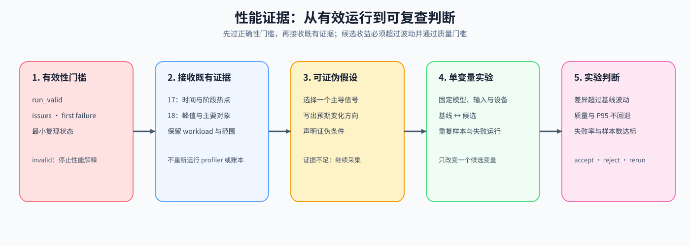

# 20. Performance Evidence and Experiment Design | 性能证据汇总与实验设计

**难度：** Medium | **环境：** CPU-first | **标签：** `性能证据`, `比较基线`, `实验设计` | **目标人群：** Part 2-4 前置补课者

> 🚀 **云端运行环境**
>
> 本章节的实战代码可以点击以下链接在免费 GPU 算力平台上直接运行：
>
> [](https://colab.research.google.com/github/datawhalechina/llm-algo-leetcode/blob/main/00_Prerequisites/20_Performance_Evidence_and_Experiment_Design.ipynb)
> [](https://modelscope.cn/my/mynotebook) *(国内推荐：魔搭社区免费实例)*


## 本节导读

本节沿用运行有效性、时间测量和内存账本的记录方式，用一组明确构造的示例练习实验设计。真实比较还需要确认这些记录来自同一工作负载。运行无效时先停止性能解释；运行有效时才形成待验证假设。

完成后，你应能从已有观测提出可验证假设，设计只改变一个条件的对照，并根据重复测量、失败记录和质量门槛决定接受、复测或拒绝候选。

**关键词：** `比较基线`, `待验证假设`, `单变量实验`, `失败率`



## 前置阅读
**导语：** 先完成 19 的运行有效性检查，再从 17 和 18 取得时间与容量证据；在本页用构造示例汇总记录、提出假设和设计对照。
- [19. Debugging and Anomaly Localization | 调试与异常定位](./19_Debugging_and_Anomaly_Localization.md)
- [17. PyTorch Profiling Basics | PyTorch 性能分析基础](./17_PyTorch_Profiling_Basics.md)
- [18. Memory Accounting and Runtime Evidence | 显存账本与运行时证据](./18_Memory_Profiling_and_Optimization.md)

## Q1：为什么正确性门槛必须先于性能解释？

耗时更短并不代表结果可用：输出错误、出现 NaN 或梯度链路中断时，任何性能收益都没有解释价值。20 节首先读取 19 输出的有效性结论；只有 `run_valid=True` 才允许时间和容量证据进入下一步，失败时保留首个失败点和复现状态。

| 有效性字段 | 它回答的问题 | 下一步 |
|:---|:---|:---|
| run_valid | 当前结果是否满足正确性要求？ | false 时停止性能解释 |
| issues | 哪类契约、数值或梯度检查失败？ | 进入对应定位路径 |
| first_failure | 最早失败发生在哪里？ | 收缩复现范围 |
| reproducible | 问题能否稳定重放？ | 决定继续定位或补充触发条件 |


```python
def validate_validity_report(report):
    """检查正确性状态与异常列表是否一致，再决定是否继续。"""
    required = {'evidence_type', 'status', 'run_valid', 'issues', 'first_failure', 'reproducible'}
    missing = sorted(required - set(report))
    if missing:
        raise KeyError(f'正确性记录缺少字段: {missing}')
    if report['evidence_type'] != 'correctness':
        raise ValueError('evidence_type 必须是 correctness')
    if type(report['run_valid']) is not bool or type(report['reproducible']) is not bool:
        raise ValueError('run_valid 和 reproducible 必须是布尔值')
    if not isinstance(report['issues'], list) or any(
        not isinstance(issue, str) or not issue.strip() for issue in report['issues']
    ):
        raise ValueError('issues 必须是异常类别列表')
    expected_valid = len(report['issues']) == 0
    if report['run_valid'] != expected_valid:
        raise ValueError('run_valid 与异常列表不一致')
    if expected_valid and report['first_failure'] is not None:
        raise ValueError('正常运行不能带有失败点')
    if report['status'] != ('valid' if expected_valid else 'invalid'):
        raise ValueError('status 与 run_valid 不一致')
    return {
        **report,
        'performance_action': 'continue' if expected_valid else 'stop_and_fix',
    }


validity_ok = validate_validity_report({
    'evidence_type': 'correctness', 'status': 'valid', 'run_valid': True,
    'issues': [], 'first_failure': None, 'reproducible': False,
})
validity_failed = validate_validity_report({
    'evidence_type': 'correctness', 'status': 'invalid', 'run_valid': False,
    'issues': ['numerical'], 'first_failure': 'mlp', 'reproducible': True,
})
print('valid:', validity_ok)
print('invalid:', validity_failed)

```

## Q1 验证：有效性门槛是否阻止无效运行进入性能解释？

```python
assert validity_ok['performance_action'] == 'continue'
assert validity_failed['performance_action'] == 'stop_and_fix'
assert validity_failed['first_failure'] == 'mlp'
assert validity_failed['reproducible']
for invalid_change in (
    {'issues': ['numerical']}, {'run_valid': 'True'}, {'first_failure': 'loss'}
):
    try:
        validate_validity_report({**validity_ok, **invalid_change})
    except ValueError:
        pass
    else:
        raise AssertionError('互相矛盾或类型错误的正确性记录不能通过')
print('✅ 正确性状态、异常列表一致性与停止条件通过')
```

## Q2：如何接收时间与容量证据而不重复采集？

前面的计时练习提供测量范围、重复样本和阶段热点，内存练习提供估算对象与构造快照。这里不读取其他 Notebook 的变量，而是构造同一工作负载的记录来检验汇总规则。阶段占比使用互不嵌套、互不重叠的阶段时间之和；真实事件有重叠时，应先整理时间线，不能直接相加。

| 证据来源 | 最小输入 | 20 节的用途 |
|:---|:---|:---|
| 时间记录结构 | workload、samples、hotspot、测量范围 | 选择最值得展开的阶段 |
| 内存记录结构 | 估算或实测标记、容量预算、主要对象、对账结果 | 判断是否存在容量压力 |
| 正确性记录结构 | run_valid、issues、first failure | 决定是否允许继续解释 |


```python
import math


def top_hotspots(events, topk=2):
    """按阶段总耗时排序，并补充其在总时间中的占比。

    events 中每项需要包含 name、total_ms 和 calls；这里处理的是
    已经整理好的事件记录，不负责从 profiler 采集原始事件。
    """
    if not isinstance(events, list) or not events or topk <= 0:
        return []
    required = {'name', 'total_ms', 'calls'}
    if any(not required.issubset(event) for event in events):
        raise ValueError('每个事件都必须包含 name、total_ms 和 calls')
    if any(not math.isfinite(event['total_ms']) or event['total_ms'] < 0 or event['calls'] <= 0 for event in events):
        raise ValueError('total_ms 不能为负数，calls 必须大于 0')
    total_ms = sum(event['total_ms'] for event in events)
    if total_ms <= 0:
        raise ValueError('事件总耗时必须大于 0')
    ordered = sorted(events, key=lambda event: event['total_ms'], reverse=True)
    return [
        {**event, 'share_pct': round(event['total_ms'] / total_ms * 100, 1)}
        for event in ordered[:topk]
    ]


events = [
    {'name': 'forward', 'total_ms': 38, 'calls': 2},
    {'name': 'backward', 'total_ms': 74, 'calls': 2},
    {'name': 'optimizer', 'total_ms': 18, 'calls': 1},
    {'name': 'dataloader', 'total_ms': 52, 'calls': 4},
]
hotspots = top_hotspots(events)
example_workload = {
    'model': 'TinyLM', 'input_shape': (4, 128), 'batch_size': 4,
    'dtype': 'fp32', 'device': 'cpu', 'scope': 'training_step',
}
time_evidence = {
    'evidence_type': 'time', 'status': 'constructed_example',
    'workload': dict(example_workload),
    'share_denominator': 'sum_of_nonoverlapping_stages',
    'hotspot': hotspots[0], 'interpretation_limit': 'hotspot_is_candidate_not_root_cause',
}
memory_evidence = {
    'evidence_type': 'memory', 'status': 'constructed_example',
    'workload': dict(example_workload), 'unit': 'MiB',
    'dominant_object': 'activation', 'reserved_mib': 61, 'capacity_mib': 64,
    'interpretation_limit': 'directional_evidence_not_strategy_decision',
}
evidence_bundle = {'validity': validity_ok, 'time': time_evidence, 'memory': memory_evidence}
print('hotspots:', hotspots)
print('focus:', hotspots[0]['name'])
# 输出示例: hotspots -> [('backward', 74), ('dataloader', 52)], focus -> backward

```

## Q2 验证：时间与容量证据是否保留来源和解释边界？

```python
assert [item['name'] for item in hotspots] == ['backward', 'dataloader']
assert hotspots[0]['share_pct'] == round(74 / 182 * 100, 1)
assert top_hotspots([], topk=2) == []
assert evidence_bundle['time']['evidence_type'] == 'time'
assert evidence_bundle['memory']['evidence_type'] == 'memory'
assert evidence_bundle['time']['hotspot']['name'] == 'backward'
assert evidence_bundle['memory']['reserved_mib'] < evidence_bundle['memory']['capacity_mib']
assert time_evidence['status'] == memory_evidence['status'] == 'constructed_example'
assert time_evidence['workload'] == memory_evidence['workload']
print('✅ 构造示例、测量范围与热点汇总检查通过')
```

## Q3：如何把时间、容量与正确性证据合成一个可验证假设？

先检查运行有效性，再检查时间和内存记录是否属于同一工作负载，以及它们是实测还是构造示例。正确性失败时应先停止性能解释；结果可信后，再根据事先声明的告警阈值判断当前证据是否足以形成实验假设。这里选择的是待验证信号，不直接宣布计算、带宽或 I/O 根因。

| 证据来源 | 输入字段 | 汇总后的作用 |
|:---|:---|:---|
| 时间证据 | hotspot、stage share | 判断哪个阶段值得展开 |
| 容量证据 | dominant object、peak / capacity | 判断是否接近容量上限 |
| 正确性证据 | run_valid、issues、first failure | 决定性能结果能否继续解释 |


```python
def synthesize_evidence(bundle, capacity_alert_ratio=0.90, hotspot_alert_share_pct=40.0):
    """先执行正确性检查，再整理同一工作负载下的时间和内存信号。"""
    if 'validity' not in bundle:
        raise KeyError('缺少 validity')
    validity = validate_validity_report(bundle['validity'])
    if not validity['run_valid']:
        return {
            'status': 'blocked_by_correctness', 'primary_signal': 'correctness',
            'hypothesis': '先修复正确性问题，再解释性能结果',
            'validity_status': validity['status'], 'issues': list(validity['issues']),
        }
    if not {'time', 'memory'} <= set(bundle):
        raise KeyError('正常运行还需要 time 和 memory 记录')
    time_signal, memory_signal = bundle['time'], bundle['memory']
    if time_signal.get('evidence_type') != 'time' or memory_signal.get('evidence_type') != 'memory':
        raise ValueError('时间或内存记录类型不正确')
    allowed_statuses = {'measured', 'estimated', 'constructed_example'}
    if any(record.get('status') not in allowed_statuses for record in (time_signal, memory_signal)):
        raise ValueError('需要明确标注实测、估算或构造示例')
    if not time_signal.get('workload') or time_signal['workload'] != memory_signal.get('workload'):
        raise ValueError('时间与内存记录必须来自同一工作负载')
    hotspot = time_signal.get('hotspot', {})
    if not {'name', 'share_pct'} <= set(hotspot):
        raise KeyError('time 记录缺少 hotspot')
    if not {'dominant_object', 'reserved_mib', 'capacity_mib'} <= set(memory_signal):
        raise KeyError('memory 记录缺少容量字段')
    values = (hotspot['share_pct'], memory_signal['reserved_mib'], memory_signal['capacity_mib'],
              capacity_alert_ratio, hotspot_alert_share_pct)
    if any(not math.isfinite(value) for value in values):
        raise ValueError('指标与阈值必须为有限值')
    if memory_signal.get('unit') != 'MiB' or memory_signal['capacity_mib'] <= 0:
        raise ValueError('本例统一使用 MiB，容量预算必须为正')
    if not 0 <= memory_signal['reserved_mib'] <= memory_signal['capacity_mib']:
        raise ValueError('reserved 必须位于容量预算内')
    if not 0 <= hotspot['share_pct'] <= 100:
        raise ValueError('share_pct 必须位于 [0, 100]')
    if not 0 < capacity_alert_ratio <= 1 or not 0 <= hotspot_alert_share_pct <= 100:
        raise ValueError('告警阈值超出允许范围')

    capacity_ratio = memory_signal['reserved_mib'] / memory_signal['capacity_mib']
    if capacity_ratio >= capacity_alert_ratio:
        status, primary_signal = 'ready_for_experiment', 'memory'
        hypothesis = f"验证 {memory_signal['dominant_object']} 是否造成容量压力"
    elif hotspot['share_pct'] >= hotspot_alert_share_pct:
        status, primary_signal = 'ready_for_experiment', 'time'
        hypothesis = f"验证 {hotspot['name']} 是否位于时间关键路径"
    else:
        status, primary_signal = 'need_more_evidence', 'none'
        hypothesis = '当前没有单一强信号'
    return {
        'status': status, 'primary_signal': primary_signal, 'hypothesis': hypothesis,
        'observation_sources': {'time': time_signal['status'], 'memory': memory_signal['status']},
        'hotspot': hotspot['name'], 'hotspot_share_pct': hotspot['share_pct'],
        'dominant_object': memory_signal['dominant_object'],
        'capacity_ratio': round(capacity_ratio, 3),
        'validity_status': validity['status'], 'issues': list(validity['issues']),
        'thresholds': {'capacity_alert_ratio': capacity_alert_ratio,
                       'hotspot_alert_share_pct': hotspot_alert_share_pct},
    }


capacity_evidence = synthesize_evidence(evidence_bundle)
input_bundle = {
    'validity': validity_ok,
    'time': {**time_evidence, 'hotspot': {'name': 'dataloader', 'share_pct': 55.0}},
    'memory': {**memory_evidence, 'reserved_mib': 24},
}
input_evidence = synthesize_evidence(input_bundle)
# 运行无效时，无须先提供性能记录。
invalid_evidence = synthesize_evidence({'validity': validity_failed})
print('capacity:', capacity_evidence)
print('input:', input_evidence)
print('invalid:', invalid_evidence)

```

## Q3 验证：正确性门槛、容量压力与时间热点能否正确分流？

```python
assert capacity_evidence['primary_signal'] == 'memory'
assert capacity_evidence['capacity_ratio'] == round(61 / 64, 3)
assert input_evidence['primary_signal'] == 'time'
assert input_evidence['hotspot'] == 'dataloader'
assert invalid_evidence['status'] == 'blocked_by_correctness'
assert invalid_evidence['issues'] == ['numerical']
assert capacity_evidence['thresholds']['capacity_alert_ratio'] == 0.90
assert capacity_evidence['observation_sources']['memory'] == 'constructed_example'
try:
    synthesize_evidence({
        **evidence_bundle, 'memory': {**memory_evidence, 'workload': {'model': 'OtherModel'}}
    })
except ValueError:
    pass
else:
    raise AssertionError('不同工作负载不能合并解释')
print('✅ 正确性优先、来源标记与同工作负载检查通过')
```

## Q4：如何把证据假设变成可判断的单变量实验？

每次实验先固定模型、输入、batch、dtype、设备、重复次数和测量方法，再由学习者显式提交一个候选变化。运行后分别保存基线与候选的重复样本，单独记录失败运行，再比较中位数、P95、失败率和质量。先固定可接受的失败率上限与 P95 回退上限，再检查中位数收益是否超过最小收益阈值和基线波动。失败样本不能从分母中消失。示例用 `(P95 - median) / median` 作为教学用波动代理，它不是统计置信区间，真实项目需要更多样本和独立回归协议。

| 实验字段 | 需要记录的内容 |
|:---|:---|
| hypothesis | 哪个信号值得用实验验证 |
| fixed conditions | 模型、输入、设备、测量方法及其他未改变的配置 |
| single change | 基线与候选唯一不同的变量 |
| repeated samples | 基线与候选的成功样本和失败运行 |
| metrics | 常规中位数、最近秩 P95、失败率、质量与资源代价 |
| regression threshold | 最小收益与基线波动两者的较大值，以及失败率和 P95 上限 |
| decision | accept、reject 或 rerun，并保留原因 |


```python
def design_single_variable_experiment(evidence, baseline, candidate_change=None):
    """固定 baseline，并校验 candidate_change 只改变一个变量。"""
    required = {'model', 'input_shape', 'batch_size', 'dtype', 'device', 'repeats', 'measurement_method'}
    missing = sorted(required - set(baseline))
    if missing:
        raise KeyError(f'baseline 缺少固定条件: {missing}')
    fixed_conditions = dict(baseline)

    if evidence['status'] == 'blocked_by_correctness':
        return {
            'action': 'fix_correctness_first',
            'hypothesis': evidence['hypothesis'],
            'baseline': dict(baseline),
            'candidate': None,
            'changed_variable': None,
            'fixed_conditions': fixed_conditions,
            'metrics': ['run_valid', 'issues', 'first_failure'],
            'evidence_level': 'teaching_proxy',
        }

    if evidence['status'] != 'ready_for_experiment' or not candidate_change:
        return {
            'action': 'collect_more_evidence',
            'hypothesis': evidence['hypothesis'],
            'baseline': dict(baseline),
            'candidate': None,
            'changed_variable': None,
            'fixed_conditions': fixed_conditions,
            'metrics': ['latency_ms', 'throughput_tok_s'],
            'evidence_level': 'teaching_proxy',
        }

    if len(candidate_change) != 1:
        raise ValueError('candidate_change 必须且只能包含一个变量')
    changed_variable, changed_value = next(iter(candidate_change.items()))
    if changed_variable not in baseline:
        raise ValueError('候选变量必须已在基线中声明')
    if changed_variable in {'model', 'input_shape', 'device', 'repeats', 'measurement_method'}:
        raise ValueError('本例固定模型、输入、设备、次数与测量方法')
    if baseline[changed_variable] == changed_value:
        raise ValueError('候选变量必须真正改变')
    fixed_conditions = {key: value for key, value in baseline.items() if key != changed_variable}
    candidate = dict(baseline)
    candidate[changed_variable] = changed_value
    return {
        'action': 'run_comparison',
        'hypothesis': evidence['hypothesis'],
        'baseline': dict(baseline),
        'candidate': candidate,
        'changed_variable': changed_variable,
        'fixed_conditions': fixed_conditions,
        'metrics': ['latency_ms', 'throughput_tok_s', 'quality', 'resource_cost'],
        'evidence_level': 'teaching_proxy',
    }


baseline = {
    'model': 'TinyLM',
    'input_shape': (4, 128),
    'batch_size': 4,
    'dtype': 'fp32',
    'device': 'cpu',
    'repeats': 5,
    'measurement_method': 'cpu_wall_training_step_ms',
    'checkpoint': False,
    'num_workers': 0,
}
memory_plan = design_single_variable_experiment(
    capacity_evidence, baseline, {'checkpoint': True}
)
input_plan = design_single_variable_experiment(
    input_evidence, baseline, {'num_workers': 2}
)
blocked_plan = design_single_variable_experiment(invalid_evidence, baseline)
print('memory plan:', memory_plan)
print('input plan:', input_plan)
print('blocked plan:', blocked_plan)

```

## Q4 验证：单变量约束、失败运行与回归阈值是否同时生效？

```python
import statistics


def changed_keys(plan):
    """返回基线与候选之间真正变化的配置项。"""
    if plan['candidate'] is None:
        return []
    keys = set(plan['baseline']) | set(plan['candidate'])
    return sorted(key for key in keys if plan['baseline'].get(key) != plan['candidate'].get(key))


def percentile(values, fraction):
    """按最近秩计算 P95 等分位数，中位数使用 statistics.median。"""
    if not values or not 0 <= fraction <= 1:
        raise ValueError('values 不能为空，fraction 必须位于 [0, 1]')
    if any(not math.isfinite(value) or value <= 0 for value in values):
        raise ValueError('延迟样本必须为正的有限值')
    ordered = sorted(values)
    return ordered[max(0, math.ceil(len(ordered) * fraction) - 1)]


def summarize_repeated_runs(runs):
    """保留全部尝试作为失败率分母，只对成功样本汇总延迟和平均质量。"""
    if any(type(run.get('ok')) is not bool for run in runs):
        raise ValueError('每次运行必须声明布尔型 ok')
    successful = [run for run in runs if run['ok']]
    failed = [run for run in runs if not run['ok']]
    if any('latency_ms' not in run or 'quality' not in run for run in successful):
        raise KeyError('成功运行必须包含 latency_ms 和 quality')
    latencies = [run['latency_ms'] for run in successful]
    qualities = [run['quality'] for run in successful]
    if any(not math.isfinite(value) or value <= 0 for value in latencies):
        raise ValueError('成功运行的延迟必须为正的有限值')
    if any(not math.isfinite(value) for value in qualities):
        raise ValueError('质量指标必须有限且采用相同评分规则')
    return {
        'attempted_runs': len(runs), 'valid_runs': len(successful), 'failed_runs': len(failed),
        'failure_rate': len(failed) / len(runs) if runs else None,
        'failure_reasons': [run.get('failure', 'unspecified') for run in failed],
        'median_ms': statistics.median(latencies) if successful else None,
        'p95_ms': percentile(latencies, 0.95) if successful else None,
        'quality': statistics.mean(qualities) if successful else None,
    }


def evaluate_regression(baseline_runs, candidate_runs, min_valid_runs=5, min_improvement=0.05,
                        quality_tolerance=0.01, maximum_failure_rate=0.0, maximum_p95_ratio=1.05):
    """按声明的成功次数、失败率、质量、P95 和中位数收益逐项检查。"""
    if type(min_valid_runs) is not int or min_valid_runs <= 0:
        raise ValueError('min_valid_runs 必须为正整数')
    thresholds = (min_improvement, quality_tolerance, maximum_failure_rate, maximum_p95_ratio)
    if any(not math.isfinite(value) for value in thresholds):
        raise ValueError('阈值必须为有限值')
    if not 0 <= min_improvement < 1 or quality_tolerance < 0:
        raise ValueError('收益阈值必须位于 [0, 1)，质量容差不能为负')
    if not 0 <= maximum_failure_rate <= 1 or maximum_p95_ratio < 1:
        raise ValueError('失败率上限必须位于 [0, 1]，P95 比例上限不能小于 1')
    b = summarize_repeated_runs(baseline_runs)
    c = summarize_repeated_runs(candidate_runs)
    result = {'baseline': b, 'candidate': c}
    if min(b['valid_runs'], c['valid_runs']) < min_valid_runs:
        return {**result, 'decision': 'rerun', 'reason': 'insufficient_valid_runs'}
    if b['failure_rate'] > maximum_failure_rate:
        return {**result, 'decision': 'rerun', 'reason': 'unreliable_baseline'}
    baseline_noise = (b['p95_ms'] - b['median_ms']) / b['median_ms']
    required_improvement = max(min_improvement, baseline_noise)
    observed_improvement = (b['median_ms'] - c['median_ms']) / b['median_ms']
    checks = {
        'failure_rate_ok': c['failure_rate'] <= maximum_failure_rate,
        'quality_ok': c['quality'] >= b['quality'] - quality_tolerance,
        'p95_ok': c['p95_ms'] / b['p95_ms'] <= maximum_p95_ratio,
        'improvement_ok': observed_improvement >= required_improvement,
    }
    failed_checks = [name for name, passed in checks.items() if not passed]
    return {
        **result, **checks, 'failed_checks': failed_checks,
        'decision': 'reject' if failed_checks else 'accept',
        'reason': 'declared_thresholds_checked',
        'baseline_noise': baseline_noise, 'required_improvement': required_improvement,
        'observed_improvement': observed_improvement,
        'maximum_failure_rate': maximum_failure_rate, 'maximum_p95_ratio': maximum_p95_ratio,
    }


# 构造数据只验证规则，不代表已经运行 TinyLM 或某项优化策略。
baseline_runs = [{'ok': True, 'latency_ms': value, 'quality': 0.900}
                 for value in (100, 102, 99, 101, 100)]
clean_candidate = [{'ok': True, 'latency_ms': value, 'quality': 0.895}
                   for value in (88, 90, 89, 91, 87)]
candidate_runs = clean_candidate + [{'ok': False, 'failure': 'timeout'}]
regression_result = evaluate_regression(baseline_runs, candidate_runs)
print('candidate with timeout:', regression_result)

assert changed_keys(memory_plan) == ['checkpoint']
assert changed_keys(input_plan) == ['num_workers']
assert 'num_workers' not in input_plan['fixed_conditions']
assert blocked_plan['action'] == 'fix_correctness_first' and blocked_plan['candidate'] is None
assert regression_result['candidate']['failed_runs'] == 1
assert regression_result['candidate']['failure_rate'] == 1 / 6
assert regression_result['decision'] == 'reject'
assert 'failure_rate_ok' in regression_result['failed_checks']
assert evaluate_regression(baseline_runs, clean_candidate)['decision'] == 'accept'
assert evaluate_regression(baseline_runs[:2], clean_candidate[:2])['decision'] == 'rerun'
assert summarize_repeated_runs([{'ok': True, 'latency_ms': x, 'quality': 1}
                                for x in [1, 2, 3, 100]])['median_ms'] == 2.5
many_timeouts = clean_candidate + [{'ok': False, 'failure': 'timeout'}] * 50
assert evaluate_regression(baseline_runs, many_timeouts)['decision'] == 'reject'
tail_regression = [{'ok': True, 'latency_ms': x, 'quality': 0.9} for x in [80, 80, 80, 80, 200]]
assert not evaluate_regression(baseline_runs, tail_regression)['p95_ok']
poor_quality = [{**run, 'quality': 0.5} for run in clean_candidate]
assert not evaluate_regression(baseline_runs, poor_quality)['quality_ok']
try:
    summarize_repeated_runs([{'ok': True, 'latency_ms': float('nan'), 'quality': 0.9}])
except ValueError:
    pass
else:
    raise AssertionError('非有限时间样本不能参与比较')
print('✅ 单变量、失败率、质量、P95 与统计量反例检查通过')

```

## 相关阅读
**导语：** 完成本节后，可以进入性能归因页或专题路线，将这里的实验协议用于真实证据。
- [Part 01 · 13 性能分析与瓶颈归因](../01_Hardware_Math_and_Systems/13_Profiling_and_Bottleneck_Analysis.md)
- [性能分析专题](../topic_discussion/performance_analysis/intro.md)
- [PyTorch Profiler 官方教程](https://docs.pytorch.org/tutorials/recipes/recipes/profiler_recipe.html)
