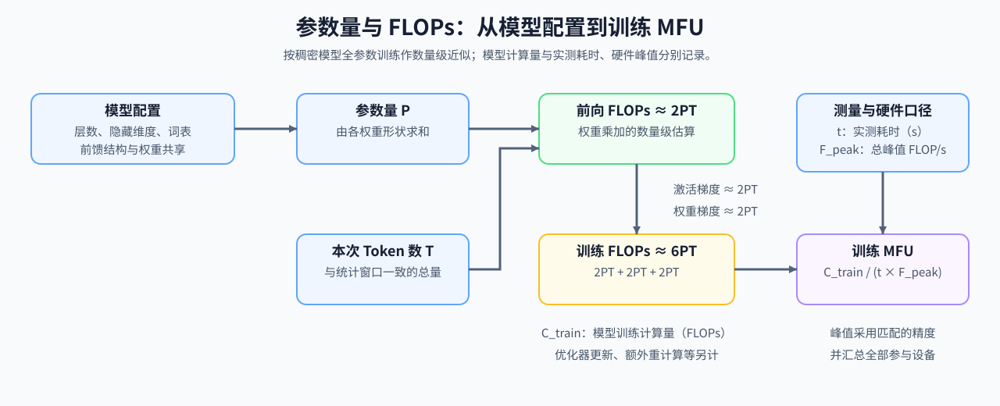

# 02. LLM Params and FLOPs | 大模型参数量与算力推导

**难度：** Medium | **环境：** CPU-first | **标签：** `数值基础`, `参数估算`, `FLOPs` | **目标人群：** 需要估算模型规模与计算预算的学习者

> 🚀 **云端运行环境**
>
> 本章节的实战代码可以点击以下链接在免费 GPU 算力平台上直接运行：
>
> [](https://colab.research.google.com/github/datawhalechina/llm-algo-leetcode/blob/main/01_Hardware_Math_and_Systems/02_LLM_Params_and_FLOPs.ipynb)
> [](https://modelscope.cn/my/mynotebook) *(国内推荐：魔搭社区免费实例)*


---

## 本节导读

模型名称里的 7B、14B 或 70B 只是规模标签。要判断模型能否装入显存以及一次训练或推理需要多少计算，还要结合层数、隐藏维度、词表、前馈网络结构和 Token 数。
本节建立“模型结构 → 参数量 → 工作负载计算量 → 模型 FLOPs 利用率（MFU）”的估算链。完成后，你应能把模型配置转换成参数与计算预算，并区分理论计算量与实测吞吐。

**关键词：** 参数量、`FLOPs`、`MFU`



---
## 前置阅读
**导语：** 进入本节前，先确认参数量如何进入 FLOPs 计算，再把前向、训练和硬件利用率放到同一条估算链上；这些数值会在后续微调、性能分析和 GPU 实验中继续使用。

- [01. Data Types and Precision | 大模型的数据格式与混合精度](./01_Data_Types_and_Precision.md)
- [Group 0B: PyTorch Tensors and Autograd | 0B: PyTorch 张量与自动求导](../00_Prerequisites/0B.md)

---
## Q1：如何根据隐藏维度、词表和层数计算Decoder参数量？

先选定一个简化结构：隐藏维度为 $d$，词表大小为 $V$，层数为 $L$；注意力使用多头注意力（MHA），每块有两个仅含缩放向量的归一化层。计算中省略偏置和末尾归一化层，词嵌入与输出头默认不共享。

**1. 词嵌入与输出头**

词嵌入和输出头各有 $Vd$ 个参数。共享两者时只减少一份 $Vd$，而不是整个模型的参数量减半。

**2. 注意力投影**

Q、K、V和输出投影各有一个 $d \times d$ 矩阵，因此每块共有 $4d^2$ 个注意力参数。分组查询注意力（GQA）会改变K、V投影的大小，需要按实际头数另算。

**3. 前馈网络与归一化**

设前馈中间维度为 $m$。标准前馈网络（FFN）有升维、降维两个矩阵，参数量为 $2dm$；SwiGLU多一个门控投影，共 $3dm$。SwiGLU可理解为一条激活分支与一条线性分支逐元素相乘后，再投影回隐藏维度。每块两个归一化缩放向量另占 $2d$ 个参数。

标准FFN取 $m=4d$，或SwiGLU取 $m \approx 8d/3$ 时，前馈参数均约为 $8d^2$。省略较小的归一化项，可以得到常用近似：

$$
P \approx 2Vd + 12Ld^2.
$$

代码会计入 $2Ld$ 个归一化参数，并使用实际整数中间维度。用 $V=10,d=6,L=1$、标准FFN的 $m=24$ 手算：词嵌入与输出头120，注意力144，前馈288，归一化12，合计564；省略归一化时为552。SwiGLU取 $m=16$ 时，前馈同样有288个参数。

较大配置沿用同一公式： $V=32000,d=4096,L=32$、SwiGLU中间维度11008。这里的11008是显式配置，不把它替换成未经取整的 $8d/3$。

### Q1小验证：从同一配置核对参数量

先复现564个参数的小例子，再只改变前馈结构或词嵌入共享方式。归一化项与前馈矩阵数分别进入断言。


```python
def calculate_transformer_params(vocab_size, hidden_dim, num_layers, intermediate_size=None, tie_embeddings=False, ffn_type='swiglu'):
    """按 dense Decoder-only Transformer 的简化结构估算参数量。

    使用 MHA，每块计入两个仅含缩放向量的归一化层；忽略 bias 和末尾 norm。
    未给定中间维度时，dense 取 4d，SwiGLU 将 8d/3 四舍五入为整数，
    不额外模拟硬件对齐。结果用于数量级预算。
    ffn_type='dense' 使用两个 FFN 矩阵；ffn_type='swiglu' 使用三个矩阵。
    """
    if min(vocab_size, hidden_dim, num_layers) <= 0:
        raise ValueError('vocab_size、hidden_dim 和 num_layers 必须为正数')
    if ffn_type not in {'dense', 'swiglu'}:
        raise ValueError("ffn_type 必须为 'dense' 或 'swiglu'")
    if intermediate_size is not None and intermediate_size <= 0:
        raise ValueError('intermediate_size 必须为正数')
    if intermediate_size is None:
        intermediate_size = 4 * hidden_dim if ffn_type == 'dense' else round(8 * hidden_dim / 3)

    embedding_params = vocab_size * hidden_dim
    attention_params = num_layers * (4 * hidden_dim * hidden_dim)
    ffn_matrix_count = 2 if ffn_type == 'dense' else 3
    ffn_params = num_layers * (ffn_matrix_count * hidden_dim * intermediate_size)
    layernorm_params = num_layers * (2 * hidden_dim)
    lm_head_params = 0 if tie_embeddings else vocab_size * hidden_dim

    total_params = embedding_params + attention_params + ffn_params + layernorm_params + lm_head_params
    return total_params
```


```python
def test_calculate_transformer_params():
    dense_small = calculate_transformer_params(10, 6, 1, ffn_type='dense')
    swiglu_small = calculate_transformer_params(10, 6, 1, intermediate_size=16)
    assert dense_small == 120 + 144 + 288 + 12 == 564
    assert swiglu_small == dense_small
    assert dense_small - (2 * 10 * 6 + 12 * 6**2) == 12
    assert calculate_transformer_params(10, 6, 1, tie_embeddings=True) == 504

    result = calculate_transformer_params(1000, 64, 2, 256, tie_embeddings=True)
    assert result == 195328, f"错误：期望 195328，实际 {result}"

    result = calculate_transformer_params(1000, 64, 2, 256, tie_embeddings=False)
    assert result == 259328, f"错误：期望 259328，实际 {result}"
    dense = calculate_transformer_params(1000, 64, 2, 256, tie_embeddings=True, ffn_type='dense')
    assert dense == 162560, f"标准 FFN 参数量不符合预期，实际 {dense}"

    result = calculate_transformer_params(32000, 4096, 32, 11008, tie_embeddings=False)
    assert result == 6_738_411_520, f"7B级教学配置参数量与逐项计算不符：{result}"

    print("✅ 参数量函数测试通过！")

test_calculate_transformer_params()
```

### Q1扩展验证：估算 7B 级配置的参数量

修改词表、隐藏维度、层数或前馈中间维度，观察总参数量；比较时只改变一项。


```python
vocab_size = 32000
hidden_dim = 4096
num_layers = 32
intermediate_size = 11008

total_params = calculate_transformer_params(vocab_size, hidden_dim, num_layers, intermediate_size, tie_embeddings=False)
print(f"估算参数量: {total_params / 1e9:.2f}B")
print("当前配置：MHA、三矩阵SwiGLU、每块两个归一化向量、词嵌入与输出头不共享。")
```

## Q2：已知参数量和 token 数，一次前向需要多少 FLOPs？


这一问只计算一次前向的 FLOPs；训练阶段为什么需要更多计算，放到下一问拆解。这里的公式是 dense Transformer 的数量级估算，不把前向 FLOPs 当成完整训练成本。

在了解了参数量之后，我们来看大模型在进行推理（前向传播）时需要多少算力。

**核心数量级估算：对 dense Transformer，1 个参数处理 1 个 Token 常用约 2 次浮点运算（FLOPs）估算。**
为什么是 2 次？因为在矩阵乘法 $Y = W \times X$ 中，对于每一个权重元素，我们需要做一次**乘法**和一次**加法**（Multiply-Accumulate, MAC）。

**推理 FLOPs 公式：**
$$ C_{forward} \approx 2 \times P \times T $$
其中：
- $C_{forward}$ 是前向传播需要的计算量（FLOPs）
- $P$ 是模型的总参数量（Parameters）
- $T$ 是处理的 Token 数量（Tokens）

*(注：这里忽略了 Attention 矩阵乘积、归一化、激活函数、padding 和其他算子；占比会随序列长度、模型结构和 batch 改变，不能固定写成 99%。)*

### Q2小验证：根据参数量和 token 数计算前向 FLOPs

先用 `2 × 参数量 × token 数` 估算一次前向。训练 FLOPs 的拆分放到下一问，避免把公式结论提前当作机制解释。

```python
def calculate_forward_flops(num_params_b, num_tokens, flops_per_param_token=2):
    """粗估 dense Transformer 一次前向的 FLOPs。

    默认 2 FLOPs/parameter/token 是乘加操作的教学近似，
    不包含序列长度相关的 attention 项、归一化和其他算子。
    """
    if num_params_b < 0 or num_tokens < 0 or flops_per_param_token < 0:
        raise ValueError('参数量、token 数和 FLOPs 系数不能为负数')
    return num_params_b * 1_000_000_000 * num_tokens * flops_per_param_token

```


```python
def test_calculate_flops():
    result = calculate_forward_flops(7, 1_000_000_000_000)
    assert result == 14_000_000_000_000_000_000_000, f"错误：期望 1.4e22，实际 {result}"

    print("✅ FLOPs 函数测试通过！")

test_calculate_flops()
```

### Q2扩展验证：观察前向 FLOPs 对 token 数的敏感性

固定参数量，比较不同 token 数下的一次前向 FLOPs；训练时间估算放到 Q3。

```python
def compare_forward_token_scales(num_params_b, token_counts):
    """比较不同 token 数下的一次前向 FLOPs；结果不是实测耗时。"""
    if not token_counts or any(tokens < 0 for tokens in token_counts):
        raise ValueError('token_counts 不能为空且不能包含负数')
    return {tokens: calculate_forward_flops(num_params_b, tokens) for tokens in token_counts}

print('7B 模型不同 token 数的前向 FLOPs：')
for tokens, flops in compare_forward_token_scales(7, [1_000, 8_000, 32_000]).items():
    print(f'{tokens:>6} tokens -> {flops:.2e} FLOPs')

```

## Q3：完整训练为什么比一次前向需要更多 FLOPs？


训练不仅包含前向传播计算损失，还包含反向传播计算梯度。

在反向传播中，我们需要：
1. 计算激活值（Activations）的梯度，以便将误差继续向后传（大约需要 $2 \times P \times T$ FLOPs）。
2. 计算权重（Weights）的梯度，用于模型参数更新（大约也需要 $2 \times P \times T$ FLOPs）。

因此，反向传播的计算量大约是前向传播的 **2 倍**。

**训练 FLOPs 公式（数量级近似）：**
$$ C_{train} = C_{forward} + C_{backward} \approx 2PT + 4PT = 6 \times P \times T $$

**不同训练方式的口径：**
| 训练方式 | 前向与反向 | 优化器状态 | 底座权重 | 本节处理方式 |
|---|---|---|---|---|
| 全参数训练 / 微调 | 全模型参与 | 覆盖全部参数 | 通常可更新 | 作为 `6PT` 基线 |
| LoRA | 经过底座并更新 Adapter | 主要维护 Adapter | 通常冻结 | 只作概念对照 |
| QLoRA | 量化底座参与计算并更新 Adapter | 主要维护 Adapter | 低比特冻结 | 只作资源边界说明 |

LoRA 和 QLoRA 的收益不能只从 FLOPs 公式判断；激活、量化反量化、kernel 和实际 workload 仍需在 Part02 项目中测量。

**实战估算：**
假设我们要从头预训练一个 LLaMA-7B（70亿参数）模型，训练数据量是 1T（1万亿）个 Tokens。
需要的总理论算力 $C = 6 \times (7 \times 10^9) \times (1 \times 10^{12}) = 4.2 \times 10^{22}$ FLOPs。

如果按每张 A100 的 312 TFLOPs 理论峰值、35% 的有效效率和 1000 张卡估算，有效集群算力约为 $1000 \times 312 \times 0.35$ TFLOPs，训练时间约为 4.5 天。这个结果随效率假设变化，只用于建立数量级直觉。

### Q3小验证：拆分训练 FLOPs 并估算场景时间

先把前向、激活梯度和权重梯度拆开，再把总 FLOPs 接到不同 GPU 规模的训练时间估算。

```python
def calculate_training_flops(num_params_b, num_tokens, flops_per_param_token=6):
    """粗估 dense Transformer 训练 FLOPs，不代表真实训练耗时。"""
    if num_params_b < 0 or num_tokens < 0 or flops_per_param_token < 0:
        raise ValueError('参数量、token 数和 FLOPs 系数不能为负数')
    return num_params_b * 1_000_000_000 * num_tokens * flops_per_param_token


def estimate_training_time(num_params_b, num_tokens, gpu_tflops, num_gpus, efficiency=0.35):
    """按理论训练 FLOPs 和假设效率估算时间，不是 GPU 实测时间。"""
    if gpu_tflops <= 0 or num_gpus <= 0 or not 0 < efficiency <= 1:
        raise ValueError('gpu_tflops、num_gpus 必须为正数，efficiency 必须在 (0, 1]')
    total_flops = calculate_training_flops(num_params_b, num_tokens)
    effective_flops = gpu_tflops * 1e12 * num_gpus * efficiency
    return total_flops / effective_flops / 3600


def training_flops_breakdown(num_params_b, num_tokens):
    """拆出前向、反向和训练总 FLOPs；是 dense Transformer 的数量级模型。"""
    forward = calculate_forward_flops(num_params_b, num_tokens)
    activation_backward = 2 * num_params_b * 1_000_000_000 * num_tokens
    weight_backward = 2 * num_params_b * 1_000_000_000 * num_tokens
    return {
        'forward': forward,
        'activation_backward': activation_backward,
        'weight_backward': weight_backward,
        'total': forward + activation_backward + weight_backward,
    }

breakdown = training_flops_breakdown(7, 1_000_000_000_000)
assert breakdown['total'] == calculate_training_flops(7, 1_000_000_000_000)
assert calculate_training_flops(7, 1_000_000_000_000) == 3 * calculate_forward_flops(7, 1_000_000_000_000)
print('训练 FLOPs 拆分:', {key: f'{value:.2e}' for key, value in breakdown.items()})

scenarios = [
    ('1x A100 80GB', 312, 1, 0.35),
    ('8x A100 80GB', 312, 8, 0.35),
    ('1000x A100 80GB', 312, 1000, 0.35),
    ('8卡假设峰值500 TFLOP/s', 500, 8, 0.45),
]

assert abs(estimate_training_time(7, 1_000_000_000_000, 312, 1000, 0.35) / 24 - 4.451566951566952) < 1e-9
print('7B训练计算时间粗估（1T tokens；峰值与效率为给定条件，不检查显存容量）：')
print('-' * 70)
for name, gpu_tflops, num_gpus, eff in scenarios:
    hours = estimate_training_time(7, 1_000_000_000_000, gpu_tflops, num_gpus, eff)
    print(f"{name:<16} {hours:>12.1f} 小时  ({hours/24:>8.1f} 天)")
```

## Q4：训练大模型时，什么是算力利用率 (MFU, Model FLOPs Utilization)？


通过前面的 Q3 我们算出了**理论所需算力**。但在实际工程中，硬件不会把所有时间都花在矩阵乘法上。这就引入了 MFU；它是观察模型计算利用率的一个重要指标，但不能单独代表训练工程质量。

- **理论算力 (Peak FLOPs)**：显卡说明书上写的算力。比如 A100 BF16 理论峰值是 312 TFLOPs（每秒执行 312 万亿次浮点运算）。
- **实际算力 (Observed FLOPs)**：即我们用 $6PT$ 算出的整个训练所需的理论运算量，除以跑完这些步骤所花的**实际时间**。
- **MFU = 模型FLOPs ÷ 实际秒数 ÷ 硬件峰值FLOP/s**。三项须覆盖同一范围：计算整个集群的模型工作量时，分母使用参与设备的峰值之和；计算单卡工作量时，使用单卡峰值。

**为什么 MFU 很难达到 100%？**
因为在真正的训练集群中，存在 **Memory-bound (显存墙)** 和 **Communication (通信瓶颈)**。GPU 很多时间在等待数据从内存搬运过来，或者在等其他机器的 All-Reduce 数据传过来，并没有在做有效的乘加运算。

MFU 没有脱离模型、精度、硬件、并行方式和统计口径的通用合格线。较低的 MFU 只能说明需要继续检查，不能单独证明通信或 I/O 是主瓶颈；应把它与时间线、访存、通信和输入流水线记录一起交给性能分析。

### Q4小验证：分别计算MFU和时间占比

先比较单卡与8卡：工作量和硬件峰值都扩大8倍、耗时相同时，MFU应保持不变。再观察给定时间线上计算与等待的占比；这些区间按互不重叠的完成时间片段相加。


```python
def calculate_mfu(model_flops, elapsed_seconds, peak_tflops):
    """用同一范围的模型 FLOPs、完成秒数和总峰值 TFLOP/s 计算 MFU。"""
    if model_flops < 0 or elapsed_seconds <= 0 or peak_tflops <= 0:
        raise ValueError('model_flops 不能为负数，elapsed_seconds 和 peak_tflops 必须为正数')
    achieved_flops = model_flops / elapsed_seconds
    return achieved_flops / (peak_tflops * 1e12)


def compute_time_fraction(compute_ms, memory_wait_ms, comm_wait_ms):
    """汇总非重叠的计算与等待区间；不据此推断设备瓶颈。"""
    if min(compute_ms, memory_wait_ms, comm_wait_ms) < 0:
        raise ValueError("时间区间须为非负数")
    total_ms = compute_ms + memory_wait_ms + comm_wait_ms
    if total_ms <= 0:
        return {'compute_time_fraction': 0.0, 'dominant_stall': 'none', 'stall_ratio': 0.0}
    compute_fraction = compute_ms / total_ms
    stalls = {'memory': memory_wait_ms, 'communication': comm_wait_ms}
    if memory_wait_ms == comm_wait_ms:
        dominant = 'none' if memory_wait_ms == 0 else 'mixed'
    else:
        dominant = max(stalls, key=stalls.get)
    return {
        'compute_time_fraction': round(compute_fraction, 3),
        'dominant_stall': dominant,
        'stall_ratio': round((memory_wait_ms + comm_wait_ms) / total_ms, 3),
    }

cases = [
    (100, 30, 20),
    (100, 60, 40),
    (100, 10, 5),
]
for case in cases:
    print(case, '->', compute_time_fraction(*case))
print('MFU example:', round(calculate_mfu(1e15, 10, 312), 4))
single_mfu = calculate_mfu(1e15, 10, 312)
cluster_mfu = calculate_mfu(8e15, 10, 8 * 312)
assert abs(single_mfu - 1 / 3.12) < 1e-12
assert single_mfu == cluster_mfu
assert compute_time_fraction(100, 0, 0)['dominant_stall'] == 'none'
assert compute_time_fraction(100, 30, 20)['compute_time_fraction'] == 0.667
assert compute_time_fraction(0, 0, 0)['dominant_stall'] == 'none'
print('A high compute-time fraction does not by itself prove high MFU')

```

---

## 相关阅读
本节可以继续接到模型配置、显存预算和 MoE 参数—计算账本。
- [Hugging Face Transformers 模型配置](https://huggingface.co/docs/transformers/main_classes/configuration)：查看 hidden size、层数、词表和 attention 配置如何落到参数估算。
- [06. VRAM Calculation and ZeRO | 显存计算与 ZeRO 优化](./06_VRAM_Calculation_and_ZeRO.md)
- [22. MoE Parameter and Compute | MoE 模型参数量计算](./22_MoE_Parameter_and_Compute.md)


---
