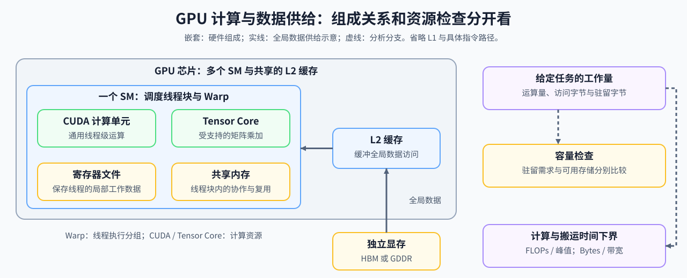

# 03. GPU Architecture and Memory | GPU 物理架构与内存层级

**难度：** Hard | **环境：** CPU-first | **标签：** `硬件系统`, `GPU`, `内存层级` | **目标人群：** 需要理解 GPU 性能约束的学习者

> 🚀 **云端运行环境**
>
> 本章节的实战代码可以点击以下链接在免费 GPU 算力平台上直接运行：
>
> [](https://colab.research.google.com/github/datawhalechina/llm-algo-leetcode/blob/main/01_Hardware_Math_and_Systems/03_GPU_Architecture_and_Memory.ipynb)
> [](https://modelscope.cn/my/mynotebook) *(国内推荐：魔搭社区免费实例)*


---

## 本节导读

GPU 上的模型计算同时受计算吞吐、显存带宽和显存容量约束。当前阶段需要频繁访问或暂时驻留的数据集合称为工作集（working set），它决定数据应在寄存器、片上存储还是显存之间怎样移动。
本节建立“计算单元 → 内存层级 → 工作集 → 资源约束”的关系。完成后，你应能根据计算量、数据量和访问路径，初步判断一个算子更可能受计算、带宽还是容量限制。

**关键词：** `Tensor Core`, `SRAM`, `HBM`



---
## 前置阅读
**导语：** 先回顾 dtype、参数量和 FLOPs 的数量级关系，再从 GPU 执行层级和内存层级出发，判断计算、带宽与容量压力分别来自哪里。

- [Part 01 · 01 数据类型与精度](./01_Data_Types_and_Precision.md)
- [Part 01 · 02 参数量与 FLOPs](./02_LLM_Params_and_FLOPs.md)
- [Part 01 · 05 通信拓扑](./05_Communication_Topologies.md)

---
## Q1：为什么 GPU 计算能力提高后，Transformer 不一定同比变快？


GPU 规格中的峰值算力只描述计算单元最快能完成多少运算，不表示数据已经及时送到计算单元。Transformer 由多个重复的计算模块组成，Attention 和 MLP 都会产生输入、权重、激活与中间结果；如果这些数据的读取、写回和复用跟不上，计算单元就会等待，峰值算力也无法转化为同等的程序加速。
因此，判断一个算子受什么限制，可以先问两个问题：它要完成多少计算，以及要从内存搬运多少数据。后面的 FLOPs、Bytes 和算术强度，就是把这两个问题量化。

不同 GPU 代际会在 dtype 支持、片上存储、异步搬运和互连能力上做不同取舍。这里先比较这些能力如何改变算子执行，再把具体设备规格作为数量级参考。

可以先用下面的三分法定位现象：

| 现象 | 主要限制 | 常见表现 |
| --- | --- | --- |
| 数据装不下 | 显存容量 | OOM，需要 offload、分片或缩短序列 |
| 数据搬得慢 | 显存带宽或访存路径 | 计算单元等待，带宽接近上限 |
| 计算做得慢 | 计算吞吐 | CUDA Core 或 Tensor Core 接近饱和 |

### Q1小验证：先区分计算路径和数据供给

先观察计算路径与内存路径各自承担什么工作，再用后面的层级表和算术强度判断具体瓶颈。

```python
from typing import Dict

# 教学代理值：用于比较数量级，不代表具体 GPU 的实测规格。
TEACHING_BANDWIDTH = {'shared_memory': 19e12, 'l2_cache': 1.5e12, 'hbm': 1.5e12}
COMPUTE_PATHS = {'cuda_core': '线程级标量 / 向量计算', 'tensor_core': '矩阵乘加与低精度路径'}


def bytes_to_gb(bytes_val: float) -> float:
    """把字节转换为十进制 GB；只用于教学展示。"""
    if bytes_val < 0:
        raise ValueError('bytes_val 不能为负数')
    return bytes_val / 1e9


def analyze_memory_hierarchy() -> Dict[str, Dict[str, float]]:
    """计算内存层级的带宽数量级和 1KB 传输时间代理值。"""
    result = {}
    for mem_type, bandwidth in TEACHING_BANDWIDTH.items():
        result[mem_type] = {'bandwidth_tb_s': bandwidth / 1e12, 'time_for_1kb_ns': 1024 / bandwidth * 1e9}
    return result


mem_analysis = analyze_memory_hierarchy()
print('计算路径：', COMPUTE_PATHS)
for name, stats in mem_analysis.items():
    print(f"{name:15s}: {stats['bandwidth_tb_s']:6.1f} TB/s, 1KB transfer proxy: {stats['time_for_1kb_ns']:6.2f} ns")
def test_gpu_memory_practice():
    assert set(COMPUTE_PATHS) == {'cuda_core', 'tensor_core'}
    assert mem_analysis['shared_memory']['bandwidth_tb_s'] > mem_analysis['hbm']['bandwidth_tb_s']
    print('✅ 03 hardware path tests passed')


test_gpu_memory_practice()

```

### 数量级速览

这一张表用于比较硬件演进中的具体变化：计算路径、低精度支持、内存带宽和互连能力如何影响算子执行。具体带宽、算力、互连和 dtype 支持取决于 SKU、驱动和平台，应以对应硬件文档为准。

| 代际 | 计算路径变化 | 内存 / 互连变化 | 对本节的意义 |
| --- | --- | --- | --- |
| V100 | Tensor Core 开始用于低精度矩阵乘加 | GPU 内存系统继续服务大规模张量计算 | 理解 CUDA Core 与 Tensor Core 的分工 |
| A100 | BF16、TF32 等训练路径更成熟 | HBM 与片上缓存能力增强 | 理解计算吞吐和数据供给的协同 |
| H100 | FP8 与异步数据搬运能力增强 | HBM 和 GPU 互连继续提升 | 理解低精度、带宽和搬运机制 |
| Blackwell | 更低精度与更强矩阵计算路径 | 互连与数据搬运能力继续增强 | 观察硬件演进如何改变算子优化空间 |


## Q2：Transformer 中的矩阵计算如何使用 Tensor Core？


Transformer 的 Attention 和 MLP 都包含矩阵乘法。Tensor Core 是专门提高矩阵乘加吞吐的计算单元，更适合回答“矩阵乘法算得够不够快”，而不是直接回答“整个 Transformer 模块算得够不够快”。

CUDA Core 负责更通用的线程级计算；Tensor Core 主要服务于 FP16、BF16、FP8 等低精度数据类型下的矩阵乘加。具体支持的 dtype、数据块形状和吞吐取决于 GPU 架构，不能用一个固定的规格概括所有设备。

Tensor Core 只覆盖矩阵乘加这一段路径；数据准备、布局转换、Softmax 和结果写回仍然需要其他执行单元与内存层级配合。因此，矩阵乘法具备 Tensor Core 候选路径，不等于整个 Transformer 模块都会按同样比例加速。
本节小验证只比较不同矩阵形状和 dtype 对 FLOPs、输入输出规模以及 Tensor Core 候选路径的影响。Attention 工作集与序列长度的关系放到 Q4 单独观察。

可以把 GPU 的执行层级先简化为：

| 层级 | 作用 |
| --- | --- |
| SM | 调度线程块并组织片上计算资源 |
| Warp | 以一组线程为单位执行指令 |
| CUDA Core | 执行通用线程级计算 |
| Tensor Core | 执行特定形状的矩阵乘加 |

### Q2小验证：矩阵形状与 Tensor Core 候选路径

先比较矩阵形状、dtype 和 FLOPs，再判断它是否具备低精度矩阵乘法的 Tensor Core 候选路径；这仍是机制模拟，不是硬件吞吐测试。

```python
def estimate_matmul_workload(m, n, k, dtype='bf16'):
    """估算矩阵乘法工作量并标记 Tensor Core 候选路径。"""
    if min(m, n, k) <= 0:
        raise ValueError('矩阵维度必须为正数')
    if dtype not in {'fp16', 'bf16', 'fp8', 'fp32'}:
        raise ValueError('unsupported dtype')
    return {
        'flops': 2 * m * n * k,
        'input_elements': m * k + k * n,
        'output_elements': m * n,
        'dtype': dtype,
        'tensor_core_candidate': dtype in {'fp16', 'bf16', 'fp8'},
    }

for shape, dtype in [((1024, 1024, 4096), 'bf16'), ((1024, 1024, 4096), 'fp32'), ((2048, 4096, 4096), 'fp16')]:
    print(shape, dtype, estimate_matmul_workload(*shape, dtype))


def test_matmul_workload():
    low_precision = estimate_matmul_workload(1024, 1024, 4096, 'bf16')
    fp32 = estimate_matmul_workload(1024, 1024, 4096, 'fp32')
    assert low_precision['flops'] == fp32['flops']
    assert low_precision['tensor_core_candidate'] is True
    assert fp32['tensor_core_candidate'] is False
    print('✅ Tensor Core candidate tests passed')


test_matmul_workload()

```

## Q3：GPU 的内存层级如何影响数据搬运？


把内存层级先看成“离计算单元的距离不同”：越靠近计算单元，通常访问更快、容量更小；越远，容量更大，但搬运代价也更明显。优化的关键不是让所有数据都停在最快的层级，而是让会被重复使用的数据尽量靠近计算单元。

当一个算子每搬运很多字节只完成少量计算时，更容易受到全局显存带宽限制。可以用**算术强度**把这个判断量化：

```text
Arithmetic Intensity = FLOPs / Bytes
```

算术强度较低，说明每搬一次数据完成的计算较少，更容易受带宽限制；算术强度较高，计算单元才更可能成为限制因素。同一 warp 的线程如果访问连续地址，更容易形成合并访问；访问跨度大或布局不匹配时，会增加全局显存事务。Triton 的 block 抽象可以帮助组织 tile 和数据搬运，但不会自动决定最优的 tile 大小或复用方式，具体选择仍需结合算子形状和 profiling 判断。资源占用过高还可能降低一个 SM 同时驻留的 warp 数量，即 occupancy。下面的表格把这些判断落到各级存储层次。

| 层级 | 主要作用 | 主要观察点 | 典型风险 |
| --- | --- | --- | --- |
| 寄存器 | 保存线程正在使用的少量数据 | 临时变量和寄存器占用 | register spilling、occupancy 下降 |
| Shared Memory（片上 SRAM） | 在线程块内复用数据 | tile 是否放得下、数据是否重复复用 | bank conflict、容量或占用过高 |
| L2 Cache | 缓冲多个 SM 对全局数据的访问 | 不同线程块能否复用相同数据 | 命中率不足、反复访问显存 |
| 全局显存（通常由 HBM 提供） | 保存权重、激活和中间结果 | 访问次数、带宽和容量 | 带宽受限、容量不足 |

### Q3小验证：用算术强度判断瓶颈

把一个算子的 FLOPs 与需要搬运的字节数放在一起，观察它更可能受计算吞吐还是显存带宽限制。


```python
def estimate_arithmetic_intensity(flops: float, bytes_moved: float) -> float:
    """计算算术强度：每搬运 1 Byte 数据对应的 FLOPs。"""
    if flops < 0 or bytes_moved <= 0:
        raise ValueError('FLOPs 不能为负数，bytes_moved 必须为正数')
    return flops / bytes_moved


def roofline_estimate(flops: float, bytes_moved: float, peak_compute_tflops: float, memory_bandwidth_gb_s: float) -> Dict[str, float | str]:
    """用简化 Roofline 估算可达性能和瓶颈；不是 profiler 计数器结果。"""
    if flops < 0 or bytes_moved <= 0 or peak_compute_tflops <= 0 or memory_bandwidth_gb_s <= 0:
        raise ValueError('输入必须满足 FLOPs>=0，字节数、峰值算力和带宽均为正数')
    intensity = estimate_arithmetic_intensity(flops, bytes_moved)
    bandwidth_roof = intensity * memory_bandwidth_gb_s / 1e3
    return {'arithmetic_intensity': intensity, 'bandwidth_roof_tflops': bandwidth_roof, 'attainable_tflops': min(peak_compute_tflops, bandwidth_roof), 'bottleneck': 'compute' if peak_compute_tflops <= bandwidth_roof else 'memory'}


cases = {'elementwise_like': (2_000_000, 1_000_000), 'matmul_like': (2_000_000_000, 100_000_000)}
for name, (flops, moved) in cases.items():
    r = roofline_estimate(flops, moved, 300, 1500)
    print(f"{name}: intensity={r['arithmetic_intensity']:.1f} FLOPs/Byte, {r['bottleneck']} bound")


def test_roofline_estimate():
    assert roofline_estimate(2e6, 1e6, 300, 1500)['bottleneck'] == 'memory'
    result = roofline_estimate(2e12, 1e8, 300, 1500)
    assert result['bottleneck'] == 'compute' and result['attainable_tflops'] <= 300
    print('✅ roofline tests passed')


test_roofline_estimate()

```

## Q4：Attention 工作集为什么会暴露显存瓶颈？


模型运行时会产生权重、激活和中间张量，它们需要在计算单元与不同内存层级之间移动。Attention 是一个典型例子：序列变长时，完整的 score 矩阵按序列长度的平方增长，工作集和数据搬运都可能成为限制。

本节先用 Attention 工作集解释分块的必要性；需要继续学习分块工作集和 Online Softmax 时，阅读 [Part 01 · 14 FlashAttention 显存模型](./14_FlashAttention_Memory_Model.md) 与 [Part 02 · 20 FlashAttention 模拟](../02_PyTorch_Algorithms/20_FlashAttention_Sim.md)。
小验证先估算 Q/K/V、score 矩阵和输出的工作集，再比较完整 score 矩阵与单个 tile 的规模；它解释驻留方式的变化，不代表真实 kernel 的端到端性能。

### Q4小验证：Attention 工作集与分块尺度

```python
def calculate_attention_vram(seq_len: int, num_heads: int, head_dim: int, dtype_bytes: int = 2, batch_size: int = 1) -> Dict[str, float]:
    """估算标准 Attention 的工作集显存；不是完整模型的 CUDA peak memory。"""
    if min(seq_len, num_heads, head_dim, dtype_bytes, batch_size) <= 0:
        raise ValueError('所有形状和 dtype_bytes 都必须为正数')
    qkv = 3 * batch_size * seq_len * num_heads * head_dim * dtype_bytes
    matrix = batch_size * num_heads * seq_len * seq_len * dtype_bytes
    output = batch_size * seq_len * num_heads * head_dim * dtype_bytes
    flops = 4 * batch_size * num_heads * seq_len * seq_len * head_dim
    return {'qkv': bytes_to_gb(qkv), 'attention_matrix': bytes_to_gb(matrix), 'output': bytes_to_gb(output), 'total': bytes_to_gb(qkv + matrix + output), 'score_flops': flops, 'score_intensity': flops / matrix}


def attention_sensitivity(seq_lens, batch_size=1, num_heads=32, head_dim=128, dtype_bytes=2):
    """生成不同序列长度下的工作集表；不等同于完整模型峰值显存。"""
    rows = []
    for seq_len in seq_lens:
        r = calculate_attention_vram(seq_len, num_heads, head_dim, dtype_bytes, batch_size)
        rows.append({'seq_len': seq_len, 'qkv_gb': round(r['qkv'], 4), 'attention_matrix_gb': round(r['attention_matrix'], 4), 'total_working_set_gb': round(r['total'], 4), 'attention_share': round(r['attention_matrix'] / r['total'], 4), 'score_flops': r['score_flops'], 'score_intensity': round(r['score_intensity'], 2)})
    return rows


def attention_score_bytes(seq_len: int, dtype_bytes: int = 2) -> int:
    """估算完整 Attention score 矩阵的体积。"""
    if seq_len <= 0 or dtype_bytes <= 0:
        raise ValueError('seq_len 和 dtype_bytes 必须为正数')
    return seq_len * seq_len * dtype_bytes


def tile_bytes(block_size: int, dtype_bytes: int = 2) -> int:
    """估算一个方形 tile 的体积。"""
    if block_size <= 0 or dtype_bytes <= 0:
        raise ValueError('block_size 和 dtype_bytes 必须为正数')
    return block_size * block_size * dtype_bytes


def compare_attention_working_set(seq_len: int, block_size: int = 128, dtype_bytes: int = 2):
    """比较完整矩阵和单 tile 工作集；不模拟真实 FlashAttention kernel。"""
    score, tile = attention_score_bytes(seq_len, dtype_bytes), tile_bytes(block_size, dtype_bytes)
    return {'naive_score_mb': score / 1024 / 1024, 'tile_kb': tile / 1024, 'tile_count': (seq_len + block_size - 1) // block_size, 'working_set_reduction': score / tile}


for row in attention_sensitivity([512, 2048, 4096, 8192]):
    print(row)

for seq_len in [2048, 4096, 8192]:
    print(f"seq_len={seq_len}: {compare_attention_working_set(seq_len)}")


def test_attention_working_set():
    rows = attention_sensitivity([512, 1024, 2048])
    totals = [r['total_working_set_gb'] for r in rows]
    matrices = [r['attention_matrix_gb'] for r in rows]
    assert totals == sorted(totals) and matrices == sorted(matrices)
    assert rows[-1]['attention_share'] > rows[0]['attention_share']
    short, long = compare_attention_working_set(2048), compare_attention_working_set(4096)
    assert long['naive_score_mb'] > short['naive_score_mb']
    assert long['tile_kb'] == short['tile_kb'] and long['tile_count'] > short['tile_count']
    print('✅ attention working-set tests passed')


test_attention_working_set()

```

## 扩展 Q5：显存跨卡分摊后，通信代价从哪里产生？


当单卡装不下模型或需要跨卡协作时，参数、激活或 KV Cache 可能需要在 GPU 之间交换。显存分摊并不会消除成本，而是把一部分成本转移到通信带宽、通信延迟和同步等待。

PCIe、NVLink 和 NVSwitch 可以提供不同的连接带宽与拓扑条件；具体差异取决于设备、链路数量和平台实现。本节扩展用于判断：如果分摊后需要频繁 All-Reduce、All-Gather 或状态同步，通信就可能成为新的瓶颈。下面的代码只估算 PCIe / NVLink 链路传输和重复同步的时间代理，不模拟集合通信的真实算法、拓扑或通信量；这些内容需要在分布式项目中验证。

| 通信方式 | 典型用途 | 主要代价 |
| --- | --- | --- |
| PCIe | GPU 与 CPU、GPU 与 GPU 之间的数据传输 | 带宽和延迟受主机拓扑影响 |
| NVLink | 节点内 GPU 间的高速互连 | 需要匹配的 GPU、链路和拓扑 |
| NVSwitch | 在多 GPU 系统中提供更均匀的互连路径 | 仍需考虑同步与通信量 |
| All-Reduce / All-Gather | 聚合或交换并行计算中的参数、梯度或激活 | 通信量、同步等待和关键路径阻塞 |


```python
def pcie_vs_nvlink(payload_mb: float, pcie_gbps: float = 64, nvlink_gbps: float = 900, communication_rounds: int = 1, sync_overhead_ms: float = 0.0):
    """估算 PCIe / NVLink 链路时间和重复同步代价；不是实测。

    All-Reduce、All-Gather、NVSwitch 拓扑和真实 collective 通信量不在此代理模型中。"""
    if payload_mb <= 0 or pcie_gbps <= 0 or nvlink_gbps <= 0:
        raise ValueError('payload 和带宽必须为正数')
    if communication_rounds < 1 or sync_overhead_ms < 0:
        raise ValueError('communication_rounds 至少为 1，sync_overhead_ms 不能为负数')
    pcie_once = payload_mb * 8 / pcie_gbps
    nvlink_once = payload_mb * 8 / nvlink_gbps
    return {'pcie_once_ms': round(pcie_once, 3), 'nvlink_once_ms': round(nvlink_once, 3), 'pcie_total_ms': round((pcie_once + sync_overhead_ms) * communication_rounds, 3), 'nvlink_total_ms': round((nvlink_once + sync_overhead_ms) * communication_rounds, 3), 'communication_rounds': communication_rounds, 'evidence_level': 'link_transfer_proxy', 'collectives_modeled': False}


for payload in [64, 256, 1024]:
    print(payload, 'MB ->', pcie_vs_nvlink(payload, communication_rounds=4, sync_overhead_ms=0.05))
print('带宽差异只有在通信位于关键路径时才会影响端到端时间')


def test_interconnect_model():
    one, many = pcie_vs_nvlink(256, communication_rounds=1), pcie_vs_nvlink(256, communication_rounds=4)
    assert many['pcie_total_ms'] > one['pcie_total_ms'] and many['nvlink_total_ms'] > one['nvlink_total_ms']
    assert many['collectives_modeled'] is False and many['evidence_level'] == 'link_transfer_proxy'
    print('✅ interconnect model tests passed')


test_interconnect_model()

```

## 相关阅读
**导语：** 如果想把硬件层级判断继续接到访存优化、attention kernel 和推理验证上，可以按“官方文档 → 开源实现 → 论文”顺序阅读；这些入口都是可选扩展。
- [NVIDIA CUDA C Programming Guide](https://docs.nvidia.com/cuda/cuda-c-programming-guide/)：了解线程层级、内存层级、Shared Memory 和异步数据搬运。
- [FlashAttention: Fast and Memory-Efficient Exact Attention with IO-Awareness](https://arxiv.org/abs/2205.14135)：理解 Attention 如何通过 IO 感知和分块减少 HBM 访问。
- [Roofline: An Insightful Visual Performance Model for Multicore Architectures](https://doi.org/10.1145/1498765.1498785)：理解算术强度、计算上限和带宽上限之间的关系。
