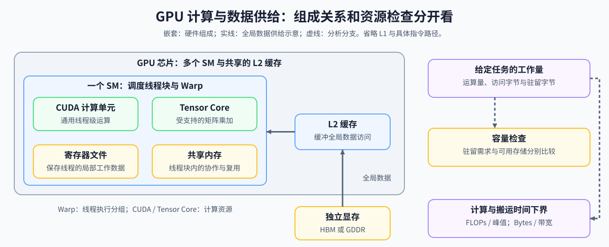

# 03. GPU Architecture and Memory | GPU 物理架构与内存层级

**难度：** Hard | **环境：** CPU-first | **标签：** `硬件系统`, `GPU`, `内存层级` | **目标人群：** 掌握张量运算

> 🚀 **云端运行环境**
>
> 本章节的实战代码可以点击以下链接在免费 GPU 算力平台上直接运行：
>
> [](https://colab.research.google.com/github/datawhalechina/llm-algo-leetcode/blob/main/01_Hardware_Math_and_Systems/03_GPU_Architecture_and_Memory.ipynb)
> [](https://modelscope.cn/my/mynotebook) *(国内推荐：魔搭社区免费实例)*


---

## 本节导读

GPU上的模型计算同时受计算吞吐、显存带宽和容量约束。流式多处理器（SM）组织线程执行，并使用寄存器与共享内存等片上资源。当前阶段访问或暂时保留的数据集合称为工作集（Working Set）；它的大小与复用关系影响哪些数据可以保留、哪些需要反复搬运。

同样叫 GPU，不同产品的显存、片上资源和指令能力并不相同；架构名称也不能直接当作某块设备的完整规格。本节把这些差别连接到计算单元、内存层级和工作集，支撑算子优化中分块、矩阵计算与资源判断。完成后，你应能根据计算量、数据量和访问路径，初步判断一个算子更可能受计算、带宽还是容量限制。

**关键词：** 流式多处理器、内存层次、算术强度、工作集



---
## 前置阅读
**导语：** 先回顾 dtype、参数量和 FLOPs 的数量级关系，再从 GPU 执行层级和内存层级出发，判断计算、带宽与容量压力分别来自哪里。

- [Part 01 · 01 数据类型与精度](./01_Data_Types_and_Precision.md)
- [Part 01 · 02 参数量与 FLOPs](./02_LLM_Params_and_FLOPs.md)

---
## Q1：为什么 GPU 计算能力提高后，Transformer 不一定同比变快？


GPU 规格中的峰值算力只描述计算单元最快能完成多少运算，不表示数据已经及时送到计算单元。Transformer 由多个重复的计算模块组成，Attention 和 MLP 都会产生输入、权重、激活与中间结果；如果这些数据的读取、写回和复用跟不上，计算单元就会等待，峰值算力也无法转化为同等的程序加速。
因此，判断一个算子受什么限制，可以先问两个问题：它要完成多少计算，以及要从内存搬运多少数据。后面的 FLOPs、Bytes 和算术强度，就是把这两个问题量化。

不同 GPU 代际会在 dtype 支持、片上存储、异步搬运和互连能力上做不同取舍。这里先解释这些能力如何改变算子执行，再区分架构名称、具体型号与设备能力。

先区分下面三类资源问题，再用实际记录检查候选约束：

| 现象 | 候选约束 | 需要核对 |
| --- | --- | --- |
| 数据装不下 | 显存容量 | 当前工作集、临时缓冲与可用容量 |
| 数据搬得慢 | 显存带宽或访存路径 | 实际搬运量、缓存命中与有效带宽 |
| 计算做得慢 | 计算吞吐 | 实际计算路径、吞吐与资源用量 |

### Q1 机制计算器：给定带宽下的数据传输需要多长时间？

固定1 MiB数据，只改变假设带宽。字节数除以带宽得到纯传输时间，不是单次内存访问延迟；实际存储层次的带宽需按设备与访问方式查询或测量。


```python
import math


def bytes_to_gb(bytes_val: float) -> float:
    """将已由形状计算得到的字节量换算为十进制GB。"""
    return bytes_val / 1e9


def estimate_transfer_times(bandwidths_gb_s: dict, payload_bytes: int = 1024**2) -> dict:
    """按显式带宽场景计算纯传输ms；场景不绑定寄存器、缓存或显存规格。"""
    if type(payload_bytes) is not int or payload_bytes < 0:
        raise ValueError("payload_bytes须为非负整数")
    result = {}
    for name, bandwidth in bandwidths_gb_s.items():
        if type(bandwidth) not in (int, float) or not math.isfinite(bandwidth) or bandwidth <= 0:
            raise ValueError("场景带宽须为有限正实数，单位GB/s")
        result[name] = {"bandwidth_gb_s": bandwidth,
                        "estimated_transfer_ms": payload_bytes / (bandwidth * 1e9) * 1e3}
    return result


# 两个给定带宽，不代表某一内存层级或GPU型号。
bandwidths_gb_s = {"scenario_a": 1000, "scenario_b": 2000}
mem_analysis = estimate_transfer_times(bandwidths_gb_s=bandwidths_gb_s)
assert bytes_to_gb(1_000_000_000) == 1
assert math.isclose(mem_analysis["scenario_a"]["estimated_transfer_ms"], 0.001048576)
assert mem_analysis["scenario_b"]["estimated_transfer_ms"] == (
    mem_analysis["scenario_a"]["estimated_transfer_ms"] / 2
)
assert estimate_transfer_times(bandwidths_gb_s=bandwidths_gb_s,
                                payload_bytes=0)["scenario_a"]["estimated_transfer_ms"] == 0
for name, row in mem_analysis.items():
    print(f"{name}: 给定 {row['bandwidth_gb_s']:g} GB/s，"
          f"1 MiB纯传输估算 {row['estimated_transfer_ms'] * 1000:g} us")

```

### 从架构名称到具体设备能力

架构名称（如 Ampere、Hopper、Blackwell）描述一类硬件设计，产品型号指向具体设备，计算能力（Compute Capability，CC）则标识 CUDA 硬件功能与指令特性。三者不能互换：同属 Blackwell 的产品也可能对应不同 CC；同一 CC 也不意味着显存容量、SM 数量、带宽与互连配置相同。

例如 NVIDIA 的[设备计算能力表](https://developer.nvidia.com/cuda/gpus)将 A100 列为 CC 8.0、H100 列为 9.0，B200 列为 10.0，而 GeForce RTX 5070 Ti 列为 12.0。CC 是能力分类，不是可直接比较快慢的分数；不能因为 12.0 大于 10.0，就推断消费级产品在给定训练或推理任务上更快。

判断一个优化能否使用，先核对具体型号与 CC，再查目标指令、数据类型和资源限制；判断它是否值得使用，还要结合输入、数据布局与真实执行结果。驱动支持的 CUDA 版本、PyTorch 构建使用的 CUDA 版本和本机 Toolkit 版本属于软件条件，不是设备 CC。资源与版本分别记录，避免把“能识别设备”当作“目标内核能够运行”。

| 要判断的问题 | 需要核对的对象 | 对算子实现的影响 |
| --- | --- | --- |
| 某条矩阵或搬运指令能否使用 | CC、该指令的目标要求、编译器支持 | 选择支持的路径，保留必要的回退实现 |
| 一个分块能否容纳 | 具体设备与内核的线程、寄存器、共享内存限制 | 决定分块、缓冲及驻留条件 |
| 数据能否装入显存、搬得是否足够快 | 产品显存、带宽及访问方式 | 判断容量、复用和数据供给压力 |
| 多卡之间如何交换数据 | 实际链路、主机拓扑与互连配置 | 决定通信路径，不从架构名称推断带宽 |

## Q2：Transformer 中的矩阵计算如何使用 Tensor Core？


Transformer 的 Attention 和 MLP 都包含矩阵乘法。Tensor Core 是专门提高矩阵乘加吞吐的计算单元，更适合回答“矩阵乘法算得够不够快”，而不是直接回答“整个 Transformer 模块算得够不够快”。

CUDA Core负责更通用的线程级计算；Tensor Core提供特定矩阵乘加路径，支持的数据类型、累加方式和块形状随设备与实现变化。FP32输入也可能按TensorFloat-32（TF32）模式进行矩阵计算，这由精度配置和后端共同决定。TF32是计算精度模式，输入仍以FP32存储；配置含义见[PyTorch 2.11 TF32说明](https://docs.pytorch.org/docs/2.11/notes/cuda.html#tensorfloat-32-tf32-on-ampere-and-later-devices)。因此输入dtype、内部计算精度与实际指令要分别核对。

Tensor Core 只覆盖矩阵乘加这一段路径；数据准备、布局转换、Softmax 和结果写回仍然需要其他执行单元与内存层级配合。因此，矩阵乘法具备 Tensor Core 候选路径，不等于整个 Transformer 模块都会按同样比例加速。
下方先核对形状和dtype对应的运算量与输入输出字节；矩阵指令的设备条件在12／23节继续检查。

计算资源与线程执行分组需要分开看，它们不是同一种层级关系：

| 对象 | 作用 |
| --- | --- |
| SM | 调度线程块并组织片上计算资源 |
| Warp | 以一组线程为单位执行指令 |
| CUDA Core | 执行通用线程级计算 |
| Tensor Core | 执行特定形状的矩阵乘加 |

### Q2 机制计算器：同一矩阵形状改变精度后，什么保持不变？

左输入为M×K，右输入为K×N，输出为M×N；乘加按两次浮点运算计。只估算输入各读一次、输出写一次的字节量，实际读写和所选指令另行核对。


```python
def estimate_matmul_workload(m: int, n: int, k: int, dtype: str = "bf16") -> dict:
    """返回矩阵乘FLOPs、输入输出元素及最低一次读写字节；不推断实际硬件路径。"""
    if any(type(dim) is not int or dim <= 0 for dim in (m, n, k)):
        raise ValueError("矩阵维度须为正整数")
    dtype_sizes = {"fp16": 2, "bf16": 2, "fp8": 1, "fp32": 4}
    if type(dtype) is not str or dtype not in dtype_sizes:
        raise ValueError("须使用fp16、bf16、fp8或fp32")
    inputs, outputs = m * k + k * n, m * n
    return {"flops": 2 * m * n * k, "input_elements": inputs,
            "output_elements": outputs, "dtype": dtype,
            "minimum_io_bytes": (inputs + outputs) * dtype_sizes[dtype]}


shape = dict(m=2, n=3, k=4)
low_precision = estimate_matmul_workload(**shape, dtype="bf16")
fp32 = estimate_matmul_workload(**shape, dtype="fp32")
assert low_precision == {
    "flops": 48, "input_elements": 20, "output_elements": 6,
    "dtype": "bf16", "minimum_io_bytes": 52,
}
assert fp32["flops"] == 48 and fp32["minimum_io_bytes"] == 104
assert estimate_matmul_workload(m=1, n=1, k=1, dtype="fp8")["minimum_io_bytes"] == 3
for dtype in ("bf16", "fp32"):
    row = estimate_matmul_workload(m=1024, n=1024, k=4096, dtype=dtype)
    print(f"{dtype}: {row['flops']:,} FLOPs，最低输入输出 {row['minimum_io_bytes']:,} B")

```

## Q3：GPU 的内存层级如何影响数据搬运？


把内存层级先看成“离计算单元的距离不同”：越靠近计算单元，通常访问更快、容量更小；越远，容量更大，但搬运代价也更明显。优化的关键不是让所有数据都停在最快的层级，而是让会被重复使用的数据尽量靠近计算单元。

当一个算子每搬运很多字节只完成少量计算时，更容易受到全局显存带宽限制。可以用**算术强度**把这个判断量化：

```text
Arithmetic Intensity = FLOPs / Bytes
```

算术强度较低，说明每搬一次数据完成的计算较少，更容易受带宽限制；算术强度较高，计算单元才更可能成为限制因素。同一 warp 的线程如果访问连续地址，更容易形成合并访问；访问跨度大或布局不匹配时，会增加全局显存事务。Triton 的 block 抽象可以帮助组织 tile 和数据搬运，但不会自动决定最优的 tile 大小或复用方式，具体选择仍需结合算子形状和 profiling 判断。SM占用率（Occupancy）是驻留Warp数与设备支持上限的比例，资源用量过高可能限制驻留；它不是前面线程槽利用比例，也不直接等于吞吐。寄存器溢出是临时值转入本地内存空间、增加存取的情况；存储体冲突是共享内存访问因地址映射而需要分批服务。HBM和GDDR是两类显存技术，不能把所有GPU显存都称作HBM。SRAM是静态随机存取存储器，常用于片上缓存和共享存储，描述的是存储技术；它不是与寄存器、缓存并列的独立访问层级。下面按数据用途区分各级存储。

| 层级 | 主要作用 | 主要观察点 | 典型风险 |
| --- | --- | --- | --- |
| 寄存器 | 保存线程正在使用的少量数据 | 临时变量和寄存器占用 | 寄存器溢出、驻留受限 |
| 共享内存 | 在线程块内复用数据 | tile 是否放得下、数据是否重复复用 | 存储体冲突、容量或驻留受限 |
| L2 Cache | 缓冲多个 SM 对全局数据的访问 | 不同线程块能否复用相同数据 | 命中率不足、反复访问显存 |
| 全局显存（如HBM或GDDR） | 保存权重、激活和中间结果 | 访问次数、带宽和容量 | 带宽受限、容量不足 |

### Q3 机制计算器：比较计算与带宽两类上界

屋顶线（Roofline）模型用给定计算上限与带宽限制共同约束吞吐。固定300 TFLOP/s与1500 GB/s，交点为200 FLOP/B；分别检查低于、等于和高于交点的输入。


```python
def estimate_arithmetic_intensity(flops: float, bytes_moved: float) -> float:
    """返回每个实际或明确假设的搬运字节对应的FLOPs。"""
    if (any(type(value) not in (int, float) or not math.isfinite(value)
            for value in (flops, bytes_moved)) or flops < 0 or bytes_moved <= 0):
        raise ValueError("FLOPs须为有限非负实数，搬运字节须为有限正实数")
    return flops / bytes_moved


def roofline_estimate(
    flops: float, bytes_moved: float, peak_compute_tflops: float, memory_bandwidth_gb_s: float,
) -> dict:
    """返回给定参考条件下的Roofline上界，未预测实际吞吐。"""
    intensity = estimate_arithmetic_intensity(flops=flops, bytes_moved=bytes_moved)
    if any(type(value) not in (int, float) or not math.isfinite(value) or value <= 0
           for value in (peak_compute_tflops, memory_bandwidth_gb_s)):
        raise ValueError("计算上限与带宽须为有限正实数")
    bandwidth_roof = intensity * memory_bandwidth_gb_s / 1000
    if bandwidth_roof < peak_compute_tflops:
        limiting_roof = "memory"
    elif bandwidth_roof > peak_compute_tflops:
        limiting_roof = "compute"
    else:
        limiting_roof = "balance"
    return {
        "arithmetic_intensity": intensity, "bandwidth_roof_tflops": bandwidth_roof,
        "roofline_upper_tflops": min(peak_compute_tflops, bandwidth_roof),
        "limiting_roof": limiting_roof,
    }


reference = dict(peak_compute_tflops=300, memory_bandwidth_gb_s=1500)
cases = {
    "low_intensity": dict(flops=2_000_000, bytes_moved=1_000_000),
    "at_balance": dict(flops=20_000_000_000, bytes_moved=100_000_000),
    "high_intensity": dict(flops=2_000_000_000_000, bytes_moved=100_000_000),
}
reports = {name: roofline_estimate(**values, **reference) for name, values in cases.items()}
assert reports["low_intensity"]["roofline_upper_tflops"] == 3
assert reports["low_intensity"]["limiting_roof"] == "memory"
assert reports["at_balance"]["arithmetic_intensity"] == 200
assert reports["at_balance"]["limiting_roof"] == "balance"
assert reports["high_intensity"]["limiting_roof"] == "compute"
assert reports["high_intensity"]["roofline_upper_tflops"] == 300
for name, result in reports.items():
    print(f"{name}: {result['arithmetic_intensity']:g} FLOP/B，"
          f"模型上界 {result['roofline_upper_tflops']:g} TFLOP/s，{result['limiting_roof']}")

```

## Q4：Attention工作集为什么随序列长度快速增长？

以标准多头注意力（MHA）为例，Q、K、V分别是查询、键和值，单头的score矩阵保存每对查询与键的分数。序列长度为N时，每头需N×N个分数；长度翻倍，分数矩阵体积变成四倍，而固定头数与头维下的Q／K／V和输出体积只翻倍。

下面先计算Q／K／V、一个分数矩阵与输出的存储和，再比较单头完整分数矩阵与一个方形分数块。分数块只是分块注意力临时状态的一部分；Q／K／V块、累加结果及Softmax状态仍需存储。完整模型峰值和实际搬运量需要单独记录，分数矩阵的存储大小不作为Roofline的搬运分母。

### Q4 对照验证：先核对小形状，再扩大序列与分块

用N=4、2头、头维3和两字节元素手算存储；再检查序列翻倍和非整除分块。MiB／KiB按1024进位，GB按十进制。


```python
def calculate_attention_vram(
    seq_len: int, num_heads: int, head_dim: int, dtype_bytes: int = 2, batch_size: int = 1,
) -> dict:
    """返回MHA中QKV、单份分数矩阵和输出的GB存储和，以及QK与PV两次矩阵乘FLOPs。"""
    if any(type(value) is not int or value <= 0
           for value in (seq_len, num_heads, head_dim, dtype_bytes, batch_size)):
        raise ValueError("形状与元素字节数须为正整数")
    qkv = 3 * batch_size * seq_len * num_heads * head_dim * dtype_bytes
    matrix = batch_size * num_heads * seq_len * seq_len * dtype_bytes
    output = batch_size * seq_len * num_heads * head_dim * dtype_bytes
    flops = 4 * batch_size * num_heads * seq_len * seq_len * head_dim
    return {"qkv": bytes_to_gb(qkv), "attention_matrix": bytes_to_gb(matrix),
            "output": bytes_to_gb(output), "total": bytes_to_gb(qkv + matrix + output),
            "qk_pv_flops": flops}


def attention_sensitivity(
    seq_lens: list | tuple, batch_size: int = 1, num_heads: int = 32,
    head_dim: int = 128, dtype_bytes: int = 2,
) -> list:
    """按序列长度返回未舍入的MHA存储估算，GB采用十进制。"""
    if not isinstance(seq_lens, (list, tuple)) or not seq_lens:
        raise ValueError("seq_lens须为非空长度序列")
    rows = []
    for seq_len in seq_lens:
        result = calculate_attention_vram(seq_len=seq_len, num_heads=num_heads,
                                          head_dim=head_dim, dtype_bytes=dtype_bytes,
                                          batch_size=batch_size)
        rows.append({"seq_len": seq_len, "qkv_gb": result["qkv"],
                     "attention_matrix_gb": result["attention_matrix"],
                     "total_working_set_gb": result["total"], "qk_pv_flops": result["qk_pv_flops"]})
    return rows


def attention_score_bytes(seq_len: int, dtype_bytes: int = 2) -> int:
    """返回单头完整分数矩阵字节量。"""
    if any(type(value) is not int or value <= 0 for value in (seq_len, dtype_bytes)):
        raise ValueError("序列长度和元素字节数须为正整数")
    return seq_len * seq_len * dtype_bytes


def tile_bytes(block_size: int, dtype_bytes: int = 2) -> int:
    """返回一个方形分数块的容量字节数。"""
    if any(type(value) is not int or value <= 0 for value in (block_size, dtype_bytes)):
        raise ValueError("块大小和元素字节数须为正整数")
    return block_size * block_size * dtype_bytes


def compare_attention_working_set(
    seq_len: int, block_size: int = 128, dtype_bytes: int = 2,
) -> dict:
    """比较单头分数矩阵和一个分数块；网格按行、列分别向上取整。"""
    score = attention_score_bytes(seq_len=seq_len, dtype_bytes=dtype_bytes)
    block = tile_bytes(block_size=block_size, dtype_bytes=dtype_bytes)
    axis_tiles = (seq_len + block_size - 1) // block_size
    return {"score_mib": score / 1024**2, "score_tile_kib": block / 1024,
            "tile_grid": (axis_tiles, axis_tiles), "score_tile_count": axis_tiles**2,
            "score_to_tile_capacity_ratio": score / block}


small = calculate_attention_vram(seq_len=4, num_heads=2, head_dim=3)
assert small == {"qkv": 144 / 1e9, "attention_matrix": 64 / 1e9,
                 "output": 48 / 1e9, "total": 256 / 1e9, "qk_pv_flops": 384}
rows = attention_sensitivity(seq_lens=[4, 8], num_heads=2, head_dim=3)
assert rows[1]["attention_matrix_gb"] == 4 * rows[0]["attention_matrix_gb"]
assert rows[1]["qkv_gb"] == 2 * rows[0]["qkv_gb"]
assert rows[1]["qk_pv_flops"] == 4 * rows[0]["qk_pv_flops"]
assert compare_attention_working_set(seq_len=100, block_size=32)["tile_grid"] == (4, 4)
assert compare_attention_working_set(seq_len=100, block_size=32)["score_tile_count"] == 16
assert tile_bytes(block_size=128) == 32_768
for length in (2048, 4096):
    result = compare_attention_working_set(seq_len=length)
    print(f"N={length}: 单头score {result['score_mib']:g} MiB，"
          f"分数块 {result['score_tile_kib']:g} KiB，网格 {result['tile_grid']}")

```

## 扩展 Q5：显存跨卡分摊后，通信代价从哪里产生？


当单卡装不下模型或需要跨卡协作时，参数、激活或 KV Cache 可能需要在 GPU 之间交换。显存分摊并不会消除成本，而是把一部分成本转移到通信带宽、通信延迟和同步等待。

PCIe、NVLink 和 NVSwitch 可以提供不同的连接带宽与拓扑条件；具体差异取决于设备、链路数量和平台实现。本节扩展用于判断：如果分摊后需要频繁 All-Reduce、All-Gather 或状态同步，通信就可能成为新的瓶颈。下面把一条链路的有效带宽作为显式输入，用相同传输量比较两条假设路径。带宽统一为GB/s，即每秒十亿字节；真实PCIe或NVLink路径还要核对方向、链路数量和拓扑，集合通信量继续在1C组计算。

| 通信方式 | 典型用途 | 主要代价 |
| --- | --- | --- |
| PCIe | GPU 与 CPU、GPU 与 GPU 之间的数据传输 | 带宽和延迟受主机拓扑影响 |
| NVLink | 节点内 GPU 间的高速互连 | 需要匹配的 GPU、链路和拓扑 |
| NVSwitch | 在多 GPU 系统中提供更均匀的互连路径 | 仍需考虑同步与通信量 |
| All-Reduce / All-Gather | 聚合或交换并行计算中的参数、梯度或激活 | 通信量、同步等待和关键路径阻塞 |


```python
def pcie_vs_nvlink(
    payload_mb: float, pcie_gb_s: float, nvlink_gb_s: float,
    communication_rounds: int = 1, sync_overhead_ms: float = 0.0,
) -> dict:
    """按给定单向有效GB/s和十进制MB估算链路ms，每轮同步开销单独加入。"""
    if any(type(value) not in (int, float) or not math.isfinite(value) or value <= 0
           for value in (payload_mb, pcie_gb_s, nvlink_gb_s)):
        raise ValueError("传输量和带宽须为有限正实数")
    if type(communication_rounds) is not int or communication_rounds < 1:
        raise ValueError("传输轮数须为正整数")
    if (type(sync_overhead_ms) not in (int, float)
            or not math.isfinite(sync_overhead_ms) or sync_overhead_ms < 0):
        raise ValueError("同步开销须为有限非负实数")
    pcie_once = payload_mb / pcie_gb_s
    nvlink_once = payload_mb / nvlink_gb_s
    return {"pcie_once_ms": pcie_once, "nvlink_once_ms": nvlink_once,
            "pcie_total_ms": (pcie_once + sync_overhead_ms) * communication_rounds,
            "nvlink_total_ms": (nvlink_once + sync_overhead_ms) * communication_rounds}


# 仅为给定带宽场景，不对应固定型号或单链路规格。
inputs = dict(payload_mb=64, pcie_gb_s=16, nvlink_gb_s=64)
one = pcie_vs_nvlink(**inputs)
many = pcie_vs_nvlink(**inputs, communication_rounds=4, sync_overhead_ms=0.05)
assert one["pcie_once_ms"] == 4 and one["nvlink_once_ms"] == 1
assert math.isclose(many["pcie_total_ms"], 16.2)
assert math.isclose(many["nvlink_total_ms"], 4.2)
print(f"单轮给定路径：{one['pcie_once_ms']:g} / {one['nvlink_once_ms']:g} ms")
print(f"四轮含同步：{many['pcie_total_ms']:g} / {many['nvlink_total_ms']:g} ms")

```

## 相关阅读

把设备能力与执行组织分开后，再追踪线程如何覆盖张量，以及片上复用受什么约束。

- [15 CUDA 执行模型](./15_CUDA_Execution_Model.md)：Grid、Block、Warp 与线程覆盖。
- [24 SRAM 优化技术](./24_SRAM_Optimization_Techniques.md)：共享内存与寄存器需求怎样限制驻留。
- [NVIDIA CUDA 编程指南](https://docs.nvidia.com/cuda/cuda-programming-guide/)：计算能力、指令与资源限制的官方定义。
