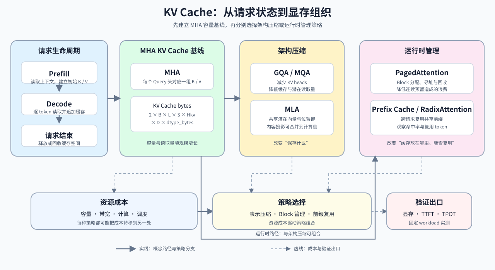

# 04. Attention Memory Optimization | 注意力机制变体与显存优化

**难度：** Medium | **环境：** CPU-first | **标签：** `推理优化`, `Attention`, `KV Cache` | **目标人群：** 系统性能入门者

> 🚀 **云端运行环境**
>
> 本章节的实战代码可以点击以下链接在免费 GPU 算力平台上直接运行：
>
> [](https://colab.research.google.com/github/datawhalechina/llm-algo-leetcode/blob/main/01_Hardware_Math_and_Systems/04_Attention_Memory_Optimization.ipynb)
> [](https://modelscope.cn/my/mynotebook) *(国内推荐：魔搭社区免费实例)*


---

## 本节导读

注意力机制的显存压力来自长期保存的键值缓存（KV Cache）、计算期间的临时工作集，以及服务运行时的缓存组织。减少状态量、减少临时读写和改善物理放置解决的是不同问题。
本节先做问题分类：头部共享或表示压缩改变长期状态量，FlashAttention 改变临时工作集与读写，PagedAttention 改变缓存的物理组织。完成后，你应能区分 MHA、MQA、GQA、MLA、FlashAttention 与 PagedAttention 分别改变哪一类成本；长期 KV Cache 容量账本在第 11 节展开，临时工作集模型在第 14 节展开。

**关键词：** `MHA`, `MQA`, `GQA`




---

## 前置阅读
**导语：** 先回顾数据表示、GPU 内存层级和缩放点积注意力，再比较三类显存杠杆。

- [Part 01 · 01 数据类型与精度](./01_Data_Types_and_Precision.md)
- [Part 01 · 03 GPU 架构与显存](./03_GPU_Architecture_and_Memory.md)
- [Part 00 · 16 Attention Mechanism Intro | 注意力机制导论](../00_Prerequisites/16_Attention_Mechanism_Intro.md)

---
## Q1：自回归生成中，标准多头注意力（MHA）的 KV Cache 如何形成显存与带宽压力？


标准多头注意力（MHA）为每一层、每个历史 token 保存 K 和 V。理论字节数可以写成：

```text
KV Cache bytes = 2 × batch × layers × seq_len × kv_heads × head_dim × dtype_bytes
```

其中 `2` 对应 K 和 V。以 `batch=1`、`layers=32`、`seq_len=2048`、`kv_heads=32`、`head_dim=128`、FP16 为例，单序列 KV Cache 约为 1.07 GB；并发序列增加到 32 时，理论容量需求也会近似扩大 32 倍。

缓存会经历 Prefill、Decode 和回收三个阶段：Prefill 建立初始 K/V，Decode 每生成一个 token 就追加并读取已有缓存，请求结束后释放或回收空间。序列长度和并发增长会带来容量压力，Decode 的反复读取还可能带来带宽压力；是否成为 Memory Bound 仍取决于模型、dtype、并发和实现。本节小验证先记录容量随序列长度变化的结果，真实延迟、带宽影响和回收策略交给推理项目验证。

| 变量 | 含义 | 对理论 KV Cache 的影响 |
| --- | --- | --- |
| `layers` | Transformer 层数 | 近似线性增长 |
| `seq_len` | 已缓存的上下文长度 | 近似线性增长 |
| `batch` / 并发 | 同时驻留的请求数 | 近似线性增长 |
| `kv_heads` | K/V 头数 | 近似线性增长，GQA / MQA 会改变它 |
| `head_dim` | 单个头的维度 | 近似线性增长 |
| `dtype_bytes` | 每个元素的字节数 | 近似线性增长，FP16 / BF16 通常为 2 |

### Q1小验证：观察 KV Cache 随序列长度的变化

把上下文长度翻倍，再看缓存大小是不是也近似翻倍。

```python
def kv_cache_bytes(seq_len, layers, heads, head_dim, dtype_bytes=2, batch_size=1):
    """估算 decode 阶段 KV Cache 的理论字节数。

    不包含 block metadata、padding、量化 scale、allocator reserve 或
    runtime workspace；这里的 heads 应该是 KV heads，而不是 query heads。
    """
    if min(seq_len, layers, heads, head_dim, dtype_bytes, batch_size) <= 0:
        raise ValueError('shape values 和 dtype_bytes 必须为正数')
    return 2 * batch_size * seq_len * layers * heads * head_dim * dtype_bytes

for seq_len in [1024, 2048, 4096]:
    size_gb = kv_cache_bytes(seq_len, 32, 32, 128) / 1e9
    print(f'seq_len={seq_len:4d} -> KV cache ≈ {size_gb:5.2f} GB')
base = kv_cache_bytes(2048, 32, 32, 128)
doubled = kv_cache_bytes(4096, 32, 32, 128)
assert doubled == 2 * base
print('seq_len doubled -> theoretical KV Cache ratio:', doubled / base)

```

## Q2：MQA (Multi-Query Attention) 和 GQA (Grouped-Query Attention) 是如何通过架构改进缓解 KV Cache 压力的？


为了减少需要搬运的数据量，研究人员改变了 Attention 的投影结构：

1. **MQA (Multi-Query Attention)**:
   - **机制**：无论有多少个 Query 头，所有 Query 头都**共享仅仅 1 个 Key 头和 1 个 Value 头**。
   - **收益**：KV Cache 中与 Key/Value 相关的头数从 `H` 降到 `1`，因此缓存大小近似缩小为 MHA 的 `1/H`，同时降低潜在的 KV 读取量；端到端速度是否提升仍取决于 kernel、backend 和 workload。
   - **代价**：共享 K/V 头会改变模型表达容量，可能影响部分任务质量；影响程度取决于模型结构、训练方式和具体 checkpoint。

2. **GQA (Grouped-Query Attention)**:
   - **机制**：一种折中方案。将 Query 头进行分组（例如 32 个 Query 头分成 8 组），每组内的 Query 头共享 1 对 Key/Value 头。
   - **收益**：KV Cache 中与 Key/Value 相关的头数从 `H` 降到 `G`，因此在其他条件相同时，缓存大小近似缩小为 MHA 的 `G/H`。例如 `H = 32, G = 8` 时，KV Cache 约为 MHA 的 `1/4`，潜在读取量也随之下降。

下面的表格把三种结构放在同一口径下比较。表中的比例是理论容量比例；实际速度、质量和 backend 收益仍需在固定 workload 上验证。

| 机制 | Query 头数 | KV 头数 | KV Cache 理论比例 | 主要变化 | 主要代价 |
| --- | ---: | ---: | ---: | --- | --- |
| MHA | H | H | 1 | 每个 Query 头对应独立 K/V 头 | KV Cache 最大 |
| GQA | H | G | G/H | 多个 Query 头共享一组 K/V 头 | 需要匹配的模型结构或 checkpoint |
| MQA | H | 1 | 1/H | 所有 Query 头共享一组 K/V 头 | 表达能力和任务质量可能受影响 |

### Q2小验证：头数变化为什么会直接影响缓存

固定上下文长度，只改变 KV 头数，看看缓存怎么缩。

```python
def kv_cache_gb(seq_len, layers, kv_heads, head_dim, dtype_bytes=2, batch_size=1):
    """返回 KV Cache 的十进制 GB 数量，用于比较不同 KV 头数。"""
    return kv_cache_bytes(seq_len, layers, kv_heads, head_dim, dtype_bytes, batch_size) / 1e9

seq_len = 4096
layers = 32
head_dim = 128
mha_gb = kv_cache_gb(seq_len, layers, 32, head_dim)
for name, kv_heads in [('MHA', 32), ('GQA', 8), ('MQA', 1)]:
    current_gb = kv_cache_gb(seq_len, layers, kv_heads, head_dim)
    print(f'{name:>3s}: kv_heads={kv_heads:2d}, KV cache ≈ {current_gb:5.2f} GB, 压缩比例={current_gb / mha_gb:.3f}')
ratios = {name: kv_cache_gb(seq_len, layers, heads, head_dim) / mha_gb for name, heads in [('MHA', 32), ('GQA', 8), ('MQA', 1)]}
assert ratios == {'MHA': 1.0, 'GQA': 0.25, 'MQA': 1 / 32}
print('head-sharing ratios are theoretical cache ratios; speed and quality require a real workload')
```

## Q3：MLA 缓存更紧凑的表示后，怎样计算注意力分数？

多头潜在注意力（Multi-head Latent Attention，MLA）把 K 和 V 的内容信息联合压缩为低维向量，称为潜在表示（latent）。它与 GQA 的区别在于：GQA 减少 K/V 头数，MLA 改变保存的表示。以内容键为例，若潜在向量为 $c$，上投影矩阵为 $U_K$，则展开后的键是 $k=U_Kc$。上投影就是把较短向量映射回计算所需的较宽表示。

计算内容分数时，可以先恢复键，再与查询 $q$ 点积；也可以利用矩阵乘法结合律，先变换查询：
```text
qᵀ (U_K c) = (U_Kᵀ q)ᵀ c
```
第二条路径直接读取历史潜在向量，与变换后的查询计算分数。这样，保存压缩表示并不意味着每轮都必须展开全部历史 K/V；相应投影也可以与查询侧、输出侧的计算合并，称为矩阵吸收。两条路径的算术操作和临时张量不同，需根据实际实现比较成本。

旋转位置编码（RoPE）通过与位置相关的旋转表示 token 位置，直接插入内容键会影响上述合并。因此，DeepSeek-V2 将内容与位置分开处理，缓存共享潜在向量和一份携带 RoPE 的位置键。下面只核对内容分数的代数等价关系；位置键与潜在向量共同占用的缓存字节数在[第11节](./11_KV_Cache_and_Memory_Growth.md)计算。机制来源见 [DeepSeek-V2 第2.1节](https://arxiv.org/html/2405.04434v5#S2.SS1)。

### Q3小验证：先恢复键与先变换查询是否得到相同分数

设查询有4个元素，潜在向量有2个元素，上投影矩阵为4行2列。先恢复得到键 $[2,3,5,1]$，与查询点积得9；再把查询变换为 $[3,1]$，与潜在向量点积，也得到9。修改查询或潜在向量后，两种算法应继续一致。


```python
def latent_content_scores(query, latent, key_projection):
    """比较单头内容分数的两种计算顺序；矩阵按行保存，省略缩放与位置分支。"""
    if not query or not latent or len(key_projection) != len(query):
        raise ValueError("上投影矩阵的行数须等于非空查询的维度，潜在向量须非空")
    if any(len(row) != len(latent) for row in key_projection):
        raise ValueError("上投影矩阵的列数须等于潜在向量的维度")
    restored_key = [sum(w * c for w, c in zip(row, latent)) for row in key_projection]
    transformed_query = [
        sum(query[i] * key_projection[i][j] for i in range(len(query)))
        for j in range(len(latent))
    ]
    return {
        "restored_key": restored_key,
        "transformed_query": transformed_query,
        "restore_then_score": sum(q * k for q, k in zip(query, restored_key)),
        "transform_then_score": sum(q * c for q, c in zip(transformed_query, latent)),
    }


query = [1, -1, 2, 0]
latent = [2, 3]
key_projection = [[1, 0], [0, 1], [1, 1], [2, -1]]
scores = latent_content_scores(query, latent, key_projection)
assert scores["restored_key"] == [2, 3, 5, 1]
assert scores["transformed_query"] == [3, 1]
assert scores["restore_then_score"] == scores["transform_then_score"] == 9
print(scores)
changed = latent_content_scores([2, 0, -1, 1], [-1, 4], key_projection)
assert changed["restore_then_score"] == changed["transform_then_score"] == -11

```

## Q4：PagedAttention 如何用分页管理减少 KV Cache 的空间浪费？


除了修改模型架构，系统层面的缓存管理同样重要。早期推理实现常为每个请求预留连续空间，但生成长度不可预知，长短请求混合时容易造成预留浪费和空间组织困难。

**机制与原理**：
1. **固定大小的 block**：把 KV Cache 按 token 切成固定大小的块。
2. **非连续存储**：物理显存中的 block 不要求连续，通过 block table 找到逻辑 token 对应的物理位置。
3. **按需增长**：请求需要更多 token 时再申请 block，减少按最大长度预留造成的浪费。

**收益**：
PagedAttention 改变的是缓存的分配和寻址方式，不是 KV 表示本身；实际并发收益还取决于 block size、调度、kernel、prefix sharing 和 workspace。

需要把两类系统机制分开：PagedAttention 主要解决物理 block 的分配、寻址和回收；Prefix Cache / RadixAttention 主要解决不同请求之间的共享前缀复用。前者回答“缓存放在哪里”，后者回答“已有前缀能否重复使用”。

| 机制 | 主要解决的问题 | 观察指标 |
| --- | --- | --- |
| PagedAttention | 请求内部的 block 分配、寻址与回收 | 空间利用率、碎片、可容纳请求数 |
| Prefix Cache / RadixAttention | 请求之间的共享前缀复用 | 命中率、复用 token 数、prefill 节省 |

### Q4小验证：分页后的显存利用率

比较连续预留与按 block 向上取整后的槽位；结果只观察空间利用率，不等同于 vLLM 的真实 block allocator 或服务吞吐。

```python
def contiguous_reserved_tokens(lengths, max_len):
    """模拟每个请求预留 max_len 个连续 token 槽位。"""
    if not lengths or max_len <= 0:
        raise ValueError('lengths 不能为空，max_len 必须为正数')
    if any(length <= 0 or length > max_len for length in lengths):
        raise ValueError('每个请求长度必须在 (0, max_len] 内')
    return len(lengths) * max_len


def paged_reserved_tokens(lengths, block_size):
    """模拟按固定 block_size 向上取整后的分页 token 槽位。"""
    if not lengths or block_size <= 0:
        raise ValueError('lengths 不能为空，block_size 必须为正数')
    if any(length <= 0 for length in lengths):
        raise ValueError('请求长度必须为正数')
    return sum(((length + block_size - 1) // block_size) * block_size for length in lengths)

lengths = [64, 96, 128, 320, 512]
max_len = max(lengths)
block_size = 128
contiguous = contiguous_reserved_tokens(lengths, max_len)
paged = paged_reserved_tokens(lengths, block_size)
utilization = sum(lengths) / paged
waste = 1 - utilization

print(f'Contiguous reservation: {contiguous} tokens')
print(f'Paged reservation: {paged} tokens')
print(f'Paged utilization: {utilization:.1%}')
print(f'Paged waste: {waste:.1%}')
assert paged <= contiguous
assert 0 < utilization <= 1

```

---

## 相关阅读
本节之后分别进入 KV 容量、Attention 工作集和头数表示机制。
- [Part 01 · 11 KV Cache 与显存增长](./11_KV_Cache_and_Memory_Growth.md)
- [Part 01 · 14 FlashAttention 显存模型](./14_FlashAttention_Memory_Model.md)
- [Part 02 · 04 Attention（MHA / MQA / GQA）](../02_PyTorch_Algorithms/04_Attention_MHA_GQA.md)

---
