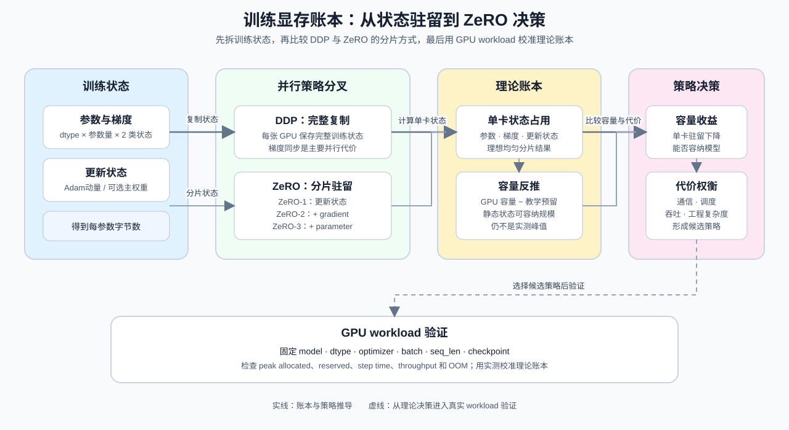

# 06. VRAM Calculation and ZeRO | 显存计算与 ZeRO 优化

**难度：** Hard | **环境：** CPU-first | **标签：** `显存优化`, `显存预算`, `ZeRO` | **目标人群：** 需要建立训练显存账本的学习者

> 🚀 **云端运行环境**
>
> 本章节的实战代码可以点击以下链接在免费 GPU 算力平台上直接运行：
>
> [](https://colab.research.google.com/github/datawhalechina/llm-algo-leetcode/blob/main/01_Hardware_Math_and_Systems/06_VRAM_Calculation_and_ZeRO.ipynb)
> [](https://modelscope.cn/my/mynotebook) *(国内推荐：魔搭社区免费实例)*


---

## 本节导读

训练显存由参数、梯度、优化器状态、激活值、通信缓冲区和临时工作区共同组成。不同状态的复制方式与生命周期不同，因此峰值不能只按参数量估算。

分布式数据并行（DDP）为每个进程保留训练状态副本；零冗余优化（ZeRO）按阶段把不同状态分片。下面沿用01节的组件，计算单卡常驻状态和给定预留后的容量，继续为通信与并行路线中的策略筛选提供输入。

**关键词：** 训练状态、`DDP`、`ZeRO`、主权重



---

## 前置阅读

**导语：** 先回顾 dtype 的字节数、参数量和通信拓扑，再用同一套参数与 optimizer 假设比较 DDP、ZeRO-1/2/3 的单卡训练状态。

- [Part 01 · 01 数据类型与精度](./01_Data_Types_and_Precision.md)
- [Part 01 · 02 参数量与 FLOPs](./02_LLM_Params_and_FLOPs.md)
- [Part 01 · 05 通信拓扑](./05_Communication_Topologies.md)

---
## Q1：DDP下每张卡保存哪些训练状态？

本例的DDP不对训练状态分片，每个进程保留完整副本。沿用01节的7B配置：参数和梯度使用BF16，Adam的一阶矩、二阶矩使用FP32，并显式保留一份FP32主权重。主权重负责高精度更新，两个动量分别记录梯度及其平方的移动平均；这些对象各计一次。

代码默认在FP16／BF16参数下保留主权重，在FP32参数下不额外保存；也可显式选择。表格只统计静态状态，激活、通信缓冲、临时工作区和分配器预留另算。SGD对照采用不带动量的版本，因此没有Adam的两个动量。

| 训练状态 | 每参数字节数 | 7B占用（十进制GB） |
| --- | ---: | ---: |
| BF16参数 | 2 | 14 |
| BF16梯度 | 2 | 14 |
| Adam一阶矩，FP32 | 4 | 28 |
| Adam二阶矩，FP32 | 4 | 28 |
| 可选FP32主权重，本例保留 | 4 | 28 |
| 合计 | 16 | 112 |

### Q1机制计算器：逐项核对DDP副本

先核对112 GB，再关闭主权重，确认总量下降28 GB到84 GB。优化器状态字段只汇总两个动量，主权重单列。


```python
def training_state_breakdown(
    num_params_b, model_dtype='fp16', optimizer='adam', keep_master_weights=None,
):
    """计算单份静态状态的十进制GB；SGD示例不带动量，忽略步数等标量。"""
    if num_params_b < 0:
        raise ValueError('参数量须为非负数')
    if model_dtype not in {'fp32', 'fp16', 'bf16'} or optimizer not in {'adam', 'sgd'}:
        raise ValueError('使用fp32/fp16/bf16参数，以及adam或无动量sgd')
    if keep_master_weights is None:
        keep_master_weights = model_dtype != 'fp32'
    if type(keep_master_weights) is not bool:
        raise ValueError('keep_master_weights须为布尔值或None')
    model_bytes = {'fp32': 4, 'fp16': 2, 'bf16': 2}[model_dtype]
    moment_gb = num_params_b * 4 if optimizer == 'adam' else 0.0
    components = {
        'parameters_gb': num_params_b * model_bytes,
        'gradients_gb': num_params_b * model_bytes,
        'adam_first_moment_gb': moment_gb,
        'adam_second_moment_gb': moment_gb,
        'master_weights_gb': num_params_b * 4 if keep_master_weights else 0.0,
    }
    return {
        **components,
        'optimizer_state_gb': 2 * moment_gb,
        'training_state_gb': sum(components.values()),
    }


def calculate_ddp_memory(
    num_params_b, model_dtype='fp16', optimizer='adam', keep_master_weights=None,
):
    """返回未分片静态状态的总GB，与training_state_breakdown使用同一配置。"""
    return training_state_breakdown(
        num_params_b, model_dtype, optimizer, keep_master_weights,
    )['training_state_gb']


ledger = training_state_breakdown(7, model_dtype='bf16', optimizer='adam')
print('7B、BF16参数与梯度、FP32动量和主权重的静态状态：')
for name in ('parameters_gb', 'gradients_gb', 'adam_first_moment_gb',
             'adam_second_moment_gb', 'master_weights_gb', 'training_state_gb'):
    print(f'{name:<26} {ledger[name]:>6.1f} GB')

```


```python
def test_calculate_ddp_memory():
    """核对组件、主权重增量与不同更新方式。"""
    ledger = training_state_breakdown(7, model_dtype='bf16', optimizer='adam')
    assert ledger['parameters_gb'] == ledger['gradients_gb'] == 14
    assert ledger['adam_first_moment_gb'] == ledger['adam_second_moment_gb'] == 28
    assert ledger['optimizer_state_gb'] == 56
    assert ledger['master_weights_gb'] == 28
    assert ledger['training_state_gb'] == 112
    assert calculate_ddp_memory(7, keep_master_weights=False) == 84
    assert calculate_ddp_memory(7, model_dtype='fp32') == 112
    assert calculate_ddp_memory(7, model_dtype='fp32', keep_master_weights=True) == 140
    assert calculate_ddp_memory(7, optimizer='sgd') == 56
    print('静态状态组件和主权重增量核对通过')


test_calculate_ddp_memory()

```

## Q2：ZeRO各阶段分别分摊什么状态？

先把状态分成参数、梯度、更新状态三组；这里的更新状态包含两个Adam动量和可选主权重。理想均匀切分时，分片组的单卡容量除以设备数，未分片组保持完整。7B配置在8卡上的DDP、ZeRO-1／2／3账本分别为112、38.5、26.25、14 GB。

表格描述持续保存的状态。ZeRO-3执行某层时还可能临时收集该层参数；这部分峰值，以及激活和通信缓冲，需要结合实际执行过程观察。

| 阶段 | 更新状态 | 梯度 | 参数 | 运行时增加的工作 |
| --- | --- | --- | --- | --- |
| DDP／ZeRO-0 | 完整 | 完整 | 完整 | 同步梯度 |
| ZeRO-1 | 分片 | 完整 | 完整 | 分片更新、同步参数 |
| ZeRO-2 | 分片 | 分片 | 完整 | 归约并分发梯度、同步参数 |
| ZeRO-3 | 分片 | 分片 | 分片 | 按需收集参数、释放临时副本 |

### Q2对照验证：固定状态组成，只改变分片阶段

参数、梯度和更新状态都从Q1取值，避免在每个阶段重新写一份字节常量。


```python
def calculate_zero_memory(
    num_params_b, zero_stage, num_gpus, model_dtype='fp16',
    optimizer='adam', keep_master_weights=None,
):
    """按理想均匀分片估算单卡常驻状态GB；不计执行时的临时收集峰值。"""
    if type(num_gpus) is not int or num_gpus <= 0:
        raise ValueError('设备数须为正整数')
    ledger = training_state_breakdown(
        num_params_b, model_dtype, optimizer, keep_master_weights,
    )
    parameters = ledger['parameters_gb']
    gradients = ledger['gradients_gb']
    updates = ledger['optimizer_state_gb'] + ledger['master_weights_gb']
    if zero_stage in (0, 'ddp'):
        return parameters + gradients + updates
    if zero_stage == 1:
        return parameters + gradients + updates / num_gpus
    if zero_stage == 2:
        return parameters + (gradients + updates) / num_gpus
    if zero_stage == 3:
        return (parameters + gradients + updates) / num_gpus
    raise ValueError('阶段使用0/ddp、1、2或3')

```


```python
def test_calculate_zero_memory():
    """逐阶段核对同一7B状态账本，单卡时各阶段应相同。"""
    for stage, expected_gb in [('ddp', 112), (1, 38.5), (2, 26.25), (3, 14)]:
        assert calculate_zero_memory(7, stage, 8) == expected_gb
        assert calculate_zero_memory(7, stage, 1) == 112
    assert calculate_zero_memory(7, 3, 8, keep_master_weights=False) == 10.5
    print('DDP与ZeRO各阶段的常驻状态核对通过')


test_calculate_zero_memory()

```

### 容量反推：给定状态预算能放下多少参数？

每卡80 GB、预留20%时，留给静态状态的预算为64 GB。用它除以每1B参数的单卡状态量，得到当前假设下的可容纳规模；这不是包含激活和执行峰值的可训练上限。


```python
def state_capacity_limit_params(
    gpu_memory_gb, num_gpus, zero_stage, overhead_ratio=0.2,
    model_dtype='fp16', optimizer='adam', keep_master_weights=None,
):
    """由每卡总GB和给定预留比例，反推静态状态可容纳的参数量，单位B。"""
    if gpu_memory_gb <= 0 or not 0 <= overhead_ratio < 1:
        raise ValueError('每卡容量须为正，预留比例须在[0, 1)内')
    state_budget_gb = gpu_memory_gb * (1 - overhead_ratio)
    state_gb_per_1b = calculate_zero_memory(
        1, zero_stage, num_gpus, model_dtype, optimizer, keep_master_weights,
    )
    return state_budget_gb / state_gb_per_1b

```


```python
def test_state_capacity_limit_params():
    """核对64 GB状态预算对应的容量及预留比例变化。"""
    assert state_capacity_limit_params(80, 8, 'ddp') == 4
    assert state_capacity_limit_params(80, 8, 3) == 32
    assert state_capacity_limit_params(80, 8, 3, overhead_ratio=0) == 40
    assert calculate_zero_memory(state_capacity_limit_params(80, 8, 3), 3, 8) == 64
    print('静态状态容量反推核对通过')


test_state_capacity_limit_params()

```

## Q3：容量表怎样帮助筛选ZeRO候选？

继续使用每卡80 GB、8卡、预留20%的同一配置。比较各阶段的单卡常驻状态、相对DDP节省比例和静态状态可容纳规模，再列出分片后需要执行的通信工作。

容量候选可继续进入[26节并行策略筛选](./26_Parallel_Strategy_Decision_Framework.md)。实际验证则需固定模型、批量和序列长度，在[Part02·27状态分片](../02_PyTorch_Algorithms/27_ZeRO_Optimizer_Sim.md)理解状态流转，再在对应多卡实验中核对临时参数收集、通信缓冲和训练步耗时。


```python
def compare_zero_strategies(
    gpu_memory_gb, num_gpus, overhead_ratio=0.2,
    model_dtype='fp16', optimizer='adam', keep_master_weights=None,
):
    """比较相同配置下的静态状态、容量和分片引入的通信工作。"""
    strategies = [('DDP', 'ddp'), ('ZeRO-1', 1), ('ZeRO-2', 2), ('ZeRO-3', 3)]
    communication = {
        'DDP': '梯度归约',
        'ZeRO-1': '分片更新、参数同步',
        'ZeRO-2': '梯度分片、参数同步',
        'ZeRO-3': '梯度分片、按需收集参数',
    }
    baseline = calculate_zero_memory(
        1, 'ddp', num_gpus, model_dtype, optimizer, keep_master_weights,
    )
    rows = []
    for name, stage in strategies:
        state_gb = calculate_zero_memory(
            1, stage, num_gpus, model_dtype, optimizer, keep_master_weights,
        )
        rows.append({
            'strategy': name,
            'per_gpu_state_gb_per_1b': round(state_gb, 3),
            'memory_saving_ratio': round(1 - state_gb / baseline, 3),
            'static_capacity_limit_params_b': round(state_capacity_limit_params(
                gpu_memory_gb, num_gpus, stage, overhead_ratio,
                model_dtype, optimizer, keep_master_weights,
            ), 3),
            'communication_work': communication[name],
        })
    return rows


GPU_MEMORY_GB = 80
NUM_GPUS = 8
RESERVED_RATIO = 0.2
strategies = compare_zero_strategies(GPU_MEMORY_GB, NUM_GPUS, RESERVED_RATIO)
assert strategies[0]['static_capacity_limit_params_b'] == 4
assert strategies[-1]['static_capacity_limit_params_b'] == 32
assert strategies[-1]['memory_saving_ratio'] == 0.875
print('每卡80 GB、8卡、预留20%的静态状态容量：')
for row in strategies:
    print(row)

```

---
## 相关阅读
本节可以继续接到 ZeRO/FSDP 的运行时管理与 Part 02 的状态分片机制。
- [DeepSpeed ZeRO](https://www.deepspeed.ai/tutorials/zero/)：查看 ZeRO 不同阶段如何分片 optimizer state、梯度和参数。
- [PyTorch Fully Sharded Data Parallel](https://pytorch.org/docs/stable/fsdp.html)：了解 FSDP 的参数分片、通信和运行时管理。
- [27. ZeRO Optimizer Sim | ZeRO 优化器模拟](../02_PyTorch_Algorithms/27_ZeRO_Optimizer_Sim.md)

---
