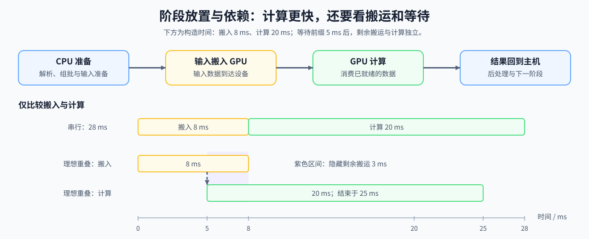

# 07. CPU GPU Heterogeneous Scheduling | CPU 与 GPU 异构调度

**难度：** Medium | **环境：** CPU-first | **标签：** `系统工程`, `CPU/GPU`, `异构调度` | **目标人群：** 系统性能入门者

> 🚀 **云端运行环境**
>
> 本章节的实战代码可以点击以下链接在免费 GPU 算力平台上直接运行：
>
> [](https://colab.research.google.com/github/datawhalechina/llm-algo-leetcode/blob/main/01_Hardware_Math_and_Systems/07_CPU_GPU_Heterogeneous_Scheduling.ipynb)
> [](https://modelscope.cn/my/mynotebook) *(国内推荐：魔搭社区免费实例)*


---

## 本节导读

同一阶段在CPU上需要2 ms，在GPU上只需0.4 ms，但输入搬入和输出回传可能花8 ms以上。应比较从数据就绪到结果可用的完整路径，再决定阶段放在何处。

本节先计算往返搬运，再改变数据依赖观察可隐藏的时间，并将状态卸载量与完整路径耗时分别比较。它支撑算子优化中的传输与运行时安排，Stream的队列与事件语义继续在17节展开。

**关键词：** 主机、设备、搬运带宽、数据依赖、状态卸载



---
## 前置阅读
**导语：** 先理解设备资源和性能记录，再比较任务留在主机或迁移到设备的端到端成本。
- [03. GPU Architecture and Memory | GPU 物理架构与内存层级](./03_GPU_Architecture_and_Memory.md)
- [Part 00 · 17 PyTorch 性能分析基础](../00_Prerequisites/17_PyTorch_Profiling_Basics.md)
## Q1：一个阶段应该留在CPU，还是迁移到GPU？

本节用主机（Host）指CPU侧，用设备（Device）指GPU侧。阶段留在主机时，直接消费已在主机上的输入；迁移到设备时，需要先搬入输入、执行计算，再把结果传回主机。下面假设参数和设备上下文已就绪，比较当前阶段的这次往返。

输入和输出各64,000,000 B，给定有效带宽16 GB/s时，往返搬运需要8 ms；再加0.1 ms固定开销。若GPU计算需0.4 ms，完整路径为8.5 ms，比CPU的2 ms更长；若CPU需100 ms、GPU计算需8 ms，同样搬运条件下GPU路径为16.1 ms。阶段的工作量与数据位置共同决定哪条路径更短。

### Q1 机制计算器：比较阶段放在 CPU 或 GPU 的端到端时间

固定同一阶段的输入输出字节数，假设输入搬入和输出回传串行发生、双向有效带宽相同。带宽使用十进制 GB/s（每秒十亿字节），时间使用毫秒；固定开销是本次往返额外开销的合计。比较 CPU 时间与“GPU 计算 + 搬运”估算，不能把 GPU 单独计算更快当作端到端结论。


```python
import math


def stage_placement(
    cpu_ms: float, gpu_ms: float, input_bytes: int, output_bytes: int,
    bandwidth_gb_per_s: float, fixed_transfer_ms: float = 0.0,
) -> dict:
    """按串行往返和给定十进制GB/s带宽，返回两条阶段路径的估算毫秒数。"""
    if any(type(value) is not int or value < 0 for value in (input_bytes, output_bytes)):
        raise ValueError("输入输出字节数须为非负整数")
    if any(type(value) not in (int, float) or not math.isfinite(value) or value < 0
           for value in (cpu_ms, gpu_ms, fixed_transfer_ms)):
        raise ValueError("计算与固定开销须为有限非负实数")
    if (type(bandwidth_gb_per_s) not in (int, float)
            or not math.isfinite(bandwidth_gb_per_s) or bandwidth_gb_per_s <= 0):
        raise ValueError("带宽须为有限正实数，单位GB/s")
    transfer_ms = (input_bytes + output_bytes) / (bandwidth_gb_per_s * 1e9) * 1e3 + fixed_transfer_ms
    gpu_path_ms = gpu_ms + transfer_ms
    return {
        "cpu_path_ms": cpu_ms, "gpu_compute_ms": gpu_ms,
        "transfer_ms": transfer_ms, "gpu_path_ms": gpu_path_ms,
        "shorter_estimated_path": "gpu" if gpu_path_ms < cpu_ms else
                                  "cpu" if cpu_ms < gpu_path_ms else "equal",
    }


inputs = dict(input_bytes=64_000_000, output_bytes=64_000_000,
              bandwidth_gb_per_s=16.0, fixed_transfer_ms=0.1)
small = stage_placement(cpu_ms=2.0, gpu_ms=0.4, **inputs)
large = stage_placement(cpu_ms=100.0, gpu_ms=8.0, **inputs)
assert math.isclose(small["transfer_ms"], 8.1)
assert math.isclose(small["gpu_path_ms"], 8.5)
assert math.isclose(large["gpu_path_ms"], 16.1)
assert small["shorter_estimated_path"] == "cpu"
assert large["shorter_estimated_path"] == "gpu"
equal = stage_placement(cpu_ms=8.5, gpu_ms=0.4, **inputs)
assert equal["shorter_estimated_path"] == "equal"
assert stage_placement(cpu_ms=1, gpu_ms=1, input_bytes=0, output_bytes=0,
                       bandwidth_gb_per_s=16)["transfer_ms"] == 0
for name, result in (("短阶段", small), ("长阶段", large)):
    print(f"{name}: CPU {result['cpu_path_ms']:g} ms，"
          f"GPU含搬运 {result['gpu_path_ms']:g} ms")

```

## Q2：哪些条件允许搬运与计算发生重叠？


重叠要求搬运与计算之间没有未满足的数据依赖，并且运行时与硬件提供可并发的执行资源。理想情况下，一部分数据搬运可以与另一部分数据的计算同时发生；暴露时间最多只能减少到较长阶段的时间，而不会让搬运成本消失。

例如，8 ms搬运被拆成若干能独立完成、独立使用的数据块，计算只依赖前5 ms搬完的块时，剩余3 ms可与20 ms计算重叠，完成于25 ms。若计算使用整份输入，就要等满8 ms，完成于28 ms。这里比较的是指定搬运与计算的组合窗口；Stream和Event如何表达各块就绪条件，在第17节展开，含首批填充与末批排空的完整多批窗口在第29节比较。

### Q2 对照验证：重叠能隐藏多少搬运时间

假设输入已拆成可独立使用的数据块，计算等待所需块搬入，其他块的搬运与这段计算独立，且资源允许并行。`dependency_ms` 表示该前缀耗时，不能超过总搬运时间；计算若必须等待整个输入，就把它设为完整搬运时间。比较时只改变这项依赖。


```python
def overlap_timeline(copy_ms: float, compute_ms: float, dependency_ms: float = 0.0) -> dict:
    """返回给定搬运前缀依赖下的串行、理想重叠与隐藏时间，单位ms。"""
    if (any(type(value) not in (int, float) or not math.isfinite(value) or value < 0
            for value in (copy_ms, compute_ms, dependency_ms))
            or dependency_ms > copy_ms):
        raise ValueError("阶段时间须为有限非负实数，依赖前缀不能超过总搬运时间")
    serial_ms = copy_ms + compute_ms
    overlappable_copy_ms = copy_ms - dependency_ms
    elapsed_ms = dependency_ms + max(overlappable_copy_ms, compute_ms)
    return {"serial_ms": serial_ms, "elapsed_ms": elapsed_ms,
            "hidden_ms": serial_ms - elapsed_ms}


inputs = dict(copy_ms=8.0, compute_ms=20.0)
reports = {prefix: overlap_timeline(**inputs, dependency_ms=prefix) for prefix in (0, 5, 8)}
assert reports[5] == {"serial_ms": 28.0, "elapsed_ms": 25.0, "hidden_ms": 3.0}
assert reports[0]["elapsed_ms"] == 20 and reports[0]["hidden_ms"] == 8
assert reports[8]["elapsed_ms"] == 28 and reports[8]["hidden_ms"] == 0
assert overlap_timeline(copy_ms=8, compute_ms=3)["hidden_ms"] == 3
assert overlap_timeline(copy_ms=0, compute_ms=0)["elapsed_ms"] == 0
for prefix, result in reports.items():
    print(f"等待前缀 {prefix} ms：完成于 {result['elapsed_ms']:g} ms，"
          f"隐藏 {result['hidden_ms']:g} ms")

```

## Q3：状态卸载省下的容量需要付出多少搬运？

状态卸载（Offload）将一部分状态从设备移到主机，等后续阶段需要时再搬回。训练中可能搬运参数、优化器状态或激活；推理中可能分层搬运权重或管理临时状态。不同对象的使用时刻和搬运频率不同，应按实际生命周期计算。

例如4 GB状态每步往返一次，共搬8 GB，按32 GB/s需250 ms；若假设其中75%可被独立计算隐藏，仍暴露62.5 ms。状态移走的大小与真实峰值下降量不同：原峰值出现时它是否已卸载、是否增加了传输缓冲区，都需结合时间线核对。

### Q3 机制计算器：把卸载状态大小与搬运时间分开记录

状态大小使用十进制 GB，带宽使用 GB/s，搬运时间使用 ms/step；一次往返计入两倍状态大小。假设的隐藏比例只用于估算暴露时间。卸载状态的大小不等于真实峰值下降量：还需检查卸载与回载是否跨越原峰值，以及是否增加传输缓冲区。


```python
def offload_ledger(
    state_gb: float, bandwidth_gb_per_s: float, round_trips_per_step: int = 1,
    overlap_ratio: float = 0.0,
) -> dict:
    """以十进制GB和GB/s，返回每步往返量、搬运ms与给定隐藏比例下的暴露ms。"""
    if (type(state_gb) not in (int, float) or not math.isfinite(state_gb) or state_gb < 0):
        raise ValueError("状态大小须为有限非负实数，单位GB")
    if (type(bandwidth_gb_per_s) not in (int, float)
            or not math.isfinite(bandwidth_gb_per_s) or bandwidth_gb_per_s <= 0):
        raise ValueError("带宽须为有限正实数，单位GB/s")
    if type(round_trips_per_step) is not int or round_trips_per_step < 0:
        raise ValueError("每步往返次数须为非负整数")
    if (type(overlap_ratio) not in (int, float) or not math.isfinite(overlap_ratio)
            or not 0 <= overlap_ratio <= 1):
        raise ValueError("隐藏比例须为 [0, 1] 内的有限实数")
    transfer_gb = state_gb * 2 * round_trips_per_step
    transfer_ms = transfer_gb / bandwidth_gb_per_s * 1e3
    return {
        "offloaded_state_gb": state_gb, "transfer_gb_per_step": transfer_gb,
        "transfer_ms": transfer_ms, "estimated_exposed_ms": transfer_ms * (1 - overlap_ratio),
    }


inputs = dict(state_gb=4.0, bandwidth_gb_per_s=32.0)
ledger = offload_ledger(**inputs, overlap_ratio=0.75)
assert ledger["transfer_gb_per_step"] == 8.0
assert ledger["transfer_ms"] == 250.0
assert ledger["estimated_exposed_ms"] == 62.5
assert offload_ledger(**inputs, overlap_ratio=0)["estimated_exposed_ms"] == 250
assert offload_ledger(**inputs, overlap_ratio=1)["estimated_exposed_ms"] == 0
assert offload_ledger(**inputs, round_trips_per_step=0)["transfer_ms"] == 0
assert offload_ledger(**inputs, round_trips_per_step=2)["transfer_gb_per_step"] == 16
print(f"每步搬运 {ledger['transfer_gb_per_step']:g} GB，"
      f"搬运 {ledger['transfer_ms']:g} ms，估算暴露 {ledger['estimated_exposed_ms']:g} ms")

```

## Q4：时间线重叠后，端到端时间减少了多少？

保持工作量与结果一致，比较串行时间和候选完成时间，再检查同步等待是否仍暴露在关键路径上。GPU 活跃区间的并集占观察窗口的比例，只是时间覆盖比例，不表示计算单元、带宽或指令吞吐的利用率；多个重叠内核的时长之和也不能作为这里的活跃时间。

### Q4 对照验证：分别记录时间收益与暴露等待

使用构造的时间线检查比值和区间约束，不对单次结果设置通用采用阈值。GPU 活跃区间与本例的暴露同步等待互不重叠，总长不能超过观察窗口。


```python
def parallelism_evidence(
    serial_ms: float, elapsed_ms: float, active_gpu_union_ms: float, exposed_sync_ms: float,
) -> dict:
    """按同工作量窗口返回时间比、节省ms与互斥区间的时间占比。"""
    values = (serial_ms, elapsed_ms, active_gpu_union_ms, exposed_sync_ms)
    if any(type(value) not in (int, float) or not math.isfinite(value) or value < 0
           for value in values):
        raise ValueError("时间须为有限非负实数")
    if serial_ms == 0 or elapsed_ms == 0:
        raise ValueError("串行与候选完成时间须为正数")
    if active_gpu_union_ms + exposed_sync_ms > elapsed_ms:
        raise ValueError("互不重叠的活跃区间与暴露等待不能超过观察窗口")
    return {
        "speedup": serial_ms / elapsed_ms, "elapsed_saved_ms": serial_ms - elapsed_ms,
        "active_time_fraction": active_gpu_union_ms / elapsed_ms,
        "exposed_sync_fraction": exposed_sync_ms / elapsed_ms,
    }


inputs = dict(serial_ms=30.0, active_gpu_union_ms=18.0)
shorter = parallelism_evidence(**inputs, elapsed_ms=20.0, exposed_sync_ms=1.0)
longer = parallelism_evidence(**inputs, elapsed_ms=32.0, exposed_sync_ms=8.0)
assert shorter["speedup"] == 1.5
assert shorter["elapsed_saved_ms"] == 10
assert shorter["active_time_fraction"] == 0.9
assert shorter["exposed_sync_fraction"] == 0.05
assert longer["elapsed_saved_ms"] == -2 and longer["speedup"] == 30 / 32
assert parallelism_evidence(**inputs, elapsed_ms=20, exposed_sync_ms=2)["exposed_sync_fraction"] == 0.1
try:
    parallelism_evidence(**inputs, elapsed_ms=20, exposed_sync_ms=3)
except ValueError:
    pass
else:
    raise AssertionError("区间总长超过窗口时应拒绝")
for name, result in (("时间缩短", shorter), ("时间增加", longer)):
    print(f"{name}: 节省 {result['elapsed_saved_ms']:g} ms，"
          f"时间比 {result['speedup']:.3f}，活跃时间占比 {result['active_time_fraction']:.1%}")

```

## 核对搬运与重叠估算

真实运行时记录双向字节数、有效带宽和输入就绪时刻，再用执行轨迹核对哪些搬运确实被计算隐藏。涉及卸载时，同时检查主机内存、传输缓冲区和峰值阶段；容量与时间需要分别比较。

## 相关阅读

先把阶段估算接到实际依赖与传输，再判断完整工作流的等待。

- [17 CUDA Stream与异步执行](./17_CUDA_Stream_and_Asynchrony.md)：区分提交、执行与输入就绪。
- [Part04·10 Stream与传输](../04_CUDA_and_System_Optimization/10_PyTorch_CUDA_Streams_and_Transfer.md)：核对跨流事件和缓冲区生命周期。
- [性能优化：时间线与关键路径](../topic_discussion/performance_optimization/methods/03_time_breakdown_and_trace_reading.md)：用实际轨迹核对暴露搬运与等待。
