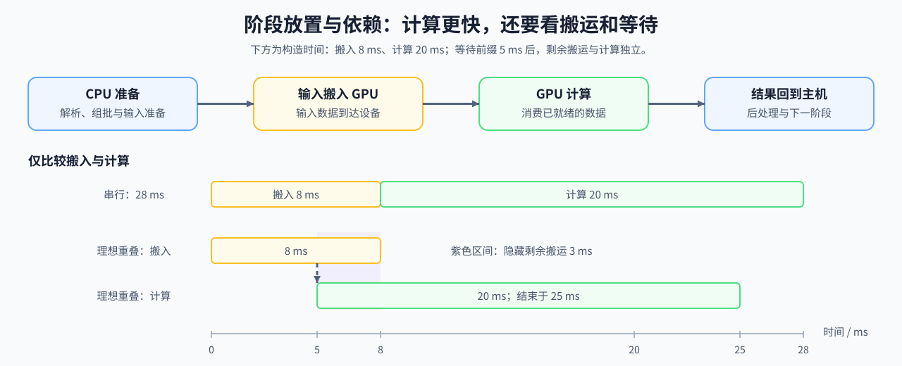

# 07. CPU GPU Heterogeneous Scheduling | CPU 与 GPU 异构调度

**难度：** Medium | **环境：** CPU-first | **标签：** `系统工程`, `CPU/GPU`, `异构调度` | **目标人群：** 系统性能入门者

> 🚀 **云端运行环境**
>
> 本章节的实战代码可以点击以下链接在免费 GPU 算力平台上直接运行：
>
> [](https://colab.research.google.com/github/datawhalechina/llm-algo-leetcode/blob/main/01_Hardware_Math_and_Systems/07_CPU_GPU_Heterogeneous_Scheduling.ipynb)
> [](https://modelscope.cn/my/mynotebook) *(国内推荐：魔搭社区免费实例)*


---

## 本节导读

主机适合控制流和数据准备，GPU 适合大规模并行计算；把一个阶段迁移到 GPU 时，还要支付输入输出搬运和同步成本。因此，设备计算更快不等于端到端一定更快。

本节建立“阶段放置 → 搬运成本 → 可重叠区间 → 端到端收益”的关系。完成后，你应能比较阶段留在 CPU 或迁移到 GPU 的总时间，并把容量收益、搬运代价和同步等待分开记录；Stream 的执行语义在第 17 节展开。

**关键词：** `host`, `device`, `PCIe`



---
## 前置阅读
**导语：** 先理解设备资源和性能记录，再比较任务留在主机或迁移到设备的端到端成本。
- [03. GPU Architecture and Memory | GPU 物理架构与内存层级](./03_GPU_Architecture_and_Memory.md)
- [Part 00 · 17 PyTorch 性能分析基础](../00_Prerequisites/17_PyTorch_Profiling_Basics.md)
## Q1：Host 和 Device 分别扮演什么角色？


Host 通常负责控制流、数据准备和调度，Device 负责大规模并行计算。

两者之间的核心瓶颈，往往不是“谁更强”，而是数据在两边之间搬运的成本和频率。

所以异构调度的第一件事，是先知道哪个环节适合留在 CPU，哪个环节应该下放到 GPU。

### Q1 机制计算器：比较阶段放在 CPU 或 GPU 的端到端时间

固定同一阶段的输入输出字节数，假设输入搬入和输出回传串行发生、双向有效带宽相同。带宽使用十进制 GB/s（每秒十亿字节），时间使用毫秒；固定开销是本次往返额外开销的合计。比较 CPU 时间与“GPU 计算 + 搬运”估算，不能把 GPU 单独计算更快当作端到端结论。


```python
import math


def stage_placement(cpu_ms, gpu_ms, input_bytes, output_bytes,
                    bandwidth_gb_per_s, fixed_transfer_ms=0.0):
    """以 GB/s 计算串行往返搬运；不执行设备计算或测量带宽。"""
    values = (cpu_ms, gpu_ms, input_bytes, output_bytes, fixed_transfer_ms)
    if any(not math.isfinite(value) or value < 0 for value in values):
        raise ValueError('时间和字节数必须是有限非负数')
    if not math.isfinite(bandwidth_gb_per_s) or bandwidth_gb_per_s <= 0:
        raise ValueError('带宽必须是有限正数，单位 GB/s')
    transfer_ms = (
        (input_bytes + output_bytes) / (bandwidth_gb_per_s * 1e9) * 1e3
        + fixed_transfer_ms
    )
    gpu_path_ms = gpu_ms + transfer_ms
    return {
        'cpu_path_ms': cpu_ms, 'gpu_compute_ms': gpu_ms,
        'transfer_ms': transfer_ms, 'gpu_path_ms': gpu_path_ms,
        'shorter_estimated_path': 'gpu' if gpu_path_ms < cpu_ms else
                                  'cpu' if cpu_ms < gpu_path_ms else 'equal',
    }


BANDWIDTH_GB_PER_S = 16.0  # 可修改：假设的有效字节带宽，不是实测值。
small_stage = stage_placement(2.0, 0.4, 64e6, 64e6, BANDWIDTH_GB_PER_S, 0.1)
large_stage = stage_placement(100.0, 8.0, 64e6, 64e6, BANDWIDTH_GB_PER_S, 0.1)
assert math.isclose(small_stage['transfer_ms'], 8.1)
assert small_stage['shorter_estimated_path'] == 'cpu'
assert large_stage['shorter_estimated_path'] == 'gpu'
print('短阶段：', small_stage)
print('长阶段：', large_stage)

```

## Q2：哪些条件允许搬运与计算发生重叠？


重叠要求搬运与计算之间没有未满足的数据依赖，并且运行时与硬件提供可并发的执行资源。理想情况下，一部分数据搬运可以与另一部分数据的计算同时发生；暴露时间最多只能减少到较长阶段的时间，而不会让搬运成本消失。

本节只计算串行与理想重叠的时间差。Stream、Event 和同步边界怎样表达这些依赖，在第 17 节继续展开。

### Q2 对照验证：重叠能隐藏多少搬运时间

假设计算需要先等待一段搬运前缀，剩余搬运与计算独立，且资源允许并行。`dependency_ms` 表示该前缀耗时，不能超过总搬运时间；计算若必须等待整个输入，就把它设为完整搬运时间。比较时只改变这项依赖。


```python
def overlap_timeline(copy_ms, compute_ms, dependency_ms=0.0):
    """计算串行时间、受依赖约束的重叠时间和被隐藏的搬运时间。"""
    if (any(not math.isfinite(value) or value < 0
            for value in (copy_ms, compute_ms, dependency_ms))
            or dependency_ms > copy_ms):
        raise ValueError('invalid timeline')
    serial_ms = copy_ms + compute_ms
    overlappable_copy_ms = copy_ms - dependency_ms
    elapsed_ms = dependency_ms + max(overlappable_copy_ms, compute_ms)
    hidden_ms = serial_ms - elapsed_ms
    return {'serial_ms': serial_ms, 'elapsed_ms': elapsed_ms, 'hidden_ms': hidden_ms}

full_overlap = overlap_timeline(8.0, 20.0)
dependency_limited = overlap_timeline(8.0, 20.0, dependency_ms=5.0)
assert full_overlap['hidden_ms'] == 8.0
assert dependency_limited['hidden_ms'] == 3.0
assert overlap_timeline(8.0, 20.0, dependency_ms=8.0)['hidden_ms'] == 0
print(full_overlap)
print(dependency_limited)
```

## Q3：CPU Offload 在训练和推理中分别怎么用？


CPU Offload 的目标，是把一部分暂时不需要常驻 GPU 的状态挪到 CPU，缓解显存压力。

在训练中，常见对象可能是优化器状态、部分参数或激活；在推理中，则可能是权重分层驻留或临时状态管理。

它的核心代价是更频繁的数据搬运，所以通常要和调度策略一起看，而不能只看“显存省了多少”。

### Q3 机制计算器：把卸载状态大小与搬运时间分开记录

状态大小使用十进制 GB，带宽使用 GB/s，搬运时间使用 ms/step；一次往返计入两倍状态大小。假设的隐藏比例只用于估算暴露时间。卸载状态的大小不等于真实峰值下降量：还需检查卸载与回载是否跨越原峰值，以及是否增加传输缓冲区。


```python
def offload_ledger(state_gb, bandwidth_gb_per_s, round_trips_per_step=1,
                   overlap_ratio=0.0):
    """分别记录卸载量、往返字节量与假设隐藏比例下的暴露时间。"""
    if not math.isfinite(state_gb) or state_gb < 0:
        raise ValueError('状态大小必须是有限非负数，单位 GB')
    if not math.isfinite(bandwidth_gb_per_s) or bandwidth_gb_per_s <= 0:
        raise ValueError('带宽必须是有限正数，单位 GB/s')
    if type(round_trips_per_step) is not int or round_trips_per_step < 0:
        raise ValueError('每步往返次数必须是非负整数')
    if not math.isfinite(overlap_ratio) or not 0 <= overlap_ratio <= 1:
        raise ValueError('隐藏比例必须位于 [0, 1]')
    transfer_gb = state_gb * 2 * round_trips_per_step
    transfer_ms = transfer_gb / bandwidth_gb_per_s * 1e3
    return {
        'offloaded_state_gb': state_gb,
        'transfer_gb_per_step': transfer_gb,
        'transfer_ms': transfer_ms,
        'estimated_exposed_ms': transfer_ms * (1 - overlap_ratio),
    }


ledger = offload_ledger(4.0, bandwidth_gb_per_s=32.0, overlap_ratio=0.75)
assert ledger['transfer_gb_per_step'] == 8.0
assert ledger['transfer_ms'] == 250.0
assert ledger['estimated_exposed_ms'] == 62.5
print(ledger)

```

## Q4：时间线重叠后，端到端时间减少了多少？

保持工作量与结果一致，比较串行时间和候选完成时间，再检查同步等待是否仍暴露在关键路径上。GPU 活跃区间的并集占观察窗口的比例，只是时间覆盖比例，不表示计算单元、带宽或指令吞吐的利用率；多个重叠内核的时长之和也不能作为这里的活跃时间。

### Q4 对照验证：分别记录时间收益与暴露等待

使用构造的时间线检查比值和区间约束，不对单次结果设置通用采用阈值。GPU 活跃区间与本例的暴露同步等待互不重叠，总长不能超过观察窗口。


```python
def parallelism_evidence(serial_ms, elapsed_ms, active_gpu_union_ms,
                         exposed_sync_ms):
    """汇总同工作量的时间对照；活跃时间占比不是硬件利用率。"""
    values = (serial_ms, elapsed_ms, active_gpu_union_ms, exposed_sync_ms)
    if any(not math.isfinite(value) or value < 0 for value in values):
        raise ValueError('时间必须是有限非负数')
    if serial_ms == 0 or elapsed_ms == 0:
        raise ValueError('串行与候选完成时间必须为正数')
    if active_gpu_union_ms + exposed_sync_ms > elapsed_ms:
        raise ValueError('互不重叠的活跃区间与暴露等待不能超过观察窗口')
    return {
        'speedup': serial_ms / elapsed_ms,
        'elapsed_saved_ms': serial_ms - elapsed_ms,
        'active_time_fraction': active_gpu_union_ms / elapsed_ms,
        'exposed_sync_fraction': exposed_sync_ms / elapsed_ms,
    }


shorter = parallelism_evidence(30.0, 20.0, 18.0, 1.0)
longer = parallelism_evidence(30.0, 32.0, 18.0, 8.0)
assert shorter['elapsed_saved_ms'] == 10.0
assert longer['elapsed_saved_ms'] == -2.0
print('时间缩短：', shorter)
print('时间增加：', longer)

```

## 核对搬运与重叠估算

真实运行时记录双向字节数、有效带宽和输入就绪时刻，再用执行轨迹核对哪些搬运确实被计算隐藏。涉及卸载时，同时检查主机内存、传输缓冲区和峰值阶段；容量与时间需要分别比较。

## 相关阅读
**导语：** 如果想继续把异构调度和 launch / graph 的关系补完整，可以接着看这些页。
- [Part 03: Triton Kernel Development | 第三部分：Triton 算子开发](../03_Triton_Kernels/intro.md)
- [05. Triton 性能调优与基准测试 (Autotune & Profiling)](../03_Triton_Kernels/05_Triton_Autotune_and_Profiling.md)
- [18. CUDA Graph and JIT Compile | CUDA Graph 与 JIT 编译](../04_CUDA_and_System_Optimization/18_CUDA_Graph_and_JIT_Compile.md)
---
