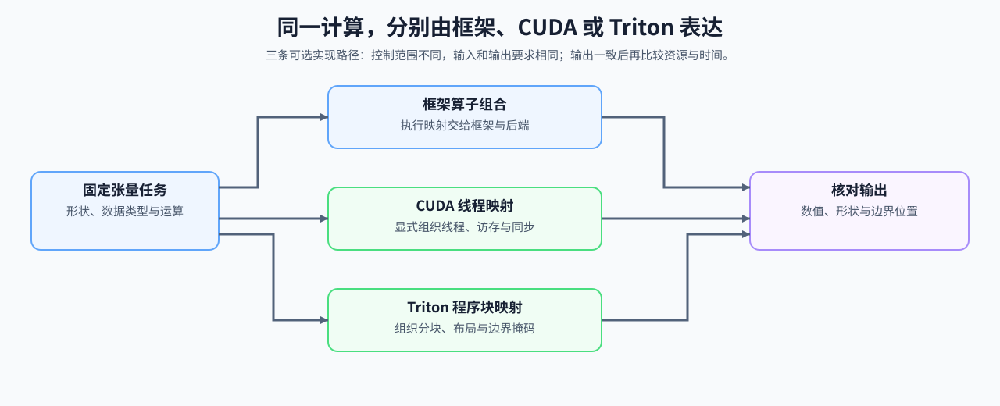

# 08. Programming Models CUDA Triton | 编程模型演进

**难度：** Medium | **环境：** CPU-first | **标签：** `算子编程`, `CUDA`, `Triton` | **目标人群：** 编译与系统入门者

> 🚀 **云端运行环境**
>
> 本章节的实战代码可以点击以下链接在免费 GPU 算力平台上直接运行：
>
> [](https://colab.research.google.com/github/datawhalechina/llm-algo-leetcode/blob/main/01_Hardware_Math_and_Systems/08_Programming_Models_CUDA_Triton.ipynb)
> [](https://modelscope.cn/my/mynotebook) *(国内推荐：魔搭社区免费实例)*


---

## 本节导读

计算 `y = (x + b) * s` 时，可以直接组合PyTorch算子，也可以让编译器融合，或编写自定义计算内核（kernel）。这些实现保持相同的计算要求，却可能产生不同的中间读写、线程分工和启动次数。应先判断哪些工作可以减少，再决定需要控制哪些执行细节。

本节比较框架、CUDA与Triton的控制范围，计算串行链的逻辑读写、线程分组和共享数据的成本。它支撑算子优化中的实现选择；线程映射继续进入15节，Triton数据块映射继续进入18节。

**关键词：** 编程模型、计算内核、线程块、数据块



---

## 前置阅读

先区分设备的计算与存储资源，再看编程模型如何组织任务。

- [03 GPU架构与内存层次](./03_GPU_Architecture_and_Memory.md)：流式多处理器、寄存器、共享内存与设备内存的关系。

## Q1：同一计算为什么会有不同的中间读写？

将 `x + b` 与后续乘法分开执行时，第一步的中间结果通常先写出，再由第二步读取；融合实现可以直接消费这个中间值。PyTorch表达的是张量运算，实际使用分离算子、编译融合还是库调用，取决于执行路径。CUDA和Triton还允许直接设计自定义内核的数据处理方式。

先用更简单的串行链比较读写：每个算子完整读取一个等大张量，并写出一个等大张量，其他输入暂不计入。三个算子分开执行，对应三次读、三次写；完全融合假设下，只保留一次输入读取与一次最终输出写入。这里比较的是逻辑全局读写，缓存命中与实际生成实现会影响设备内存流量。

### Q1 机制计算器：核对串行链的逻辑字节量

固定每个张量为8,000,000 B，分别比较两个算子、三个算子与完全融合的读写；一次“读”表示完整读取一个张量。


```python
def memory_traffic(num_ops: int, tensor_bytes: int, fused: bool = False) -> dict:
    """按单输入、等大输出的串行链，返回整张量读写次数与逻辑字节量。"""
    if any(type(value) is not int or value <= 0
           for value in (num_ops, tensor_bytes)):
        raise ValueError("num_ops 和 tensor_bytes 须为正整数")
    if type(fused) is not bool:
        raise ValueError("fused 须为布尔值")
    reads = 1 if fused else num_ops
    writes = 1 if fused else num_ops
    return {"reads": reads, "writes": writes,
            "traffic_bytes": (reads + writes) * tensor_bytes}


tensor_bytes = 8_000_000
cases = {
    "two_separate": memory_traffic(num_ops=2, tensor_bytes=tensor_bytes),
    "three_separate": memory_traffic(num_ops=3, tensor_bytes=tensor_bytes),
    "three_fused": memory_traffic(num_ops=3, tensor_bytes=tensor_bytes, fused=True),
}
assert cases["two_separate"]["traffic_bytes"] == 32_000_000
assert cases["three_separate"] == {
    "reads": 3, "writes": 3, "traffic_bytes": 48_000_000,
}
assert cases["three_fused"] == {
    "reads": 1, "writes": 1, "traffic_bytes": 16_000_000,
}
assert memory_traffic(num_ops=1, tensor_bytes=4)["traffic_bytes"] == 8
for name, result in cases.items():
    print(f"{name}: 读 {result['reads']} 次，写 {result['writes']} 次，"
          f"逻辑读写 {result['traffic_bytes']:,} B")

```

## Q2：单个CUDA线程块怎样按Warp分组？

CUDA用线程（Thread）执行局部计算，一组线程构成线程块（Block），一次启动的全部线程块构成网格（Grid）。NVIDIA硬件将同一块的线程按32个组成线程束（Warp），线程在Warp中的位置称为Lane。这些任务单位如何在流式多处理器（SM）上驻留，还要考虑资源和调度。

48个线程需要两个Warp，共64个线程槽，其中16个槽没有分配线程，槽利用比例为75%。这个比例描述块内线程打包；SM占用率（occupancy）则描述驻留Warp数相对设备上限的比例，还需要资源与设备信息。

这一步先检查一个块怎样打包线程；整个输入需要多少块，在[15 CUDA执行模型](./15_CUDA_Execution_Model.md)按元素数量计算。同一块内线程如何交换并复用数据，再进入[16 块内协作](./16_Warp_Block_SharedMemory_Basics.md)。

### Q2 机制计算器：核对单块线程打包

先核对48个线程需要两个Warp、余下16个未分配槽，再比较1、32与33个线程。这里固定32线程Warp，尚未给出整个输入的元素数，因此不计算Grid或尾部越界线程。


```python
def block_launch_stats(num_threads: int) -> dict:
    """按32线程Warp计算单块线程槽，返回Warp数、未分配槽数和利用比例。"""
    if type(num_threads) is not int or num_threads <= 0:
        raise ValueError("num_threads 须为正整数")
    warp_size = 32
    warps = (num_threads + warp_size - 1) // warp_size
    thread_slots = warps * warp_size
    return {
        "warps": warps,
        "unassigned_slots": thread_slots - num_threads,
        "thread_slot_utilization": num_threads / thread_slots,
    }


threads = 48
packed = block_launch_stats(num_threads=threads)
assert packed == {
    "warps": 2, "unassigned_slots": 16, "thread_slot_utilization": 0.75,
}
assert block_launch_stats(num_threads=1)["unassigned_slots"] == 31
assert block_launch_stats(num_threads=32)["thread_slot_utilization"] == 1.0
assert block_launch_stats(num_threads=33)["unassigned_slots"] == 31
print(f"{threads} 个线程：{packed['warps']} 个Warp，"
      f"未分配 {packed['unassigned_slots']} 个槽，"
      f"线程槽利用比例 {packed['thread_slot_utilization']:.0%}")

```

## Q3：共享数据省下的读取能否覆盖同步成本？

块内多个线程重复读取同一数据块时，可以先将它搬入共享内存，再供消费者使用。共享内存是线程块协作使用的片上存储；同步保证消费者在写入完成后读取。若数据只使用一次，就没有可省的重复读取，还可能增加协作成本。

假设64,000 B的数据块完整读取两次，复用可省去一次64,000 B的全局读取。按给定的16,000 B/us带宽换算为4 us，再与同步开销比较。若一次同步假设为2 us，那么同步一、二、三次时，模型净节省分别为2、0、−2 us。这个对照说明显式控制可能带来额外工作；缓存、共享内存访问与其他指令还需在实际实现中继续核对。

### Q3 对照验证：比较节省时间大于、等于和小于同步开销

先核对4 us的读取估算，再只改变同步次数；各次同步统一假设为2 us。


```python
import math


def shared_tradeoff(
    reuse_times: int, sync_points: int, tile_bytes: int,
    bandwidth_bytes_per_us: float, sync_cost_us: float,
) -> dict:
    """按完整数据块复用和给定带宽，返回逻辑读取减少量及简化时间差（us）。"""
    if (type(reuse_times) is not int or reuse_times <= 0
            or type(sync_points) is not int or sync_points < 0
            or type(tile_bytes) is not int or tile_bytes <= 0):
        raise ValueError("复用次数和数据块字节数须为正整数，同步次数须为非负整数")
    if any(type(value) not in (int, float) or not math.isfinite(value)
           for value in (bandwidth_bytes_per_us, sync_cost_us)):
        raise ValueError("带宽和单次同步耗时须为有限实数")
    if bandwidth_bytes_per_us <= 0 or sync_cost_us < 0:
        raise ValueError("带宽须为正数，同步耗时须为非负数")
    saved_read_bytes = (reuse_times - 1) * tile_bytes
    estimated_read_saved_us = saved_read_bytes / bandwidth_bytes_per_us
    sync_us = sync_points * sync_cost_us
    return {
        "saved_global_read_bytes": saved_read_bytes,
        "estimated_read_saved_us": estimated_read_saved_us,
        "synchronization_us": sync_us,
        "estimated_net_saved_us": estimated_read_saved_us - sync_us,
    }


base = dict(reuse_times=2, tile_bytes=64_000,
            bandwidth_bytes_per_us=16_000, sync_cost_us=2.0)
reports = {count: shared_tradeoff(**base, sync_points=count) for count in (1, 2, 3)}
assert reports[1]["saved_global_read_bytes"] == 64_000
assert reports[1]["estimated_read_saved_us"] == 4.0
assert reports[1]["synchronization_us"] == 2.0
assert [reports[count]["estimated_net_saved_us"] for count in (1, 2, 3)] == [2, 0, -2]
no_reuse = shared_tradeoff(**(base | {"reuse_times": 1}), sync_points=1)
assert no_reuse["saved_global_read_bytes"] == 0
assert no_reuse["estimated_net_saved_us"] == -2
for count, result in reports.items():
    print(f"同步 {count} 次：模型净节省 {result['estimated_net_saved_us']:g} us")

```

## Q4：Triton把哪些映射工作交给编译器？

Triton用程序实例（Program）处理一个逻辑数据块（Tile），用启动网格安排这些实例，用掩码（Mask）屏蔽超出输入的位置。开发者仍需选择数据块、组织地址和复用关系；编译器根据表达式与配置将块内工作映射到线程、指令和资源。CUDA更直接地用线程索引和同步原语表达这些工作，两者都需要检查实际布局和执行结果。

例如1000个元素按每块128个槽处理，需要8个Program，共1024个槽，其中24个槽在访问时被屏蔽。下面为一个连续布局示例检查给定的数据类型支持与填充比例上限；非连续输入也可有对应实现，应先改写地址计算，而不是认定Triton只能处理连续输入。

### Q4 条件筛选：逐项改变布局、数据类型与填充比例

布局和数据类型支持为给定条件，填充比例按“屏蔽槽数／总槽数”计算。先比较1000个元素的覆盖，再检查比例恰好等于上限时能否保留。


```python
def triton_candidate(
    num_elements: int, block_size: int, layout_contiguous: bool,
    dtype_supported: bool, max_padding_ratio: float = 0.25,
) -> dict:
    """检查给定连续布局示例的条件；返回几何覆盖和未满足项。"""
    if any(type(value) is not int or value <= 0 for value in (num_elements, block_size)):
        raise ValueError("元素数和块大小须为正整数")
    if type(layout_contiguous) is not bool or type(dtype_supported) is not bool:
        raise ValueError("布局和数据类型检查须为布尔值")
    if (type(max_padding_ratio) not in (int, float)
            or not math.isfinite(max_padding_ratio) or not 0 <= max_padding_ratio < 1):
        raise ValueError("填充比例上限须为 [0, 1) 内的有限实数")
    programs = (num_elements + block_size - 1) // block_size
    padding_ratio = (programs * block_size - num_elements) / (programs * block_size)
    reasons = []
    if not layout_contiguous:
        reasons.append("non_contiguous_layout")
    if not dtype_supported:
        reasons.append("unsupported_dtype")
    if padding_ratio > max_padding_ratio:
        reasons.append("padding_ratio")
    return {"stated_conditions_met": not reasons, "programs": programs,
            "padding_ratio": padding_ratio, "reasons": reasons}


base = dict(num_elements=1000, block_size=128, layout_contiguous=True,
            dtype_supported=True, max_padding_ratio=0.25)
changes = {
    "given_conditions": {},
    "layout_miss": {"layout_contiguous": False},
    "dtype_miss": {"dtype_supported": False},
    "at_padding_limit": {"num_elements": 96},
    "over_padding_limit": {"num_elements": 95},
}
reports = {name: triton_candidate(**(base | change))
           for name, change in changes.items()}
assert reports["given_conditions"]["programs"] == 8
assert reports["given_conditions"]["padding_ratio"] == 24 / 1024
assert reports["layout_miss"]["reasons"] == ["non_contiguous_layout"]
assert reports["dtype_miss"]["reasons"] == ["unsupported_dtype"]
assert reports["at_padding_limit"]["stated_conditions_met"]
assert reports["at_padding_limit"]["padding_ratio"] == 0.25
assert reports["over_padding_limit"]["reasons"] == ["padding_ratio"]
for name, result in reports.items():
    print(f"{name}: Program数={result['programs']}，"
          f"屏蔽槽比例={result['padding_ratio']:.2%}，未满足项={result['reasons']}")

```

## 怎样选择下一步要改变的执行方式？

中间结果反复写出时，先比较现有编译融合能否消除这些边界；需要改变协作加载、布局或同步时，再选择CUDA或Triton表达相应算法。输出、形状与边界核对通过后，比较包含必要适配与同步的调用时间，才能判断增加的控制是否值得。

## 相关阅读

按需要控制的执行细节，继续学习编译、线程或数据块映射。

- [09 AI编译器与计算图优化](./09_AI_Compilers_and_Graph_Optimization.md)：检查现有编译路径能否消除中间读写。
- [15 CUDA执行模型](./15_CUDA_Execution_Model.md)：从任务规模推导线程块，并检查资源预算。
- [18 Triton分块模型](./18_Triton_Block_Model.md)：用Program、偏移与掩码覆盖输入空间。
