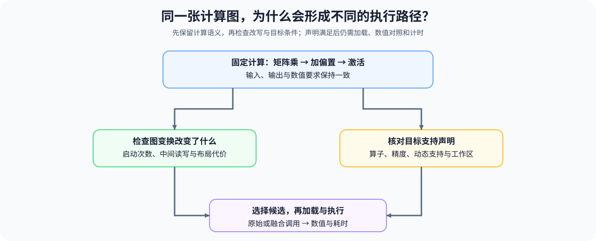
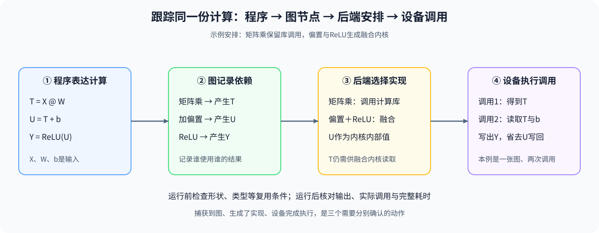

# 09. AI Compilers and Graph Optimization | AI 编译器与计算图优化

**难度：** Hard | **环境：** CPU-first | **标签：** `编译系统`, `AI Compiler`, `Graph Optimization` | **目标人群：** 编译与系统入门者

> 🚀 **云端运行环境**
>
> 本章节的实战代码可以点击以下链接在免费 GPU 算力平台上直接运行：
>
> [](https://colab.research.google.com/github/datawhalechina/llm-algo-leetcode/blob/main/01_Hardware_Math_and_Systems/09_AI_Compilers_and_Graph_Optimization.ipynb)
> [](https://modelscope.cn/my/mynotebook) *(国内推荐：魔搭社区免费实例)*


---

## 本节导读

同一段“矩阵乘 → 加偏置 → 激活”，可以逐个调用算子，也可以交给编译器改写。两种方式需要保持约定的计算语义与数值要求，却可能使用不同的中间张量、启动次数和后端路径。

从程序中取得计算关系、改写计算关系、生成设备实现是不同动作。本节沿这条计算链区分它们，再比较图变换改变的读写与启动，检查后端的算子、精度和工作区条件。算子优化据此判断该继续利用现有编译，还是改变内核实现；实际快慢由同输入执行与计时确认。

**关键词：** AI 编译器、计算图、中间张量、后端路径



---
## 前置阅读

先理解张量任务怎样分成逻辑数据块，再追踪图中的依赖与后端安排。

- [18 Triton分块模型](./18_Triton_Block_Model.md)：区分计算区域与实际线程映射。

## Q1：程序、计算图和设备实现怎样连接？

沿同一个例子跟踪三个值：矩阵乘产生 `T = X @ W`，加偏置产生 `U = T + b`，ReLU把U中的负值变为0，得到Y。计算图用节点记录运算，用连线表示谁使用谁的结果。从程序中提取这些关系称为图捕获；编译器保存计算信息的形式称为中间表示（IR），计算图是其中一种形式。它描述计算依赖，还没有指定线程分工或设备指令。

编译后端把这些关系落实为目标实现。一种候选安排保留矩阵乘库调用，把偏置与ReLU合成一个内核；T仍须跨调用传递，U可以作为内部值直接消费。下面用CPU上的字典声明依赖和分组，计算谁使用T／U、哪些值跨组；它展示分组含义，不模拟真实图捕获或代码生成。实际PyTorch入口 `torch.compile` 涉及的名称按这条链理解：

| 环节 | 本例中发生什么 | PyTorch中的对应角色 |
| --- | --- | --- |
| 取得计算关系 | 记录矩阵乘、加偏置与ReLU的依赖 | TorchDynamo捕获可处理的计算，FX图表示节点与连接 |
| 选择实现 | 保留矩阵乘库调用，组合偏置与激活 | 常用后端TorchInductor组合库调用或生成代码，GPU实现可能包含Triton内核 |
| 提交并执行 | 运行得到T的调用，再运行得到Y的调用 | 实际设备调用与数值、耗时需要另外确认 |




```python
def execution_plan_report(node_inputs: dict, groups: list, external_inputs: set) -> dict:
    """按依赖顺序声明节点、按执行顺序声明分组；计算使用者与组间中间值，不运行编译器。"""
    flattened = [name for group in groups for name in group]
    if (not node_inputs or any(not group for group in groups)
            or len(flattened) != len(set(flattened)) or set(flattened) != set(node_inputs)):
        raise ValueError("各节点须恰好属于一个非空分组")
    if set(node_inputs) & external_inputs:
        raise ValueError("节点结果不能与外部输入同名")
    owner = {name: index for index, group in enumerate(groups) for name in group}
    available = set(external_inputs)
    users = {name: [] for name in node_inputs}
    for name, inputs in node_inputs.items():
        if any(source not in available for source in inputs):
            raise ValueError("节点输入须先于当前节点就绪")
        for source in set(inputs) & set(node_inputs):
            if owner[source] > owner[name]:
                raise ValueError("分组执行顺序必须满足依赖")
            users[source].append(name)
        available.add(name)
    boundaries = [name for name, readers in users.items()
                  if any(owner[reader] != owner[name] for reader in readers)]
    return {"users": users, "materialized_intermediates": boundaries,
            "planned_calls": len(groups)}


# 手工声明同一条计算的输入依赖，分组是假设的实现安排。
node_inputs = {"T": ("X", "W"), "U": ("T", "b"), "Y": ("U",)}
node_ops = {"T": "matmul", "U": "add", "Y": "relu"}
external_inputs = {"X", "W", "b"}
separate_plan = execution_plan_report(node_inputs, [["T"], ["U"], ["Y"]], external_inputs)
fused_plan = execution_plan_report(node_inputs, [["T"], ["U", "Y"]], external_inputs)
assert separate_plan["users"] == {"T": ["U"], "U": ["Y"], "Y": []}
assert separate_plan["materialized_intermediates"] == ["T", "U"]
assert fused_plan["materialized_intermediates"] == ["T"]
assert separate_plan["planned_calls"] == 3 and fused_plan["planned_calls"] == 2
for name, plan in (("分离安排", separate_plan), ("偏置与激活合并", fused_plan)):
    print(f"{name}: 计划调用 {plan['planned_calls']} 次，"
          f"组间中间值 {plan['materialized_intermediates']}；最终输出始终是Y")

```

## Q2：分组改变后，哪些中间读写和启动可以减少？

沿用Q1的三步计算，分离安排中T、U各跨一次组；偏置与激活合并后只剩T跨组。假设两者都含1024个FP32元素，每个组间值写一次、读一次，逻辑读写便从16 KiB减为8 KiB。这里给每组一次启动、每次启动5 μs的构造假设，启动项从15 μs减为10 μs。

如果改写还需要布局转换，即为满足实现要求而重新排列或复制数据，其读写量也要记录。下面保留同一三步计算，只改变分组和新增布局字节；字节数与启动微秒数分开返回，不把两种单位直接相加。

### Q2 机制计算器：把分组计划接到启动与读写账目

使用Q1得到的三组／两组计划，核对16 KiB与8 KiB，再在两组安排中加入8 KiB布局读写。


```python
import math


def graph_cost(
    num_ops: int, fused_groups: int, intermediate_elements: int,
    bytes_per_element: int, layout_bytes: int = 0,
    launch_overhead_us: float = 5.0,
) -> dict:
    """按等大边界、每组一次启动的串行链，返回逻辑字节量与假设启动微秒数。"""
    if (type(num_ops) is not int or type(fused_groups) is not int
            or num_ops <= 0 or not 1 <= fused_groups <= num_ops):
        raise ValueError("算子数须为正整数，分组数须在 1 到算子数之间")
    if (type(intermediate_elements) is not int or intermediate_elements < 0
            or type(bytes_per_element) is not int or bytes_per_element <= 0
            or type(layout_bytes) is not int or layout_bytes < 0):
        raise ValueError("元素数和布局字节数须为非负整数，元素字节数须为正整数")
    if (type(launch_overhead_us) not in (int, float)
            or not math.isfinite(launch_overhead_us) or launch_overhead_us < 0):
        raise ValueError("launch_overhead_us 须为有限非负实数")
    materialized_boundaries = fused_groups - 1
    intermediate_bytes = (
        materialized_boundaries * intermediate_elements * bytes_per_element * 2
    )
    return {
        "launches": fused_groups,
        "launch_overhead_us": fused_groups * launch_overhead_us,
        "materialized_boundaries": materialized_boundaries,
        "intermediate_traffic_bytes": intermediate_bytes,
        "layout_traffic_bytes": layout_bytes,
        "total_extra_traffic_bytes": intermediate_bytes + layout_bytes,
    }


# T、U均按1024个FP32元素计，调用数来自Q1的手工分组计划。
inputs = dict(num_ops=len(node_inputs), intermediate_elements=1024, bytes_per_element=4)
plans = {
    "unfused": graph_cost(**inputs, fused_groups=separate_plan["planned_calls"]),
    "partial": graph_cost(**inputs, fused_groups=fused_plan["planned_calls"]),
    "partial_with_layout": graph_cost(**inputs, fused_groups=fused_plan["planned_calls"],
                                      layout_bytes=8192),
}
assert plans["unfused"]["intermediate_traffic_bytes"] == 16384
assert plans["unfused"]["launch_overhead_us"] == 15
assert plans["partial"]["intermediate_traffic_bytes"] == 8192
assert plans["partial"]["launch_overhead_us"] == 10
assert plans["partial_with_layout"]["total_extra_traffic_bytes"] == 16384
assert graph_cost(num_ops=1, fused_groups=1, intermediate_elements=0,
                  bytes_per_element=4, launch_overhead_us=0)["total_extra_traffic_bytes"] == 0
for name, row in plans.items():
    print(f"{name}: 计划启动 {row['launches']} 次，假设启动项 {row['launch_overhead_us']:g} us，"
          f"额外逻辑读写 {row['total_extra_traffic_bytes'] / 1024:g} KiB")

```

## Q3：新增布局读写会抵消多少减少量？

两组安排原本省去U的8 KiB写出与读取；若新增布局转换也读写8 KiB，净读写减少量就变为零；若新增12 KiB，则比原安排多4 KiB。但计划调用数仍从3降为2，给定的启动项仍减少5 μs。这些变化可以同时存在，不能把“净读写减少”当作唯一选择条件。

下面直接比较Q2生成的账目，不重复填写一组融合条件。语义与中间值的使用者在[19 算子融合](./19_Operator_Fusion_Introduction.md)继续核对；寄存器、共享内存与实际调用则需要生成代码和运行记录。图的分组计划只提出希望减少的工作，实际耗时还要包含资源变化、布局与提交成本。

### Q3 对照验证：分别核对启动节省与净读写变化

固定原来的分离安排，比较无布局转换、恰好抵消与布局开销更大的三种候选。


```python
def graph_rewrite_delta(before: dict, after: dict) -> dict:
    """比较graph_cost生成的两份同范围账目；分别返回启动与逻辑流量差。"""
    net_bytes = before["total_extra_traffic_bytes"] - after["total_extra_traffic_bytes"]
    return {
        "saved_launches": before["launches"] - after["launches"],
        "saved_launch_overhead_us": before["launch_overhead_us"] - after["launch_overhead_us"],
        "net_logical_traffic_saved_bytes": net_bytes,
        "has_net_traffic_saving": net_bytes > 0,
    }


more_layout = graph_cost(**inputs, fused_groups=fused_plan["planned_calls"], layout_bytes=12288)
comparisons = {
    "no_layout": graph_rewrite_delta(plans["unfused"], plans["partial"]),
    "equal_layout": graph_rewrite_delta(plans["unfused"], plans["partial_with_layout"]),
    "more_layout": graph_rewrite_delta(plans["unfused"], more_layout),
}
assert comparisons["no_layout"]["net_logical_traffic_saved_bytes"] == 8192
assert comparisons["equal_layout"]["net_logical_traffic_saved_bytes"] == 0
assert comparisons["more_layout"]["net_logical_traffic_saved_bytes"] == -4096
assert all(row["saved_launches"] == 1 for row in comparisons.values())
assert all(row["saved_launch_overhead_us"] == 5 for row in comparisons.values())
assert not comparisons["more_layout"]["has_net_traffic_saving"]
for name, row in comparisons.items():
    print(f"{name}: 计划少 {row['saved_launches']} 次启动，"
          f"给定启动项减少 {row['saved_launch_overhead_us']:g} us，"
          f"净逻辑读写减少 {row['net_logical_traffic_saved_bytes'] / 1024:g} KiB")

```

## Q4：给定后端声明，哪些候选还能继续验证？

沿用矩阵乘、加偏置和ReLU三个操作，假设现在还要覆盖变化的批量大小。不同后端声明支持的运算、数据类型、动态形状与工作区可能不同。工作区是执行期间额外使用的临时内存，例如某种矩阵乘实现的暂存空间；先按这些声明排除缺项，再比较剩余候选的假设延迟。

动态形状指输入的一些维度可以变化。复用真实编译版本前，先进行编译版本适用条件检查（guard），判断输入是否仍符合该版本要求，失败后还可能查找其他缓存版本、重新编译或回退；具体维度、步长和图中断需要在版本复用问题中另查。下面只筛选给定声明，工作区以MiB计，动态支持是一个简化字段，不会捕获计算图或查询真实设备。

### Q4 约束筛选：用同一计算需要的运算集合检查声明

需求中的操作来自Q1的节点；构造更快但缺少操作、类型、动态支持或工作区超预算的候选，核对它们先被排除。


```python
def choose_backend(requirements: dict, candidates: dict) -> dict:
    """按给定能力筛选，并取假设延迟最小者；同延迟保留输入顺序靠前者。

    requirements 含 ops 集合、dtype 字符串、dynamic_shape 布尔值和
    workspace_limit_mib；候选含 ops/dtypes 集合、dynamic_shape、
    workspace_mib、estimated_latency_ms。返回入选名、可选名和排除原因。
    """
    if (type(requirements["ops"]) is not set
            or type(requirements["dtype"]) is not str
            or type(requirements["dynamic_shape"]) is not bool):
        raise ValueError("需求的 ops/dtype/dynamic_shape 须为集合/字符串/布尔值")
    limit_mib = requirements["workspace_limit_mib"]
    if (type(limit_mib) not in (int, float)
            or not math.isfinite(limit_mib) or limit_mib < 0):
        raise ValueError("workspace_limit_mib 须为有限非负实数")
    eligible, rejected = [], {}
    for name, candidate in candidates.items():
        if (type(candidate["ops"]) is not set
                or type(candidate["dtypes"]) is not set
                or type(candidate["dynamic_shape"]) is not bool):
            raise ValueError("候选的 ops/dtypes 须为集合，dynamic_shape 须为布尔值")
        workspace_mib = candidate["workspace_mib"]
        latency_ms = candidate["estimated_latency_ms"]
        if (type(workspace_mib) not in (int, float)
                or not math.isfinite(workspace_mib) or workspace_mib < 0
                or type(latency_ms) not in (int, float)
                or not math.isfinite(latency_ms) or latency_ms <= 0):
            raise ValueError("候选工作区须为有限非负实数，假设延迟须为有限正实数")
        reasons = []
        if not requirements["ops"].issubset(candidate["ops"]):
            reasons.append("missing_ops")
        if requirements["dtype"] not in candidate["dtypes"]:
            reasons.append("unsupported_dtype")
        if requirements["dynamic_shape"] and not candidate["dynamic_shape"]:
            reasons.append("dynamic_shape")
        if workspace_mib > limit_mib:
            reasons.append("workspace")
        if reasons:
            rejected[name] = reasons
        else:
            eligible.append(name)
    selected = min(
        eligible, key=lambda name: candidates[name]["estimated_latency_ms"],
        default=None,
    )
    return {"selected": selected, "eligible": eligible, "rejected": rejected}


requirements = {
    "ops": set(node_ops.values()), "dtype": "bf16",
    "dynamic_shape": True, "workspace_limit_mib": 512,
}
base = {
    "ops": set(node_ops.values()), "dtypes": {"fp16", "bf16"},
    "dynamic_shape": True, "workspace_mib": 256, "estimated_latency_ms": 3.0,
}
# 每个不满足项都更快，检验能力筛选是否优先于假设延迟。
changes = {
    "supported": {},
    "missing_op": {"ops": {"matmul"}, "estimated_latency_ms": 1.0},
    "wrong_dtype": {"dtypes": {"fp32"}, "estimated_latency_ms": 1.0},
    "static_only": {"dynamic_shape": False, "estimated_latency_ms": 1.0},
    "over_workspace": {"workspace_mib": 513, "estimated_latency_ms": 1.0},
    "at_workspace": {"workspace_mib": 512, "estimated_latency_ms": 4.0},
    "slower_supported": {"estimated_latency_ms": 6.0},
    "multiple_misses": {"ops": set(), "dtypes": set(), "dynamic_shape": False,
                        "workspace_mib": 513, "estimated_latency_ms": 0.5},
}
candidates = {name: base | change for name, change in changes.items()}
decision = choose_backend(requirements=requirements, candidates=candidates)
assert decision["selected"] == "supported"
assert decision["eligible"] == ["supported", "at_workspace", "slower_supported"]
for name, reason in (("missing_op", "missing_ops"),
                     ("wrong_dtype", "unsupported_dtype"),
                     ("static_only", "dynamic_shape"),
                     ("over_workspace", "workspace")):
    assert decision["rejected"][name] == [reason]
assert decision["rejected"]["multiple_misses"] == [
    "missing_ops", "unsupported_dtype", "dynamic_shape", "workspace",
]
unavailable = choose_backend(
    requirements=requirements, candidates={"static_only": candidates["static_only"]},
)
assert unavailable["selected"] is None and unavailable["eligible"] == []
assert choose_backend(requirements=requirements, candidates={}) == {
    "selected": None, "eligible": [], "rejected": {},
}
print("按给定能力可选：", decision["eligible"])
print("按假设延迟入选：", decision["selected"])
print("各候选的排除原因：", decision["rejected"])

```

## 相关阅读

先沿具体中间值判断改写，再按输入变化或实际执行问题继续：

- [19 算子融合导论](./19_Operator_Fusion_Introduction.md)：跟踪偏置与激活之间的U是否需要写回，并核对样例输出。
- [30 动态形状处理](./30_Dynamic_Shape_Handling.md)：区分版本适用条件不满足、版本复用、重新编译和图中断。
- [Part03·21 图捕获与版本复用](../03_Triton_Kernels/21_Torch_Compile_Graph_Reuse.md)：实际观察计算图、版本复用和受控图中断，再进入设备实现与性能比较。
