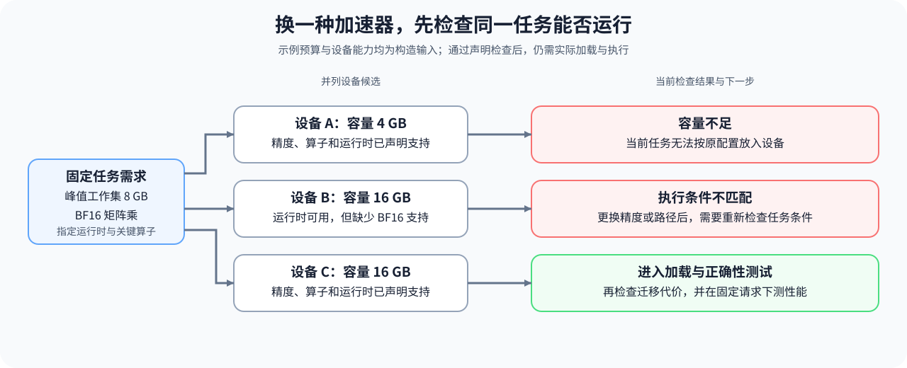

# 10. Domestic AI Chips Overview | 加速器选型与软件栈适配

**难度：** Medium | **环境：** CPU-first | **标签：** `硬件系统`, `AI 芯片`, `异构算力` | **目标人群：** 硬件约束学习者

> 🚀 **云端运行环境**
>
> 本章节的实战代码可以点击以下链接在免费 GPU 算力平台上直接运行：
>
> [](https://colab.research.google.com/github/datawhalechina/llm-algo-leetcode/blob/main/01_Hardware_Math_and_Systems/10_Domestic_AI_Chips_Overview.ipynb)
> [](https://modelscope.cn/my/mynotebook) *(国内推荐：魔搭社区免费实例)*


---

## 本节导读

准备把同一个模型换到另一种加速器上时，容量更大、峰值算力更高的设备，也可能无法加载原有产物，或缺少某个关键操作。硬件参数之外，还要确认模型需要的精度、执行框架和软件支持是否匹配。

本节先列出同一任务的容量与操作需求，再检查所需软件组件、迁移工期和功率上限。完成后，你应能指出候选具体缺少什么，而不是用一个综合分数掩盖问题；保留的候选继续在运行时约束与部署专题中验证。

**关键词：** 阶段需求、软件栈、算子支持、迁移工期



## 前置阅读

先理解工作集与设备能力，再按同一任务需求筛选候选。

- [03 GPU架构与内存](./03_GPU_Architecture_and_Memory.md)：容量、计算与访存约束。
- [09 图编译与后端](./09_AI_Compilers_and_Graph_Optimization.md)：操作支持声明与实际执行的区别。

## Q1：同一任务需要哪些容量、精度和操作？

假设一个生成阶段需要8 GB预计峰值、BF16类型与矩阵乘／Softmax操作。16 GB候选若声明支持这些操作与类型，可以继续检查软件路径；若需求改为20 GB，容量便不足。即使设备峰值算力更高，缺少当前计算所需的操作或数值类型，也无法直接执行这一方案。

架构规定一类设备的指令与执行能力，具体产品给出可用内存、带宽和功率等规格，软件版本决定当前框架能调用哪些实现。同一架构下不同产品的容量可以不同，同为BF16也可能采用不同矩阵计算路径。容量需求应合计同一阶段的权重、状态与工作区；容量和操作满足后，再在固定负载上比较带宽与计算时间，而不是按型号名称或峰值算力直接排序。

### Q1 可行性检查：先比较预算与已声明能力

容量输入是同一阶段的预计峰值工作集，包括权重、状态与工作区，而不只是权重文件大小。下面核对给定的容量、算子和数据类型，不读取本机规格或加载模型。


```python
import math


def accelerator_feasibility(required_peak_bytes, device_memory_bytes, required_ops, supported_ops, required_dtype, supported_dtypes):
    """在比较峰值前检查容量、算子和 dtype 三个硬条件。"""
    if any(type(value) not in (int, float) or not math.isfinite(value) or value <= 0
           for value in (required_peak_bytes, device_memory_bytes)):
        raise ValueError('memory bytes must be positive')
    reasons = []
    if required_peak_bytes > device_memory_bytes:
        reasons.append('insufficient_memory')
    missing_ops = sorted(set(required_ops) - set(supported_ops))
    if missing_ops:
        reasons.append('missing_ops')
    if required_dtype not in supported_dtypes:
        reasons.append('unsupported_dtype')
    return {'feasible': not reasons, 'reasons': reasons, 'missing_ops': missing_ops}

ready = accelerator_feasibility(8e9, 16e9, {'matmul', 'softmax'}, {'matmul', 'softmax'}, 'bf16', {'fp16', 'bf16'})
blocked = accelerator_feasibility(20e9, 16e9, {'matmul', 'softmax'}, {'matmul'}, 'bf16', {'fp16'})
assert ready['feasible'] is True
assert blocked['feasible'] is False
assert blocked['reasons'] == ['insufficient_memory', 'missing_ops', 'unsupported_dtype']
assert blocked['missing_ops'] == ['softmax']
assert accelerator_feasibility(
    16e9, 16e9, {'matmul'}, {'matmul'}, 'bf16', {'bf16'})['feasible']
print('ready:', ready)
print('blocked:', blocked)
```

## Q2：所选执行路径需要哪些软件组件？

驱动连接设备，执行框架加载产物并安排操作，内核完成具体计算。某些路径还需要编译或已经生成的目标产物，以及跨设备集合通信。按阶段要求列出这些条件，比把所有设备都套入同一安装清单更准确；例如单进程、无集合通信的任务可先检查本地执行，确实需要多设备通信时再检查相应组件。

Python调用相似也可能使用不同底层软件。[PyTorch的HIP说明](https://docs.pytorch.org/docs/2.11/notes/hip.html#hip-interfaces-reuse-the-cuda-interfaces)以ROCm构建复用许多`torch.cuda`接口，调用形式本身不足以识别底层设备或软件栈；自定义扩展还要核对目标工具链与产物。下面的编译支持字段表示所选路径需要的编译或产物能力，预编译路径可由匹配产物满足。关键操作覆盖率只统计本任务必需操作；组件状态由外部给定，加载与数值结果仍需实际检查。

### Q2 条件检查：哪些组件能沿用，哪些需要补齐

固定Q1的8 GB需求与16 GB设备声明，只改变软件条件：单设备路径不需要集合通信；需要跨设备通信时补查通信组件；已有目标框架但尚无目标编译／产物和关键内核时，则分别列出这两项缺口。容量相同，不代表迁移工作相同。


```python
def stack_readiness(driver, compiler, runtime, kernel, communication,
                    kernel_coverage=1.0, requires_communication=False):
    """按当前路径检查给定状态，条件满足不等于已经真实执行。"""
    layers = {
        'driver': driver, 'compiler': compiler, 'runtime': runtime,
        'kernel': kernel, 'communication': communication,
    }
    if any(type(value) is not bool for value in
           (*layers.values(), requires_communication)):
        raise ValueError('组件状态与通信需求必须是布尔值')
    if (type(kernel_coverage) not in (int, float) or not math.isfinite(kernel_coverage)
            or not 0 <= kernel_coverage <= 1):
        raise ValueError('关键算子覆盖率必须位于 [0, 1]')
    required = ['driver', 'compiler', 'runtime', 'kernel']
    if requires_communication:
        required.append('communication')
    missing = [name for name in required if not layers[name]]
    if kernel_coverage != 1:
        missing.append('kernel_coverage')
    return {
        'declared_requirements_met': not missing,
        'missing': missing,
        'first_reported_gap': missing[0] if missing else None,
        'kernel_coverage': kernel_coverage,
    }


component_states = dict(driver=True, compiler=True, runtime=True,
                        kernel=True, communication=False)
single_device = stack_readiness(**component_states)
multi_device = stack_readiness(**component_states, requires_communication=True)
assert single_device['declared_requirements_met']
assert multi_device['missing'] == ['communication']
assert stack_readiness(**(component_states | {'compiler': False}))['missing'] == ['compiler']
target_components = component_states | {'compiler': False, 'kernel': False}
needs_target_artifacts = stack_readiness(**target_components)
assert ready['feasible']
assert needs_target_artifacts['missing'] == ['compiler', 'kernel']
print('无通信需求：', single_device)
print('需要通信：', multi_device)
print('容量满足，目标产物与内核待补齐：', needs_target_artifacts)

```

## Q3：哪些候选值得进入迁移与运行验证？

沿用前两问的容量、操作与软件条件，再加入当前任务的工期和功率限制。假设允许8周迁移、1 kW功率；需要6周、0.5 kW的替代方案可以继续验证，软件条件未满足的候选则先补齐缺项。供应风险也应来自明确调查或场景假设，与当前允许上限比较，不由设备品牌或产地推算。

下面只形成下一步候选：保留哪种设备声明、缺什么软件、迁移条件是否超限。进入[34 阶段与运行时约束](./34_Heterogeneous_Accelerators_and_Runtime_Constraints.md)后，再检查阶段之间的数据交接；采用判断还需共同功能、质量与性能记录，完整费用在[33 TCO与成本](./33_TCO_and_Cost_Model.md)计算。

### Q3 候选筛选：给定风险与资源是否超过上限

以下工期、功率和风险值均为假设输入；风险分值范围为零到一，不是从设备名称推导出的真实故障概率。


```python
def admit_accelerator_candidate(feasible, stack_ready, migration_weeks, max_migration_weeks, supply_risk, max_supply_risk, power_kw, power_cap_kw):
    """在完整 TCO 计算前，用硬约束和风险上限筛选设备候选。"""
    if type(feasible) is not bool or type(stack_ready) is not bool:
        raise ValueError('条件检查结果必须是布尔值')
    if any(type(value) not in (int, float) or not math.isfinite(value) or value < 0 for value in
           (migration_weeks, max_migration_weeks, supply_risk, max_supply_risk,
            power_kw, power_cap_kw)):
        raise ValueError('risk and resource inputs must be non-negative')
    if not 0 <= supply_risk <= 1 or not 0 <= max_supply_risk <= 1:
        raise ValueError('风险分值与上限必须位于 [0, 1]')
    reasons = []
    if not feasible:
        reasons.append('device_constraints')
    if not stack_ready:
        reasons.append('software_stack')
    if migration_weeks > max_migration_weeks:
        reasons.append('migration_schedule')
    if supply_risk > max_supply_risk:
        reasons.append('supply_risk')
    if power_kw > power_cap_kw:
        reasons.append('power_cap')
    return {'admitted': not reasons, 'reasons': reasons}

candidates = {
    'baseline': admit_accelerator_candidate(feasible=ready['feasible'],
        stack_ready=single_device['declared_requirements_met'], migration_weeks=2,
        max_migration_weeks=8, supply_risk=0.2, max_supply_risk=0.5,
        power_kw=0.7, power_cap_kw=1.0),
    'alternative': admit_accelerator_candidate(feasible=ready['feasible'],
        stack_ready=single_device['declared_requirements_met'], migration_weeks=6,
        max_migration_weeks=8, supply_risk=0.4, max_supply_risk=0.5,
        power_kw=0.5, power_cap_kw=1.0),
    'immature_stack': admit_accelerator_candidate(feasible=ready['feasible'],
        stack_ready=needs_target_artifacts['declared_requirements_met'], migration_weeks=4,
        max_migration_weeks=8, supply_risk=0.3, max_supply_risk=0.5,
        power_kw=0.6, power_cap_kw=1.0),
}
admitted = [name for name, result in candidates.items() if result['admitted']]
assert admitted == ['baseline', 'alternative']
assert candidates['immature_stack']['reasons'] == ['software_stack']
print('admission results:', candidates)

```

## 相关阅读

将候选条件继续用于阶段交接与同口径成本比较。

- [34 异构加速器与运行时约束](./34_Heterogeneous_Accelerators_and_Runtime_Constraints.md)：逐阶段需求、输入转换、搬运与同时驻留。
- [33 TCO与成本](./33_TCO_and_Cost_Model.md)：将迁移工时与运行记录接到单位成功请求成本。
- [部署与异构系统专题](../topic_discussion/deployment_heterogeneous/intro.md)：完成目标设备上的产物加载与执行验证。
