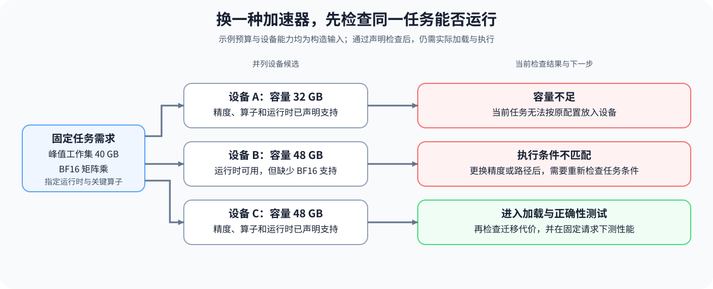

# 10. Domestic AI Chips Overview | 算力现状与替代方案

**难度：** Medium | **环境：** CPU-first | **标签：** `硬件系统`, `AI 芯片`, `异构算力` | **目标人群：** 硬件约束学习者

> 🚀 **云端运行环境**
>
> 本章节的实战代码可以点击以下链接在免费 GPU 算力平台上直接运行：
>
> [](https://colab.research.google.com/github/datawhalechina/llm-algo-leetcode/blob/main/01_Hardware_Math_and_Systems/10_Domestic_AI_Chips_Overview.ipynb)
> [](https://modelscope.cn/my/mynotebook) *(国内推荐：魔搭社区免费实例)*


---

## 本节导读

准备把同一个模型换到另一种加速器上时，容量更大、峰值算力更高的设备，也可能无法加载原有产物，或缺少某个关键操作。硬件参数之外，还要确认模型需要的精度、执行框架和软件支持是否匹配。

本节先列出同一任务的容量与操作需求，再检查所需软件组件、迁移工期和功率上限。完成后，你应能指出候选具体缺少什么，而不是用一个综合分数掩盖问题；保留的候选继续在运行时约束与部署专题中验证。

**关键词：** 设备生态、软件栈、迁移风险



## 前置阅读
**导语：** 先准备单设备资源和多设备通信两个约束，再筛选硬件候选。
- [1B：单设备执行、内存与访存](./1B.md)
- [1C：通信、并行与容错](./1C.md)
## Q1：选芯片时为什么不能只看算力峰值？


纸面峰值只说明“理论上能跑多快”，不说明“真实工作负载里能不能持续跑快”。

实际选型还要看：
- 软件栈是否成熟；
- 编译器和关键内核是否可用；
- 通信和调度能力是否匹配；
- 迁移和维护成本是否可控。

所以选型不是单一性能数字的比较，而是端到端可落地性的比较。

### Q1 可行性检查：先比较预算与已声明能力

容量输入是同一阶段的预计峰值工作集，包括权重、状态与工作区，而不只是权重文件大小。下面核对给定的容量、算子和数据类型，不读取本机规格或加载模型。


```python
import math


def accelerator_feasibility(required_peak_bytes, device_memory_bytes, required_ops, supported_ops, required_dtype, supported_dtypes):
    """在比较峰值前检查容量、算子和 dtype 三个硬条件。"""
    if any(not math.isfinite(value) or value <= 0
           for value in (required_peak_bytes, device_memory_bytes)):
        raise ValueError('memory bytes must be positive')
    reasons = []
    if required_peak_bytes > device_memory_bytes:
        reasons.append('insufficient_memory')
    missing_ops = sorted(set(required_ops) - set(supported_ops))
    if missing_ops:
        reasons.append('missing_ops')
    if required_dtype not in supported_dtypes:
        reasons.append('unsupported_dtype')
    return {'feasible': not reasons, 'reasons': reasons, 'missing_ops': missing_ops}

ready = accelerator_feasibility(8e9, 16e9, {'matmul', 'softmax'}, {'matmul', 'softmax'}, 'bf16', {'fp16', 'bf16'})
blocked = accelerator_feasibility(20e9, 16e9, {'matmul', 'softmax'}, {'matmul'}, 'bf16', {'fp16'})
assert ready['feasible'] is True
assert blocked['feasible'] is False
print('ready:', ready)
print('blocked:', blocked)
```

## Q2：软件栈要检查哪些必要组件？

设备能力需要驱动、执行框架、目标内核与相关依赖配合。检查清单应由执行路径决定：单进程、无集合通信的工作负载不应因缺少通信库而被阻止；需要集合通信时，则必须检查对应支持。

下面只比较已声明的组件状态。编译器字段表示所选路径所需的编译或产物支持，不表示每台机器都必须安装本地工具链；具体版本兼容和实际执行仍需独立验证。

### Q2 条件检查：通信支持是否为当前路径所必需


```python
def stack_readiness(driver, compiler, runtime, kernel, communication,
                    kernel_coverage=1.0, requires_communication=False):
    """按当前路径检查给定状态，条件满足不等于已经真实执行。"""
    layers = {
        'driver': driver, 'compiler': compiler, 'runtime': runtime,
        'kernel': kernel, 'communication': communication,
    }
    if any(type(value) is not bool for value in
           (*layers.values(), requires_communication)):
        raise ValueError('组件状态与通信需求必须是布尔值')
    if not math.isfinite(kernel_coverage) or not 0 <= kernel_coverage <= 1:
        raise ValueError('关键算子覆盖率必须位于 [0, 1]')
    required = ['driver', 'compiler', 'runtime', 'kernel']
    if requires_communication:
        required.append('communication')
    missing = [name for name in required if not layers[name]]
    if kernel_coverage != 1:
        missing.append('kernel_coverage')
    return {
        'declared_requirements_met': not missing,
        'missing': missing,
        'first_reported_gap': missing[0] if missing else None,
        'kernel_coverage': kernel_coverage,
    }


single_device = stack_readiness(True, True, True, True, False)
multi_device = stack_readiness(True, True, True, True, False,
                               requires_communication=True)
assert single_device['declared_requirements_met']
assert multi_device['missing'] == ['communication']
assert stack_readiness(True, False, True, True, True)['missing'] == ['compiler']
print('无通信需求：', single_device)
print('需要通信：', multi_device)

```

## Q3：替代方案什么时候值得进入后续验证？


当预算、供应链、功耗、部署环境或合规要求发生变化时，替代方案就不只是备选，而可能成为主方案。

候选能否继续验证，要回到三件事：
- 是否满足容量、精度和关键算子硬条件；
- 软件栈是否闭环；
- 迁移工期、供应风险和功耗是否超过当前上限。

这里先形成候选清单，不计算完整总拥有成本；单位成功请求成本由 [33 TCO 与成本模型](./33_TCO_and_Cost_Model.md)统一计算。

### Q3 候选筛选：给定风险与资源是否超过上限

以下工期、功率和风险值均为假设输入；风险分值范围为零到一，不是从设备名称推导出的真实故障概率。


```python
def admit_accelerator_candidate(feasible, stack_ready, migration_weeks, max_migration_weeks, supply_risk, max_supply_risk, power_kw, power_cap_kw):
    """在完整 TCO 计算前，用硬约束和风险上限筛选设备候选。"""
    if type(feasible) is not bool or type(stack_ready) is not bool:
        raise ValueError('条件检查结果必须是布尔值')
    if any(not math.isfinite(value) or value < 0 for value in
           (migration_weeks, max_migration_weeks, supply_risk, max_supply_risk,
            power_kw, power_cap_kw)):
        raise ValueError('risk and resource inputs must be non-negative')
    if not 0 <= supply_risk <= 1 or not 0 <= max_supply_risk <= 1:
        raise ValueError('风险分值与上限必须位于 [0, 1]')
    reasons = []
    if not feasible:
        reasons.append('device_constraints')
    if not stack_ready:
        reasons.append('software_stack')
    if migration_weeks > max_migration_weeks:
        reasons.append('migration_schedule')
    if supply_risk > max_supply_risk:
        reasons.append('supply_risk')
    if power_kw > power_cap_kw:
        reasons.append('power_cap')
    return {'admitted': not reasons, 'reasons': reasons}

candidates = {
    'baseline': admit_accelerator_candidate(True, True, 2, 8, 0.2, 0.5, 0.7, 1.0),
    'alternative': admit_accelerator_candidate(True, True, 6, 8, 0.4, 0.5, 0.5, 1.0),
    'immature_stack': admit_accelerator_candidate(True, False, 4, 8, 0.3, 0.5, 0.6, 1.0),
}
admitted = [name for name, result in candidates.items() if result['admitted']]
assert admitted == ['baseline', 'alternative']
assert candidates['immature_stack']['reasons'] == ['software_stack']
print('admission results:', candidates)

```

## 相关阅读
**导语：** 如果想继续把选型、编译和通信侧的判断补完整，可以接着看这些页。
- [05. Triton 性能调优与基准测试 (Autotune & Profiling)](../03_Triton_Kernels/05_Triton_Autotune_and_Profiling.md)
- [15. CUDA Custom Kernel Intro | CUDA 自定义算子入门](../04_CUDA_and_System_Optimization/15_CUDA_Custom_Kernel_Intro.md)
- [09. Distributed Communication Primitives | 分布式进阶：多机通信原语实战 (All-Reduce, All-Gather)](../04_CUDA_and_System_Optimization/19_Distributed_Communication_Primitives.md)
