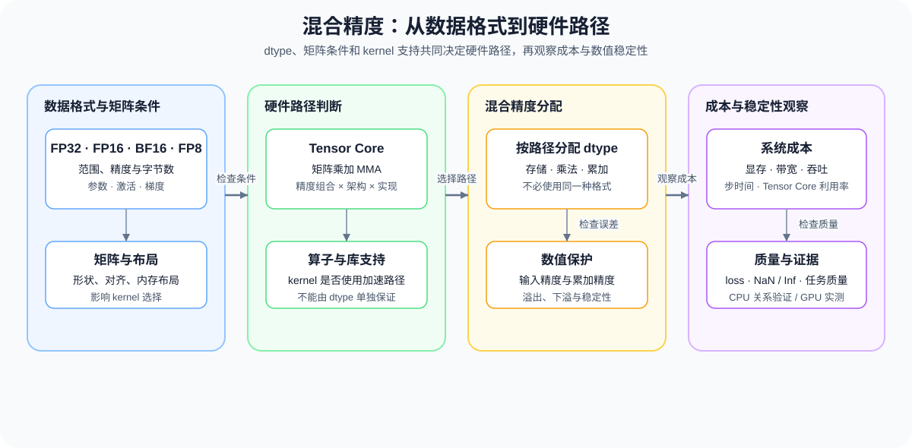

# 12. TensorCore and Mixed Precision | Tensor Core 与混合精度

**难度：** Medium | **环境：** CPU-first | **标签：** `硬件系统`, `Tensor Core`, `混合精度` | **目标人群：** 系统性能入门者

> 🚀 **云端运行环境**
>
> 本章节的实战代码可以点击以下链接在免费 GPU 算力平台上直接运行：
>
> [](https://colab.research.google.com/github/datawhalechina/llm-algo-leetcode/blob/main/01_Hardware_Math_and_Systems/12_TensorCore_and_Mixed_Precision.ipynb)
> [](https://modelscope.cn/my/mynotebook) *(国内推荐：魔搭社区免费实例)*


---

## 本节导读

同样一个4096×4096张量，用FP32存储需64 MiB，换成FP16或BF16需32 MiB。但输入存储变小，不代表累加器、输出或训练状态都随之减半，也不保证采用了某条矩阵指令。

本节先核对矩阵运算量，再分别计算各类张量的存储，区分输入、乘法与累加精度。这些判断支撑算子优化的矩阵路径选择，具体实现条件和指令证据继续在23节核对。

**关键词：** 矩阵乘加、输入存储、累加精度、混合精度



---

## 前置阅读

先区分数值表示与GPU资源，再计算不同精度下的工作量和字节数。

- [01 数据类型与精度](./01_Data_Types_and_Precision.md)：表示范围、精度与元素字节数。
- [03 GPU架构与内存层次](./03_GPU_Architecture_and_Memory.md)：矩阵计算资源、工作集和存储层次。

## Q1：矩阵乘加打包后，运算量为什么不变？

矩阵乘法（GEMM）的左输入为M×K，右输入为K×N，输出含M×N个元素。每个输出累加K个乘积，按一次乘法与一次加法各计一次浮点运算，共约2MNK次；这里忽略额外缩放和数据转换。融合乘加（FMA）处理标量乘加，矩阵乘加（MMA）则用受支持的矩阵块执行相应工作。

Tensor Core是矩阵乘加的硬件路径。将工作分块打包可以提高吞吐与数据复用，但不会把同一矩阵乘所需的2MNK变少。一个16×16×16逻辑子问题对应8192 FLOPs，实际要映射多少条指令，还取决于目标架构、精度与实现。

### Q1 机制计算器：先核对小矩阵，再扩大规模

用2×3输出、归约维度4手算48 FLOPs，再计算16×16×16逻辑子问题与1024维矩阵。


```python
def gemm_flops(m: int, n: int, k: int) -> int:
    """乘加按两次运算计，返回矩阵乘的2MNK，不估算指令数或耗时。"""
    if any(type(dim) is not int or dim <= 0 for dim in (m, n, k)):
        raise ValueError("m、n、k须为正整数")
    return 2 * m * n * k


assert gemm_flops(m=2, n=3, k=4) == 48
assert gemm_flops(m=16, n=16, k=16) == 8192
assert gemm_flops(m=1, n=1, k=1) == 2
work = gemm_flops(m=1024, n=1024, k=1024)
assert work == 2_147_483_648
print(f"1024维矩阵乘：{work:,} FLOPs；是否更快需观察实际执行。")

```

## Q2：输入存储、乘法与累加为什么要分开记录？

存储类型决定张量每个元素占多少字节，乘法类型决定矩阵路径如何处理输入，累加类型决定中间和采用什么精度。例如给定BF16输入、BF16乘法与FP32累加的路径，输入仍是两字节元素，FP32累加器则需要单独安排。较高精度累加可以减轻累积舍入，但不能恢复输入转换已经丢失的信息，也不能保证整个模型稳定。

FP32输入还可能使用TF32矩阵计算模式，输入存储仍为四字节；TF32不是这里可直接替换为更小存储张量的dtype。FP8则包含不同数值格式与缩放方案，表中的一字节只是元素载荷，不含量化元数据。各类路径的实际支持与误差需分别核对。

| 存储类型 | 每元素字节数 | 表示特点 | 需要继续核对 |
| --- | ---: | --- | --- |
| FP32 | 4 | 较高表示精度与较宽范围 | 是否采用IEEE FP32或允许TF32计算 |
| FP16 | 2 | 字节较少，范围小于FP32 | 转换溢出、下溢与累加方式 |
| BF16 | 2 | 指数范围接近FP32，有效精度较低 | 输入误差、原生支持与累加方式 |
| FP8 | 1 | 范围与精度随具体格式变化 | 格式、缩放、内核支持及质量 |

### Q2 机制计算器：相同元素数量对应多少存储？

固定4096×4096元素，仅改变每元素字节数。输出使用MiB，按1024进位；计算的是张量载荷，不是运行时峰值。


```python
def tensor_storage_bytes(numel: int, dtype_bytes: int) -> int:
    """返回张量载荷字节数；numel可为零，元素字节数须为正整数。"""
    if type(numel) is not int or numel < 0 or type(dtype_bytes) is not int or dtype_bytes <= 0:
        raise ValueError("元素数须为非负整数，元素字节数须为正整数")
    return numel * dtype_bytes


numel = 4096 * 4096
sizes = {name: tensor_storage_bytes(numel=numel, dtype_bytes=width)
         for name, width in (("FP32", 4), ("BF16/FP16", 2), ("FP8载荷", 1))}
assert sizes["FP32"] == 67_108_864
assert sizes["BF16/FP16"] == 33_554_432
assert sizes["FP8载荷"] == 16_777_216
assert tensor_storage_bytes(numel=0, dtype_bytes=4) == 0
for name, size in sizes.items():
    print(f"{name}: {size / 1024**2:g} MiB")

```

## Q3：一类张量降精度后，总存储为什么未必减半？

参数、激活和KV缓存可以采用不同存储格式。以一组简化推理张量为例：参数有1 Mi个元素，激活2 Mi个，KV缓存1 Mi个，全部FP32时共16 MiB；若只将激活和KV改为两字节元素，参数仍占4 MiB，总量降到10 MiB，而不是8 MiB。实际需要转换和搬运多少字节，还取决于各类张量的使用次数。

下面分别传入三种存储宽度，不把它们强行绑定为一个dtype。这个账目只含列出的三类张量；训练时还需计梯度、优化器状态等对象，实际执行还可能增加转换缓冲与工作区。输入存储与累加精度也不是同一份内存账目。

### Q3 对照验证：只改激活和KV，再与统一两字节比较

Mi个元素表示1024×1024个元素。先核对16 MiB基线，再比较10 MiB的混合存储与8 MiB的统一两字节假设。


```python
def precision_impact_ledger(
    params: int, activation_elements: int, kv_elements: int,
    weights_bytes: int, activation_bytes: int, kv_bytes: int,
) -> dict:
    """按三类张量各自的存储宽度，返回载荷字节数与总和。"""
    sizes = {
        "weights_bytes": tensor_storage_bytes(numel=params, dtype_bytes=weights_bytes),
        "activation_bytes": tensor_storage_bytes(numel=activation_elements, dtype_bytes=activation_bytes),
        "kv_cache_bytes": tensor_storage_bytes(numel=kv_elements, dtype_bytes=kv_bytes),
    }
    return sizes | {"total_bytes": sum(sizes.values())}


elements = dict(params=1024**2, activation_elements=2 * 1024**2, kv_elements=1024**2)
baseline = precision_impact_ledger(**elements, weights_bytes=4, activation_bytes=4, kv_bytes=4)
mixed = precision_impact_ledger(**elements, weights_bytes=4, activation_bytes=2, kv_bytes=2)
uniform_two_bytes = precision_impact_ledger(**elements, weights_bytes=2, activation_bytes=2, kv_bytes=2)
assert baseline["total_bytes"] == 16 * 1024**2
assert mixed["total_bytes"] == 10 * 1024**2
assert mixed["weights_bytes"] == baseline["weights_bytes"] == 4 * 1024**2
assert mixed["activation_bytes"] == baseline["activation_bytes"] / 2
assert uniform_two_bytes["total_bytes"] == 8 * 1024**2
for name, row in (("全部FP32", baseline), ("只改激活与KV", mixed), ("统一两字节假设", uniform_two_bytes)):
    print(f"{name}: {row['total_bytes'] / 1024**2:g} MiB")

```

## 相关阅读

从精度账目进入具体矩阵路径，再按训练或内核问题继续验证。

- [23 Tensor Core矩阵路径](./23_TensorCore_Deep_Dive.md)：核对精度组合、实现条件与指令观察。
- [PyTorch 2.11 AMP说明](https://docs.pytorch.org/docs/2.11/amp.html)：查看按操作选择计算类型，区分自动转换与数值保护。
- [PyTorch 2.11 TF32说明](https://docs.pytorch.org/docs/2.11/notes/cuda.html#tensorfloat-32-tf32-on-ampere-and-later-devices)：区分FP32输入存储与内部矩阵计算模式。
