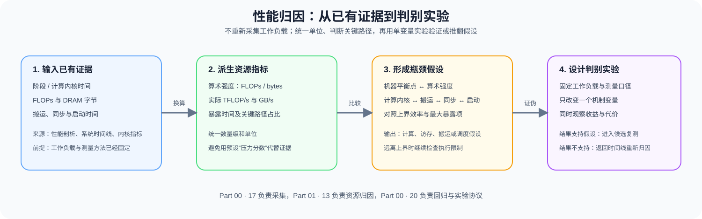

# 13. Profiling and Bottleneck Analysis | 性能分析与瓶颈定位

**难度：** Medium | **环境：** CPU-first | **标签：** `系统性能`, `Profiling`, `瓶颈分析` | **目标人群：** 需要定位训练或推理性能瓶颈的学习者

> 🚀 **云端运行环境**
>
> 本章节的实战代码可以点击以下链接在免费 GPU 算力平台上直接运行：
>
> [](https://colab.research.google.com/github/datawhalechina/llm-algo-leetcode/blob/main/01_Hardware_Math_and_Systems/13_Profiling_and_Bottleneck_Analysis.ipynb)
> [](https://modelscope.cn/my/mynotebook) *(国内推荐：魔搭社区免费实例)*


---

## 本节导读

性能记录中的计算量、访存字节、阶段耗时、数据搬运、同步等待和启动开销，需要先放回同一个固定工作负载，才能用于解释瓶颈。

本节建立“原始记录 → 派生指标 → 候选瓶颈 → 判别实验”的归因链。完成后，你应能比较计算、访存和暴露等待的假设，为下一项判别实验选择一个具体变量。本节主要支撑性能分析；确认局部瓶颈后，再进入算子优化或性能优化的实际对照。


**关键词：** 性能剖析（profiling）、算术强度、机器平衡点、瓶颈归因



---

## 前置阅读

**导语：** 先建立 GPU 计算与访存的资源模型，并从 Part 00 获得固定工作负载下的阶段耗时与追踪记录。

- [Part 01 · 03 GPU 架构与显存](./03_GPU_Architecture_and_Memory.md)
- [Part 00 · 17 PyTorch 性能分析基础](../00_Prerequisites/17_PyTorch_Profiling_Basics.md)
- [Part 01 · 02 参数量与 FLOPs](./02_LLM_Params_and_FLOPs.md)
---
## 证据从哪里来

不同工具提供不同粒度的原始证据。以下计算器使用明确构造的数值练习归因规则。读取真实记录时，先核对工作负载、测量区间和数据类型；理论 FLOPs、最低搬运量与硬件计数器实测值应分别标注。

| 证据层级 | 典型来源 | 本节使用的字段 |
|:---|:---|:---|
| 阶段与算子 | `torch.profiler` | 阶段耗时、算子耗时、调用次数 |
| 系统时间线 | Nsight Systems | 搬运、同步、启动与暴露等待 |
| Kernel 指标 | Nsight Compute | FLOPs、DRAM 字节、实际吞吐与停顿原因 |

## Q1：怎样把原始记录转换成可比较的资源指标？

比较前先固定输入、数据类型和测量区间，再统一浮点运算量、DRAM 字节和内核时间的单位。算术强度表示每搬运一个字节完成多少次浮点运算；实际计算吞吐和实际带宽表示当前 Kernel 在给定时间内交付了多少工作。

| 派生指标 | 计算关系 | 回答的问题 |
|:---|:---|:---|
| 算术强度 | FLOPs / DRAM bytes | 这段计算更依赖计算还是数据搬运？ |
| 实际计算吞吐 | FLOPs / kernel time | 当前交付了多少 TFLOP/s？ |
| 实际带宽 | DRAM bytes / kernel time | 当前消耗了多少 GB/s？ |
| 暴露时间占比 | 某类等待 / 总时间 | 搬运、同步或启动是否位于关键路径？ |

### Q1 小验证：从同一条记录派生资源指标

构造一个串行阶段：内核执行与已经去重的搬运、同步、启动暴露时间互不重叠，因此可以相加。存在重叠的真实时间线需要按依赖关系求关键路径，不能直接套用这个分母。

```python
import math


def derive_resource_metrics(record):
    """把 Kernel 工作量与暴露时间转换成统一资源指标。"""
    required = {'flops', 'dram_bytes', 'kernel_ms', 'transfer_ms', 'sync_ms', 'launch_ms', 'time_model'}
    if set(record) != required:
        raise ValueError(f'record 必须且只能包含 {sorted(required)}')
    if record['time_model'] != 'nonoverlapping_exposed_intervals':
        raise ValueError('本计算器只接受互不重叠、已经去重的暴露区间')
    numeric = [value for key, value in record.items() if key != 'time_model']
    if any(not math.isfinite(value) for value in numeric):
        raise ValueError('工作量和时间必须为有限值')
    if record['flops'] <= 0 or record['dram_bytes'] <= 0 or record['kernel_ms'] <= 0:
        raise ValueError('flops、dram_bytes 和 kernel_ms 必须大于 0')
    if any(record[name] < 0 for name in ('transfer_ms', 'sync_ms', 'launch_ms')):
        raise ValueError('暴露时间不能为负数')
    total_ms = sum(record[name] for name in ('kernel_ms', 'transfer_ms', 'sync_ms', 'launch_ms'))
    return {
        'arithmetic_intensity_flop_per_byte': record['flops'] / record['dram_bytes'],
        'achieved_tflops': record['flops'] / (record['kernel_ms'] / 1000) / 1e12,
        'achieved_dram_gbps': record['dram_bytes'] / (record['kernel_ms'] / 1000) / 1e9,
        'total_ms': total_ms,
        'exposed_share': {
            name: record[f'{name}_ms'] / total_ms
            for name in ('transfer', 'sync', 'launch')
        },
    }

profile_record = {
    'flops': 4.0e10, 'dram_bytes': 8.0e9, 'kernel_ms': 20.0,
    'transfer_ms': 3.0, 'sync_ms': 2.0, 'launch_ms': 1.0,
    'time_model': 'nonoverlapping_exposed_intervals',
}
resource_metrics = derive_resource_metrics(profile_record)
print(resource_metrics)
assert resource_metrics['arithmetic_intensity_flop_per_byte'] == 5.0
assert round(resource_metrics['achieved_tflops'], 1) == 2.0
assert round(resource_metrics['achieved_dram_gbps'], 1) == 400.0

```

## Q2：机器平衡点与暴露时间怎样形成瓶颈假设？

机器平衡点等于峰值计算吞吐除以峰值带宽，单位也是 FLOP/byte。Kernel 的算术强度低于该点时，Roofline 上限首先由带宽决定；高于该点时，首先由计算吞吐决定。这是上界分类，还不能确认实际瓶颈。应将当前吞吐与同精度、同类工作负载下的参考上界比较：距离上界较远时，先检查占用率、布局、启动粒度和其他执行限制。下例的 70% 仅是显式声明的教学筛查线，不是通用硬件判定标准。系统阶段的暴露等待还可能比内核时间更长。

| 证据 | 归因对象 | 仍需排除的情况 |
|:---|:---|:---|
| 算术强度低于平衡点、接近参考带宽且内核时间主导 | 访存路径 | 布局、缓存命中和实际带宽是否异常 |
| 算术强度不低于平衡点、接近参考计算上界且内核时间主导 | 计算路径 | Tensor Core、占用率和指令效率是否达标 |
| 与两类参考上界均相距较远 | 尚不能确认内核主约束 | 工作量估算、占用率、布局和启动粒度 |
| H2D / D2H 暴露时间主导 | 数据搬运 | 输入准备、固定内存和异步拷贝是否生效 |
| 同步或启动时间主导 | 调度路径 | 依赖、碎片化 Kernel 和 CPU 发射开销 |

### Q2 小验证：比较机器平衡点与关键路径时间

先用给定参考上界计算平衡点和效率，再比较互不重叠的阶段时间。分别构造远离上界、接近带宽上界和搬运时间主导的情况，观察假设怎样变化。

```python
def attribute_bottleneck(record, reference_tflops, reference_dram_gbps, efficiency_screen=0.70):
    """用参考上界筛查假设；低效率记录保留为需要继续检查的路径。"""
    if any(not math.isfinite(value) or value <= 0
           for value in (reference_tflops, reference_dram_gbps)):
        raise ValueError('参考上界必须是正的有限值')
    if not math.isfinite(efficiency_screen) or not 0 < efficiency_screen <= 1:
        raise ValueError('效率筛查线必须位于 (0, 1]')
    metrics = derive_resource_metrics(record)
    machine_balance = reference_tflops * 1000 / reference_dram_gbps
    roofline_limit = min(
        reference_tflops,
        metrics['arithmetic_intensity_flop_per_byte'] * reference_dram_gbps / 1000,
    )
    efficiency = metrics['achieved_tflops'] / roofline_limit
    bound = ('memory' if metrics['arithmetic_intensity_flop_per_byte'] < machine_balance
             else 'compute')
    kernel_hypothesis = f'kernel_{bound}' if efficiency >= efficiency_screen else 'kernel_underutilized'
    exposed_ms = {
        kernel_hypothesis: record['kernel_ms'], 'transfer': record['transfer_ms'],
        'synchronization': record['sync_ms'], 'launch': record['launch_ms'],
    }
    primary = max(exposed_ms, key=exposed_ms.get)
    if efficiency > 1.05:
        primary = 'recheck_reference'
    return {
        'machine_balance_flop_per_byte': machine_balance,
        'roofline_bound': bound, 'roofline_limit_tflops': roofline_limit,
        'reference_efficiency': efficiency, 'efficiency_screen': efficiency_screen,
        'reference_consistency': 'recheck_reference' if efficiency > 1.05 else 'within_screen',
        'exposed_ms': exposed_ms, 'primary_hypothesis': primary,
    }


underutilized_case = attribute_bottleneck(profile_record, 120, 3000)
memory_record = {
    **profile_record, 'kernel_ms': 3.0, 'transfer_ms': 0.3, 'sync_ms': 0.2, 'launch_ms': 0.1
}
memory_case = attribute_bottleneck(memory_record, 120, 3000)
transfer_record = {**profile_record, 'kernel_ms': 6.0, 'transfer_ms': 14.0}
transfer_case = attribute_bottleneck(transfer_record, 120, 3000)
print('below reference:', underutilized_case)
print('near bandwidth reference:', memory_case)
print('exposed transfer:', transfer_case)
assert underutilized_case['primary_hypothesis'] == 'kernel_underutilized'
assert round(underutilized_case['reference_efficiency'], 3) == 0.133
assert memory_case['roofline_bound'] == 'memory'
assert memory_case['primary_hypothesis'] == 'kernel_memory'
assert transfer_case['primary_hypothesis'] == 'transfer'

```

## Q3：如何用判别实验验证或推翻瓶颈假设？

归因结果决定下一项实验，而不是直接决定最终优化方案。判别实验需要保持输入和目标问题不变，只改变一个明确选定的实现条件，并同时记录目标指标和代价指标。如果目标指标没有按预期变化，应回到时间线修改假设。

| 假设 | 单一变化 | 主要观察 | 证伪条件 |
|:---|:---|:---|:---|
| 访存假设 | 只改变分块尺寸 | DRAM bytes、Kernel 时间 | 字节数下降但时间无显著变化 |
| 计算假设 | 只改变计算内核实现 | TFLOP/s、质量误差 | 计算吞吐提高但端到端时间不变 |
| 搬运假设 | 只改变主机内存是否锁页 | 暴露搬运时间 | 搬运重叠后关键路径没有缩短 |
| 同步或启动假设 | 只改变同步位置或图捕获开关中的一项 | launch 数、同步等待 | 事件减少但阶段时间不变 |

### Q3 小验证：为归因结果生成单变量判别实验

将 Q2 的主假设转换成变化变量、观察指标和证伪条件，避免一次修改多个策略。

```python
def build_discrimination_experiment(attribution, single_change):
    """为一个主假设选定一个具体变量，同时保留端到端与正确性观察。"""
    plans = {
        'kernel_memory': {
            'allowed_changes': {'tile_size', 'layout'},
            'target_metrics': ['dram_bytes', 'kernel_ms', 'stage_ms', 'max_abs_error'],
            'revisit_when': 'bytes_down_but_kernel_ms_unchanged',
        },
        'kernel_compute': {
            'allowed_changes': {'compute_kernel'},
            'target_metrics': ['achieved_tflops', 'kernel_ms', 'stage_ms', 'max_abs_error'],
            'revisit_when': 'kernel_faster_but_stage_ms_unchanged',
        },
        'kernel_underutilized': {
            'allowed_changes': {'block_size'},
            'target_metrics': ['kernel_ms', 'occupancy', 'stage_ms', 'max_abs_error'],
            'revisit_when': 'occupancy_changes_but_kernel_ms_unchanged',
        },
        'transfer': {
            'allowed_changes': {'pin_memory', 'async_copy'},
            'target_metrics': ['exposed_transfer_ms', 'stage_ms', 'host_memory_mib', 'max_abs_error'],
            'revisit_when': 'transfer_overlap_up_but_stage_ms_unchanged',
        },
        'synchronization': {
            'allowed_changes': {'sync_placement'},
            'target_metrics': ['sync_ms', 'stage_ms', 'max_abs_error'],
            'revisit_when': 'sync_ms_down_but_stage_ms_unchanged',
        },
        'launch': {
            'allowed_changes': {'graph_capture'},
            'target_metrics': ['launch_count', 'launch_ms', 'stage_ms', 'max_abs_error'],
            'revisit_when': 'launches_down_but_stage_ms_unchanged',
        },
    }
    hypothesis = attribution['primary_hypothesis']
    if hypothesis not in plans:
        raise ValueError(f'不支持的瓶颈假设: {hypothesis}')
    selected = plans[hypothesis]
    if single_change not in selected['allowed_changes']:
        raise ValueError('必须从当前假设中选择一个具体变化变量')
    return {
        'hypothesis': hypothesis, 'single_change': single_change,
        'target_metrics': selected['target_metrics'], 'revisit_when': selected['revisit_when'],
    }


assert attribute_bottleneck(profile_record, 1, 100)['primary_hypothesis'] == 'recheck_reference'

memory_plan = build_discrimination_experiment(memory_case, 'tile_size')
transfer_plan = build_discrimination_experiment(transfer_case, 'pin_memory')
print('memory plan:', memory_plan)
print('transfer plan:', transfer_plan)
assert memory_plan['single_change'] == 'tile_size'
assert 'stage_ms' in memory_plan['target_metrics']
assert transfer_plan['single_change'] == 'pin_memory'
assert 'host_memory_mib' in transfer_plan['target_metrics']
try:
    build_discrimination_experiment(memory_case, 'tile_or_layout')
except ValueError:
    pass
else:
    raise AssertionError('不能把多个备选项当成一个已选变量')
try:
    derive_resource_metrics({**profile_record, 'time_model': 'overlapping_intervals'})
except ValueError:
    pass
else:
    raise AssertionError('重叠时间线不能直接相加')

```

---
## 相关阅读
从资源归因继续进入训练、推理或端到端项目，用固定工作负载验证判别实验。
- [PyTorch Profiler 官方文档](https://pytorch.org/docs/stable/profiler.html)
- [Part 02 · 73 训练性能分析](../02_PyTorch_Algorithms/73_Training_Performance_Analysis.md)
- [Part 02 · 74 Profiling 驱动的端到端优化](../02_PyTorch_Algorithms/74_Profiling_Driven_End_to_End_Optimization.md)
---
