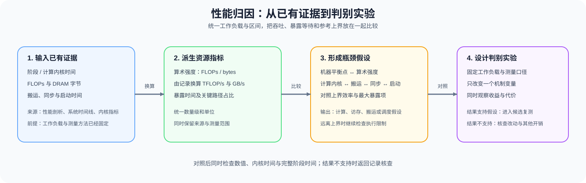

# 13. Profiling and Bottleneck Analysis | 性能分析与瓶颈定位

**难度：** Medium | **环境：** CPU-first | **标签：** `系统性能`, `Profiling`, `瓶颈分析` | **目标人群：** 系统性能入门者

> 🚀 **云端运行环境**
>
> 本章节的实战代码可以点击以下链接在免费 GPU 算力平台上直接运行：
>
> [](https://colab.research.google.com/github/datawhalechina/llm-algo-leetcode/blob/main/01_Hardware_Math_and_Systems/13_Profiling_and_Bottleneck_Analysis.ipynb)
> [](https://modelscope.cn/my/mynotebook) *(国内推荐：魔搭社区免费实例)*


---

## 本节导读

一段内核执行20 ms，完成400亿次浮点运算，搬运80亿字节；阶段还暴露3 ms搬运、2 ms同步和1 ms启动开销。应先统一这些记录的范围和单位，再判断该改计算、访存还是等待。

性能剖析（Profiling）记录程序如何执行。本节从已有记录计算吞吐和时间占比，用资源上界形成候选假设，再选择一个变量做对照；它支撑性能优化的瓶颈定位。确认局部计算或访存问题后，可进入算子优化核对实现与完整调用。


**关键词：** 性能剖析（profiling）、算术强度、机器平衡点、瓶颈归因



---

## 前置阅读

**导语：** 先建立 GPU 计算与访存的资源模型，并从 Part 00 获得固定工作负载下的阶段耗时与追踪记录。

- [Part 01 · 03 GPU 架构与显存](./03_GPU_Architecture_and_Memory.md)
- [Part 00 · 17 PyTorch 性能分析基础](../00_Prerequisites/17_PyTorch_Profiling_Basics.md)
- [Part 01 · 02 参数量与 FLOPs](./02_LLM_Params_and_FLOPs.md)
---
## 证据从哪里来

不同工具提供不同粒度的原始证据。以下计算器使用明确构造的数值练习归因规则。读取真实记录时，先核对工作负载、测量区间和数据类型；理论 FLOPs、最低搬运量与硬件计数器实测值应分别标注。

| 证据层级 | 典型来源 | 本节使用的字段 |
|:---|:---|:---|
| 阶段与算子 | `torch.profiler` | 阶段耗时、算子耗时、调用次数 |
| 系统时间线 | Nsight Systems（系统时间线工具） | 搬运、同步、启动与暴露等待 |
| Kernel 指标 | Nsight Compute（内核指标工具） | FLOPs、设备内存（DRAM）搬运字节、实际吞吐与停顿原因 |

## Q1：怎样把原始记录转换成可比较的资源指标？

比较前先固定输入、数据类型和测量区间，再统一浮点运算量、DRAM 字节和内核时间的单位。算术强度表示每搬运一个字节完成多少次浮点运算；按记录换算的计算吞吐和带宽表示当前 Kernel 在给定时间内交付了多少工作。

| 派生指标 | 计算关系 | 回答的问题 |
|:---|:---|:---|
| 算术强度 | FLOPs / DRAM bytes | 这段计算更依赖计算还是数据搬运？ |
| 记录计算吞吐 | FLOPs / kernel time | 当前交付了多少 TFLOP/s？ |
| 记录带宽 | DRAM bytes / kernel time | 当前消耗了多少 GB/s？ |
| 暴露时间占比 | 某类等待 / 总时间 | 搬运、同步或启动是否位于关键路径？ |

### Q1 小验证：从同一条记录派生资源指标

构造一个串行阶段：内核执行与已经去重的搬运、同步、启动暴露时间互不重叠，因此可以相加。存在重叠的真实时间线需要按依赖关系求关键路径，不能直接套用这个分母。

```python
import math


def derive_resource_metrics(record: dict) -> dict:
    """按互斥阶段窗口，返回FLOP/B、TFLOP/s、GB/s与暴露时间占比。"""
    required = {'flops', 'dram_bytes', 'kernel_ms', 'transfer_ms', 'sync_ms', 'launch_ms', 'time_model'}
    if set(record) != required:
        raise ValueError(f'record 必须且只能包含 {sorted(required)}')
    if record['time_model'] != 'nonoverlapping_exposed_intervals':
        raise ValueError('本计算器只接受互不重叠、已经去重的暴露区间')
    numeric = [value for key, value in record.items() if key != 'time_model']
    if any(type(value) not in (int, float) or not math.isfinite(value) for value in numeric):
        raise ValueError('工作量和时间必须为有限值')
    if record['flops'] <= 0 or record['dram_bytes'] <= 0 or record['kernel_ms'] <= 0:
        raise ValueError('flops、dram_bytes 和 kernel_ms 必须大于 0')
    if any(record[name] < 0 for name in ('transfer_ms', 'sync_ms', 'launch_ms')):
        raise ValueError('暴露时间不能为负数')
    total_ms = sum(record[name] for name in ('kernel_ms', 'transfer_ms', 'sync_ms', 'launch_ms'))
    return {
        'arithmetic_intensity_flop_per_byte': record['flops'] / record['dram_bytes'],
        'achieved_tflops': record['flops'] / (record['kernel_ms'] / 1000) / 1e12,
        'achieved_dram_gb_s': record['dram_bytes'] / (record['kernel_ms'] / 1000) / 1e9,
        'total_ms': total_ms,
        'exposed_share': {
            name: record[f'{name}_ms'] / total_ms
            for name in ('transfer', 'sync', 'launch')
        },
    }

profile_record = {
    "flops": 4.0e10, "dram_bytes": 8.0e9, "kernel_ms": 20.0,
    "transfer_ms": 3.0, "sync_ms": 2.0, "launch_ms": 1.0,
    "time_model": "nonoverlapping_exposed_intervals",
}
resource_metrics = derive_resource_metrics(record=profile_record)
assert resource_metrics["arithmetic_intensity_flop_per_byte"] == 5
assert resource_metrics["achieved_tflops"] == 2
assert resource_metrics["achieved_dram_gb_s"] == 400
assert resource_metrics["total_ms"] == 26
assert resource_metrics["exposed_share"] == {"transfer": 3 / 26, "sync": 2 / 26, "launch": 1 / 26}
print(f"给定记录：{resource_metrics['arithmetic_intensity_flop_per_byte']:g} FLOP/B，"
      f"{resource_metrics['achieved_tflops']:g} TFLOP/s，"
      f"{resource_metrics['achieved_dram_gb_s']:g} GB/s，阶段共 {resource_metrics['total_ms']:g} ms")

```

## Q2：资源上界与阶段时间怎样形成瓶颈假设？

机器平衡点是计算吞吐上限除以带宽，单位FLOP/B；它对应两类Roofline上界的交点。算术强度低于交点时，模型上界由带宽决定；高于时由计算决定；相等时两类上界重合。还要将记录中的吞吐与同类精度、同一设备路径的参考值比较：远离上界时，继续检查布局、驻留、指令或工作量估算，不能只按交点位置确认瓶颈。

下面把达到参考上界70%作为给定筛查线，将超出参考值5%作为需要重查的容差；两者都是可修改的示例条件。先检查参考是否一致，再比较互不重叠的内核、搬运、同步和启动时间。若多项时间相同，本例按列举顺序显示一个入口，实际应共同检查这些并列项。

| 记录与参考关系 | 下一项检查 |
| --- | --- |
| 靠近带宽上界，且内核时间最长 | 数据布局、缓存与实际搬运量 |
| 靠近计算上界，且内核时间最长 | 实际矩阵指令、计算吞吐与资源用量 |
| 处于两类上界交点 | 同时保留计算与访存解释 |
| 远离参考上界 | 工作量、指令、驻留和启动粒度 |
| 暴露搬运、同步或启动时间最长 | 输入准备、依赖或主机提交 |
| 明显超出给定参考 | 单位、计数范围、精度路径和参考值 |

### Q2 对照验证：比较各类候选与边界

先核对同一记录的低效率情形，再分别构造接近带宽上界、接近计算上界、交点及暴露等待更长的情况。


```python
def attribute_bottleneck(
    record: dict, reference_tflops: float, reference_dram_gb_s: float,
    efficiency_screen: float = 0.70, reference_tolerance: float = 0.05,
) -> dict:
    """用同路径参考上界形成候选；筛查线与超界容差均为给定比例。"""
    if any(type(value) not in (int, float) or not math.isfinite(value) or value <= 0
           for value in (reference_tflops, reference_dram_gb_s)):
        raise ValueError("参考计算与带宽上界须为有限正实数")
    if (type(efficiency_screen) not in (int, float) or not math.isfinite(efficiency_screen)
            or not 0 < efficiency_screen <= 1):
        raise ValueError("效率筛查线须为(0,1]内的有限实数")
    if (type(reference_tolerance) not in (int, float) or not math.isfinite(reference_tolerance)
            or not 0 <= reference_tolerance < 1):
        raise ValueError("参考超界容差须为[0,1)内的有限实数")
    metrics = derive_resource_metrics(record=record)
    intensity = metrics["arithmetic_intensity_flop_per_byte"]
    machine_balance = reference_tflops * 1000 / reference_dram_gb_s
    roofline_limit = min(reference_tflops, intensity * reference_dram_gb_s / 1000)
    efficiency = metrics["achieved_tflops"] / roofline_limit
    bound = "memory" if intensity < machine_balance else (
        "compute" if intensity > machine_balance else "balance"
    )
    kernel_hypothesis = f"kernel_{bound}" if efficiency >= efficiency_screen else "kernel_underutilized"
    exposed_ms = {
        kernel_hypothesis: record["kernel_ms"], "transfer": record["transfer_ms"],
        "synchronization": record["sync_ms"], "launch": record["launch_ms"],
    }
    inconsistent = efficiency > 1 + reference_tolerance
    primary = "recheck_reference" if inconsistent else max(exposed_ms, key=exposed_ms.get)
    return {
        "machine_balance_flop_per_byte": machine_balance, "roofline_bound": bound,
        "roofline_limit_tflops": roofline_limit, "reference_efficiency": efficiency,
        "efficiency_screen": efficiency_screen, "reference_tolerance": reference_tolerance,
        "reference_consistency": "recheck_reference" if inconsistent else "within_tolerance",
        "exposed_ms": exposed_ms, "primary_hypothesis": primary,
    }


reference = dict(reference_tflops=120, reference_dram_gb_s=3000)
underutilized_case = attribute_bottleneck(record=profile_record, **reference)
memory_record = profile_record | {"kernel_ms": 3.0, "transfer_ms": 0.3, "sync_ms": 0.2, "launch_ms": 0.1}
memory_case = attribute_bottleneck(record=memory_record, **reference)
compute_case = attribute_bottleneck(record=profile_record | {"flops": 4e12, "kernel_ms": 40}, **reference)
balance_case = attribute_bottleneck(record=memory_record | {"flops": 3.2e11, "kernel_ms": 3.2}, **reference)
transfer_case = attribute_bottleneck(record=profile_record | {"kernel_ms": 6, "transfer_ms": 14}, **reference)
assert underutilized_case["primary_hypothesis"] == "kernel_underutilized"
assert math.isclose(underutilized_case["reference_efficiency"], 2 / 15)
assert memory_case["primary_hypothesis"] == "kernel_memory"
assert compute_case["primary_hypothesis"] == "kernel_compute"
assert balance_case["roofline_bound"] == "balance"
assert balance_case["primary_hypothesis"] == "kernel_balance"
assert transfer_case["primary_hypothesis"] == "transfer"
for field, expected in (("sync_ms", "synchronization"), ("launch_ms", "launch")):
    assert attribute_bottleneck(record=profile_record | {field: 30}, **reference)["primary_hypothesis"] == expected
assert attribute_bottleneck(record=profile_record, reference_tflops=1,
                            reference_dram_gb_s=100)["primary_hypothesis"] == "recheck_reference"
for name, result in (("低于上界", underutilized_case), ("带宽侧", memory_case),
                     ("计算侧", compute_case), ("交点", balance_case), ("搬运主导", transfer_case)):
    print(f"{name}: 参考效率 {result['reference_efficiency']:.1%}，"
          f"下一项检查 {result['primary_hypothesis']}")

```

## Q3：如何分别判断内核改进与阶段收益？

判别实验保持输入和目标问题不变，只改变一个明确选定的实现条件。先检查目标路径是否按预期变化，再检查整个阶段的完成时间，并记录正确性与新增开销。例如，更换计算内核后，矩阵乘变快，但布局转换可能增加搬运时间；这时应分别解释内核收益和阶段成本。

沿用前面的互斥时间窗口，构造一个例子：基线内核20 ms、其他开销6 ms，阶段共26 ms；候选内核10 ms，但新增转换使其他开销升至16 ms，阶段仍为26 ms。内核时间减半，下一项检查是新增的10 ms花在哪里。若搬运字节下降而内核时间基本不变，则要检查实际执行路径、缓存命中或计算限制是否解释了现象。

| 假设 | 单一变化 | 同时观察 | 需要进一步检查的现象 |
|:---|:---|:---|:---|
| 访存限制 | 只改变分块尺寸 | DRAM bytes、内核时间、阶段时间、数值误差 | 字节数下降而内核时间基本不变：检查缓存行为、计算限制与测量波动 |
| 计算限制 | 只改变计算内核实现 | TFLOP/s、内核时间、阶段时间、数值误差 | 内核变快而阶段时间不变：检查新增转换、搬运与其他等待 |
| 搬运等待 | 只改变主机内存是否锁页（固定传输缓冲所在的主机内存页） | 暴露搬运时间、阶段时间、主机内存、数值误差 | 暴露搬运时间下降而阶段时间不变：检查其他等待是否占据关键路径 |
| 同步或启动开销 | 只改变同步位置或图捕获开关中的一项 | 同步等待或启动开销、阶段时间、数值误差 | 目标开销下降而阶段时间不变：检查剩余等待与新增执行成本 |

### Q3 小验证：为归因结果生成单变量判别实验

将 Q2 的主假设转换成变化变量、观察指标和后续检查条件。`revisit_when` 标记需要继续解释的现象，再结合内核与阶段时间判断收益。下面用构造记录核对两种时间可以有不同变化。


```python
def build_discrimination_experiment(attribution: dict, single_change: str) -> dict:
    """选定一个变化变量；revisit_when 提示复查现象，不自动判定假设失效。"""
    plans = {
        'kernel_memory': {
            'allowed_changes': {'tile_size', 'layout'},
            'target_metrics': ['dram_bytes', 'kernel_ms', 'stage_ms', 'max_abs_error'],
            'revisit_when': 'bytes_down_but_kernel_ms_unchanged',
        },
        'kernel_compute': {
            'allowed_changes': {'compute_kernel'},
            'target_metrics': ['achieved_tflops', 'kernel_ms', 'stage_ms', 'max_abs_error'],
            'revisit_when': 'kernel_faster_but_stage_ms_unchanged',
        },
        'kernel_balance': {
            'allowed_changes': {'tile_size', 'compute_kernel'},
            'target_metrics': ['dram_bytes', 'kernel_ms', 'stage_ms', 'max_abs_error'],
            'revisit_when': 'neither_path_explains_stage_time',
        },
        'kernel_underutilized': {
            'allowed_changes': {'block_size'},
            'target_metrics': ['kernel_ms', 'occupancy', 'stage_ms', 'max_abs_error'],
            'revisit_when': 'occupancy_changes_but_kernel_ms_unchanged',
        },
        'transfer': {
            'allowed_changes': {'pin_memory', 'async_copy'},
            'target_metrics': ['exposed_transfer_ms', 'stage_ms', 'host_memory_mib', 'max_abs_error'],
            'revisit_when': 'transfer_overlap_up_but_stage_ms_unchanged',
        },
        'synchronization': {
            'allowed_changes': {'sync_placement'},
            'target_metrics': ['sync_ms', 'stage_ms', 'max_abs_error'],
            'revisit_when': 'sync_ms_down_but_stage_ms_unchanged',
        },
        'launch': {
            'allowed_changes': {'graph_capture'},
            'target_metrics': ['launch_count', 'launch_ms', 'stage_ms', 'max_abs_error'],
            'revisit_when': 'launches_down_but_stage_ms_unchanged',
        },
    }
    hypothesis = attribution['primary_hypothesis']
    if hypothesis not in plans:
        raise ValueError(f'不支持的瓶颈假设: {hypothesis}')
    selected = plans[hypothesis]
    if type(single_change) is not str or single_change not in selected['allowed_changes']:
        raise ValueError('必须从当前假设中选择一个具体变化变量')
    return {
        'hypothesis': hypothesis, 'single_change': single_change,
        'target_metrics': selected['target_metrics'], 'revisit_when': selected['revisit_when'],
    }


plans = {
    "memory": build_discrimination_experiment(attribution=memory_case, single_change="tile_size"),
    "compute": build_discrimination_experiment(attribution=compute_case, single_change="compute_kernel"),
    "balance": build_discrimination_experiment(attribution=balance_case, single_change="tile_size"),
    "transfer": build_discrimination_experiment(attribution=transfer_case, single_change="pin_memory"),
}
assert plans["memory"]["single_change"] == "tile_size"
assert plans["compute"]["target_metrics"] == [
    "achieved_tflops", "kernel_ms", "stage_ms", "max_abs_error",
]
assert plans["compute"]["revisit_when"] == "kernel_faster_but_stage_ms_unchanged"
assert "max_abs_error" in plans["balance"]["target_metrics"]
assert "host_memory_mib" in plans["transfer"]["target_metrics"]
for attribution, change in (
    (memory_case, "tile_or_layout"), (memory_case, "pin_memory"),
    ({"primary_hypothesis": "recheck_reference"}, "tile_size"),
):
    try:
        build_discrimination_experiment(attribution=attribution, single_change=change)
    except ValueError:
        pass
    else:
        raise AssertionError("须先确认可检查的假设，再选择一个适用变量")
try:
    derive_resource_metrics(record=profile_record | {"time_model": "overlapping_intervals"})
except ValueError:
    pass
else:
    raise AssertionError("重叠区间不能直接相加")
for name, plan in plans.items():
    print(f"{name}: 只改变 {plan['single_change']}；同时观察 {plan['target_metrics']}")

# 构造记录：内核节省的时间被新增转换搬运抵消，时间窗口仍互不重叠。
candidate_record = profile_record | {"kernel_ms": 10.0, "transfer_ms": 13.0}
candidate_metrics = derive_resource_metrics(record=candidate_record)
assert profile_record["kernel_ms"] / candidate_record["kernel_ms"] == 2.0
assert candidate_metrics["achieved_tflops"] == 4.0
assert candidate_metrics["total_ms"] == resource_metrics["total_ms"] == 26.0
print(f"构造对照：内核20→10 ms，暴露搬运3→13 ms，阶段仍为"
      f"{candidate_metrics['total_ms']:g} ms；继续检查新增搬运。")

```

## 相关阅读

用实际记录对照归因，再把单变量变化接到完整负载复测。

- [性能优化：瓶颈归因方法](../topic_discussion/performance_optimization/methods/05_bottleneck_attribution.md)：区分观察、资源假设与判别对照。
- [Part02·74 Profiling驱动的端到端优化](../02_PyTorch_Algorithms/74_Profiling_Driven_End_to_End_Optimization.md)：从局部候选回到完整调用比较。
- [Nsight Compute Roofline说明](https://docs.nvidia.com/nsight-compute/ProfilingGuide/index.html#roofline-charts)：核对工作量、搬运字节与对应计算路径的参考上界。
