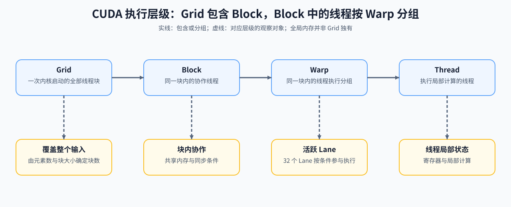
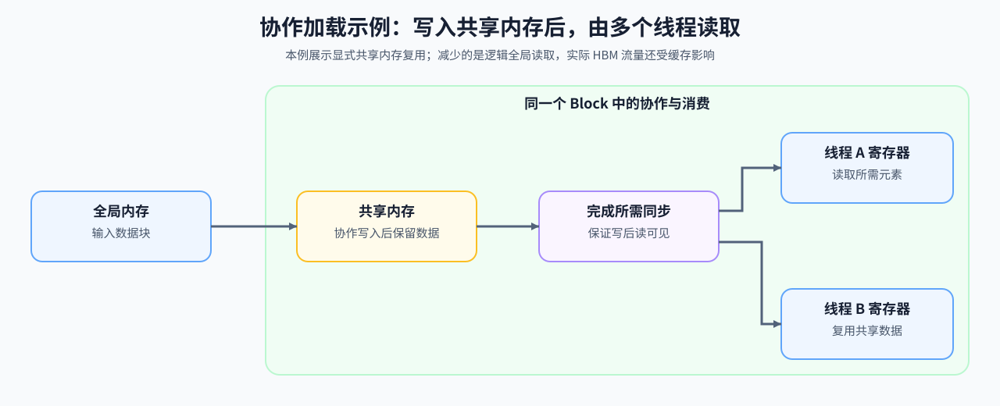
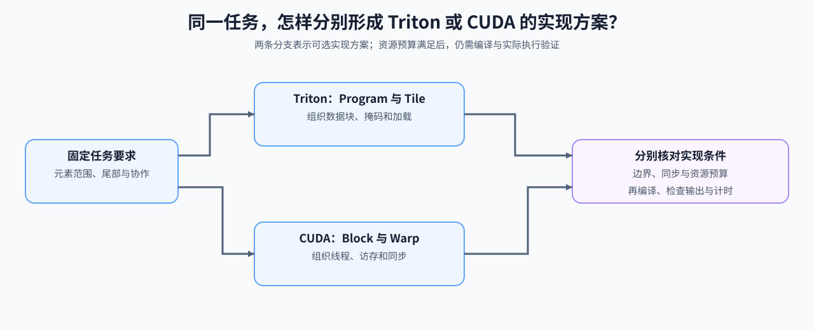

# 15. CUDA Execution Model | CUDA 执行模型

**难度：** Medium | **环境：** CPU-first | **标签：** `算子编程`, `CUDA`, `执行模型` | **目标人群：** 编译与系统入门者

> 🚀 **云端运行环境**
>
> 本章节的实战代码可以点击以下链接在免费 GPU 算力平台上直接运行：
>
> [](https://colab.research.google.com/github/datawhalechina/llm-algo-leetcode/blob/main/01_Hardware_Math_and_Systems/15_CUDA_Execution_Model.ipynb)
> [](https://modelscope.cn/my/mynotebook) *(国内推荐：魔搭社区免费实例)*


---

## 本节导读

CUDA 将一次内核启动的线程组织成 Grid 和 Block；同一 Block 内的线程再按 Warp 分组执行。程序选择网格和块大小，设备则决定这些工作如何在 SM 上驻留和执行。任务组织不是 GPU 核心数量的逐层展开。

本节从1000个元素的任务开始，计算需要多少线程块，区分尾部无效线程与Warp中未分配的线程槽，再检查块内复用和资源上限。这些计算支撑算子优化中的CUDA实现，后续可在Part04·01核对实际索引与启动。

**关键词：** `grid`, `block`, `warp`



---
## 前置阅读

**导语：** 先理解 GPU 资源和 CUDA 编程模型，再把张量任务映射到 Grid、Block、Warp 与 Thread。

- [03. GPU Architecture and Memory | GPU 物理架构与内存层级](./03_GPU_Architecture_and_Memory.md)
- [08. Programming Models and CUDA/Triton | 编程模型演进](./08_Programming_Models_CUDA_Triton.md)

## Q1：GPU 上的 kernel 为什么不是“一个线程在跑”？

Thread（线程）执行局部计算，若干线程组成 Block（线程块），一次启动的全部 Block 组成 Grid（网格）。这些是程序组织任务的单位，不是芯片预先固定拥有的 Grid 或 Block 数量。NVIDIA 将同一块内连续编号的线程按 32 个分为一个 Warp，Lane 表示线程在该组中的位置；分支和边界条件会让部分 Lane 不参与某条指令。

例如每线程处理一个元素，1000 个元素使用每块 256 个线程时，需要 4 个 Block，每块 8 个 Warp，最后 24 个线程不处理有效元素。若改成每块 128 个线程，就需要 8 个 Block、每块 4 个 Warp。两者覆盖相同输入，却改变了块内协作与资源分配，不能仅凭总线程数相同就判断耗时相同。

两种未使用位置也要分开：66个元素按每块33线程执行，两个Block正好覆盖输入，没有尾部越界线程；但每块仍分成两个Warp，共有62个未分配槽。这与1000个元素例子中的24个尾部线程是不同数量。

SM（流式多处理器）是承载这些工作的硬件单元。一个 SM 可以驻留多个满足资源约束的 Block，Grid 的 Block 数也可以多于 SM 数，剩余工作等待资源；Block 编号不指定某个固定 SM，Warp 也不是 32 个独占物理计算核心。线程可按地址访问全局内存，执行层级不是逐层收窄的内存权限。官方定义见 [CUDA 编程模型](https://docs.nvidia.com/cuda/cuda-programming-guide/01-introduction/programming-model.html)。

### Q1 机制计算器：从元素数量推导 Grid、Block 与 Warp

假设每个线程负责一个元素，先计算最小覆盖网格，再区分尾块中超出输入的线程与每块按 Warp 打包产生的空槽；两者不是同一数量。


```python
def launch_geometry(
    num_elements: int, threads_per_block: int, warp_size: int = 32,
) -> dict:
    """每线程处理一个元素，返回最小网格、尾部无效线程和Warp未分配槽数。"""
    if any(type(value) is not int or value <= 0
           for value in (num_elements, threads_per_block, warp_size)):
        raise ValueError("元素数、块线程数和Warp大小须为正整数")
    blocks = (num_elements + threads_per_block - 1) // threads_per_block
    warps_per_block = (threads_per_block + warp_size - 1) // warp_size
    launched_threads = blocks * threads_per_block
    return {
        "grid_blocks": blocks,
        "warps_per_block": warps_per_block,
        "total_warps": blocks * warps_per_block,
        "launched_threads": launched_threads,
        "inactive_tail_threads": launched_threads - num_elements,
        "warp_thread_slots": blocks * warps_per_block * warp_size,
        "unassigned_warp_slots": blocks * (warps_per_block * warp_size - threads_per_block),
    }


num_elements = 1000
reports = {threads: launch_geometry(num_elements=num_elements, threads_per_block=threads)
           for threads in (128, 256)}
assert reports[256] == {
    "grid_blocks": 4, "warps_per_block": 8, "total_warps": 32,
    "launched_threads": 1024, "inactive_tail_threads": 24,
    "warp_thread_slots": 1024, "unassigned_warp_slots": 0,
}
assert reports[128]["grid_blocks"] == 8
assert reports[128]["warps_per_block"] == 4
assert reports[128]["inactive_tail_threads"] == 24
# 两个33线程块共66线程：没有尾部越界线程，却有62个未分配Warp槽。
packed = launch_geometry(num_elements=66, threads_per_block=33)
assert packed["unassigned_warp_slots"] == 62
assert packed["inactive_tail_threads"] == 0
assert launch_geometry(num_elements=256, threads_per_block=256)["inactive_tail_threads"] == 0
assert launch_geometry(num_elements=1, threads_per_block=32)["inactive_tail_threads"] == 31
for threads, result in reports.items():
    print(f"每块 {threads} 线程：{result['grid_blocks']} 块，"
          f"每块 {result['warps_per_block']} 个Warp，"
          f"尾部无效线程 {result['inactive_tail_threads']} 个")

```

## Q2：块数改变后，总读取与单块共享内存怎样变化？

Block 为线程提供共享内存与协作边界，Warp 是线程的执行分组。生产者写入数据、消费者读取数据时，需要满足对应的同步与可见性条件；属于同一 Warp 不代表可以省略所有同步检查。

例如8个线程块各处理4096个两字节元素，每块需要8 KiB数据。每份数据使用四次时，重复完整读取共256 KiB；若每块只从全局内存搬入一次，共读取64 KiB，可减少192 KiB逻辑读取。若只改变为一个Block，总加载量降为8 KiB，而每块仍申请8 KiB共享内存。总读取随任务块数变化，单块资源需求却可以保持不变；实际峰值还要看同时驻留的块数，不能直接把整个Grid的副本相加当作一个SM的占用。实际设备内存流量与耗时继续由缓存、同步和执行安排决定。



### Q2 流量账本：把整个Grid的读取与单块申请分开

先核对8块使用四次时的256／64 KiB读取，再固定每块4096个两字节元素，比较1块和8块：总加载量相差8倍，单块申请均为8 KiB。这里统计逻辑读取，实际显存流量还需核对缓存行为。


```python
def block_reuse_traffic(
    blocks: int, tile_elements: int, bytes_per_element: int, reuse_count: int,
) -> dict:
    """按每块完整加载一次，返回逻辑全局读取字节量及每块共享内存字节量。"""
    if any(type(value) is not int or value <= 0
           for value in (blocks, tile_elements, bytes_per_element, reuse_count)):
        raise ValueError("块数、元素数、元素字节数和使用次数须为正整数")
    tile_bytes = tile_elements * bytes_per_element
    baseline_global_read_bytes = blocks * tile_bytes * reuse_count
    tiled_global_read_bytes = blocks * tile_bytes
    return {
        "baseline_global_read_bytes": baseline_global_read_bytes,
        "tiled_global_read_bytes": tiled_global_read_bytes,
        "global_read_bytes_saved": baseline_global_read_bytes - tiled_global_read_bytes,
        "shared_bytes_per_block": tile_bytes,
    }


inputs = dict(blocks=8, tile_elements=4096, bytes_per_element=2)
reports = {count: block_reuse_traffic(**inputs, reuse_count=count) for count in (1, 2, 4)}
# 每块8 KiB，共8块；使用四次时，256 KiB读取减到64 KiB。
assert reports[4] == {
    "baseline_global_read_bytes": 262_144, "tiled_global_read_bytes": 65_536,
    "global_read_bytes_saved": 196_608, "shared_bytes_per_block": 8192,
}
assert reports[2]["global_read_bytes_saved"] == 65_536
assert reports[1]["global_read_bytes_saved"] == 0
one_block = block_reuse_traffic(
    blocks=1, tile_elements=4096, bytes_per_element=2, reuse_count=4,
)
assert one_block["shared_bytes_per_block"] == reports[4]["shared_bytes_per_block"] == 8192
assert reports[4]["tiled_global_read_bytes"] == 8 * one_block["tiled_global_read_bytes"]
print(f"1块／8块：总加载 {one_block['tiled_global_read_bytes'] // 1024}／"
      f"{reports[4]['tiled_global_read_bytes'] // 1024} KiB，单块申请均为8 KiB")
for count, result in reports.items():
    print(f"使用 {count} 次：逻辑全局读取 "
          f"{result['baseline_global_read_bytes'] / 1024:g} → "
          f"{result['tiled_global_read_bytes'] / 1024:g} KiB，"
          f"每块共享内存 {result['shared_bytes_per_block'] / 1024:g} KiB")

```

## Q3：单个 Block 的资源需求怎样限制配置？

相同任务可以选择不同线程数、共享内存和寄存器用量，但这些资源都受设备与编译配置限制。先逐项计算单块需求，再与给定预算比较；线程数过多、共享内存超限或寄存器需求过高，都可能让配置无法按预期执行。

块大小是程序选择，允许的范围则由设备与内核共同限制；共享内存和寄存器的预算也不是所有代际通用的固定数字。下面用示例预算检查单块需求；多块驻留和分配粒度继续在[Part04·05资源与驻留](../04_CUDA_and_System_Optimization/05_CUDA_Block_Resources_and_Residency.md)中计算。计算寄存器总字节数时，本例按每线程寄存器数乘线程数，再乘每个寄存器的4 B；它与给定的单块上限比较。实际实现还需核对编译后的资源用量、启动与数值结果。



### Q3 资源门槛：检查单块配置是否超过给定预算

预算是示例输入，不代表具体 GPU。分别检查每块线程数、共享内存、每线程寄存器与每块寄存器总量；暂不计分配粒度和多块驻留，预算内也不等于可以实际启动或达到高吞吐。


```python
def block_resource_gate(
    threads_per_block: int, shared_bytes_per_block: int,
    registers_per_thread: int, limits: dict,
) -> dict:
    """按给定单块上限检查资源；每个寄存器按4 B计，返回用量与未满足项。

    limits 提供每块线程数、共享字节数、每线程寄存器数和每块寄存器字节上限。
    这里的单块预算不表示SM实际驻留容量。
    """
    if type(threads_per_block) is not int or threads_per_block <= 0:
        raise ValueError("块线程数须为正整数")
    if any(type(value) is not int or value < 0
           for value in (shared_bytes_per_block, registers_per_thread)):
        raise ValueError("共享内存字节数与寄存器数量须为非负整数")
    required = ("max_threads_per_block", "max_shared_bytes_per_block",
                "max_registers_per_thread", "max_register_bytes_per_block")
    if any(key not in limits or type(limits[key]) is not int or limits[key] <= 0
           for key in required):
        raise ValueError("须提供全部资源上限，且上限为正整数")
    reasons = []
    if threads_per_block > limits["max_threads_per_block"]:
        reasons.append("threads_per_block")
    if shared_bytes_per_block > limits["max_shared_bytes_per_block"]:
        reasons.append("shared_memory")
    if registers_per_thread > limits["max_registers_per_thread"]:
        reasons.append("registers_per_thread")
    register_bytes = threads_per_block * registers_per_thread * 4
    if register_bytes > limits["max_register_bytes_per_block"]:
        reasons.append("register_file")
    return {"within_stated_limits": not reasons, "reasons": reasons,
            "register_bytes_per_block": register_bytes}


# 给定预算用于分别核对约束，数值不绑定某个GPU型号。
limits = {
    "max_threads_per_block": 1024, "max_shared_bytes_per_block": 64 * 1024,
    "max_registers_per_thread": 128, "max_register_bytes_per_block": 64 * 1024,
}
base = dict(threads_per_block=256, shared_bytes_per_block=32 * 1024,
            registers_per_thread=64, limits=limits)
changes = {
    "at_register_budget": {},
    "over_threads": {"threads_per_block": 1025, "registers_per_thread": 0},
    "over_shared": {"shared_bytes_per_block": 64 * 1024 + 1},
    "over_per_thread": {"threads_per_block": 32, "registers_per_thread": 129},
    "over_register_total": {"registers_per_thread": 65},
    "at_threads_and_shared": {"threads_per_block": 1024, "registers_per_thread": 16,
                               "shared_bytes_per_block": 64 * 1024},
    "at_per_thread": {"threads_per_block": 32, "registers_per_thread": 128},
}
reports = {name: block_resource_gate(**(base | change)) for name, change in changes.items()}
assert reports["at_register_budget"]["register_bytes_per_block"] == 65_536
for name in ("at_register_budget", "at_threads_and_shared", "at_per_thread"):
    assert reports[name]["within_stated_limits"]
for name, reason in (("over_threads", "threads_per_block"),
                     ("over_shared", "shared_memory"),
                     ("over_per_thread", "registers_per_thread"),
                     ("over_register_total", "register_file")):
    assert reports[name]["reasons"] == [reason]
combined = block_resource_gate(**(base | {"threads_per_block": 1025,
                                         "shared_bytes_per_block": 65_537}))
assert combined["reasons"] == ["threads_per_block", "shared_memory", "register_file"]
for name, result in reports.items():
    print(f"{name}: 寄存器 {result['register_bytes_per_block']:,} B/块，"
          f"超限项={result['reasons']}")

```

## 相关阅读

从逻辑任务覆盖继续到真实 CUDA 索引，或比较 Triton 的数据块抽象。

- [Part04·01 CUDA 向量加法](../04_CUDA_and_System_Optimization/01_CUDA_Custom_Kernel_Intro.md)：线程索引、尾块和实际启动。
- [18 Triton Block 模型](./18_Triton_Block_Model.md)：Program、逻辑元素槽与物理线程的区别。
