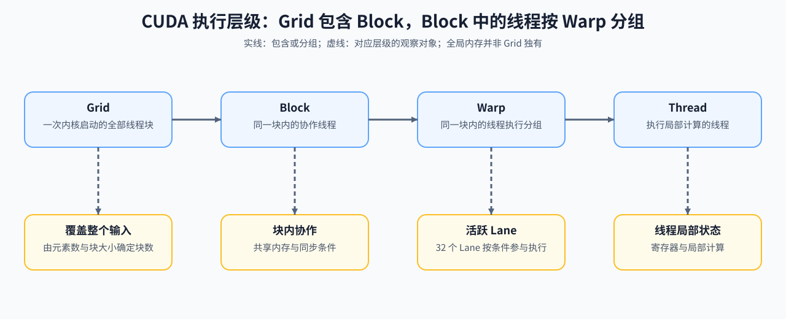
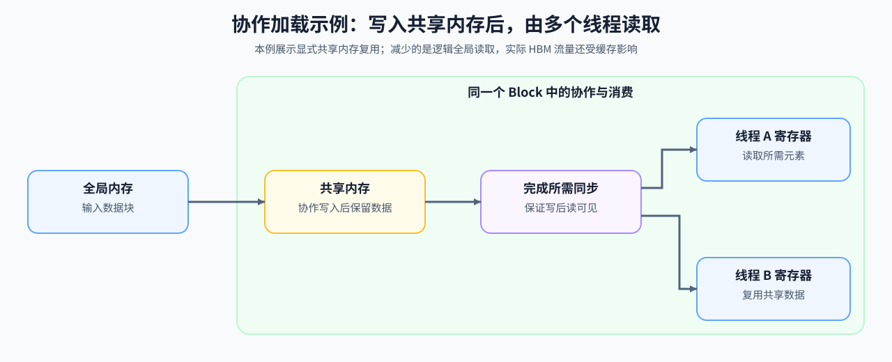
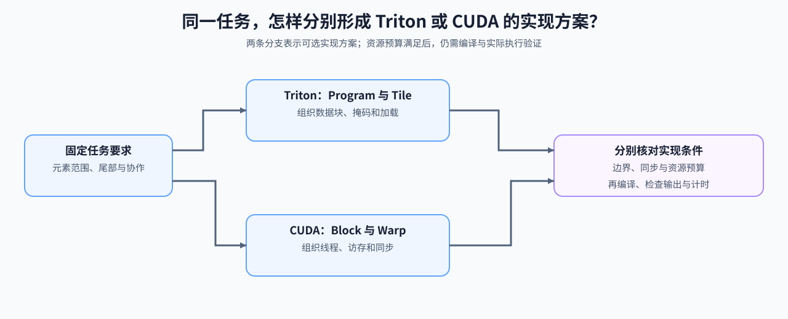

# 15. CUDA Execution Model | CUDA 执行模型

**难度：** Medium | **环境：** CPU-first | **标签：** `算子编程`, `CUDA`, `执行模型` | **目标人群：** 编译与系统入门者

> 🚀 **云端运行环境**
>
> 本章节的实战代码可以点击以下链接在免费 GPU 算力平台上直接运行：
>
> [](https://colab.research.google.com/github/datawhalechina/llm-algo-leetcode/blob/main/01_Hardware_Math_and_Systems/15_CUDA_Execution_Model.ipynb)
> [](https://modelscope.cn/my/mynotebook) *(国内推荐：魔搭社区免费实例)*


---

## 本节导读

CUDA kernel 会把同一项张量任务分配到 Grid、Block、Warp 和 Thread 四个层级。层级变化会影响覆盖范围、尾部空闲线程、协作边界和可用片上资源。

本节从任务覆盖、Warp 打包和 Block 资源约束建立执行账本。完成后，你应能从元素数量推导 launch 几何，并判断一个 Block 配置是否满足线程、共享内存和寄存器限制；这些能力直接支撑算子优化路线及 Part 03–04 的 Kernel 实现。

**关键词：** `grid`, `block`, `warp`



---
## 前置阅读

**导语：** 先理解 GPU 资源和 CUDA 编程模型，再把张量任务映射到 Grid、Block、Warp 与 Thread。

- [03. GPU Architecture and Memory | GPU 物理架构与内存层级](./03_GPU_Architecture_and_Memory.md)
- [08. Programming Models and CUDA/Triton | 编程模型演进](./08_Programming_Models_CUDA_Triton.md)
- [Group 1D: Execution Models, Asynchrony and Operator Mapping | 1D: 执行模型、异步调度与算子映射](./1D.md)

## Q1：GPU 上的 kernel 为什么不是“一个线程在跑”？

一次计算内核启动包含多个线程块，每个块内的线程按 Warp 分组执行。块大小决定任务如何覆盖输入，也影响尾部屏蔽与块内协作；Warp 分组决定哪些 Lane 同时参与一条指令。它们是执行层级，不是逐层收窄的内存访问权限：各线程仍可按地址访问全局内存。

### Q1 机制计算器：从元素数量推导 Grid、Block 与 Warp

假设每个线程负责一个元素，先计算最小覆盖网格，再区分尾块中超出输入的线程与每块按 Warp 打包产生的空槽；两者不是同一数量。


```python
def launch_geometry(num_elements, threads_per_block, warp_size=32):
    """计算一维 kernel 的 block、warp 和尾块有效线程。"""
    if any(type(value) is not int or value <= 0 for value in (num_elements, threads_per_block, warp_size)):
        raise ValueError('元素数、块线程数和 Warp 大小必须是正整数')
    blocks = (num_elements + threads_per_block - 1) // threads_per_block
    warps_per_block = (threads_per_block + warp_size - 1) // warp_size
    launched_threads = blocks * threads_per_block
    return {
        'grid_blocks': blocks,
        'warps_per_block': warps_per_block,
        'total_warps': blocks * warps_per_block,
        'launched_threads': launched_threads,
        'inactive_tail_threads': launched_threads - num_elements,
        'warp_thread_slots': blocks * warps_per_block * warp_size,
        'unassigned_warp_slots': blocks * (warps_per_block * warp_size - threads_per_block),
    }

for threads_per_block in [64, 128, 256]:
    print(threads_per_block, '->', launch_geometry(1000, threads_per_block))
assert launch_geometry(1000, 256)['inactive_tail_threads'] == 24
assert launch_geometry(66, 33)['unassigned_warp_slots'] == 62
assert launch_geometry(66, 33)['inactive_tail_threads'] == 0

```

## Q2：Block 内怎样通过共享内存复用数据？

Block 为线程提供共享内存与协作边界，Warp 是线程的执行分组。生产者写入数据、消费者读取数据时，需要满足对应的同步与可见性条件；属于同一 Warp 不代表可以省略所有同步检查。

把重复使用的数据先搬入共享内存，可以减少逻辑全局读取。是否减少实际 HBM 流量、是否缩短时间，还取决于缓存命中、同步和片上资源占用。



### Q2 流量账本：复用减少了多少全局读取请求

假设每次都完整读取数据块，且暂不计缓存命中，比较重复读取与每块搬入一次的字节量。实际 HBM 流量还受缓存影响，不能直接用这些逻辑读取字节替代硬件计数。


```python
def block_reuse_traffic(blocks, tile_elements, bytes_per_element, reuse_count):
    """比较整块重复全局读取与每块只搬入一次的逻辑字节量。"""
    if any(type(value) is not int or value <= 0 for value in (blocks, tile_elements, bytes_per_element, reuse_count)):
        raise ValueError('块数、元素数、元素字节数和使用次数必须是正整数')
    tile_bytes = tile_elements * bytes_per_element
    baseline_global_read_bytes = blocks * tile_bytes * reuse_count
    tiled_global_read_bytes = blocks * tile_bytes
    return {
        'baseline_global_read_bytes': baseline_global_read_bytes,
        'tiled_global_read_bytes': tiled_global_read_bytes,
        'global_read_bytes_saved': baseline_global_read_bytes - tiled_global_read_bytes,
        'shared_bytes_per_block': tile_bytes,
    }

for reuse_count in [1, 2, 4]:
    print('reuse', reuse_count, '->', block_reuse_traffic(8, 4096, 2, reuse_count))
assert block_reuse_traffic(8, 4096, 2, 1)['global_read_bytes_saved'] == 0

```

## Q3：单个 Block 的资源需求怎样限制配置？

相同任务可以选择不同线程数、共享内存和寄存器用量，但这些资源都受设备与编译配置限制。先逐项计算单块需求，再与给定预算比较；线程数过多、共享内存超限或寄存器需求过高，都可能让配置无法按预期执行。

下面用示例预算检查单块需求；多块驻留和分配粒度继续在 SRAM 优化小节计算。资源检查与张量覆盖检查需要同时成立，才能进入实际核函数验证；还应核对编译后的寄存器和共享内存用量、启动限制及输出，再测量时间。



### Q3 资源门槛：检查单块配置是否超过给定预算

预算是示例输入，不代表具体 GPU。分别检查每块线程数、共享内存、每线程寄存器与每块寄存器总量；暂不计分配粒度和多块驻留，预算内也不等于可以实际启动或达到高吞吐。


```python
def block_resource_gate(threads_per_block, shared_bytes_per_block,
                        registers_per_thread, limits):
    """按给定整数预算检查单块资源，不替代编译与设备启动验证。"""
    if type(threads_per_block) is not int or threads_per_block <= 0:
        raise ValueError('块线程数必须是正整数')
    if any(type(value) is not int or value < 0
           for value in (shared_bytes_per_block, registers_per_thread)):
        raise ValueError('共享内存字节数与寄存器数量必须是非负整数')
    required = ('max_threads_per_block', 'max_shared_bytes_per_block',
                'max_registers_per_thread', 'register_file_bytes_per_block')
    if any(key not in limits or type(limits[key]) is not int or limits[key] <= 0
           for key in required):
        raise ValueError('必须提供全部资源预算，且预算为正整数')
    reasons = []
    if threads_per_block > limits['max_threads_per_block']:
        reasons.append('threads_per_block')
    if shared_bytes_per_block > limits['max_shared_bytes_per_block']:
        reasons.append('shared_memory')
    if registers_per_thread > limits['max_registers_per_thread']:
        reasons.append('registers_per_thread')
    register_bytes = threads_per_block * registers_per_thread * 4
    if register_bytes > limits['register_file_bytes_per_block']:
        reasons.append('register_file')
    return {'within_stated_limits': not reasons, 'reasons': reasons,
            'register_bytes_per_block': register_bytes}


limits = {
    'max_threads_per_block': 1024,
    'max_shared_bytes_per_block': 64 * 1024,
    'max_registers_per_thread': 128,
    'register_file_bytes_per_block': 256 * 1024,
}
valid = block_resource_gate(256, 32 * 1024, 64, limits)
invalid = block_resource_gate(2048, 96 * 1024, 64, limits)
assert valid['within_stated_limits']
assert not invalid['within_stated_limits']
assert 'registers_per_thread' in block_resource_gate(32, 0, 129, limits)['reasons']
print(valid)
print(invalid)

```

## 相关阅读

**导语：** 把执行模型和 Triton 的 block 思维放一起看，后面写 kernel 会更稳。

- [Part 03: Triton Kernel Development | 第三部分：Triton 算子开发](../03_Triton_Kernels/intro.md)
- [01. Triton 入门与 Hello World：向量加法 (Vector Addition)](../03_Triton_Kernels/01_Triton_Vector_Addition.md)
- [04. Triton 矩阵乘法 (GEMM) 与自动调优 (Autotune)](../03_Triton_Kernels/04_Triton_GEMM_Tutorial.md)
---
