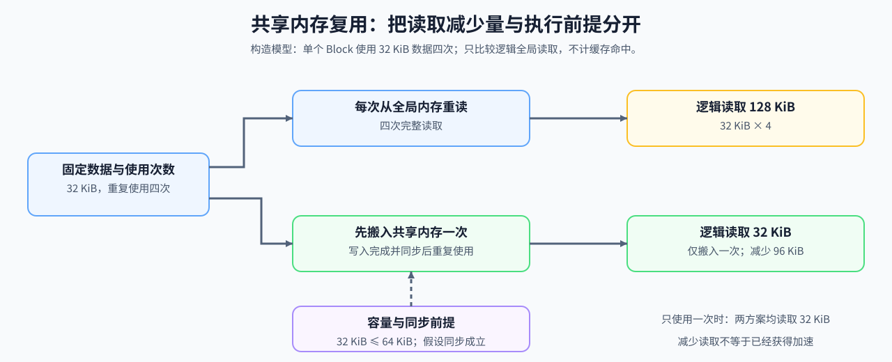

# 16. Warp Block SharedMemory Basics | Warp、Block 与 Shared Memory 基础

**难度：** Medium | **环境：** CPU-first | **标签：** `算子编程`, `CUDA`, `Shared Memory` | **目标人群：** 编译与系统入门者

> 🚀 **云端运行环境**
>
> 本章节的实战代码可以点击以下链接在免费 GPU 算力平台上直接运行：
>
> [](https://colab.research.google.com/github/datawhalechina/llm-algo-leetcode/blob/main/01_Hardware_Math_and_Systems/16_Warp_Block_SharedMemory_Basics.ipynb)
> [](https://modelscope.cn/my/mynotebook) *(国内推荐：魔搭社区免费实例)*


---

## 本节导读

同一数据被 Block 内多个线程重复使用时，反复从全局内存读取 会产生不必要的外部流量。共享内存把这份数据保留在 Block 内，但同时受到容量和同步正确性的约束。

本节计算单块内的线程槽覆盖比例与复用前后的逻辑读取字节量，再分别检查容量、同步和复用收益。它主要支撑算子优化路线，也为 Triton Tile、融合和片上归约提供访存基础。

**关键词：** `CUDA`, `Warp`, `Shared Memory`



---
## 前置阅读

先区分程序定义的线程块与设备承载它的 SM，再观察块内数据复用。

- [15 CUDA 执行模型](./15_CUDA_Execution_Model.md)：网格覆盖、Warp 分组与单块资源限制。

## Q1：Warp、Block 和 Thread 分别负责什么？

一个 Thread 处理分配给它的元素，同一 Block 的线程共享协作范围，硬件将块内连续线程按 32 个组成 NVIDIA Warp。Warp 中的线程可以因条件不同而暂时不参与同一条指令；不能把“属于同一 Warp”理解成所有内存访问天然同步，也不能把 Warp 数当作物理核心数。

例如一个 Block 有 48 个线程时，会占用两个 Warp 的线程槽，第二个 Warp 只有 16 个有效线程。两个这样的 Block 仍各自分成两个 Warp，不会把剩余线程拼成第三个满 Warp。下方计算的是线程槽覆盖比例，不是某个 SM 的实测占用率。

共享内存用于同块线程之间复用数据；在本节的普通线程块模型中，其他 Block 不直接使用这块副本。生产者完成写入、消费者读取和下一轮覆盖之间，仍需满足同步与可见性条件。设备代际会改变可用资源和支持机制，但不会把一次启动的全部线程变成一个共享内存协作组。

### Q1 覆盖率计算：单个 Block 的线程怎样装入 Warp

这里的线程数属于同一个 Block。不同 Block 的尾部线程不会合并到一个 Warp；线程槽覆盖比例也不是设备占用率。


```python
def execution_coverage(num_threads, warp_size=32):
    """计算单个 Block 的 Warp 数、尾 Warp 线程数与槽覆盖比例。"""
    if any(type(value) is not int or value <= 0 for value in (num_threads, warp_size)):
        raise ValueError('单块线程数与 Warp 大小必须是正整数')
    warps = (num_threads + warp_size - 1) // warp_size
    thread_slots = warps * warp_size
    last_warp_active_threads = num_threads - (warps - 1) * warp_size
    return {
        'threads': num_threads,
        'warps': warps,
        'last_warp_active_threads': last_warp_active_threads,
        'thread_slot_utilization': num_threads / thread_slots,
    }

for threads in [32, 48, 65]:
    print(execution_coverage(threads))
assert execution_coverage(48)['last_warp_active_threads'] == 16

```

## Q2：共享内存怎样改变重复读取？

同一 Block 多次使用一份数据时，可以把它从全局内存搬入共享内存，让线程重复读取片上副本。这样减少的是重复的全局读取请求；实际 HBM 字节量还取决于原方案的缓存命中情况。搬入、同步和片上容量则是新增成本，需要分别记录。

下面比较每次完整重读与每块只搬入一次的逻辑字节量，不把该比例当作加速比。

### Q2 对照验证：计算整块复用的逻辑读取减少量

暂不计缓存命中，假设各 Block 独立搬入并完整使用数据块。只改变使用次数，观察逻辑全局读取量；这里不测量真实 HBM 流量。


```python
def shared_reuse_gain(tile_bytes, reuse_count, blocks):
    """返回整块读取模型的逻辑字节量及减少比例，不测量 HBM。"""
    if any(type(value) is not int or value <= 0 for value in (tile_bytes, reuse_count, blocks)):
        raise ValueError('数据块字节数、使用次数与块数必须是正整数')
    baseline_global_read_bytes = tile_bytes * reuse_count * blocks
    shared_global_read_bytes = tile_bytes * blocks
    return {
        'baseline_global_read_bytes': baseline_global_read_bytes,
        'shared_global_read_bytes': shared_global_read_bytes,
        'saved_global_read_bytes': baseline_global_read_bytes - shared_global_read_bytes,
        'global_read_reduction_fraction': 1 - shared_global_read_bytes / baseline_global_read_bytes,
    }

for reuse_count in [1, 2, 4]:
    print('reuse', reuse_count, '->', shared_reuse_gain(8192, reuse_count, 8))
assert shared_reuse_gain(8192, 1, 8)['saved_global_read_bytes'] == 0

```

## Q3：容量和同步检查通过后，是否就有复用收益？

共享内存方案首先需要容纳数据块，并让消费者在数据写入后再读取。两项检查通过，只说明本例的容量与同步前提满足；如果数据只使用一次，方案仍可正确执行，但没有减少逻辑全局读取。实际核函数的同步正确性需要检查控制流和访问关系，不能由一个布尔输入代替验证。

### Q3 对照验证：分别检查执行前提与复用量

固定块数和预算，分别构造容量超限、同步条件不满足与没有重复使用的情况。


```python
def shared_memory_candidate(tile_bytes, reuse_count, blocks,
                            shared_limit_bytes, synchronization_valid):
    """检查给定容量和同步前提；同步输入是已知假设，而非验证结果。"""
    traffic = shared_reuse_gain(tile_bytes, reuse_count, blocks)
    if type(shared_limit_bytes) is not int or shared_limit_bytes <= 0:
        raise ValueError('共享内存预算必须是正整数字节数')
    if type(synchronization_valid) is not bool:
        raise ValueError('同步前提必须是布尔值')
    reasons = []
    if tile_bytes > shared_limit_bytes:
        reasons.append('shared_capacity')
    if not synchronization_valid:
        reasons.append('synchronization')
    return {
        'capacity_and_sync_conditions_met': not reasons,
        'reasons': reasons,
        'has_logical_read_reduction': traffic['saved_global_read_bytes'] > 0,
        **traffic,
    }


good = shared_memory_candidate(32 * 1024, 4, 8, 64 * 1024, True)
too_large = shared_memory_candidate(96 * 1024, 4, 8, 64 * 1024, True)
no_reuse = shared_memory_candidate(32 * 1024, 1, 8, 64 * 1024, True)
assert good['capacity_and_sync_conditions_met']
assert not too_large['capacity_and_sync_conditions_met']
assert no_reuse['capacity_and_sync_conditions_met']
assert not no_reuse['has_logical_read_reduction']
assert shared_memory_candidate(1024, 4, 8, 65536, False)['reasons'] == ['synchronization']
print(good)
print(too_large)
print(no_reuse)

```

### 从逻辑复用到实际内核

先判断线程协作与同步是否正确，再检查共享内存容量和逻辑读取减少量。继续扩大分块时，还要结合寄存器、驻留块数与编译结果验证；这些资源关系可在 [SRAM 优化技术](./24_SRAM_Optimization_Techniques.md)继续计算。

## 相关阅读

先将块内协作接到实际共享内存矩阵乘，再继续计算资源与驻留的取舍。

- [Part04·06 共享内存 GEMM](../04_CUDA_and_System_Optimization/06_CUDA_Shared_Memory_Optimization.md)：协作装载、读取及覆盖前的同步。
- [24 SRAM 优化技术](./24_SRAM_Optimization_Techniques.md)：共享内存、寄存器与驻留块数。
