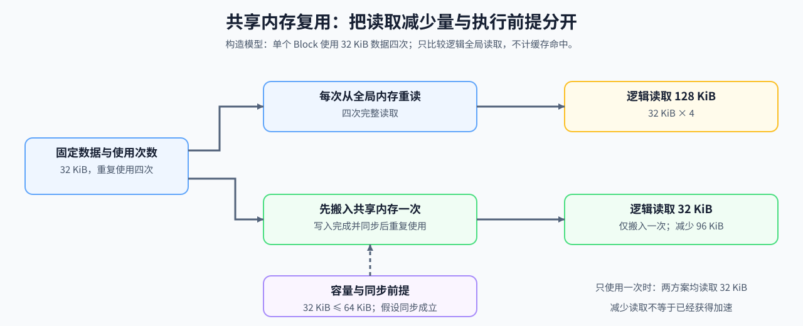

# 16. Warp Block SharedMemory Basics | Warp、Block 与 Shared Memory 基础

**难度：** Medium | **环境：** CPU-first | **标签：** `算子编程`, `CUDA`, `Shared Memory` | **目标人群：** 编译与系统入门者

> 🚀 **云端运行环境**
>
> 本章节的实战代码可以点击以下链接在免费 GPU 算力平台上直接运行：
>
> [](https://colab.research.google.com/github/datawhalechina/llm-algo-leetcode/blob/main/01_Hardware_Math_and_Systems/16_Warp_Block_SharedMemory_Basics.ipynb)
> [](https://modelscope.cn/my/mynotebook) *(国内推荐：魔搭社区免费实例)*


---

## 本节导读

一个线程块（Block）四次使用同一份32 KiB数据，每次完整重读共需128 KiB逻辑全局读取；先搬入共享内存再复用，只需从全局内存读取32 KiB。共享内存是同块线程协作使用的片上存储，这份副本能否保留和正确使用，还受容量与同步约束。

本节先区分Warp内的线程槽与Block的协作范围，再计算重复读取减少量，检查容量边界和给定的同步条件。它支撑算子优化中的协作加载与分块复用，实际读写顺序继续在Part04·06共享内存矩阵乘中核对。

**关键词：** 线程块、线程束、共享内存、同步



---

## 前置阅读

先区分程序定义的线程块与设备承载它的 SM，再观察块内数据复用。

- [15 CUDA 执行模型](./15_CUDA_Execution_Model.md)：网格覆盖、Warp 分组与单块资源限制。

## Q1：两个48线程块为什么仍需要四个Warp？

线程（Thread）执行局部计算，同一线程块中的线程构成协作范围；NVIDIA把块内连续线程按32个分成线程束（Warp），线程在Warp中的位置称为Lane。一个48线程块需要两个Warp，第二个Warp分配16个线程，其余16个槽未分配。两个这样的线程块各自分组，共需四个Warp，剩余线程不会跨块拼成第三个满Warp。

若真正把任务改成一个96线程块，才会按三个Warp分组；这同时改变了协作范围和单块资源需求。下面保持总线程数96不变，对照两个48线程块与一个96线程块，检查分组边界如何改变Warp数。

这里统计的是已分配线程占Warp槽的比例。分支与边界条件还会改变某条指令的活跃Lane数；SM占用率则涉及驻留Warp数与设备上限。共享内存的协作边界也不同：普通线程块各自保留副本，生产者与消费者仍需保证写入、读取和下一轮覆盖的顺序。

### Q1 覆盖率计算：同样96个线程，按一块还是两块分组？

先核对48线程块需要两个Warp，再比较两个独立块共四个Warp与一个96线程块的三个Warp。小输入与恰好填满Warp的情况检查尾Warp计算；两种块安排的性能需另外比较。


```python
def execution_coverage(num_threads: int, warp_size: int = 32) -> dict:
    """按给定Warp大小，返回单块线程数、尾Warp分配线程数与槽利用比例。"""
    if any(type(value) is not int or value <= 0 for value in (num_threads, warp_size)):
        raise ValueError("单块线程数与Warp大小须为正整数")
    warps = (num_threads + warp_size - 1) // warp_size
    thread_slots = warps * warp_size
    last_warp_assigned_threads = num_threads - (warps - 1) * warp_size
    return {
        "threads": num_threads, "warps": warps,
        "last_warp_assigned_threads": last_warp_assigned_threads,
        "thread_slot_utilization": num_threads / thread_slots,
    }


threads_per_block, blocks = 48, 2
one_block = execution_coverage(num_threads=threads_per_block)
assert one_block == {
    "threads": 48, "warps": 2, "last_warp_assigned_threads": 16,
    "thread_slot_utilization": 0.75,
}
assert blocks * one_block["warps"] == 4
merged = execution_coverage(num_threads=threads_per_block * blocks)
assert merged["warps"] == 3 and merged["thread_slot_utilization"] == 1.0
for threads, expected in ((1, (1, 1)), (32, (1, 32)), (33, (2, 1)), (65, (3, 1))):
    result = execution_coverage(num_threads=threads)
    assert (result["warps"], result["last_warp_assigned_threads"]) == expected
print(f"每块 {threads_per_block} 线程：{one_block['warps']} 个Warp，"
      f"线程槽利用比例 {one_block['thread_slot_utilization']:.0%}")
print(f"{blocks} 个独立线程块共需 {blocks * one_block['warps']} 个Warp")
print(f"改成一个96线程块：{merged['warps']} 个Warp；协作范围也随块安排改变")

```

## Q2：同一块内四次使用数据，读取怎样减少？

同一Block多次使用一份数据时，可以先把数据从全局内存搬入共享内存，再读取片上副本。沿主图的32 KiB数据块计算：使用四次时，逻辑全局读取从128 KiB降到32 KiB，减少96 KiB，即75%。如果有多个Block各自使用这份数据，每块仍要独立搬入，不能把块内复用当成跨块共享。

上述减少量对应完整数据块的读取请求，实际设备内存流量还取决于原方案的缓存命中。读取请求可能先由缓存满足，因此逻辑请求字节数与实际设备内存字节数需要分别观察。下方先算同一块内的重复使用，再在Q3检查这份副本的容量与写入、读取、覆盖顺序；读取减少与协作正确分别判断。

### Q2 对照验证：从主图的单块例子扩大到多个块

先复现单块使用四次的128 KiB与32 KiB，再只改变使用次数。最后扩大到8个Block，核对每块独立加载带来的总量。


```python
def shared_reuse_gain(tile_bytes: int, reuse_count: int, blocks: int) -> dict:
    """每块独立加载一次，返回全局逻辑读取字节量及减少比例。"""
    if any(type(value) is not int or value <= 0
           for value in (tile_bytes, reuse_count, blocks)):
        raise ValueError("数据块字节数、使用次数与块数须为正整数")
    baseline_global_read_bytes = tile_bytes * reuse_count * blocks
    shared_global_read_bytes = tile_bytes * blocks
    return {
        "baseline_global_read_bytes": baseline_global_read_bytes,
        "shared_global_read_bytes": shared_global_read_bytes,
        "saved_global_read_bytes": baseline_global_read_bytes - shared_global_read_bytes,
        "global_read_reduction_fraction": 1 - shared_global_read_bytes / baseline_global_read_bytes,
    }


tile_bytes = 32 * 1024
reports = {count: shared_reuse_gain(tile_bytes=tile_bytes, reuse_count=count, blocks=1)
           for count in (1, 2, 4)}
assert reports[4] == {
    "baseline_global_read_bytes": 131_072, "shared_global_read_bytes": 32_768,
    "saved_global_read_bytes": 98_304, "global_read_reduction_fraction": 0.75,
}
assert reports[2]["saved_global_read_bytes"] == 32_768
assert reports[1]["saved_global_read_bytes"] == 0
many_blocks = shared_reuse_gain(tile_bytes=tile_bytes, reuse_count=4, blocks=8)
assert many_blocks["shared_global_read_bytes"] == 262_144
assert many_blocks["saved_global_read_bytes"] == 786_432
for count, result in reports.items():
    print(f"单块使用 {count} 次：逻辑全局读取 "
          f"{result['baseline_global_read_bytes'] / 1024:g} → "
          f"{result['shared_global_read_bytes'] / 1024:g} KiB")
print(f"8个块各加载一次：共 {many_blocks['shared_global_read_bytes'] / 1024:g} KiB")

```

## Q3：容量满足后，还需要怎样保证读写顺序？

先保证数据块能装入给定的共享内存预算，再检查消费者的读取和生产者的覆盖顺序。例如一组线程协作写入当前块，完成所需同步后，其他线程读取；所有消费者读完，再同步并覆盖为下一块。前一次同步避免读取尚未写好的数据，后一次同步避免较慢的消费者读到下一轮数据。若并非块内所有线程都能到达同一块级屏障，还需调整控制流或同步范围。

下面用给定布尔值记录“同步顺序已经核对”的假设，比较容量刚好足够、差一个字节、同步条件不满足与只使用一次的情况。计算器同时返回潜在读取减少量：容量或同步前提不满足时，减少量仍只是完整驻留模型的假设值；只有前提满足，才继续进入相应实现与计时。

### Q3 对照验证：分别核对前提与潜在读取减少量

固定32 KiB数据与单块范围，只改变局部预算、同步条件或使用次数。预算只分配给本例数据块，实际实现还要容纳其他共享状态。


```python
def shared_memory_candidate(
    tile_bytes: int, reuse_count: int, blocks: int,
    shared_limit_bytes: int, synchronization_valid: bool,
) -> dict:
    """汇总单块预算与给定同步条件，并保留完整驻留假设下的潜在逻辑读取减少量。"""
    traffic = shared_reuse_gain(tile_bytes=tile_bytes, reuse_count=reuse_count, blocks=blocks)
    if type(shared_limit_bytes) is not int or shared_limit_bytes <= 0:
        raise ValueError("共享内存预算须为正整数字节数")
    if type(synchronization_valid) is not bool:
        raise ValueError("同步前提须为布尔值")
    reasons = []
    if tile_bytes > shared_limit_bytes:
        reasons.append("shared_capacity")
    if not synchronization_valid:
        reasons.append("synchronization")
    return {
        "capacity_and_sync_conditions_met": not reasons,
        "reasons": reasons,
        "has_logical_read_reduction": traffic["saved_global_read_bytes"] > 0,
        **traffic,
    }


base = dict(tile_bytes=32 * 1024, reuse_count=4, blocks=1,
            shared_limit_bytes=64 * 1024, synchronization_valid=True)
changes = {
    "given_conditions": {},
    "at_capacity": {"shared_limit_bytes": 32 * 1024},
    "short_one_byte": {"shared_limit_bytes": 32 * 1024 - 1},
    "sync_miss": {"synchronization_valid": False},
    "no_reuse": {"reuse_count": 1},
    "both_miss": {"shared_limit_bytes": 32 * 1024 - 1, "synchronization_valid": False},
}
reports = {name: shared_memory_candidate(**(base | change))
           for name, change in changes.items()}
assert reports["given_conditions"]["capacity_and_sync_conditions_met"]
assert reports["at_capacity"]["capacity_and_sync_conditions_met"]
assert reports["short_one_byte"]["reasons"] == ["shared_capacity"]
assert reports["sync_miss"]["reasons"] == ["synchronization"]
assert reports["both_miss"]["reasons"] == ["shared_capacity", "synchronization"]
assert reports["given_conditions"]["saved_global_read_bytes"] == 98_304
assert reports["no_reuse"]["capacity_and_sync_conditions_met"]
assert not reports["no_reuse"]["has_logical_read_reduction"]
assert reports["no_reuse"]["saved_global_read_bytes"] == 0
for name, result in reports.items():
    print(f"{name}: 给定前提满足={result['capacity_and_sync_conditions_met']}，"
          f"潜在读取减少 {result['saved_global_read_bytes'] / 1024:g} KiB，"
          f"未满足项={result['reasons']}")

```

### 从逻辑复用到实际内核

在[Part04·06共享内存GEMM](../04_CUDA_and_System_Optimization/06_CUDA_Shared_Memory_Optimization.md)中，沿加载、读取与覆盖顺序检查同步，再核对编译用量和数值结果。若改为异步搬入下一子块，应先确认搬入完成，再允许消费者读取；块内线程会合与异步传输完成是两项不同的条件，见[Part04·09异步拷贝流水](../04_CUDA_and_System_Optimization/09_CUDA_Async_Copy_Pipeline.md)。扩大数据块时，寄存器与共享内存可能限制同时驻留的线程块，容量与驻留的计算继续见[24 SRAM优化技术](./24_SRAM_Optimization_Techniques.md)。

## 相关阅读

先将块内协作接到实际共享内存矩阵乘，再继续计算资源与驻留的取舍。

- [Part04·06 共享内存 GEMM](../04_CUDA_and_System_Optimization/06_CUDA_Shared_Memory_Optimization.md)：协作装载、读取及覆盖前的同步。
- [24 SRAM 优化技术](./24_SRAM_Optimization_Techniques.md)：共享内存、寄存器与驻留块数。
