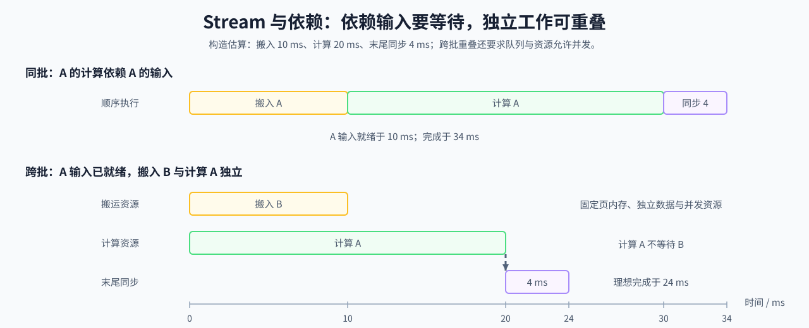

# 17. CUDA Stream and Asynchrony | CUDA Stream 与异步执行

**难度：** Medium | **环境：** CPU-first | **标签：** `算子编程`, `CUDA Stream`, `异步执行` | **目标人群：** 编译与系统入门者

> 🚀 **云端运行环境**
>
> 本章节的实战代码可以点击以下链接在免费 GPU 算力平台上直接运行：
>
> [](https://colab.research.google.com/github/datawhalechina/llm-algo-leetcode/blob/main/01_Hardware_Math_and_Systems/17_CUDA_Stream_and_Asynchrony.ipynb)
> [](https://modelscope.cn/my/mynotebook) *(国内推荐：魔搭社区免费实例)*


---

## 本节导读

吞吐受限不一定来自单个计算内核过慢，也可能来自拷贝、计算和同步被排成了不必要的串行链。本节从任务依赖出发，解释 Stream 顺序、事件同步和异步提交怎样共同决定可重叠区间。

完成后，你应能区分主机提交顺序、设备执行顺序和真实依赖，并使用时间线判断重叠是否发生、同步是否暴露在关键路径上。

**关键词：** CUDA Stream、异步执行（asynchrony）、重叠（overlap）



---
## 前置阅读

**导语：** 先理解阶段放置和设备执行顺序，再看 Stream 与 Event 怎样表达异步依赖。

- [07. CPU and GPU Heterogeneous Scheduling | CPU 与 GPU 异构调度](./07_CPU_GPU_Heterogeneous_Scheduling.md)
- [15. CUDA Execution Model | CUDA 执行模型](./15_CUDA_Execution_Model.md)
- [Group 1D: Execution Models, Asynchrony and Operator Mapping | 1D: 执行模型、异步调度与算子映射](./1D.md)

## Q1：不同 Stream 中的任务什么时候可以重叠？

同一 Stream 内的任务按顺序执行，不同 Stream 之间还要满足数据依赖与资源条件。只有计算不依赖当前搬运的数据、且设备能同时提供相应资源时，才有机会重叠。例如，下一批输入搬运可以与当前批计算独立；当前批计算则必须等待自身输入就绪。

下面用两个独立阶段说明理想上限：忽略争用和提交开销时，重叠部分取两段时间的较小值，总时间取较大值；末尾同步开销仍串行加入。若计算依赖这次搬运，就使用两段时间之和。

### Q1小验证：只改变数据依赖，比较完成时间


```python
import math


def stream_timeline(copy_ms, compute_ms, sync_ms, independent=True):
    """估算两阶段时间；independent 表示计算不依赖这次搬运。"""
    values = (copy_ms, compute_ms, sync_ms)
    if any(not math.isfinite(value) or value < 0 for value in values):
        raise ValueError('阶段时间必须为有限非负数')
    if type(independent) is not bool:
        raise ValueError('independent 必须是布尔值')
    serial_ms = copy_ms + compute_ms + sync_ms
    elapsed_ms = (max(copy_ms, compute_ms) if independent
                  else copy_ms + compute_ms) + sync_ms
    return {
        'serial_ms': serial_ms,
        'estimated_elapsed_ms': elapsed_ms,
        'hidden_ms': serial_ms - elapsed_ms,
        'speedup': serial_ms / elapsed_ms if elapsed_ms else 1.0,
    }


for independent in [True, False]:
    print(independent, '->', stream_timeline(10, 20, 4, independent))
assert stream_timeline(10, 20, 4)['hidden_ms'] == 10
assert stream_timeline(10, 20, 4, independent=False)['hidden_ms'] == 0
assert stream_timeline(0, 20, 4)['speedup'] == 1.0

```

## Q2：具备异步拷贝条件后，为什么还不能直接预测收益？

对主机与设备搬运，固定页内存是常见的异步拷贝条件之一；要获得重叠，还需要独立数据、合适的队列与可并行资源。任一条件缺失，计算器就不把搬运计入可隐藏时间。

下面把这些条件作为显式输入，先计算理想可隐藏时间，再减去假设的暴露事件开销。开销大于隐藏时间时，净节省为负；这些输入应由实际时间线核实，而非根据 Stream 数量猜测。

### Q2小验证：逐项撤掉重叠条件


```python
def overlap_candidate(copy_ms, compute_ms, event_overhead_ms=0.0,
                      pinned_memory=True, independent=True,
                      concurrent_resources=True):
    """估算给定条件下的重叠空间，不执行异步拷贝。"""
    values = (copy_ms, compute_ms, event_overhead_ms)
    if any(not math.isfinite(value) or value < 0 for value in values):
        raise ValueError('时间必须为有限非负数')
    conditions = {
        'pinned_memory': pinned_memory,
        'independent': independent,
        'concurrent_resources': concurrent_resources,
    }
    if any(type(value) is not bool for value in conditions.values()):
        raise ValueError('重叠条件必须是布尔值')
    missing = [name for name, value in conditions.items() if not value]
    hidden = min(copy_ms, compute_ms) if not missing else 0.0
    return {
        'missing_conditions': missing,
        'ideal_hidden_ms': hidden,
        'event_overhead_ms': event_overhead_ms,
        'estimated_net_saved_ms': hidden - event_overhead_ms,
    }


print(overlap_candidate(10, 20, 1))
assert overlap_candidate(10, 20, 1)['estimated_net_saved_ms'] == 9
for condition in ['pinned_memory', 'independent', 'concurrent_resources']:
    report = overlap_candidate(10, 20, 1, **{condition: False})
    assert report['ideal_hidden_ms'] == 0
    assert report['missing_conditions'] == [condition]
assert overlap_candidate(1, 3, 3)['estimated_net_saved_ms'] == -2

```

## Q3：怎样从暴露时间区分计算、搬运和等待？

先把观察窗口划成互不重叠的计算、暴露搬运、暴露同步和空闲区间，再比较各类时间。占比最大的类别只是下一项检查的线索：计算时间长还需要核对计算量与效率，空闲时间长则要继续追查输入、依赖或主机提交。

下面只接受已去除重叠的区间长度。不能把多个 Stream 的完整事件时长直接相加，也不能把最长类别直接当成已确认的瓶颈。

### Q3小验证：用互不重叠的时间计算占比


```python
def classify_timeline(kernel_ms, exposed_copy_ms, exposed_sync_ms, idle_ms):
    """汇总互不重叠的暴露区间；最长类别不等于已确认的瓶颈。"""
    parts = {
        'kernel': kernel_ms,
        'copy': exposed_copy_ms,
        'sync': exposed_sync_ms,
        'idle': idle_ms,
    }
    if any(not math.isfinite(value) or value < 0 for value in parts.values()):
        raise ValueError('时间线字段必须是有限非负数')
    total_ms = sum(parts.values())
    if total_ms == 0:
        raise ValueError('时间线总时间必须大于 0')
    dominant = max(parts, key=parts.get)
    return {
        'total_ms': total_ms,
        'dominant': dominant,
        'fractions': {name: round(value / total_ms, 3) for name, value in parts.items()},
    }

plans = {
    'kernel_longest': (18, 2, 1, 1),
    'sync_longest': (6, 2, 12, 1),
    'copy_longest': (5, 14, 2, 1),
}
for name, timeline in plans.items():
    print(name, '->', classify_timeline(*timeline))

assert classify_timeline(*plans['sync_longest'])['dominant'] == 'sync'

```

## 继续检查重叠条件

把估算接到真实运行时，分别记录输入就绪、任务提交和设备完成时刻，并注明所用资源。完整依赖链仍需等待，独立任务是否真正重叠要从执行轨迹判断；实际收益则由固定输入下的重复端到端计时核对。

## 相关阅读

- [29 CUDA Stream 高级调度](./29_CUDA_Stream_Advanced_Scheduling.md)：计算显式依赖与队列顺序共同约束的时间线。
- [13 性能分析与瓶颈定位](./13_Profiling_and_Bottleneck_Analysis.md)：区分资源上限、低效率和暴露等待。
- [性能分析：时间线、I/O 与关键路径](../topic_discussion/performance_analysis/03_time_breakdown_and_trace_reading.md)：核对实际执行轨迹中的等待与重叠。
