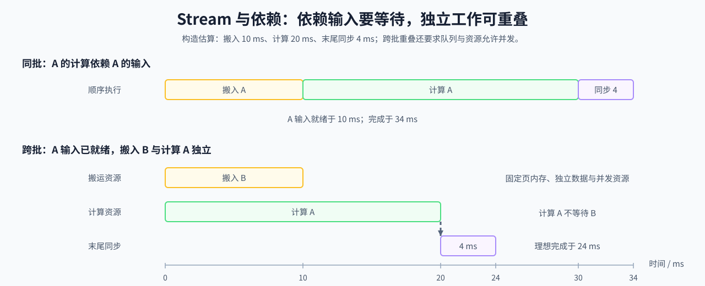

# 17. CUDA Stream and Asynchrony | CUDA Stream 与异步执行

**难度：** Medium | **环境：** CPU-first | **标签：** `算子编程`, `CUDA Stream`, `异步执行` | **目标人群：** 编译与系统入门者

> 🚀 **云端运行环境**
>
> 本章节的实战代码可以点击以下链接在免费 GPU 算力平台上直接运行：
>
> [](https://colab.research.google.com/github/datawhalechina/llm-algo-leetcode/blob/main/01_Hardware_Math_and_Systems/17_CUDA_Stream_and_Asynchrony.ipynb)
> [](https://modelscope.cn/my/mynotebook) *(国内推荐：魔搭社区免费实例)*


---

## 本节导读

CUDA流（Stream）是设备上的操作队列，同一流内按提交顺序执行。下一批输入的10 ms搬运若与当前批20 ms计算独立，两者可能重叠；当前批的计算则需要等待自身输入。异步提交允许主机先继续工作，设备完成时刻仍由依赖和资源决定。

本节先比较这两种依赖，再检查事件、锁页内存和并发条件，最后计算互不重叠区间的时间占比。这些判断支撑算子优化的运行时安排；实际传输继续在Part04·10验证，更复杂的多批依赖在29节计算。

**关键词：** CUDA Stream、异步执行（asynchrony）、重叠（overlap）



---
## 前置阅读

先计算阶段放置与搬运成本，再看队列如何约束这些阶段。

- [07 CPU与GPU异构调度](./07_CPU_GPU_Heterogeneous_Scheduling.md)：完整路径、依赖前缀与可隐藏时间。
- [15 CUDA执行模型](./15_CUDA_Execution_Model.md)：区分内核内部任务组织与内核之间的队列安排。

## Q1：不同 Stream 中的任务什么时候可以重叠？

同一 Stream 内的任务按顺序执行，不同 Stream 之间还要满足数据依赖与资源条件。只有计算不依赖当前搬运的数据、且设备能同时提供相应资源时，才有机会重叠。例如，下一批输入搬运可以与当前批计算独立；当前批计算则必须等待自身输入就绪。

下面比较两种依赖模型：忽略争用和提交开销时，独立阶段的重叠部分取两段时间的较小值，总时间取较大值；末尾同步开销仍串行加入。若计算依赖这次搬运，就使用两段时间之和。主图跨批窗口假设A输入已就绪，24 ms与34 ms不能直接作为单批请求的加速结论；完整两批工作量的对照在29节计算。

### Q1 对照验证：只改变数据依赖，比较完成时间

沿主图固定搬运10 ms、计算20 ms和末尾同步4 ms。独立时估算24 ms，相依时34 ms；再检查没有搬运与空窗口。


```python
import math


def stream_timeline(
    copy_ms: float, compute_ms: float, sync_ms: float, independent: bool = True,
) -> dict:
    """按两个资源可并发的阶段与末尾开销，返回估算ms；空窗口时间比为None。"""
    if any(type(value) not in (int, float) or not math.isfinite(value) or value < 0
           for value in (copy_ms, compute_ms, sync_ms)):
        raise ValueError("阶段时间须为有限非负实数")
    if type(independent) is not bool:
        raise ValueError("independent须为布尔值")
    serial_ms = copy_ms + compute_ms + sync_ms
    elapsed_ms = (max(copy_ms, compute_ms) if independent else copy_ms + compute_ms) + sync_ms
    return {
        "serial_ms": serial_ms, "estimated_elapsed_ms": elapsed_ms,
        "hidden_ms": serial_ms - elapsed_ms,
        "speedup": serial_ms / elapsed_ms if elapsed_ms else None,
    }


inputs = dict(copy_ms=10, compute_ms=20, sync_ms=4)
independent = stream_timeline(**inputs, independent=True)
dependent = stream_timeline(**inputs, independent=False)
assert independent["serial_ms"] == 34
assert independent["estimated_elapsed_ms"] == 24 and independent["hidden_ms"] == 10
assert dependent["estimated_elapsed_ms"] == 34 and dependent["hidden_ms"] == 0
assert stream_timeline(copy_ms=0, compute_ms=20, sync_ms=4)["speedup"] == 1
assert stream_timeline(copy_ms=0, compute_ms=0, sync_ms=0)["speedup"] is None
for name, result in (("独立数据", independent), ("相依数据", dependent)):
    print(f"{name}: 完成于 {result['estimated_elapsed_ms']:g} ms，"
          f"相对串行隐藏 {result['hidden_ms']:g} ms")

```

## Q2：怎样让消费者等待输入，同时保留其他重叠机会？

事件（Event）是在某个流中记录的进度标记。搬运流在输入传输后记录事件，计算流等待该事件后再使用输入；设备侧的事件等待可只约束相关消费者，主机不必为此阻塞到整个设备空闲。主机若立即读取回传结果，则需确认对应传输已完成。

对于本例主机—设备异步搬运，锁页内存（Pinned Memory）是固定在主机内存、供传输使用的缓冲区；主机输入缓冲区在传输完成前须保持有效且内容不变，设备输入缓冲区也须保留到消费者用完；只有生命周期和输入就绪都满足，才能安全复用。下面固定使用不同流，分别检查锁页缓冲、独立数据和并发资源，再从理想隐藏时间减去给定的暴露事件开销。开销等于或超过隐藏时间时，净节省可能为零或负数。

### Q2 对照验证：逐项撤掉条件，再改变事件开销

布尔值是给定条件，不执行真实事件记录或传输。比较缺少一项条件、开销相等和开销更大的结果。


```python
def overlap_candidate(
    copy_ms: float, compute_ms: float, event_overhead_ms: float = 0.0,
    pinned_memory: bool = True, independent: bool = True, concurrent_resources: bool = True,
) -> dict:
    """在本例不同流、锁页缓冲模型中，返回缺少条件与估算隐藏/净节省ms。"""
    if any(type(value) not in (int, float) or not math.isfinite(value) or value < 0
           for value in (copy_ms, compute_ms, event_overhead_ms)):
        raise ValueError("时间须为有限非负实数")
    conditions = {"pinned_memory": pinned_memory, "independent": independent,
                  "concurrent_resources": concurrent_resources}
    if any(type(value) is not bool for value in conditions.values()):
        raise ValueError("重叠条件须为布尔值")
    missing = [name for name, value in conditions.items() if not value]
    hidden = min(copy_ms, compute_ms) if not missing else 0.0
    return {
        "missing_conditions": missing, "ideal_hidden_ms": hidden,
        "event_overhead_ms": event_overhead_ms,
        "estimated_net_saved_ms": hidden - event_overhead_ms,
    }


inputs = dict(copy_ms=10, compute_ms=20, event_overhead_ms=1)
report = overlap_candidate(**inputs)
assert report["ideal_hidden_ms"] == 10 and report["estimated_net_saved_ms"] == 9
for condition in ("pinned_memory", "independent", "concurrent_resources"):
    missing = overlap_candidate(**inputs, **{condition: False})
    assert missing["ideal_hidden_ms"] == 0
    assert missing["estimated_net_saved_ms"] == -1
    assert missing["missing_conditions"] == [condition]
assert overlap_candidate(**(inputs | {"event_overhead_ms": 10}))["estimated_net_saved_ms"] == 0
assert overlap_candidate(copy_ms=1, compute_ms=3, event_overhead_ms=3)["estimated_net_saved_ms"] == -2
print(f"给定条件齐全：理想隐藏 {report['ideal_hidden_ms']:g} ms，"
      f"计入事件开销后净节省 {report['estimated_net_saved_ms']:g} ms")

```

## Q3：怎样从暴露时间区分计算、搬运和等待？

先把观察窗口划成互不重叠的计算、暴露搬运、暴露同步和空闲区间，再比较各类时间。占比最大的类别只是下一项检查的线索：计算时间长还需要核对计算量与效率，空闲时间长则要继续追查输入、依赖或主机提交。

下面只接受已去除重叠的区间长度。不能把多个 Stream 的完整事件时长直接相加，也不能把最长类别直接当成已确认的瓶颈。

### Q3 对照验证：用互不重叠的时间计算占比

区间已按计算、暴露搬运、暴露同步与空闲互斥分类。分别改变最长类别；比例保留完整精度，仅在展示时四舍五入。


```python
def classify_timeline(
    kernel_ms: float, exposed_copy_ms: float, exposed_sync_ms: float, idle_ms: float,
) -> dict:
    """返回互斥时间总长、最长类别和占比；并列时按输入类别顺序展示一个。"""
    parts = {"kernel": kernel_ms, "copy": exposed_copy_ms, "sync": exposed_sync_ms, "idle": idle_ms}
    if any(type(value) not in (int, float) or not math.isfinite(value) or value < 0
           for value in parts.values()):
        raise ValueError("时间线字段须为有限非负实数")
    total_ms = sum(parts.values())
    if total_ms == 0:
        raise ValueError("时间线总时间须大于0")
    return {
        "total_ms": total_ms, "dominant": max(parts, key=parts.get),
        "fractions": {name: value / total_ms for name, value in parts.items()},
    }


cases = {
    "kernel_longest": dict(kernel_ms=18, exposed_copy_ms=2, exposed_sync_ms=1, idle_ms=1),
    "sync_longest": dict(kernel_ms=6, exposed_copy_ms=2, exposed_sync_ms=12, idle_ms=1),
    "copy_longest": dict(kernel_ms=5, exposed_copy_ms=14, exposed_sync_ms=2, idle_ms=1),
    "idle_longest": dict(kernel_ms=1, exposed_copy_ms=1, exposed_sync_ms=1, idle_ms=9),
}
reports = {name: classify_timeline(**values) for name, values in cases.items()}
for name, expected in (("kernel_longest", "kernel"), ("sync_longest", "sync"),
                       ("copy_longest", "copy"), ("idle_longest", "idle")):
    assert reports[name]["dominant"] == expected
    assert math.isclose(sum(reports[name]["fractions"].values()), 1.0)
assert reports["kernel_longest"]["total_ms"] == 22
assert reports["kernel_longest"]["fractions"]["kernel"] == 18 / 22
assert classify_timeline(kernel_ms=1, exposed_copy_ms=1, exposed_sync_ms=0,
                         idle_ms=0)["dominant"] == "kernel"
for name, result in reports.items():
    shares = {key: f"{value:.1%}" for key, value in result["fractions"].items()}
    print(f"{name}: 总长 {result['total_ms']:g} ms，占比 {shares}")

```

## 继续检查重叠条件

把估算接到真实运行时，分别记录输入就绪、任务提交和设备完成时刻，并注明所用资源。完整依赖链仍需等待，独立任务是否真正重叠要从执行轨迹判断；实际收益则由固定输入下的重复端到端计时核对。这里关注主机与设备之间的跨批搬运；单个内核内部从全局内存预取到共享内存的流水，使用的是块内数据就绪与覆盖顺序，继续见[Part04·09](../04_CUDA_and_System_Optimization/09_CUDA_Async_Copy_Pipeline.md)。

## 相关阅读

先在真实传输中核对等待和缓冲寿命，再扩展到多批次的完整依赖图。

- [Part04·10 Stream与传输](../04_CUDA_and_System_Optimization/10_PyTorch_CUDA_Streams_and_Transfer.md)：跨流事件、输入就绪与内存生命周期。
- [29 CUDA Stream高级调度](./29_CUDA_Stream_Advanced_Scheduling.md)：显式依赖、同队列顺序和多批流水线。
- [PyTorch 2.11 CUDA语义](https://docs.pytorch.org/docs/2.11/notes/cuda.html#cuda-streams)：重点看CUDA streams与Use pinned memory buffers，对照同步和锁页缓冲的要求。
